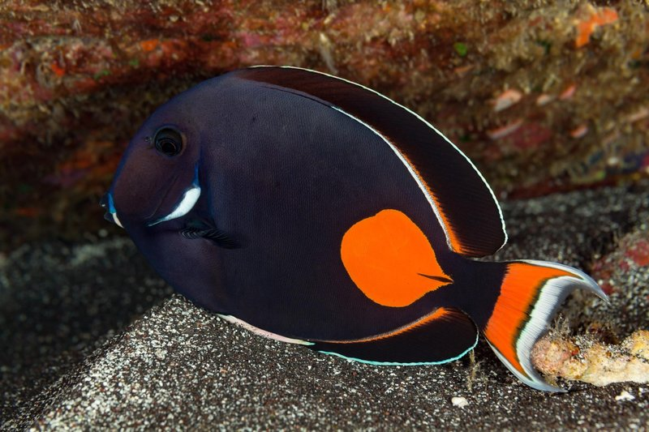

# Cirujano Aquiles — *Acanthurus achilles* Shaw, 1803

> Archivo generado desde `especies/datos/catalogo_inicial.json` con `especies/herramientas/generar_fichas.py`. No editar a mano.

*Imagen ilustrativa generada con IA por Brayan (2026-11-16). No es una fotografía de un ejemplar real; puede contener errores anatómicos.*

**Grupo:** pez  
**Otros nombres:** Achilles tang, Red-tailed surgeonfish  
**Fecha de consulta:** 2026-11-16  
**Confianza global:** media  
**Estado:** verificada; pendiente de revisión del equipo

## Ficha AIRI

| Campo | Valor |
|---|---|
| Nombre común | Cirujano Aquiles |
| Nombre científico | *Acanthurus achilles* |
| Temperamento | Semiagresivo |
| Comportamiento | Territorial, Sociable. Agresivo con otros cirujanos y pacífico con el resto. Necesita corriente fuerte. Solo para expertos. |
| Adecuado para arrecife | Sí. LiveAquaria lo considera compatible con arrecife; no hay verificación independiente. |
| Tipo de alimentación | Herbívoro: algas filamentosas, algas carnosas pequeñas, alga marina seca. |
| Temperatura | 22.2–25.6 °C |
| Litraje recomendado | 681.3 L (180 gal EE. UU.). *Es el mínimo recomendado por una sola fuente comercial; ninguna fuente científica consultada establece un litraje.* |
| Tamaño adulto | 24 cm (longitud total). Al venderse mide 5.1–19.1 cm (juvenil o subadulto). *Diferencia menor entre fuentes: FishBase 24 cm; LiveAquaria 8.5 in (≈ 21.6 cm).* |

## Detalle verificado

| Campo | Dato | Confianza | Fuentes |
|---|---|---|---|
| Clasificación taxonómica | Clase Teleostei; orden Acanthuriformes; familia Acanthuridae; subfamilia Acanthurinae. WoRMS AphiaID 272957 (aceptado). Sinónimos: Hepatus achilles, Teuthis achilles. | alta | [worms_acanthurus_achilles](https://www.marinespecies.org/aphia.php?p=taxdetails&id=272957), [fishbase_acanthurus_achilles](https://www.fishbase.se/summary/Acanthurus-achilles.html) |
| Hábitat natural | Arrecifes externos de aguas claras, normalmente en grupos. Se hibrida con Acanthurus nigricans (FishBase). Profundidad: 0–10 m (habitual 0–4 m). Distribución: Pacífico occidental, de las islas oceánicas de Oceanía a Hawái y Pitcairn, más Wake, Marcus y Marianas; Pacífico centro-oriental: extremo sur de Baja California e islas cercanas. | media | [fishbase_acanthurus_achilles](https://www.fishbase.se/summary/Acanthurus-achilles.html) |
| Tamaño adulto | Máx. 24 cm (longitud total). Diferencia menor entre fuentes: FishBase 24 cm; LiveAquaria 8.5 in (≈ 21.6 cm). | media | [fishbase_acanthurus_achilles](https://www.fishbase.se/summary/Acanthurus-achilles.html), [liveaquaria_acanthurus_achilles](https://www.liveaquaria.com/products/achilles-tang-expert-only) |
| Alimentación | Herbívoro: come algas filamentosas y algas carnosas pequeñas (FishBase). En acuario necesita abundantes algas marinas, al menos tres veces por semana (LiveAquaria). | alta | [fishbase_acanthurus_achilles](https://www.fishbase.se/summary/Acanthurus-achilles.html), [liveaquaria_acanthurus_achilles](https://www.liveaquaria.com/products/achilles-tang-expert-only) |
| Temperatura del agua | Acuario: 22.2–25.6 °C (72–78 °F). FishBase no indica rango de temperatura para esta especie. | baja | [liveaquaria_acanthurus_achilles](https://www.liveaquaria.com/products/achilles-tang-expert-only) |
| Rango de pH | Fuente de acuario: 8.1–8.4. Rango prudente AIRI: 8.1–8.3. Criterio: Intersección con la tabla MSD para agua salada (7.8–8.3). | media | [liveaquaria_acanthurus_achilles](https://www.liveaquaria.com/products/achilles-tang-expert-only), [msd_tabla_referencia](https://www.msdvetmanual.com/multimedia/table/normal-reference-ranges-for-routine-water-quality-analysis), [msd_capitulo](https://www.msdvetmanual.com/exotic-and-laboratory-animals/aquatic-systems/environmental-diseases-of-aquatic-animals-in-aquatic-systems) |
| Salinidad | 1.020–1.025 de gravedad específica (adimensional). Agua de mar media: 35 ppt (UF/IFAS). No se convierte a ppt porque la equivalencia depende de la temperatura. | media | [liveaquaria_acanthurus_achilles](https://www.liveaquaria.com/products/achilles-tang-expert-only), [ufifas_ph_sal_temp](https://waterwatch.ifas.ufl.edu/media/waterwatchifasufledu/FactSheet_pH_Sal_Temp.pdf) |
| Volumen mínimo | 681.3 L (180 gal EE. UU.). Justificación: Cifra de LiveAquaria (180 gal), con mucho espacio para nadar y corriente fuerte, porque vive en zonas de oleaje. | baja | [liveaquaria_acanthurus_achilles](https://www.liveaquaria.com/products/achilles-tang-expert-only) |
| Comportamiento | Monógamo; va normalmente en grupos (FishBase). Agresivo con otros cirujanos y pacífico con el resto. Solo para expertos (LiveAquaria). | media | [fishbase_acanthurus_achilles](https://www.fishbase.se/summary/Acanthurus-achilles.html), [liveaquaria_acanthurus_achilles](https://www.liveaquaria.com/products/achilles-tang-expert-only) |
| Territorialidad y refugio | Territorial con otros cirujanos. | media | [liveaquaria_acanthurus_achilles](https://www.liveaquaria.com/products/achilles-tang-expert-only), [fishbase_acanthurus_achilles](https://www.fishbase.se/summary/Acanthurus-achilles.html) |
| Compatibilidad con arrecife | sí (según la fuente; sin verificación independiente) | baja | [liveaquaria_acanthurus_achilles](https://www.liveaquaria.com/products/achilles-tang-expert-only) |
| Convivencia: condiciones | Acuario grande con corriente fuerte. · Dieta rica en algas. · Sin otros cirujanos. | baja | [liveaquaria_acanthurus_achilles](https://www.liveaquaria.com/products/achilles-tang-expert-only), [fishbase_acanthurus_achilles](https://www.fishbase.se/summary/Acanthurus-achilles.html) |
| Convivencia: riesgos | Agresión hacia otros cirujanos. · Espina caudal posiblemente venenosa (FishBase lo clasifica como traumatogénico). | baja | [liveaquaria_acanthurus_achilles](https://www.liveaquaria.com/products/achilles-tang-expert-only), [fishbase_acanthurus_achilles](https://www.fishbase.se/summary/Acanthurus-achilles.html) |
| Conservación | Preocupación menor (LC), evaluada el 03/05/2010, según FishBase. | media | [fishbase_acanthurus_achilles](https://www.fishbase.se/summary/Acanthurus-achilles.html) |

**Regla AIRI:** compartir rangos de agua no implica compatibilidad entre especies. Los rangos de acuario provienen de una fuente comercial y no son límites veterinarios.

## Fuentes

- **worms_acanthurus_achilles** (taxonomía): WoRMS — Acanthurus achilles Shaw, 1803 (AphiaID 272957). <https://www.marinespecies.org/aphia.php?p=taxdetails&id=272957>. Consultada el 2026-11-16.
- **fishbase_acanthurus_achilles** (biología): FishBase — Acanthurus achilles. <https://www.fishbase.se/summary/Acanthurus-achilles.html>. Consultada el 2026-11-16.
- **liveaquaria_acanthurus_achilles** (comercial): LiveAquaria — Achilles Tang (EXPERT ONLY). <https://www.liveaquaria.com/products/achilles-tang-expert-only>. Consultada el 2026-11-16.
- **msd_tabla_referencia** (veterinaria): MSD Veterinary Manual — “Normal” Reference Ranges for Routine Water Quality Analysis. <https://www.msdvetmanual.com/multimedia/table/normal-reference-ranges-for-routine-water-quality-analysis>. Consultada el 2026-11-12. Reutilizada del registro del motor (motor/airi_motor/datos/fuentes.json); no se volvió a consultar para estas fichas.
- **ufifas_ph_sal_temp** (institucional): UF/IFAS — pH, Salinity and Temperature (hoja informativa). <https://waterwatch.ifas.ufl.edu/media/waterwatchifasufledu/FactSheet_pH_Sal_Temp.pdf>. Consultada el 2026-11-12. Reutilizada del registro del motor (motor/airi_motor/datos/fuentes.json); no se volvió a consultar para estas fichas.
- **msd_capitulo** (veterinaria): MSD Veterinary Manual — Environmental Diseases of Aquatic Animals in Aquatic Systems. <https://www.msdvetmanual.com/exotic-and-laboratory-animals/aquatic-systems/environmental-diseases-of-aquatic-animals-in-aquatic-systems>. Consultada el 2026-11-12. Reutilizada del registro del motor (motor/airi_motor/datos/fuentes.json); no se volvió a consultar para estas fichas.
