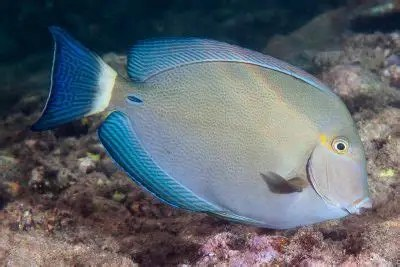

# Cirujano de Bahía — *Acanthurus bahianus* Castelnau, 1855

> Archivo generado desde `especies/datos/catalogo_inicial.json` con `especies/herramientas/generar_fichas.py`. No editar a mano.

*Imagen ilustrativa generada con IA por Brayan (2026-11-16). No es una fotografía de un ejemplar real; puede contener errores anatómicos.*

**Grupo:** pez  
**Otros nombres:** Ocean surgeon, Ocean tang, Barber surgeonfish, Cirujano pardo  
**Fecha de consulta:** 2026-11-16  
**Confianza global:** media  
**Estado:** verificada; pendiente de revisión del equipo

## Ficha AIRI

| Campo | Valor |
|---|---|
| Nombre común | Cirujano de Bahía |
| Nombre científico | *Acanthurus bahianus* |
| Temperamento | Semiagresivo *Clasificación de AIRI a partir de Quality Marine: social, pero agresivo con cirujanos de forma similar. La fuente no da una categoría de temperamento.* |
| Comportamiento | Sociable, Territorial. Social y diurno, pero puede ser agresivo con cirujanos de forma parecida. Tiene una espina afilada junto a la cola: manipular con cuidado. |
| Adecuado para arrecife | Con precaución. Se considera apto para arrecife, pero si no está bien alimentado puede picar invertebrados pequeños, móviles o sésiles (Quality Marine). |
| Tipo de alimentación | Herbívoro: algas, alimentos a base de algas, alimentos cárnicos marinos. |
| Temperatura | 22.2–25.6 °C *FishBase no indica rango de temperatura; el rango es de Quality Marine.* |
| Litraje recomendado | 1135.5 L (300 gal EE. UU.). *Es el mínimo recomendado por una sola fuente comercial; ninguna fuente científica consultada establece un litraje.* |
| Tamaño adulto | 14.6 cm (longitud estándar). *Diferencia importante entre fuentes: FishBase registra 14.6 cm de longitud estándar; Quality Marine indica que puede llegar a casi 14 in (≈ 35.6 cm). La diferencia puede deberse a la confusión taxonómica con A. tractus.* |

## Detalle verificado

| Campo | Dato | Confianza | Fuentes |
|---|---|---|---|
| Clasificación taxonómica | Clase Teleostei; orden Acanthuriformes; familia Acanthuridae; subfamilia Acanthurinae. WoRMS AphiaID 159578 (aceptado). Sinónimos: Hepatus bahianus, Teuthis bahianus. Su nombre viene de Bahía (Brasil). Hay desacuerdo taxonómico: FishBase considera a Acanthurus tractus (Atlántico occidental norte) una especie hermana distinta (Bernal y Rocha, 2011) y limita A. bahianus al Atlántico sur y central; WoRMS sigue usando A. bahianus para todo el Atlántico occidental. | alta | [worms_acanthurus_bahianus](https://www.marinespecies.org/aphia.php?p=taxdetails&id=159578), [fishbase_acanthurus_bahianus](https://www.fishbase.se/summary/Acanthurus-bahianus.html) |
| Hábitat natural | Fondos someros con formaciones coralinas o rocosas (WoRMS). Especie diurna asociada a arrecifes (FishBase). Profundidad: 2–80 m. Distribución: Según FishBase: costa de Brasil, del Parcel Manuel Luiz a Santa Catarina, con las islas oceánicas de Fernando de Noronha, Atol das Rocas y Trindade, además de las islas Ascensión y Santa Elena. WoRMS le da una distribución más amplia: de Massachusetts (EE. UU.) y Bermudas al golfo de México y Brasil. | media | [fishbase_acanthurus_bahianus](https://www.fishbase.se/summary/Acanthurus-bahianus.html), [worms_acanthurus_bahianus](https://www.marinespecies.org/aphia.php?p=taxdetails&id=159578) |
| Tamaño adulto | Máx. 14.6 cm (longitud estándar). Diferencia importante entre fuentes: FishBase registra 14.6 cm de longitud estándar; Quality Marine indica que puede llegar a casi 14 in (≈ 35.6 cm). La diferencia puede deberse a la confusión taxonómica con A. tractus. | baja | [fishbase_acanthurus_bahianus](https://www.fishbase.se/summary/Acanthurus-bahianus.html), [qualitymarine_acanthurus_bahianus](https://www.qualitymarine.com/quality-marine/fish/tangs/acanthurus/ocean-surgeon-31571/) |
| Alimentación | Herbívoro: se alimenta de algas (WoRMS). En acuario, Quality Marine recomienda una dieta variada de alimentos a base de algas y cárnicos. | media | [worms_acanthurus_bahianus](https://www.marinespecies.org/aphia.php?p=taxdetails&id=159578), [qualitymarine_acanthurus_bahianus](https://www.qualitymarine.com/quality-marine/fish/tangs/acanthurus/ocean-surgeon-31571/) |
| Temperatura del agua | Acuario: 22.2–25.6 °C (72–78 °F). FishBase no indica rango de temperatura para esta especie. | baja | [qualitymarine_acanthurus_bahianus](https://www.qualitymarine.com/quality-marine/fish/tangs/acanthurus/ocean-surgeon-31571/) |
| Rango de pH | Fuente de acuario: 8.1–8.4. Rango prudente AIRI: 8.1–8.3. Criterio: Intersección con la tabla MSD para agua salada (7.8–8.3). | media | [qualitymarine_acanthurus_bahianus](https://www.qualitymarine.com/quality-marine/fish/tangs/acanthurus/ocean-surgeon-31571/), [msd_tabla_referencia](https://www.msdvetmanual.com/multimedia/table/normal-reference-ranges-for-routine-water-quality-analysis), [msd_capitulo](https://www.msdvetmanual.com/exotic-and-laboratory-animals/aquatic-systems/environmental-diseases-of-aquatic-animals-in-aquatic-systems) |
| Salinidad | 1.020–1.025 de gravedad específica (adimensional). Agua de mar media: 35 ppt (UF/IFAS). No se convierte a ppt porque la equivalencia depende de la temperatura. | media | [qualitymarine_acanthurus_bahianus](https://www.qualitymarine.com/quality-marine/fish/tangs/acanthurus/ocean-surgeon-31571/), [ufifas_ph_sal_temp](https://waterwatch.ifas.ufl.edu/media/waterwatchifasufledu/FactSheet_pH_Sal_Temp.pdf) |
| Volumen mínimo | 1135.5 L (300 gal EE. UU.). Justificación: Quality Marine recomienda un acuario mínimo de 300 gal: los cirujanos Acanthurus adultos se vuelven grandes y necesitan mucho espacio para nadar y roca para pastar y esconderse. | baja | [qualitymarine_acanthurus_bahianus](https://www.qualitymarine.com/quality-marine/fish/tangs/acanthurus/ocean-surgeon-31571/) |
| Comportamiento | Diurno (FishBase). Quality Marine lo describe como social, pero advierte que los cirujanos Acanthurus pueden ser agresivos con cirujanos de forma similar. Tiene una espina muy afilada junto a la cola. Es poco común en el comercio de acuarios. | media | [fishbase_acanthurus_bahianus](https://www.fishbase.se/summary/Acanthurus-bahianus.html), [qualitymarine_acanthurus_bahianus](https://www.qualitymarine.com/quality-marine/fish/tangs/acanthurus/ocean-surgeon-31571/) |
| Territorialidad y refugio | Agresivo con cirujanos de forma similar. Necesita roca para pastar y esconderse. | media | [qualitymarine_acanthurus_bahianus](https://www.qualitymarine.com/quality-marine/fish/tangs/acanthurus/ocean-surgeon-31571/), [fishbase_acanthurus_bahianus](https://www.fishbase.se/summary/Acanthurus-bahianus.html) |
| Compatibilidad con arrecife | con precaución (según la fuente; sin verificación independiente) | baja | [qualitymarine_acanthurus_bahianus](https://www.qualitymarine.com/quality-marine/fish/tangs/acanthurus/ocean-surgeon-31571/) |
| Convivencia: condiciones | Acuario muy grande con espacio para nadar. · Dieta variada de algas y alimentos cárnicos. · Evitar cirujanos de forma similar. | baja | [qualitymarine_acanthurus_bahianus](https://www.qualitymarine.com/quality-marine/fish/tangs/acanthurus/ocean-surgeon-31571/), [fishbase_acanthurus_bahianus](https://www.fishbase.se/summary/Acanthurus-bahianus.html) |
| Convivencia: riesgos | Espina caudal muy afilada: manipular con cuidado (Quality Marine). · Agresión hacia cirujanos de forma similar. · Puede picar invertebrados si está mal alimentado. | baja | [qualitymarine_acanthurus_bahianus](https://www.qualitymarine.com/quality-marine/fish/tangs/acanthurus/ocean-surgeon-31571/), [fishbase_acanthurus_bahianus](https://www.fishbase.se/summary/Acanthurus-bahianus.html) |
| Conservación | Preocupación menor (LC), evaluada el 03/05/2010, según FishBase. | media | [fishbase_acanthurus_bahianus](https://www.fishbase.se/summary/Acanthurus-bahianus.html) |

**Regla AIRI:** compartir rangos de agua no implica compatibilidad entre especies. Los rangos de acuario provienen de una fuente comercial y no son límites veterinarios.

## Fuentes

- **worms_acanthurus_bahianus** (taxonomía): WoRMS — Acanthurus bahianus Castelnau, 1855 (AphiaID 159578). <https://www.marinespecies.org/aphia.php?p=taxdetails&id=159578>. Consultada el 2026-11-16.
- **fishbase_acanthurus_bahianus** (biología): FishBase — Acanthurus bahianus. <https://www.fishbase.se/summary/Acanthurus-bahianus.html>. Consultada el 2026-11-16.
- **qualitymarine_acanthurus_bahianus** (comercial): Quality Marine — Ocean Tang. <https://www.qualitymarine.com/quality-marine/fish/tangs/acanthurus/ocean-surgeon-31571/>. Consultada el 2026-11-16.
- **msd_tabla_referencia** (veterinaria): MSD Veterinary Manual — “Normal” Reference Ranges for Routine Water Quality Analysis. <https://www.msdvetmanual.com/multimedia/table/normal-reference-ranges-for-routine-water-quality-analysis>. Consultada el 2026-11-12. Reutilizada del registro del motor (motor/airi_motor/datos/fuentes.json); no se volvió a consultar para estas fichas.
- **ufifas_ph_sal_temp** (institucional): UF/IFAS — pH, Salinity and Temperature (hoja informativa). <https://waterwatch.ifas.ufl.edu/media/waterwatchifasufledu/FactSheet_pH_Sal_Temp.pdf>. Consultada el 2026-11-12. Reutilizada del registro del motor (motor/airi_motor/datos/fuentes.json); no se volvió a consultar para estas fichas.
- **msd_capitulo** (veterinaria): MSD Veterinary Manual — Environmental Diseases of Aquatic Animals in Aquatic Systems. <https://www.msdvetmanual.com/exotic-and-laboratory-animals/aquatic-systems/environmental-diseases-of-aquatic-animals-in-aquatic-systems>. Consultada el 2026-11-12. Reutilizada del registro del motor (motor/airi_motor/datos/fuentes.json); no se volvió a consultar para estas fichas.
