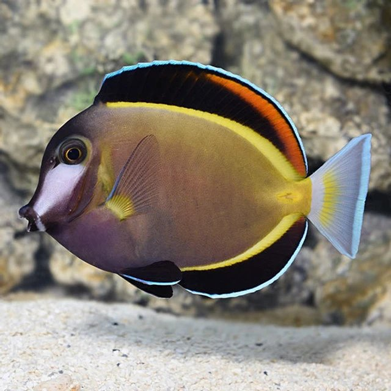

# Cirujano polvo café — *Acanthurus japonicus* (Schmidt, 1931)

> Archivo generado desde `especies/datos/catalogo_inicial.json` con `especies/herramientas/generar_fichas.py`. No editar a mano.

*Imagen ilustrativa generada con IA por Brayan (2026-11-18). No es una fotografía de un ejemplar real; puede contener errores anatómicos.*

**Grupo:** pez  
**Otros nombres:** Powder brown tang, Japan surgeonfish, White-faced surgeonfish  
**Fecha de consulta:** 2026-11-18  
**Confianza global:** media  
**Estado:** verificada; pendiente de revisión del equipo

## Ficha AIRI

| Campo | Valor |
|---|---|
| Nombre común | Cirujano polvo café |
| Nombre científico | *Acanthurus japonicus* |
| Temperamento | Semiagresivo |
| Comportamiento | Territorial. Semiagresivo: solo uno por acuario y con cuidado al juntarlo con otros cirujanos. |
| Adecuado para arrecife | Sí. LiveAquaria lo considera compatible con arrecife. |
| Tipo de alimentación | Herbívoro: algas, algas marinas, alga seca (nori). |
| Temperatura | 22.2–25.6 °C |
| Litraje recomendado | 492.1 L (130 gal EE. UU.). *Es el mínimo recomendado por una sola fuente comercial; ninguna fuente científica consultada establece un litraje.* |
| Tamaño adulto | 23 cm (longitud total). Al venderse mide 5.1–15.2 cm (juvenil o subadulto). *Diferencia menor entre fuentes: FishBase 23 cm; LiveAquaria 8 in (≈ 20.3 cm).* |

## Detalle verificado

| Campo | Dato | Confianza | Fuentes |
|---|---|---|---|
| Clasificación taxonómica | Clase Teleostei; orden Acanthuriformes; familia Acanthuridae. WoRMS AphiaID 272962 (aceptado). Sinónimos: Hepatus aliala japonicus Schmidt, 1931 (combinación original). | alta | [worms_acanthurus_japonicus](https://www.marinespecies.org/aphia.php?p=taxdetails&id=272962), [fishbase_acanthurus_japonicus](https://www.fishbase.se/summary/Acanthurus-japonicus.html) |
| Hábitat natural | Lagunas de aguas claras y arrecifes externos, normalmente en zonas someras expuestas (FishBase). Profundidad: 1–20 m (habitual 5–15 m). Distribución: Indo-Pacífico occidental: de Sulawesi (Indonesia) a Filipinas y las islas Ryukyu. | alta | [fishbase_acanthurus_japonicus](https://www.fishbase.se/summary/Acanthurus-japonicus.html) |
| Tamaño adulto | Máx. 23 cm (longitud total). Diferencia menor entre fuentes: FishBase 23 cm; LiveAquaria 8 in (≈ 20.3 cm). | media | [fishbase_acanthurus_japonicus](https://www.fishbase.se/summary/Acanthurus-japonicus.html), [liveaquaria_acanthurus_japonicus](https://www.liveaquaria.com/products/powder-brown-tang) |
| Alimentación | Come algas (FishBase). En acuario: abundantes algas marinas y alga seca al menos tres veces por semana (LiveAquaria). | alta | [fishbase_acanthurus_japonicus](https://www.fishbase.se/summary/Acanthurus-japonicus.html), [liveaquaria_acanthurus_japonicus](https://www.liveaquaria.com/products/powder-brown-tang) |
| Temperatura del agua | Acuario: 22.2–25.6 °C (72–78 °F). Medio natural: 24–28 °C. El rango de acuario no cae por completo dentro del rango natural registrado por FishBase. | baja | [liveaquaria_acanthurus_japonicus](https://www.liveaquaria.com/products/powder-brown-tang), [fishbase_acanthurus_japonicus](https://www.fishbase.se/summary/Acanthurus-japonicus.html) |
| Rango de pH | Fuente de acuario: 8.1–8.4. Rango prudente AIRI: 8.1–8.3. Criterio: Intersección con la tabla MSD para agua salada (7.8–8.3). | media | [liveaquaria_acanthurus_japonicus](https://www.liveaquaria.com/products/powder-brown-tang), [msd_tabla_referencia](https://www.msdvetmanual.com/multimedia/table/normal-reference-ranges-for-routine-water-quality-analysis), [msd_capitulo](https://www.msdvetmanual.com/exotic-and-laboratory-animals/aquatic-systems/environmental-diseases-of-aquatic-animals-in-aquatic-systems) |
| Salinidad | 1.020–1.025 de gravedad específica (adimensional). Agua de mar media: 35 ppt (UF/IFAS). No se convierte a ppt porque la equivalencia depende de la temperatura. | media | [liveaquaria_acanthurus_japonicus](https://www.liveaquaria.com/products/powder-brown-tang), [ufifas_ph_sal_temp](https://waterwatch.ifas.ufl.edu/media/waterwatchifasufledu/FactSheet_pH_Sal_Temp.pdf) |
| Volumen mínimo | 492.1 L (130 gal EE. UU.). Justificación: Cifra de los datos rápidos de LiveAquaria (130 gal); su descripción indica 125 gal o más. | baja | [liveaquaria_acanthurus_japonicus](https://www.liveaquaria.com/products/powder-brown-tang) |
| Comportamiento | Forma grupos pequeños o grandes y a veces va solo (FishBase). Mejor uno por acuario: los cirujanos de forma parecida pueden ser muy agresivos entre sí (LiveAquaria). | media | [fishbase_acanthurus_japonicus](https://www.fishbase.se/summary/Acanthurus-japonicus.html), [liveaquaria_acanthurus_japonicus](https://www.liveaquaria.com/products/powder-brown-tang) |
| Territorialidad y refugio | Necesita mucho espacio para nadar (LiveAquaria). | media | [liveaquaria_acanthurus_japonicus](https://www.liveaquaria.com/products/powder-brown-tang) |
| Compatibilidad con arrecife | sí (según la fuente; sin verificación independiente) | baja | [liveaquaria_acanthurus_japonicus](https://www.liveaquaria.com/products/powder-brown-tang) |
| Convivencia: condiciones | Acuario de 130 gal o más. · Solo uno por acuario. | baja | [liveaquaria_acanthurus_japonicus](https://www.liveaquaria.com/products/powder-brown-tang) |
| Convivencia: riesgos | Agresión entre cirujanos de forma parecida. | baja | [liveaquaria_acanthurus_japonicus](https://www.liveaquaria.com/products/powder-brown-tang) |
| Conservación | Preocupación menor (LC), evaluada el 03/05/2010, según FishBase. | media | [fishbase_acanthurus_japonicus](https://www.fishbase.se/summary/Acanthurus-japonicus.html) |

**Regla AIRI:** compartir rangos de agua no implica compatibilidad entre especies. Los rangos de acuario provienen de una fuente comercial y no son límites veterinarios.

## Fuentes

- **worms_acanthurus_japonicus** (taxonomía): WoRMS — Acanthurus japonicus (Schmidt, 1931) (AphiaID 272962). <https://www.marinespecies.org/aphia.php?p=taxdetails&id=272962>. Consultada el 2026-11-18.
- **fishbase_acanthurus_japonicus** (biología): FishBase — Acanthurus japonicus. <https://www.fishbase.se/summary/Acanthurus-japonicus.html>. Consultada el 2026-11-18.
- **liveaquaria_acanthurus_japonicus** (comercial): LiveAquaria — Powder Brown Tang (Acanthurus japonicus). <https://www.liveaquaria.com/products/powder-brown-tang>. Consultada el 2026-11-18.
- **msd_tabla_referencia** (veterinaria): MSD Veterinary Manual — “Normal” Reference Ranges for Routine Water Quality Analysis. <https://www.msdvetmanual.com/multimedia/table/normal-reference-ranges-for-routine-water-quality-analysis>. Consultada el 2026-11-12. Reutilizada del registro del motor (motor/airi_motor/datos/fuentes.json); no se volvió a consultar para estas fichas.
- **ufifas_ph_sal_temp** (institucional): UF/IFAS — pH, Salinity and Temperature (hoja informativa). <https://waterwatch.ifas.ufl.edu/media/waterwatchifasufledu/FactSheet_pH_Sal_Temp.pdf>. Consultada el 2026-11-12. Reutilizada del registro del motor (motor/airi_motor/datos/fuentes.json); no se volvió a consultar para estas fichas.
- **msd_capitulo** (veterinaria): MSD Veterinary Manual — Environmental Diseases of Aquatic Animals in Aquatic Systems. <https://www.msdvetmanual.com/exotic-and-laboratory-animals/aquatic-systems/environmental-diseases-of-aquatic-animals-in-aquatic-systems>. Consultada el 2026-11-12. Reutilizada del registro del motor (motor/airi_motor/datos/fuentes.json); no se volvió a consultar para estas fichas.
