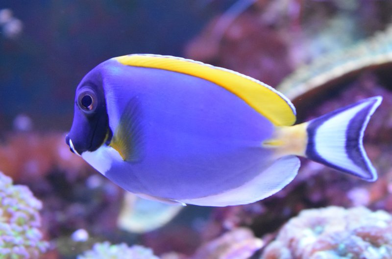

# Cirujano polvo azul — *Acanthurus leucosternon* Bennett, 1833

> Archivo generado desde `especies/datos/catalogo_inicial.json` con `especies/herramientas/generar_fichas.py`. No editar a mano.

*Imagen ilustrativa generada con IA por Brayan (2026-11-18). No es una fotografía de un ejemplar real; puede contener errores anatómicos.*

**Grupo:** pez  
**Otros nombres:** Powder blue tang, Powder blue surgeonfish  
**Fecha de consulta:** 2026-11-18  
**Confianza global:** media  
**Estado:** verificada; pendiente de revisión del equipo

## Ficha AIRI

| Campo | Valor |
|---|---|
| Nombre común | Cirujano polvo azul |
| Nombre científico | *Acanthurus leucosternon* |
| Temperamento | Semiagresivo *Saltwaterfish lo clasifica como semiagresivo; LiveAquaria lo describe como extremadamente agresivo con otros cirujanos.* |
| Comportamiento | Territorial. Muy agresivo con otros cirujanos: mejor uno solo por acuario. Necesita mucho espacio y algas. |
| Adecuado para arrecife | Sí. Saltwaterfish lo considera apto para arrecife; LiveAquaria no publica este dato. |
| Tipo de alimentación | Herbívoro: algas bentónicas, algas marinas, alga seca (nori). *Saltwaterfish lo clasifica como omnívoro.* |
| Temperatura | 23–28 °C *Rango del medio natural (FishBase): ninguna tienda consultada publica un rango de acuario.* |
| Litraje recomendado | 473.1 L (125 gal EE. UU.). *Dos fuentes comerciales coinciden en unos 120–125 gal.* |
| Tamaño adulto | 54 cm (longitud total). Al venderse mide 2.5–20.3 cm (juvenil o subadulto). Madura desde 13.8 cm. *Diferencia entre fuentes: FishBase registra 54 cm como máximo (longitud habitual 19 cm); Saltwaterfish indica 9 in (≈ 22.9 cm). LiveAquaria no publica datos rápidos.* |

## Detalle verificado

| Campo | Dato | Confianza | Fuentes |
|---|---|---|---|
| Clasificación taxonómica | Clase Teleostei; orden Acanthuriformes; familia Acanthuridae. WoRMS AphiaID 219628 (aceptado). Sinónimos: Acanthurus delisiani Valenciennes, 1835, Hepatus leucosternon (Bennett, 1833). | alta | [worms_acanthurus_leucosternon](https://www.marinespecies.org/aphia.php?p=taxdetails&id=219628), [fishbase_acanthurus_leucosternon](https://www.fishbase.se/summary/Acanthurus-leucosternon.html) |
| Hábitat natural | Arrecifes coralinos costeros e insulares, someros y de aguas claras, sobre todo planicies arrecifales y pendientes externas superiores (FishBase). Profundidad: 0–25 m. Distribución: Océano Índico: de África oriental al mar de Andamán, el suroeste de Indonesia y la isla de Navidad; llega hasta Bali. | alta | [fishbase_acanthurus_leucosternon](https://www.fishbase.se/summary/Acanthurus-leucosternon.html) |
| Tamaño adulto | Máx. 54 cm (longitud total). Diferencia entre fuentes: FishBase registra 54 cm como máximo (longitud habitual 19 cm); Saltwaterfish indica 9 in (≈ 22.9 cm). LiveAquaria no publica datos rápidos. | baja | [fishbase_acanthurus_leucosternon](https://www.fishbase.se/summary/Acanthurus-leucosternon.html), [saltwaterfish_acanthurus_leucosternon](https://www.saltwaterfish.com/product-powder-blue-tang) |
| Alimentación | Come algas bentónicas: pequeñas algas dispersas y crecimientos en grietas (FishBase). En acuario: abundantes algas marinas y alga seca al menos tres veces por semana (LiveAquaria). | alta | [fishbase_acanthurus_leucosternon](https://www.fishbase.se/summary/Acanthurus-leucosternon.html), [liveaquaria_acanthurus_leucosternon](https://www.liveaquaria.com/products/powder-blue-tang) |
| Temperatura del agua | Acuario: null (no verificado). Medio natural: 23–28 °C. LiveAquaria no publica datos rápidos de esta especie y Saltwaterfish no indica temperatura; solo se dispone del rango natural de FishBase. | media | [fishbase_acanthurus_leucosternon](https://www.fishbase.se/summary/Acanthurus-leucosternon.html) |
| Rango de pH | null (no verificado). Ninguna fuente consultada publica pH para esta especie. | baja | [msd_tabla_referencia](https://www.msdvetmanual.com/multimedia/table/normal-reference-ranges-for-routine-water-quality-analysis) |
| Salinidad | null (no verificado). Agua de mar media: 35 ppt (UF/IFAS). | baja | [ufifas_ph_sal_temp](https://waterwatch.ifas.ufl.edu/media/waterwatchifasufledu/FactSheet_pH_Sal_Temp.pdf) |
| Volumen mínimo | 473.1 L (125 gal EE. UU.). Justificación: LiveAquaria recomienda 125 gal o más en su descripción; Saltwaterfish indica 120 gal. | baja | [liveaquaria_acanthurus_leucosternon](https://www.liveaquaria.com/products/powder-blue-tang), [saltwaterfish_acanthurus_leucosternon](https://www.saltwaterfish.com/product-powder-blue-tang) |
| Comportamiento | Puede ir solo o en grandes grupos de alimentación; monógamo (FishBase). Extremadamente agresivo con otros cirujanos, sobre todo de forma y color parecidos: mejor uno solo por acuario, salvo en sistemas muy grandes y añadiéndolos a la vez (LiveAquaria). | media | [fishbase_acanthurus_leucosternon](https://www.fishbase.se/summary/Acanthurus-leucosternon.html), [liveaquaria_acanthurus_leucosternon](https://www.liveaquaria.com/products/powder-blue-tang) |
| Territorialidad y refugio | Necesita mucho espacio para nadar (LiveAquaria). | media | [liveaquaria_acanthurus_leucosternon](https://www.liveaquaria.com/products/powder-blue-tang) |
| Compatibilidad con arrecife | sí (según la fuente; sin verificación independiente) | baja | [saltwaterfish_acanthurus_leucosternon](https://www.saltwaterfish.com/product-powder-blue-tang) |
| Convivencia: condiciones | Acuario de 125 gal o más. · Solo uno por acuario salvo en sistemas muy grandes. · Dieta rica en algas. | baja | [liveaquaria_acanthurus_leucosternon](https://www.liveaquaria.com/products/powder-blue-tang), [saltwaterfish_acanthurus_leucosternon](https://www.saltwaterfish.com/product-powder-blue-tang) |
| Convivencia: riesgos | Muy agresivo con otros cirujanos. · Espina caudal muy afilada (Saltwaterfish). | baja | [liveaquaria_acanthurus_leucosternon](https://www.liveaquaria.com/products/powder-blue-tang), [saltwaterfish_acanthurus_leucosternon](https://www.saltwaterfish.com/product-powder-blue-tang) |
| Conservación | Preocupación menor (LC), evaluada el 03/05/2010, según FishBase. | media | [fishbase_acanthurus_leucosternon](https://www.fishbase.se/summary/Acanthurus-leucosternon.html) |

**Regla AIRI:** compartir rangos de agua no implica compatibilidad entre especies. Los rangos de acuario provienen de una fuente comercial y no son límites veterinarios.

## Fuentes

- **worms_acanthurus_leucosternon** (taxonomía): WoRMS — Acanthurus leucosternon Bennett, 1833 (AphiaID 219628). <https://www.marinespecies.org/aphia.php?p=taxdetails&id=219628>. Consultada el 2026-11-18.
- **fishbase_acanthurus_leucosternon** (biología): FishBase — Acanthurus leucosternon. <https://www.fishbase.se/summary/Acanthurus-leucosternon.html>. Consultada el 2026-11-18.
- **liveaquaria_acanthurus_leucosternon** (comercial): LiveAquaria — Powder Blue Tang. <https://www.liveaquaria.com/products/powder-blue-tang>. Consultada el 2026-11-18.
- **saltwaterfish_acanthurus_leucosternon** (comercial): Saltwaterfish — Powder Blue Tang. <https://www.saltwaterfish.com/product-powder-blue-tang>. Consultada el 2026-11-18.
- **msd_tabla_referencia** (veterinaria): MSD Veterinary Manual — “Normal” Reference Ranges for Routine Water Quality Analysis. <https://www.msdvetmanual.com/multimedia/table/normal-reference-ranges-for-routine-water-quality-analysis>. Consultada el 2026-11-12. Reutilizada del registro del motor (motor/airi_motor/datos/fuentes.json); no se volvió a consultar para estas fichas.
- **ufifas_ph_sal_temp** (institucional): UF/IFAS — pH, Salinity and Temperature (hoja informativa). <https://waterwatch.ifas.ufl.edu/media/waterwatchifasufledu/FactSheet_pH_Sal_Temp.pdf>. Consultada el 2026-11-12. Reutilizada del registro del motor (motor/airi_motor/datos/fuentes.json); no se volvió a consultar para estas fichas.
- **msd_capitulo** (veterinaria): MSD Veterinary Manual — Environmental Diseases of Aquatic Animals in Aquatic Systems. <https://www.msdvetmanual.com/exotic-and-laboratory-animals/aquatic-systems/environmental-diseases-of-aquatic-animals-in-aquatic-systems>. Consultada el 2026-11-12. Reutilizada del registro del motor (motor/airi_motor/datos/fuentes.json); no se volvió a consultar para estas fichas.
