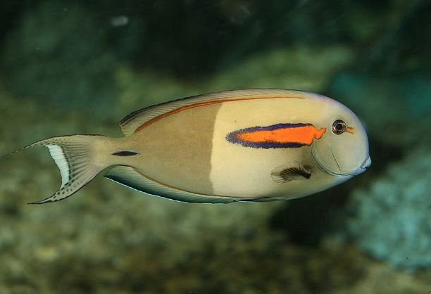

# Cirujano orange shoulder — *Acanthurus olivaceus* Bloch & Schneider, 1801

> Archivo generado desde `especies/datos/catalogo_inicial.json` con `especies/herramientas/generar_fichas.py`. No editar a mano.

*Imagen ilustrativa generada con IA por Brayan (2026-11-16). No es una fotografía de un ejemplar real; puede contener errores anatómicos.*

**Grupo:** pez  
**Otros nombres:** Orangeshoulder tang, Orangespot surgeonfish, Orange-epaulette surgeonfish  
**Fecha de consulta:** 2026-11-16  
**Confianza global:** media  
**Estado:** verificada; pendiente de revisión del equipo

## Ficha AIRI

| Campo | Valor |
|---|---|
| Nombre común | Cirujano orange shoulder |
| Nombre científico | *Acanthurus olivaceus* |
| Temperamento | Semiagresivo *LiveAquaria lo clasifica como semiagresivo, pero indica que no es agresivo con otros cirujanos.* |
| Comportamiento | Sociable. En la naturaleza va solo o en cardúmenes. No suele ser agresivo con otros cirujanos. Necesita mucho espacio para nadar. |
| Adecuado para arrecife | Sí. LiveAquaria lo considera compatible con arrecife; no hay verificación independiente. |
| Tipo de alimentación | Herbívoro: detritos, diatomeas, algas filamentosas finas, alga marina seca. |
| Temperatura | 22.2–25.6 °C *Discrepancia: el límite inferior de acuario (22.2 °C) está por debajo del mínimo natural indicado por FishBase (24 °C).* |
| Litraje recomendado | 681.3 L (180 gal EE. UU.). *Es el mínimo recomendado por una sola fuente comercial; ninguna fuente científica consultada establece un litraje.* |
| Tamaño adulto | 35 cm (longitud total). Al venderse mide 5.1–20.3 cm (juvenil o subadulto). *LiveAquaria: 14 in (≈ 35.6 cm), coherente con FishBase. Vive hasta 33 años. El juvenil es amarillo; el adulto es gris con una franja naranja sobre la aleta pectoral.* |

## Detalle verificado

| Campo | Dato | Confianza | Fuentes |
|---|---|---|---|
| Clasificación taxonómica | Clase Teleostei; orden Acanthuriformes; familia Acanthuridae; subfamilia Acanthurinae. WoRMS AphiaID 219625 (aceptado). Sinónimos: Acanthurus chrysosoma Bleeker, 1857, Acanthurus humeralis Valenciennes. | alta | [worms_acanthurus_olivaceus](https://www.marinespecies.org/aphia.php?p=taxdetails&id=219625), [fishbase_acanthurus_olivaceus](https://www.fishbase.se/summary/Acanthurus-olivaceus.html) |
| Hábitat natural | Arrecifes externos sobre roca desnuda o mezcla de cascajo y arena, de 9 a al menos 46 m. Los juveniles viven en bahías y lagunas protegidas desde 3 m. Los adultos van solos o en cardúmenes. Profundidad: 3–46 m (habitual 9–46 m). Distribución: Pacífico: de las islas Christmas y Cocos-Keeling (Índico oriental) a Hawái y las Tuamotu; al norte hasta Japón; al sur hasta Lord Howe. En el Índico lo reemplaza Acanthurus tennenti. | media | [fishbase_acanthurus_olivaceus](https://www.fishbase.se/summary/Acanthurus-olivaceus.html) |
| Tamaño adulto | Máx. 35 cm (longitud total). LiveAquaria: 14 in (≈ 35.6 cm), coherente con FishBase. Vive hasta 33 años. El juvenil es amarillo; el adulto es gris con una franja naranja sobre la aleta pectoral. | alta | [fishbase_acanthurus_olivaceus](https://www.fishbase.se/summary/Acanthurus-olivaceus.html), [liveaquaria_acanthurus_olivaceus](https://www.liveaquaria.com/products/orangeshoulder-tang) |
| Alimentación | Herbívoro: en la naturaleza come la película de detritos, diatomeas y algas filamentosas finas de la superficie (FishBase). En acuario necesita abundantes algas marinas, al menos tres veces por semana (LiveAquaria). | alta | [fishbase_acanthurus_olivaceus](https://www.fishbase.se/summary/Acanthurus-olivaceus.html), [liveaquaria_acanthurus_olivaceus](https://www.liveaquaria.com/products/orangeshoulder-tang) |
| Temperatura del agua | Acuario: 22.2–25.6 °C (72–78 °F). Medio natural: 24–28 °C. Discrepancia: el límite inferior de acuario (22.2 °C) está por debajo del mínimo natural indicado por FishBase (24 °C). | baja | [liveaquaria_acanthurus_olivaceus](https://www.liveaquaria.com/products/orangeshoulder-tang), [fishbase_acanthurus_olivaceus](https://www.fishbase.se/summary/Acanthurus-olivaceus.html) |
| Rango de pH | Fuente de acuario: 8.1–8.4. Rango prudente AIRI: 8.1–8.3. Criterio: Intersección con la tabla MSD para agua salada (7.8–8.3). | media | [liveaquaria_acanthurus_olivaceus](https://www.liveaquaria.com/products/orangeshoulder-tang), [msd_tabla_referencia](https://www.msdvetmanual.com/multimedia/table/normal-reference-ranges-for-routine-water-quality-analysis), [msd_capitulo](https://www.msdvetmanual.com/exotic-and-laboratory-animals/aquatic-systems/environmental-diseases-of-aquatic-animals-in-aquatic-systems) |
| Salinidad | 1.020–1.025 de gravedad específica (adimensional). Agua de mar media: 35 ppt (UF/IFAS). No se convierte a ppt porque la equivalencia depende de la temperatura. | media | [liveaquaria_acanthurus_olivaceus](https://www.liveaquaria.com/products/orangeshoulder-tang), [ufifas_ph_sal_temp](https://waterwatch.ifas.ufl.edu/media/waterwatchifasufledu/FactSheet_pH_Sal_Temp.pdf) |
| Volumen mínimo | 681.3 L (180 gal EE. UU.). Justificación: Cifra de LiveAquaria (180 gal). Es un cirujano grande (35 cm) que necesita mucho espacio libre para nadar. | baja | [liveaquaria_acanthurus_olivaceus](https://www.liveaquaria.com/products/orangeshoulder-tang), [fishbase_acanthurus_olivaceus](https://www.fishbase.se/summary/Acanthurus-olivaceus.html) |
| Comportamiento | LiveAquaria lo clasifica como semiagresivo, aunque indica que no es agresivo con otros cirujanos; para tener varios, recomienda añadir un juvenil a un acuario con un adulto. En la naturaleza va solo o en cardúmenes (FishBase). | media | [fishbase_acanthurus_olivaceus](https://www.fishbase.se/summary/Acanthurus-olivaceus.html), [liveaquaria_acanthurus_olivaceus](https://www.liveaquaria.com/products/orangeshoulder-tang) |
| Territorialidad y refugio | No se describe como agresivo con otros cirujanos. Necesita espacio libre para nadar. | media | [liveaquaria_acanthurus_olivaceus](https://www.liveaquaria.com/products/orangeshoulder-tang), [fishbase_acanthurus_olivaceus](https://www.fishbase.se/summary/Acanthurus-olivaceus.html) |
| Compatibilidad con arrecife | sí (según la fuente; sin verificación independiente) | baja | [liveaquaria_acanthurus_olivaceus](https://www.liveaquaria.com/products/orangeshoulder-tang) |
| Convivencia: condiciones | Acuario muy grande. · Para varios ejemplares, añadir un juvenil a un acuario con un adulto. · Dieta rica en algas. | baja | [liveaquaria_acanthurus_olivaceus](https://www.liveaquaria.com/products/orangeshoulder-tang), [fishbase_acanthurus_olivaceus](https://www.fishbase.se/summary/Acanthurus-olivaceus.html) |
| Convivencia: riesgos | Necesita mucho espacio: en acuarios pequeños no tiene sitio para nadar. | baja | [liveaquaria_acanthurus_olivaceus](https://www.liveaquaria.com/products/orangeshoulder-tang), [fishbase_acanthurus_olivaceus](https://www.fishbase.se/summary/Acanthurus-olivaceus.html) |
| Conservación | Preocupación menor (LC), evaluada el 04/05/2010, según FishBase. | media | [fishbase_acanthurus_olivaceus](https://www.fishbase.se/summary/Acanthurus-olivaceus.html) |

**Regla AIRI:** compartir rangos de agua no implica compatibilidad entre especies. Los rangos de acuario provienen de una fuente comercial y no son límites veterinarios.

## Fuentes

- **worms_acanthurus_olivaceus** (taxonomía): WoRMS — Acanthurus olivaceus Bloch & Schneider, 1801 (AphiaID 219625). <https://www.marinespecies.org/aphia.php?p=taxdetails&id=219625>. Consultada el 2026-11-16.
- **fishbase_acanthurus_olivaceus** (biología): FishBase — Acanthurus olivaceus Bloch & Schneider, 1801. <https://www.fishbase.se/summary/Acanthurus-olivaceus.html>. Consultada el 2026-11-16.
- **liveaquaria_acanthurus_olivaceus** (comercial): LiveAquaria — Orangeshoulder Tang. <https://www.liveaquaria.com/products/orangeshoulder-tang>. Consultada el 2026-11-16.
- **msd_tabla_referencia** (veterinaria): MSD Veterinary Manual — “Normal” Reference Ranges for Routine Water Quality Analysis. <https://www.msdvetmanual.com/multimedia/table/normal-reference-ranges-for-routine-water-quality-analysis>. Consultada el 2026-11-12. Reutilizada del registro del motor (motor/airi_motor/datos/fuentes.json); no se volvió a consultar para estas fichas.
- **ufifas_ph_sal_temp** (institucional): UF/IFAS — pH, Salinity and Temperature (hoja informativa). <https://waterwatch.ifas.ufl.edu/media/waterwatchifasufledu/FactSheet_pH_Sal_Temp.pdf>. Consultada el 2026-11-12. Reutilizada del registro del motor (motor/airi_motor/datos/fuentes.json); no se volvió a consultar para estas fichas.
- **msd_capitulo** (veterinaria): MSD Veterinary Manual — Environmental Diseases of Aquatic Animals in Aquatic Systems. <https://www.msdvetmanual.com/exotic-and-laboratory-animals/aquatic-systems/environmental-diseases-of-aquatic-animals-in-aquatic-systems>. Consultada el 2026-11-12. Reutilizada del registro del motor (motor/airi_motor/datos/fuentes.json); no se volvió a consultar para estas fichas.
