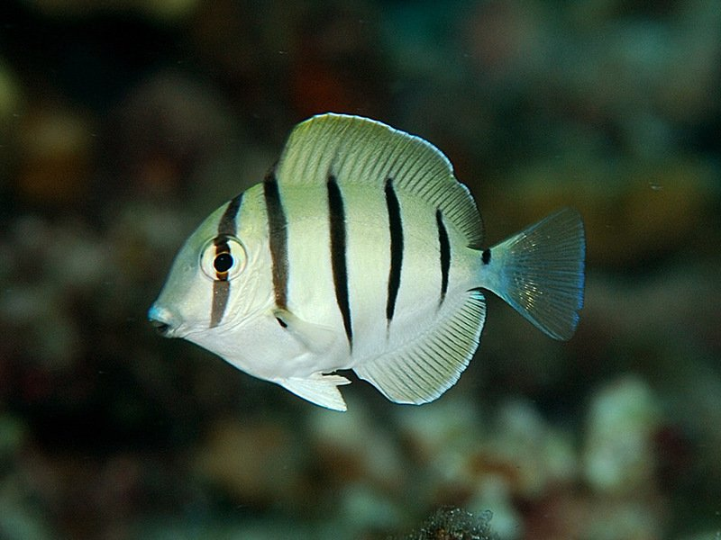

# Cirujano convicto — *Acanthurus triostegus* (Linnaeus, 1758)

> Archivo generado desde `especies/datos/catalogo_inicial.json` con `especies/herramientas/generar_fichas.py`. No editar a mano.

*Imagen ilustrativa generada con IA por Brayan (2026-11-18). No es una fotografía de un ejemplar real; puede contener errores anatómicos.*

**Grupo:** pez  
**Otros nombres:** Convict tang, Convict surgeonfish, Cirujano reo  
**Fecha de consulta:** 2026-11-18  
**Confianza global:** media  
**Estado:** verificada; pendiente de revisión del equipo

## Ficha AIRI

| Campo | Valor |
|---|---|
| Nombre común | Cirujano convicto |
| Nombre científico | *Acanthurus triostegus* |
| Temperamento | Semiagresivo |
| Comportamiento | Sociable. Más acosado que acosador: otros cirujanos lo molestan. Puede vivir en grupo si todos se introducen a la vez. |
| Adecuado para arrecife | Sí. LiveAquaria lo considera compatible con arrecife. |
| Tipo de alimentación | Herbívoro: algas filamentosas, algas marinas, alga seca (nori). |
| Temperatura | 22.2–25.6 °C |
| Litraje recomendado | 492.1 L (130 gal EE. UU.). *Es el mínimo recomendado por una sola fuente comercial; ninguna fuente científica consultada establece un litraje.* |
| Tamaño adulto | 27 cm (longitud total). Madura desde 8.8 cm. *Diferencia entre fuentes: FishBase 27 cm (longitud habitual 17 cm); LiveAquaria 8 in (≈ 20.3 cm).* |

## Detalle verificado

| Campo | Dato | Confianza | Fuentes |
|---|---|---|---|
| Clasificación taxonómica | Clase Teleostei; orden Acanthuriformes; familia Acanthuridae. WoRMS AphiaID 219630 (aceptado). Sinónimos: Acanthurus hirudo Bennett, 1829, Acanthurus sandvicensis Streets, 1877. | alta | [worms_acanthurus_triostegus](https://www.marinespecies.org/aphia.php?p=taxdetails&id=219630), [fishbase_acanthurus_triostegus](https://www.fishbase.se/summary/Acanthurus-triostegus.html) |
| Hábitat natural | Lagunas y arrecifes externos de sustrato duro; los jóvenes abundan en pozas de marea. A menudo se alimenta cerca de desagües de agua dulce (FishBase). Profundidad: 0–90 m. Distribución: Indo-Pacífico, salvo los mares que rodean la península arábiga; Pacífico oriental, del golfo de California a Panamá, incluidas las islas Revillagigedo, Cocos, Clipperton y Galápagos. | alta | [fishbase_acanthurus_triostegus](https://www.fishbase.se/summary/Acanthurus-triostegus.html) |
| Tamaño adulto | Máx. 27 cm (longitud total). Diferencia entre fuentes: FishBase 27 cm (longitud habitual 17 cm); LiveAquaria 8 in (≈ 20.3 cm). | media | [fishbase_acanthurus_triostegus](https://www.fishbase.se/summary/Acanthurus-triostegus.html), [liveaquaria_acanthurus_triostegus](https://www.liveaquaria.com/products/convict-tang) |
| Alimentación | Come algas filamentosas, a menudo en grandes grupos (FishBase). En acuario: abundantes algas marinas y alga seca al menos tres veces por semana (LiveAquaria). | alta | [fishbase_acanthurus_triostegus](https://www.fishbase.se/summary/Acanthurus-triostegus.html), [liveaquaria_acanthurus_triostegus](https://www.liveaquaria.com/products/convict-tang) |
| Temperatura del agua | Acuario: 22.2–25.6 °C (72–78 °F). FishBase no indica rango de temperatura para esta especie. | baja | [liveaquaria_acanthurus_triostegus](https://www.liveaquaria.com/products/convict-tang) |
| Rango de pH | Fuente de acuario: 8.1–8.4. Rango prudente AIRI: 8.1–8.3. Criterio: Intersección con la tabla MSD para agua salada (7.8–8.3). | media | [liveaquaria_acanthurus_triostegus](https://www.liveaquaria.com/products/convict-tang), [msd_tabla_referencia](https://www.msdvetmanual.com/multimedia/table/normal-reference-ranges-for-routine-water-quality-analysis), [msd_capitulo](https://www.msdvetmanual.com/exotic-and-laboratory-animals/aquatic-systems/environmental-diseases-of-aquatic-animals-in-aquatic-systems) |
| Salinidad | 1.020–1.025 de gravedad específica (adimensional). Agua de mar media: 35 ppt (UF/IFAS). No se convierte a ppt porque la equivalencia depende de la temperatura. | media | [liveaquaria_acanthurus_triostegus](https://www.liveaquaria.com/products/convict-tang), [ufifas_ph_sal_temp](https://waterwatch.ifas.ufl.edu/media/waterwatchifasufledu/FactSheet_pH_Sal_Temp.pdf) |
| Volumen mínimo | 492.1 L (130 gal EE. UU.). Justificación: Cifra de los datos rápidos de LiveAquaria (130 gal); su descripción indica 125 gal o más. | baja | [liveaquaria_acanthurus_triostegus](https://www.liveaquaria.com/products/convict-tang) |
| Comportamiento | A veces forma cardúmenes y grandes grupos de alimentación (FishBase). Otros cirujanos lo acosan; puede vivir en paz con otros convictos si se introducen todos a la vez (LiveAquaria). | media | [fishbase_acanthurus_triostegus](https://www.fishbase.se/summary/Acanthurus-triostegus.html), [liveaquaria_acanthurus_triostegus](https://www.liveaquaria.com/products/convict-tang) |
| Territorialidad y refugio | Necesita mucho espacio para nadar (LiveAquaria). | media | [liveaquaria_acanthurus_triostegus](https://www.liveaquaria.com/products/convict-tang) |
| Compatibilidad con arrecife | sí (según la fuente; sin verificación independiente) | baja | [liveaquaria_acanthurus_triostegus](https://www.liveaquaria.com/products/convict-tang) |
| Convivencia: condiciones | Acuario de 130 gal o más. · Sin otras especies de cirujanos. · Si son varios, introducirlos a la vez. | baja | [liveaquaria_acanthurus_triostegus](https://www.liveaquaria.com/products/convict-tang) |
| Convivencia: riesgos | Otros cirujanos lo acosan. | baja | [liveaquaria_acanthurus_triostegus](https://www.liveaquaria.com/products/convict-tang) |
| Conservación | Preocupación menor (LC), evaluada el 04/05/2010, según FishBase. | media | [fishbase_acanthurus_triostegus](https://www.fishbase.se/summary/Acanthurus-triostegus.html) |

**Regla AIRI:** compartir rangos de agua no implica compatibilidad entre especies. Los rangos de acuario provienen de una fuente comercial y no son límites veterinarios.

## Fuentes

- **worms_acanthurus_triostegus** (taxonomía): WoRMS — Acanthurus triostegus (Linnaeus, 1758) (AphiaID 219630). <https://www.marinespecies.org/aphia.php?p=taxdetails&id=219630>. Consultada el 2026-11-18.
- **fishbase_acanthurus_triostegus** (biología): FishBase — Acanthurus triostegus. <https://www.fishbase.se/summary/Acanthurus-triostegus.html>. Consultada el 2026-11-18.
- **liveaquaria_acanthurus_triostegus** (comercial): LiveAquaria — Convict Tang (Acanthurus triostegus). <https://www.liveaquaria.com/products/convict-tang>. Consultada el 2026-11-18.
- **msd_tabla_referencia** (veterinaria): MSD Veterinary Manual — “Normal” Reference Ranges for Routine Water Quality Analysis. <https://www.msdvetmanual.com/multimedia/table/normal-reference-ranges-for-routine-water-quality-analysis>. Consultada el 2026-11-12. Reutilizada del registro del motor (motor/airi_motor/datos/fuentes.json); no se volvió a consultar para estas fichas.
- **ufifas_ph_sal_temp** (institucional): UF/IFAS — pH, Salinity and Temperature (hoja informativa). <https://waterwatch.ifas.ufl.edu/media/waterwatchifasufledu/FactSheet_pH_Sal_Temp.pdf>. Consultada el 2026-11-12. Reutilizada del registro del motor (motor/airi_motor/datos/fuentes.json); no se volvió a consultar para estas fichas.
- **msd_capitulo** (veterinaria): MSD Veterinary Manual — Environmental Diseases of Aquatic Animals in Aquatic Systems. <https://www.msdvetmanual.com/exotic-and-laboratory-animals/aquatic-systems/environmental-diseases-of-aquatic-animals-in-aquatic-systems>. Consultada el 2026-11-12. Reutilizada del registro del motor (motor/airi_motor/datos/fuentes.json); no se volvió a consultar para estas fichas.
