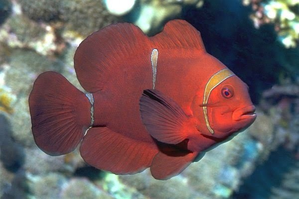

# Pez payaso marrón — *Amphiprion biaculeatus* (Bloch, 1790)

> Archivo generado desde `especies/datos/catalogo_inicial.json` con `especies/herramientas/generar_fichas.py`. No editar a mano.

*Imagen ilustrativa generada con IA por Brayan (2026-11-18). No es una fotografía de un ejemplar real; puede contener errores anatómicos.*

**Grupo:** pez  
**Otros nombres:** Maroon clownfish, Spine-cheeked anemonefish, Premnas biaculeatus (nombre anterior)  
**Fecha de consulta:** 2026-11-18  
**Confianza global:** media  
**Estado:** verificada; pendiente de revisión del equipo

## Ficha AIRI

| Campo | Valor |
|---|---|
| Nombre común | Pez payaso marrón |
| Nombre científico | *Amphiprion biaculeatus* |
| Temperamento | Agresivo |
| Comportamiento | Territorial. Agresivo, sobre todo con otros peces payaso: solo uno o una pareja. Suele vivir en una anémona burbuja. |
| Adecuado para arrecife | Sí. LiveAquaria lo considera compatible con arrecife. |
| Tipo de alimentación | Omnívoro: zooplancton, algas, camarón congelado, preparados para herbívoros. |
| Temperatura | 22.2–25.6 °C |
| Litraje recomendado | 113.6 L (30 gal EE. UU.). *Es el mínimo recomendado por una sola fuente comercial; ninguna fuente científica consultada establece un litraje.* |
| Tamaño adulto | 17 cm (longitud total). Al venderse mide 1.3–8.9 cm (juvenil o subadulto). *Diferencia menor entre fuentes: FishBase 17 cm; LiveAquaria 6 in (≈ 15.2 cm).* |

## Detalle verificado

| Campo | Dato | Confianza | Fuentes |
|---|---|---|---|
| Clasificación taxonómica | Clase Teleostei; orden Ovalentaria (incertae sedis); familia Pomacentridae. WoRMS AphiaID 1605249 (aceptado). Sinónimos: Chaetodon biaculeatus Bloch, 1790 (combinación original), Premnas biaculeatus (nombre usado en acuariofilia), Lutianus trifasciatus Schneider, 1801. WoRMS acepta Amphiprion biaculeatus; Premnas biaculeatus es su nombre anterior y FishBase todavía lo usa. | alta | [worms_amphiprion_biaculeatus](https://www.marinespecies.org/aphia.php?p=taxdetails&id=1605249), [fishbase_amphiprion_biaculeatus](https://www.fishbase.se/summary/Premnas-biaculeatus.html) |
| Hábitat natural | Lagunas y arrecifes externos, sobre todo en aguas costeras protegidas; asociado a la anémona burbuja (Entacmaea quadricolor) (FishBase). Profundidad: 1–16 m. Distribución: Indo-Pacífico occidental: archipiélago indoaustraliano, de la India y Birmania a Filipinas, Nueva Guinea, Islas Salomón, Vanuatu y el norte de Australia. | alta | [fishbase_amphiprion_biaculeatus](https://www.fishbase.se/summary/Premnas-biaculeatus.html) |
| Tamaño adulto | Máx. 17 cm (longitud total). Diferencia menor entre fuentes: FishBase 17 cm; LiveAquaria 6 in (≈ 15.2 cm). | media | [fishbase_amphiprion_biaculeatus](https://www.fishbase.se/summary/Premnas-biaculeatus.html), [liveaquaria_amphiprion_biaculeatus](https://www.liveaquaria.com/products/maroon-clownfish) |
| Alimentación | Come sobre todo zooplancton y algas bentónicas (FishBase). En acuario: alimentos cárneos como camarón congelado y preparados para herbívoros (LiveAquaria). | alta | [fishbase_amphiprion_biaculeatus](https://www.fishbase.se/summary/Premnas-biaculeatus.html), [liveaquaria_amphiprion_biaculeatus](https://www.liveaquaria.com/products/maroon-clownfish) |
| Temperatura del agua | Acuario: 22.2–25.6 °C (72–78 °F). FishBase no indica rango de temperatura para esta especie. | baja | [liveaquaria_amphiprion_biaculeatus](https://www.liveaquaria.com/products/maroon-clownfish) |
| Rango de pH | null (no verificado). Los datos rápidos de LiveAquaria no indican pH para esta especie. | baja | [msd_tabla_referencia](https://www.msdvetmanual.com/multimedia/table/normal-reference-ranges-for-routine-water-quality-analysis) |
| Salinidad | 1.020–1.025 de gravedad específica (adimensional). Agua de mar media: 35 ppt (UF/IFAS). No se convierte a ppt porque la equivalencia depende de la temperatura. | media | [liveaquaria_amphiprion_biaculeatus](https://www.liveaquaria.com/products/maroon-clownfish), [ufifas_ph_sal_temp](https://waterwatch.ifas.ufl.edu/media/waterwatchifasufledu/FactSheet_pH_Sal_Temp.pdf) |
| Volumen mínimo | 113.6 L (30 gal EE. UU.). Justificación: Cifra de LiveAquaria (30 gal), idealmente con una anémona hospedadora. | baja | [liveaquaria_amphiprion_biaculeatus](https://www.liveaquaria.com/products/maroon-clownfish) |
| Comportamiento | Suele vivir en pareja; el macho es mucho más pequeño que la hembra (FishBase). Agresivo con otros peces payaso: es difícil mantener más de uno salvo que sean pareja (LiveAquaria). | media | [fishbase_amphiprion_biaculeatus](https://www.fishbase.se/summary/Premnas-biaculeatus.html), [liveaquaria_amphiprion_biaculeatus](https://www.liveaquaria.com/products/maroon-clownfish) |
| Territorialidad y refugio | Defiende su anémona; pelea con los de su especie salvo en pareja (LiveAquaria). | media | [liveaquaria_amphiprion_biaculeatus](https://www.liveaquaria.com/products/maroon-clownfish) |
| Compatibilidad con arrecife | sí (según la fuente; sin verificación independiente) | baja | [liveaquaria_amphiprion_biaculeatus](https://www.liveaquaria.com/products/maroon-clownfish) |
| Convivencia: condiciones | Acuario de 30 gal o más. · Anémona hospedadora deseable. · Solo uno o una pareja. | baja | [liveaquaria_amphiprion_biaculeatus](https://www.liveaquaria.com/products/maroon-clownfish) |
| Convivencia: riesgos | Agresivo con otros peces payaso. · Las espinas de sus mejillas se enredan en la red: hay que capturarlo con un recipiente. | baja | [liveaquaria_amphiprion_biaculeatus](https://www.liveaquaria.com/products/maroon-clownfish) |
| Conservación | Preocupación menor (LC), evaluada el 23/09/2021, según FishBase. | media | [fishbase_amphiprion_biaculeatus](https://www.fishbase.se/summary/Premnas-biaculeatus.html) |

**Regla AIRI:** compartir rangos de agua no implica compatibilidad entre especies. Los rangos de acuario provienen de una fuente comercial y no son límites veterinarios.

## Fuentes

- **worms_amphiprion_biaculeatus** (taxonomía): WoRMS — Amphiprion biaculeatus (Bloch, 1790) (AphiaID 1605249). <https://www.marinespecies.org/aphia.php?p=taxdetails&id=1605249>. Consultada el 2026-11-18.
- **fishbase_amphiprion_biaculeatus** (biología): FishBase — Premnas biaculeatus. <https://www.fishbase.se/summary/Premnas-biaculeatus.html>. Consultada el 2026-11-18.
- **liveaquaria_amphiprion_biaculeatus** (comercial): LiveAquaria — Maroon Clownfish. <https://www.liveaquaria.com/products/maroon-clownfish>. Consultada el 2026-11-18.
- **msd_tabla_referencia** (veterinaria): MSD Veterinary Manual — “Normal” Reference Ranges for Routine Water Quality Analysis. <https://www.msdvetmanual.com/multimedia/table/normal-reference-ranges-for-routine-water-quality-analysis>. Consultada el 2026-11-12. Reutilizada del registro del motor (motor/airi_motor/datos/fuentes.json); no se volvió a consultar para estas fichas.
- **ufifas_ph_sal_temp** (institucional): UF/IFAS — pH, Salinity and Temperature (hoja informativa). <https://waterwatch.ifas.ufl.edu/media/waterwatchifasufledu/FactSheet_pH_Sal_Temp.pdf>. Consultada el 2026-11-12. Reutilizada del registro del motor (motor/airi_motor/datos/fuentes.json); no se volvió a consultar para estas fichas.
- **msd_capitulo** (veterinaria): MSD Veterinary Manual — Environmental Diseases of Aquatic Animals in Aquatic Systems. <https://www.msdvetmanual.com/exotic-and-laboratory-animals/aquatic-systems/environmental-diseases-of-aquatic-animals-in-aquatic-systems>. Consultada el 2026-11-12. Reutilizada del registro del motor (motor/airi_motor/datos/fuentes.json); no se volvió a consultar para estas fichas.
