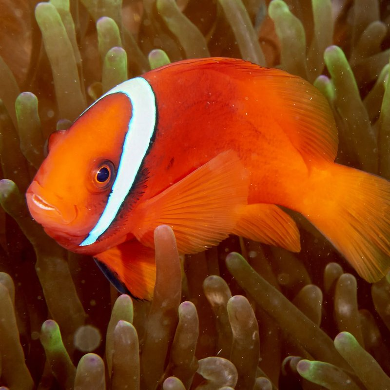

# Pez payaso tomate — *Amphiprion frenatus* Brevoort, 1856

> Archivo generado desde `especies/datos/catalogo_inicial.json` con `especies/herramientas/generar_fichas.py`. No editar a mano.

*Imagen ilustrativa generada con IA por Brayan (2026-11-18). No es una fotografía de un ejemplar real; puede contener errores anatómicos.*

**Grupo:** pez  
**Otros nombres:** Tomato clownfish, Bridled clownfish, Red clownfish  
**Fecha de consulta:** 2026-11-18  
**Confianza global:** media  
**Estado:** verificada; pendiente de revisión del equipo

## Ficha AIRI

| Campo | Valor |
|---|---|
| Nombre común | Pez payaso tomate |
| Nombre científico | *Amphiprion frenatus* |
| Temperamento | Semiagresivo |
| Comportamiento | Territorial. Resistente y fácil, pero territorial y más agresivo con la edad. Suele vivir en una anémona burbuja. |
| Adecuado para arrecife | Sí. LiveAquaria lo considera compatible con arrecife. |
| Tipo de alimentación | Omnívoro: alimentos cárneos, preparados para herbívoros. |
| Temperatura | 22.2–25.6 °C |
| Litraje recomendado | 113.6 L (30 gal EE. UU.). *Es el mínimo recomendado por una sola fuente comercial; ninguna fuente científica consultada establece un litraje.* |
| Tamaño adulto | 14 cm (longitud total). Al venderse mide 1.9–10.2 cm (juvenil o subadulto). *Diferencia menor entre fuentes: FishBase 14 cm; LiveAquaria 5 in (≈ 12.7 cm) en el medio natural y unas 3.5 in (≈ 8.9 cm) en acuario.* |

## Detalle verificado

| Campo | Dato | Confianza | Fuentes |
|---|---|---|---|
| Clasificación taxonómica | Clase Teleostei; orden Ovalentaria (incertae sedis); familia Pomacentridae. WoRMS AphiaID 278394 (aceptado). Sinónimos: Amphiprion polylepis (Bleeker, 1877), Prochilus polylepis Bleeker, 1877. | alta | [worms_amphiprion_frenatus](https://www.marinespecies.org/aphia.php?p=taxdetails&id=278394), [fishbase_amphiprion_frenatus](https://www.fishbase.se/summary/Amphiprion-frenatus.html) |
| Hábitat natural | Arrecifes de laguna y bahías; asociado a la anémona burbuja (Entacmaea quadricolor) (FishBase). Profundidad: 1–12 m. Distribución: Pacífico occidental: del golfo de Tailandia al suroeste de Palaos, al norte hasta el sur de Japón y al sur hasta Java. | alta | [fishbase_amphiprion_frenatus](https://www.fishbase.se/summary/Amphiprion-frenatus.html) |
| Tamaño adulto | Máx. 14 cm (longitud total). Diferencia menor entre fuentes: FishBase 14 cm; LiveAquaria 5 in (≈ 12.7 cm) en el medio natural y unas 3.5 in (≈ 8.9 cm) en acuario. | media | [fishbase_amphiprion_frenatus](https://www.fishbase.se/summary/Amphiprion-frenatus.html), [liveaquaria_amphiprion_frenatus](https://www.liveaquaria.com/products/tomato-clownfish) |
| Alimentación | Come con voracidad la mayoría de los alimentos cárneos y preparados para herbívoros (LiveAquaria). FishBase no detalla su dieta. | baja | [liveaquaria_amphiprion_frenatus](https://www.liveaquaria.com/products/tomato-clownfish) |
| Temperatura del agua | Acuario: 22.2–25.6 °C (72–78 °F). FishBase no indica rango de temperatura para esta especie. | baja | [liveaquaria_amphiprion_frenatus](https://www.liveaquaria.com/products/tomato-clownfish) |
| Rango de pH | Fuente de acuario: 8.1–8.4. Rango prudente AIRI: 8.1–8.3. Criterio: Intersección con la tabla MSD para agua salada (7.8–8.3). | media | [liveaquaria_amphiprion_frenatus](https://www.liveaquaria.com/products/tomato-clownfish), [msd_tabla_referencia](https://www.msdvetmanual.com/multimedia/table/normal-reference-ranges-for-routine-water-quality-analysis), [msd_capitulo](https://www.msdvetmanual.com/exotic-and-laboratory-animals/aquatic-systems/environmental-diseases-of-aquatic-animals-in-aquatic-systems) |
| Salinidad | 1.020–1.025 de gravedad específica (adimensional). Agua de mar media: 35 ppt (UF/IFAS). No se convierte a ppt porque la equivalencia depende de la temperatura. | media | [liveaquaria_amphiprion_frenatus](https://www.liveaquaria.com/products/tomato-clownfish), [ufifas_ph_sal_temp](https://waterwatch.ifas.ufl.edu/media/waterwatchifasufledu/FactSheet_pH_Sal_Temp.pdf) |
| Volumen mínimo | 113.6 L (30 gal EE. UU.). Justificación: Cifra de LiveAquaria (30 gal). | baja | [liveaquaria_amphiprion_frenatus](https://www.liveaquaria.com/products/tomato-clownfish) |
| Comportamiento | Monógamo y hermafrodita protándrico: nacen machos y el dominante se convierte en hembra. Los machos cuidan y oxigenan los huevos (FishBase). Muy resistente; algo territorial y cada vez más agresivo con los de su especie al crecer (LiveAquaria). | media | [fishbase_amphiprion_frenatus](https://www.fishbase.se/summary/Amphiprion-frenatus.html), [liveaquaria_amphiprion_frenatus](https://www.liveaquaria.com/products/tomato-clownfish) |
| Territorialidad y refugio | Defiende su anémona; sin anémona puede usar un coral como hospedador (LiveAquaria). | media | [liveaquaria_amphiprion_frenatus](https://www.liveaquaria.com/products/tomato-clownfish) |
| Compatibilidad con arrecife | sí (según la fuente; sin verificación independiente) | baja | [liveaquaria_amphiprion_frenatus](https://www.liveaquaria.com/products/tomato-clownfish) |
| Convivencia: condiciones | Anémona hospedadora (opcional). · Compañeros que no se lo puedan comer. | baja | [liveaquaria_amphiprion_frenatus](https://www.liveaquaria.com/products/tomato-clownfish) |
| Convivencia: riesgos | No conviene con peces tímidos o que comen despacio. · Agresivo con los de su especie. | baja | [liveaquaria_amphiprion_frenatus](https://www.liveaquaria.com/products/tomato-clownfish) |
| Conservación | Preocupación menor (LC), evaluada el 16/11/2010, según FishBase. | media | [fishbase_amphiprion_frenatus](https://www.fishbase.se/summary/Amphiprion-frenatus.html) |

**Regla AIRI:** compartir rangos de agua no implica compatibilidad entre especies. Los rangos de acuario provienen de una fuente comercial y no son límites veterinarios.

## Fuentes

- **worms_amphiprion_frenatus** (taxonomía): WoRMS — Amphiprion frenatus Brevoort, 1856 (AphiaID 278394). <https://www.marinespecies.org/aphia.php?p=taxdetails&id=278394>. Consultada el 2026-11-18.
- **fishbase_amphiprion_frenatus** (biología): FishBase — Amphiprion frenatus. <https://www.fishbase.se/summary/Amphiprion-frenatus.html>. Consultada el 2026-11-18.
- **liveaquaria_amphiprion_frenatus** (comercial): LiveAquaria — Tomato Clownfish (Amphiprion frenatus). <https://www.liveaquaria.com/products/tomato-clownfish>. Consultada el 2026-11-18.
- **msd_tabla_referencia** (veterinaria): MSD Veterinary Manual — “Normal” Reference Ranges for Routine Water Quality Analysis. <https://www.msdvetmanual.com/multimedia/table/normal-reference-ranges-for-routine-water-quality-analysis>. Consultada el 2026-11-12. Reutilizada del registro del motor (motor/airi_motor/datos/fuentes.json); no se volvió a consultar para estas fichas.
- **ufifas_ph_sal_temp** (institucional): UF/IFAS — pH, Salinity and Temperature (hoja informativa). <https://waterwatch.ifas.ufl.edu/media/waterwatchifasufledu/FactSheet_pH_Sal_Temp.pdf>. Consultada el 2026-11-12. Reutilizada del registro del motor (motor/airi_motor/datos/fuentes.json); no se volvió a consultar para estas fichas.
- **msd_capitulo** (veterinaria): MSD Veterinary Manual — Environmental Diseases of Aquatic Animals in Aquatic Systems. <https://www.msdvetmanual.com/exotic-and-laboratory-animals/aquatic-systems/environmental-diseases-of-aquatic-animals-in-aquatic-systems>. Consultada el 2026-11-12. Reutilizada del registro del motor (motor/airi_motor/datos/fuentes.json); no se volvió a consultar para estas fichas.
