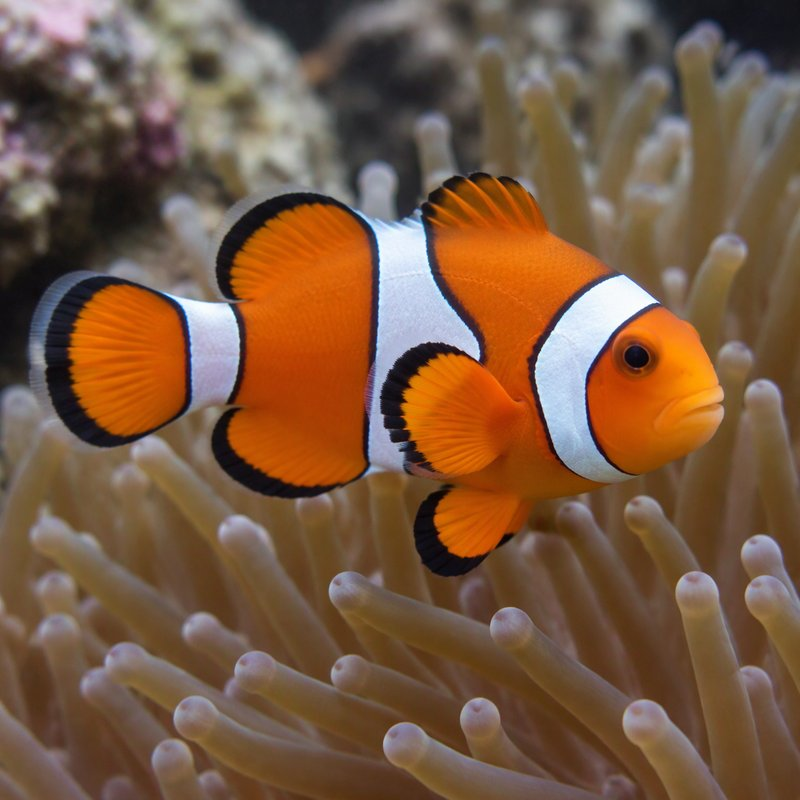

# Pez payaso común — *Amphiprion ocellaris* Cuvier, 1830

> Archivo generado desde `especies/datos/catalogo_inicial.json` con `especies/herramientas/generar_fichas.py`. No editar a mano.

*Imagen ilustrativa generada con IA por Brayan (2026-11-16). No es una fotografía de un ejemplar real; puede contener errores anatómicos.*

**Grupo:** pez  
**Otros nombres:** Clown anemonefish, Ocellaris clownfish  
**Fecha de consulta:** 2026-11-16  
**Confianza global:** media  
**Estado:** verificada; pendiente de revisión del equipo

## Ficha AIRI

| Campo | Valor |
|---|---|
| Nombre común | Pez payaso común |
| Nombre científico | *Amphiprion ocellaris* |
| Temperamento | Pacífico |
| Comportamiento | Pacífico, Territorial. Vive en pareja monógama; la hembra es la más grande. En la naturaleza se refugia en anémonas. Defiende sus huevos frente a otros peces. |
| Adecuado para arrecife | Sí. La única fuente consultada que lo evalúa (LiveAquaria) lo considera compatible con arrecife; no hay verificación independiente. |
| Tipo de alimentación | Omnívoro: alimentos cárnicos (misis, artemia), preparados congelados herbívoros. |
| Temperatura | 22.2–25.6 °C *FishBase no indica rango de temperatura para esta especie; el dato de acuario no tiene corroboración independiente.* |
| Litraje recomendado | 75.7 L (20 gal EE. UU.). *Es el mínimo recomendado por una sola fuente comercial; ninguna fuente científica consultada establece un litraje.* |
| Tamaño adulto | 11 cm (longitud total). Al venderse mide 2.5–10.8 cm (juvenil o subadulto). *LiveAquaria indica 4¼ in (10.8 cm), coherente con FishBase (11 cm).* |

## Detalle verificado

| Campo | Dato | Confianza | Fuentes |
|---|---|---|---|
| Clasificación taxonómica | Clase Teleostei; orden Ovalentaria (incertae sedis); familia Pomacentridae; subfamilia Pomacentrinae. WoRMS AphiaID 278400 (aceptado). Sinónimos: Amphiprion bicolor, Amphiprion melanurus. | alta | [worms_amphiprion_ocellaris](https://www.marinespecies.org/aphia.php?p=taxdetails&id=278400), [fishbase_amphiprion_ocellaris](https://www.fishbase.se/summary/Amphiprion-ocellaris.html) |
| Hábitat natural | Arrecifes coralinos del Indo-Pacífico occidental, en lagunas someras y tranquilas, entre los tentáculos de anémonas grandes (Heteractis magnifica, Stichodactyla gigantea, S. mertensii). Marino, asociado a arrecifes, no migratorio. Profundidad: 1–15 m. Distribución: Océano Índico oriental (Andamán y Nicobar, Tailandia, Malasia, noroeste de Australia) hasta Singapur, Indonesia y Filipinas; al norte hasta Taiwán y las islas Ryukyu. | media | [fishbase_amphiprion_ocellaris](https://www.fishbase.se/summary/Amphiprion-ocellaris.html) |
| Tamaño adulto | Máx. 11 cm (longitud total). LiveAquaria: 4¼ in (≈ 10.8 cm). | alta | [fishbase_amphiprion_ocellaris](https://www.fishbase.se/summary/Amphiprion-ocellaris.html), [liveaquaria_amphiprion_ocellaris](https://www.liveaquaria.com/products/ocellaris-clownfish) |
| Alimentación | Omnívoro. En acuario acepta la mayoría de alimentos cárnicos y preparados congelados herbívoros. FishBase no describe la dieta natural en su resumen (solo nivel trófico 3.1). | baja | [liveaquaria_amphiprion_ocellaris](https://www.liveaquaria.com/products/ocellaris-clownfish), [fishbase_amphiprion_ocellaris](https://www.fishbase.se/summary/Amphiprion-ocellaris.html) |
| Temperatura del agua | Acuario: 22.2–25.6 °C (72–78 °F). FishBase no indica rango de temperatura para esta especie; el dato de acuario no tiene corroboración independiente. | baja | [liveaquaria_amphiprion_ocellaris](https://www.liveaquaria.com/products/ocellaris-clownfish) |
| Rango de pH | Fuente de acuario: 8.1–8.4. Rango prudente AIRI: 8.1–8.3. Criterio: Intersección con la tabla MSD para agua salada (7.8–8.3). | media | [liveaquaria_amphiprion_ocellaris](https://www.liveaquaria.com/products/ocellaris-clownfish), [msd_tabla_referencia](https://www.msdvetmanual.com/multimedia/table/normal-reference-ranges-for-routine-water-quality-analysis), [msd_capitulo](https://www.msdvetmanual.com/exotic-and-laboratory-animals/aquatic-systems/environmental-diseases-of-aquatic-animals-in-aquatic-systems) |
| Salinidad | 1.020–1.025 de gravedad específica (adimensional). Agua de mar media: 35 ppt (UF/IFAS). No se convierte a ppt porque la equivalencia depende de la temperatura. | media | [liveaquaria_amphiprion_ocellaris](https://www.liveaquaria.com/products/ocellaris-clownfish), [ufifas_ph_sal_temp](https://waterwatch.ifas.ufl.edu/media/waterwatchifasufledu/FactSheet_pH_Sal_Temp.pdf) |
| Volumen mínimo | 75.7 L (20 gal EE. UU.). Justificación: Cifra de LiveAquaria. Es coherente con un pez pequeño (hasta 11 cm), de nado poco amplio, que en la naturaleza permanece junto a su anémona y vive en pareja. | baja | [liveaquaria_amphiprion_ocellaris](https://www.liveaquaria.com/products/ocellaris-clownfish), [fishbase_amphiprion_ocellaris](https://www.fishbase.se/summary/Amphiprion-ocellaris.html) |
| Comportamiento | Hermafrodita protándrico: la pareja es monógama y la hembra es la de mayor tamaño. Ovíparo: pone huevos adheridos al sustrato que el macho cuida y oxigena. Según LiveAquaria es pacífico y resistente, y se reproduce con facilidad en acuario. Se ha registrado que alcanzó 12 años en cautiverio. | media | [fishbase_amphiprion_ocellaris](https://www.fishbase.se/summary/Amphiprion-ocellaris.html), [liveaquaria_amphiprion_ocellaris](https://www.liveaquaria.com/products/ocellaris-clownfish) |
| Territorialidad y refugio | En la naturaleza usa anémonas como refugio. En acuario la pareja defiende la puesta frente a otros peces. Las fuentes consultadas no establecen si una anémona es imprescindible en cautiverio. | media | [fishbase_amphiprion_ocellaris](https://www.fishbase.se/summary/Amphiprion-ocellaris.html), [liveaquaria_amphiprion_ocellaris](https://www.liveaquaria.com/products/ocellaris-clownfish) |
| Compatibilidad con arrecife | sí (según la fuente; sin verificación independiente) | baja | [liveaquaria_amphiprion_ocellaris](https://www.liveaquaria.com/products/ocellaris-clownfish) |
| Convivencia: condiciones | Puede mantenerse con otros peces payaso si se introducen en el acuario al mismo tiempo. | baja | [liveaquaria_amphiprion_ocellaris](https://www.liveaquaria.com/products/ocellaris-clownfish) |
| Convivencia: riesgos | Defiende los huevos frente a otros habitantes del acuario. | baja | [liveaquaria_amphiprion_ocellaris](https://www.liveaquaria.com/products/ocellaris-clownfish) |
| Conservación | Preocupación menor (LC), evaluada el 03/02/2021, según FishBase. | media | [fishbase_amphiprion_ocellaris](https://www.fishbase.se/summary/Amphiprion-ocellaris.html) |

**Regla AIRI:** compartir rangos de agua no implica compatibilidad entre especies. Los rangos de acuario provienen de una fuente comercial y no son límites veterinarios.

## Fuentes

- **worms_amphiprion_ocellaris** (taxonomía): WoRMS — Amphiprion ocellaris Cuvier, 1830 (AphiaID 278400). <https://www.marinespecies.org/aphia.php?p=taxdetails&id=278400>. Consultada el 2026-11-16.
- **fishbase_amphiprion_ocellaris** (biología): FishBase — Amphiprion ocellaris, Clown anemonefish. <https://www.fishbase.se/summary/Amphiprion-ocellaris.html>. Consultada el 2026-11-16.
- **liveaquaria_amphiprion_ocellaris** (comercial): LiveAquaria — Ocellaris Clownfish. <https://www.liveaquaria.com/products/ocellaris-clownfish>. Consultada el 2026-11-16.
- **msd_tabla_referencia** (veterinaria): MSD Veterinary Manual — “Normal” Reference Ranges for Routine Water Quality Analysis. <https://www.msdvetmanual.com/multimedia/table/normal-reference-ranges-for-routine-water-quality-analysis>. Consultada el 2026-11-12. Reutilizada del registro del motor (motor/airi_motor/datos/fuentes.json); no se volvió a consultar para estas fichas.
- **ufifas_ph_sal_temp** (institucional): UF/IFAS — pH, Salinity and Temperature (hoja informativa). <https://waterwatch.ifas.ufl.edu/media/waterwatchifasufledu/FactSheet_pH_Sal_Temp.pdf>. Consultada el 2026-11-12. Reutilizada del registro del motor (motor/airi_motor/datos/fuentes.json); no se volvió a consultar para estas fichas.
- **msd_capitulo** (veterinaria): MSD Veterinary Manual — Environmental Diseases of Aquatic Animals in Aquatic Systems. <https://www.msdvetmanual.com/exotic-and-laboratory-animals/aquatic-systems/environmental-diseases-of-aquatic-animals-in-aquatic-systems>. Consultada el 2026-11-12. Reutilizada del registro del motor (motor/airi_motor/datos/fuentes.json); no se volvió a consultar para estas fichas.
