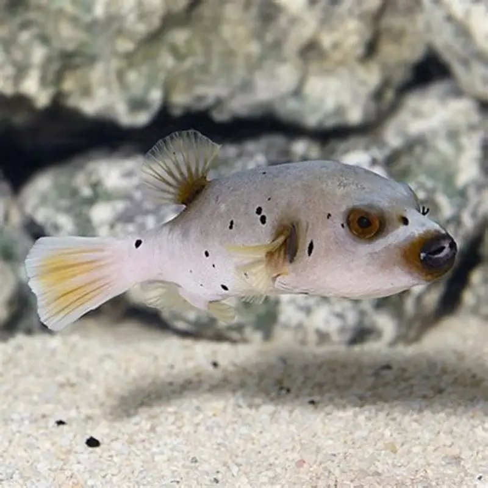

# Pez globo cara de perro — *Arothron nigropunctatus* (Bloch & Schneider, 1801)

> Archivo generado desde `especies/datos/catalogo_inicial.json` con `especies/herramientas/generar_fichas.py`. No editar a mano.

*Imagen ilustrativa generada con IA por Brayan (2026-11-18). No es una fotografía de un ejemplar real; puede contener errores anatómicos.*

**Grupo:** pez  
**Otros nombres:** Dogface puffer, Blackspotted puffer  
**Fecha de consulta:** 2026-11-18  
**Confianza global:** media  
**Estado:** verificada; pendiente de revisión del equipo

## Ficha AIRI

| Campo | Valor |
|---|---|
| Nombre común | Pez globo cara de perro |
| Nombre científico | *Arothron nigropunctatus* |
| Temperamento | Semiagresivo |
| Comportamiento | . Semiagresivo y con mucha personalidad. Se come los invertebrados, así que no es apto para arrecife. Necesita alimentos duros para desgastar sus dientes. |
| Adecuado para arrecife | No. LiveAquaria lo desaconseja: se come los invertebrados del arrecife. |
| Tipo de alimentación | Carnívoro: corales e invertebrados, calamar y kril, almejas, camarón con concha. *FishBase incluye algas en su dieta natural; LiveAquaria lo clasifica como carnívoro.* |
| Temperatura | 22.2–25.6 °C |
| Litraje recomendado | 567.8 L (150 gal EE. UU.). *Es el mínimo recomendado por una sola fuente comercial; ninguna fuente científica consultada establece un litraje.* |
| Tamaño adulto | 33 cm (longitud total). Al venderse mide 3.8–25.4 cm (juvenil o subadulto). *FishBase 33 cm y LiveAquaria 13 in (≈ 33 cm) coinciden.* |

## Detalle verificado

| Campo | Dato | Confianza | Fuentes |
|---|---|---|---|
| Clasificación taxonómica | Clase Teleostei; orden Tetraodontiformes; familia Tetraodontidae. WoRMS AphiaID 219921 (aceptado). Sinónimos: Tetraodon nigropunctatus Bloch & Schneider, 1801 (combinación original), Arothron citrinellus (Günther, 1870). | alta | [worms_arothron_nigropunctatus](https://www.marinespecies.org/aphia.php?p=taxdetails&id=219921), [fishbase_arothron_nigropunctatus](https://www.fishbase.se/summary/Arothron-nigropunctatus.html) |
| Hábitat natural | Arrecifes costeros, crestas y pendientes externas con abundantes invertebrados. A veces solitario; los adultos suelen ir en pareja (FishBase). Profundidad: 0–60 m. Distribución: Indo-Pacífico: de África oriental a Micronesia y Samoa, al norte hasta el sur de Japón y al sur hasta Nueva Gales del Sur. En el mar Rojo lo sustituye Arothron diadematus. | alta | [fishbase_arothron_nigropunctatus](https://www.fishbase.se/summary/Arothron-nigropunctatus.html) |
| Tamaño adulto | Máx. 33 cm (longitud total). FishBase 33 cm y LiveAquaria 13 in (≈ 33 cm) coinciden. | alta | [fishbase_arothron_nigropunctatus](https://www.fishbase.se/summary/Arothron-nigropunctatus.html), [liveaquaria_arothron_nigropunctatus](https://www.liveaquaria.com/products/arothron-dog-face-puffer) |
| Alimentación | Come corales (sobre todo puntas de Acropora), crustáceos, moluscos, esponjas, tunicados y algas (FishBase). En acuario: alimentos cárneos variados como calamar, kril, almejas y camarón con concha, que le ayudan a desgastar sus dientes de crecimiento continuo (LiveAquaria). | alta | [fishbase_arothron_nigropunctatus](https://www.fishbase.se/summary/Arothron-nigropunctatus.html), [liveaquaria_arothron_nigropunctatus](https://www.liveaquaria.com/products/arothron-dog-face-puffer) |
| Temperatura del agua | Acuario: 22.2–25.6 °C (72–78 °F). FishBase no indica rango de temperatura para esta especie. | baja | [liveaquaria_arothron_nigropunctatus](https://www.liveaquaria.com/products/arothron-dog-face-puffer) |
| Rango de pH | Fuente de acuario: 8.1–8.4. Rango prudente AIRI: 8.1–8.3. Criterio: Intersección con la tabla MSD para agua salada (7.8–8.3). | media | [liveaquaria_arothron_nigropunctatus](https://www.liveaquaria.com/products/arothron-dog-face-puffer), [msd_tabla_referencia](https://www.msdvetmanual.com/multimedia/table/normal-reference-ranges-for-routine-water-quality-analysis), [msd_capitulo](https://www.msdvetmanual.com/exotic-and-laboratory-animals/aquatic-systems/environmental-diseases-of-aquatic-animals-in-aquatic-systems) |
| Salinidad | 1.020–1.025 de gravedad específica (adimensional). Agua de mar media: 35 ppt (UF/IFAS). No se convierte a ppt porque la equivalencia depende de la temperatura. | media | [liveaquaria_arothron_nigropunctatus](https://www.liveaquaria.com/products/arothron-dog-face-puffer), [ufifas_ph_sal_temp](https://waterwatch.ifas.ufl.edu/media/waterwatchifasufledu/FactSheet_pH_Sal_Temp.pdf) |
| Volumen mínimo | 567.8 L (150 gal EE. UU.). Justificación: Cifra de los datos rápidos de LiveAquaria (150 gal); su descripción menciona 100 gal o más para un acuario solo de peces. | baja | [liveaquaria_arothron_nigropunctatus](https://www.liveaquaria.com/products/arothron-dog-face-puffer) |
| Comportamiento | A veces solitario; los adultos suelen ir en pareja (FishBase). Tímido al principio; tolera a otros peces globo que no sean más agresivos que él. Se asusta con la red: conviene moverlo con un recipiente (LiveAquaria). | media | [fishbase_arothron_nigropunctatus](https://www.fishbase.se/summary/Arothron-nigropunctatus.html), [liveaquaria_arothron_nigropunctatus](https://www.liveaquaria.com/products/arothron-dog-face-puffer) |
| Territorialidad y refugio | Tímido al principio; necesita un acuario amplio solo de peces (LiveAquaria). | media | [liveaquaria_arothron_nigropunctatus](https://www.liveaquaria.com/products/arothron-dog-face-puffer) |
| Compatibilidad con arrecife | no (según la fuente; sin verificación independiente) | baja | [liveaquaria_arothron_nigropunctatus](https://www.liveaquaria.com/products/arothron-dog-face-puffer) |
| Convivencia: condiciones | Acuario solo de peces. · Alimentos con concha para desgastar los dientes. · Moverlo con un recipiente, no con red. | baja | [liveaquaria_arothron_nigropunctatus](https://www.liveaquaria.com/products/arothron-dog-face-puffer), [fishbase_arothron_nigropunctatus](https://www.fishbase.se/summary/Arothron-nigropunctatus.html) |
| Convivencia: riesgos | Se come corales e invertebrados. · Su carne es venenosa si se ingiere (FishBase). | baja | [liveaquaria_arothron_nigropunctatus](https://www.liveaquaria.com/products/arothron-dog-face-puffer), [fishbase_arothron_nigropunctatus](https://www.fishbase.se/summary/Arothron-nigropunctatus.html) |
| Conservación | Preocupación menor (LC), evaluada el 07/06/2011, según FishBase. | media | [fishbase_arothron_nigropunctatus](https://www.fishbase.se/summary/Arothron-nigropunctatus.html) |

**Regla AIRI:** compartir rangos de agua no implica compatibilidad entre especies. Los rangos de acuario provienen de una fuente comercial y no son límites veterinarios.

## Fuentes

- **worms_arothron_nigropunctatus** (taxonomía): WoRMS — Arothron nigropunctatus (Bloch & Schneider, 1801) (AphiaID 219921). <https://www.marinespecies.org/aphia.php?p=taxdetails&id=219921>. Consultada el 2026-11-18.
- **fishbase_arothron_nigropunctatus** (biología): FishBase — Arothron nigropunctatus. <https://www.fishbase.se/summary/Arothron-nigropunctatus.html>. Consultada el 2026-11-18.
- **liveaquaria_arothron_nigropunctatus** (comercial): LiveAquaria — Arothron Dog Face Puffer (Arothron nigropunctatus). <https://www.liveaquaria.com/products/arothron-dog-face-puffer>. Consultada el 2026-11-18.
- **msd_tabla_referencia** (veterinaria): MSD Veterinary Manual — “Normal” Reference Ranges for Routine Water Quality Analysis. <https://www.msdvetmanual.com/multimedia/table/normal-reference-ranges-for-routine-water-quality-analysis>. Consultada el 2026-11-12. Reutilizada del registro del motor (motor/airi_motor/datos/fuentes.json); no se volvió a consultar para estas fichas.
- **ufifas_ph_sal_temp** (institucional): UF/IFAS — pH, Salinity and Temperature (hoja informativa). <https://waterwatch.ifas.ufl.edu/media/waterwatchifasufledu/FactSheet_pH_Sal_Temp.pdf>. Consultada el 2026-11-12. Reutilizada del registro del motor (motor/airi_motor/datos/fuentes.json); no se volvió a consultar para estas fichas.
- **msd_capitulo** (veterinaria): MSD Veterinary Manual — Environmental Diseases of Aquatic Animals in Aquatic Systems. <https://www.msdvetmanual.com/exotic-and-laboratory-animals/aquatic-systems/environmental-diseases-of-aquatic-animals-in-aquatic-systems>. Consultada el 2026-11-12. Reutilizada del registro del motor (motor/airi_motor/datos/fuentes.json); no se volvió a consultar para estas fichas.
