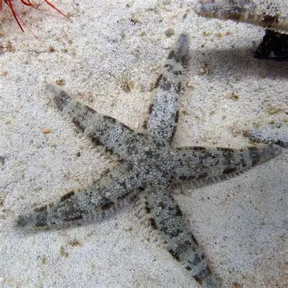

# Estrella arenera — *Astropecten polyacanthus* Müller & Troschel, 1842

> Archivo generado desde `especies/datos/catalogo_inicial.json` con `especies/herramientas/generar_fichas.py`. No editar a mano.

*Imagen ilustrativa generada con IA por Brayan (2026-11-16). No es una fotografía de un ejemplar real; puede contener errores anatómicos.*

**Grupo:** estrella de mar  
**Otros nombres:** Sand sifting sea star, Brown spotted combstar  
**Fecha de consulta:** 2026-11-16  
**Confianza global:** media  
**Estado:** verificada; pendiente de revisión del equipo

## Ficha AIRI

| Campo | Valor |
|---|---|
| Nombre común | Estrella arenera |
| Nombre científico | *Astropecten polyacanthus* |
| Temperamento | Pacífico |
| Comportamiento | Pacífico. Nocturna y pacífica con los peces. Se entierra y remueve la arena. Se come invertebrados pequeños y puede morir de hambre en acuarios con poca fauna. |
| Adecuado para arrecife | Con precaución. Los datos rápidos de LiveAquaria dicen que es apta, pero su descripción advierte que come camarones, erizos, moluscos, bivalvos y estrellas pequeñas. |
| Tipo de alimentación | Carnívoro: bivalvos y caracoles enterrados, invertebrados pequeños, detritos y restos de comida. *LiveAquaria la llama omnívora en su descripción y carnívora en sus datos rápidos; SeaLifeBase describe una dieta animal.* |
| Temperatura | 22.2–25.6 °C |
| Litraje recomendado | null (no verificado). *Ninguna fuente consultada publica un litraje mínimo para esta especie; se deja en null en lugar de estimarlo.* |
| Tamaño adulto | 12 cm (diámetro). Al venderse mide 2.5–6.3 cm (juvenil o subadulto). *Diferencia entre fuentes: SeaLifeBase 12 cm de diámetro; LiveAquaria 8 in (≈ 20.3 cm).* |

## Detalle verificado

| Campo | Dato | Confianza | Fuentes |
|---|---|---|---|
| Clasificación taxonómica | Clase Asteroidea; orden Paxillosida; familia Astropectinidae. WoRMS AphiaID 213245 (aceptado). Sinónimos: Astropecten hystrix Müller & Troschel, 1842, Astropecten samoensis Perrier, 1869. LiveAquaria escribe «polycanthus» y, por error, indica la familia Hippolytidae en sus datos rápidos; WoRMS y SeaLifeBase la sitúan en Astropectinidae. | alta | [worms_astropecten_polyacanthus](https://www.marinespecies.org/aphia.php?p=taxdetails&id=213245), [sealifebase_astropecten_polyacanthus](https://www.sealifebase.se/summary/Astropecten-polyacanthus.html) |
| Hábitat natural | Fondos de arena: de día permanece enterrada y de noche sale a alimentarse sobre la arena. Profundidad: 0–222 m (habitual 0–185 m (WoRMS)). Distribución: Atlántico sudoriental y todo el Indo-Pacífico tropical, del Mar Rojo y Sudáfrica a Hawái. | media | [sealifebase_astropecten_polyacanthus](https://www.sealifebase.se/summary/Astropecten-polyacanthus.html) |
| Tamaño adulto | Máx. 12 cm (diámetro). Diferencia entre fuentes: SeaLifeBase 12 cm de diámetro; LiveAquaria 8 in (≈ 20.3 cm). | baja | [sealifebase_astropecten_polyacanthus](https://www.sealifebase.se/summary/Astropecten-polyacanthus.html), [liveaquaria_astropecten_polyacanthus](https://www.liveaquaria.com/products/sand-sifting-sea-star) |
| Alimentación | Carnívora: come sobre todo bivalvos, caracoles y otros invertebrados pequeños enterrados en la arena (SeaLifeBase). En acuario consume detritos y restos de comida, pero también camarones, erizos, moluscos y estrellas pequeñas; debe alimentarse activamente o morirá de hambre (LiveAquaria). | alta | [sealifebase_astropecten_polyacanthus](https://www.sealifebase.se/summary/Astropecten-polyacanthus.html), [liveaquaria_astropecten_polyacanthus](https://www.liveaquaria.com/products/sand-sifting-sea-star) |
| Temperatura del agua | Acuario: 22.2–25.6 °C (72–78 °F). SeaLifeBase no indica rango de temperatura para esta especie. | baja | [liveaquaria_astropecten_polyacanthus](https://www.liveaquaria.com/products/sand-sifting-sea-star) |
| Rango de pH | Fuente de acuario: 8.1–8.4. Rango prudente AIRI: 8.1–8.3. Criterio: Intersección con la tabla MSD para agua salada (7.8–8.3). | media | [liveaquaria_astropecten_polyacanthus](https://www.liveaquaria.com/products/sand-sifting-sea-star), [msd_tabla_referencia](https://www.msdvetmanual.com/multimedia/table/normal-reference-ranges-for-routine-water-quality-analysis), [msd_capitulo](https://www.msdvetmanual.com/exotic-and-laboratory-animals/aquatic-systems/environmental-diseases-of-aquatic-animals-in-aquatic-systems) |
| Salinidad | 1.023–1.025 de gravedad específica (adimensional). Agua de mar media: 35 ppt (UF/IFAS). No se convierte a ppt porque la equivalencia depende de la temperatura. | media | [liveaquaria_astropecten_polyacanthus](https://www.liveaquaria.com/products/sand-sifting-sea-star), [ufifas_ph_sal_temp](https://waterwatch.ifas.ufl.edu/media/waterwatchifasufledu/FactSheet_pH_Sal_Temp.pdf) |
| Volumen mínimo | null (no verificado). Justificación: Ninguna fuente consultada publica un litraje mínimo para esta especie; se deja en null en lugar de estimarlo. | baja | [liveaquaria_astropecten_polyacanthus](https://www.liveaquaria.com/products/sand-sifting-sea-star) |
| Comportamiento | Nocturna: se entierra y remueve grandes cantidades de arena buscando alimento. Pacífica con los peces, pero se come invertebrados pequeños (SeaLifeBase y LiveAquaria). | media | [sealifebase_astropecten_polyacanthus](https://www.sealifebase.se/summary/Astropecten-polyacanthus.html), [liveaquaria_astropecten_polyacanthus](https://www.liveaquaria.com/products/sand-sifting-sea-star) |
| Territorialidad y refugio | No territorial. Necesita un lecho de arena grande y profundo, de varias pulgadas. | media | [liveaquaria_astropecten_polyacanthus](https://www.liveaquaria.com/products/sand-sifting-sea-star), [sealifebase_astropecten_polyacanthus](https://www.sealifebase.se/summary/Astropecten-polyacanthus.html) |
| Compatibilidad con arrecife | con precaución (según la fuente; sin verificación independiente) | baja | [liveaquaria_astropecten_polyacanthus](https://www.liveaquaria.com/products/sand-sifting-sea-star) |
| Convivencia: condiciones | Lecho de arena grande y profundo. · Alimentación activa además de lo que encuentre en la arena. · Sin peces globo ni otros depredadores. | baja | [liveaquaria_astropecten_polyacanthus](https://www.liveaquaria.com/products/sand-sifting-sea-star), [sealifebase_astropecten_polyacanthus](https://www.sealifebase.se/summary/Astropecten-polyacanthus.html) |
| Convivencia: riesgos | Se come invertebrados pequeños (camarones, erizos, moluscos, estrellas pequeñas). · Puede morir de hambre y descomponerse en la arena. · No tolera medicamentos con cobre ni cambios bruscos de salinidad, pH u oxígeno; requiere aclimatación por goteo. | baja | [liveaquaria_astropecten_polyacanthus](https://www.liveaquaria.com/products/sand-sifting-sea-star), [sealifebase_astropecten_polyacanthus](https://www.sealifebase.se/summary/Astropecten-polyacanthus.html) |
| Conservación | No evaluada por la UICN, según SeaLifeBase. | media | [sealifebase_astropecten_polyacanthus](https://www.sealifebase.se/summary/Astropecten-polyacanthus.html) |

**Regla AIRI:** compartir rangos de agua no implica compatibilidad entre especies. Los rangos de acuario provienen de una fuente comercial y no son límites veterinarios.

## Fuentes

- **worms_astropecten_polyacanthus** (taxonomía): WoRMS — Astropecten polyacanthus Müller & Troschel, 1842 (AphiaID 213245). <https://www.marinespecies.org/aphia.php?p=taxdetails&id=213245>. Consultada el 2026-11-16.
- **sealifebase_astropecten_polyacanthus** (biología): SeaLifeBase — Astropecten polyacanthus. <https://www.sealifebase.se/summary/Astropecten-polyacanthus.html>. Consultada el 2026-11-16.
- **liveaquaria_astropecten_polyacanthus** (comercial): LiveAquaria — Sand Sifting Sea Star. <https://www.liveaquaria.com/products/sand-sifting-sea-star>. Consultada el 2026-11-16.
- **msd_tabla_referencia** (veterinaria): MSD Veterinary Manual — “Normal” Reference Ranges for Routine Water Quality Analysis. <https://www.msdvetmanual.com/multimedia/table/normal-reference-ranges-for-routine-water-quality-analysis>. Consultada el 2026-11-12. Reutilizada del registro del motor (motor/airi_motor/datos/fuentes.json); no se volvió a consultar para estas fichas.
- **ufifas_ph_sal_temp** (institucional): UF/IFAS — pH, Salinity and Temperature (hoja informativa). <https://waterwatch.ifas.ufl.edu/media/waterwatchifasufledu/FactSheet_pH_Sal_Temp.pdf>. Consultada el 2026-11-12. Reutilizada del registro del motor (motor/airi_motor/datos/fuentes.json); no se volvió a consultar para estas fichas.
- **msd_capitulo** (veterinaria): MSD Veterinary Manual — Environmental Diseases of Aquatic Animals in Aquatic Systems. <https://www.msdvetmanual.com/exotic-and-laboratory-animals/aquatic-systems/environmental-diseases-of-aquatic-animals-in-aquatic-systems>. Consultada el 2026-11-12. Reutilizada del registro del motor (motor/airi_motor/datos/fuentes.json); no se volvió a consultar para estas fichas.
