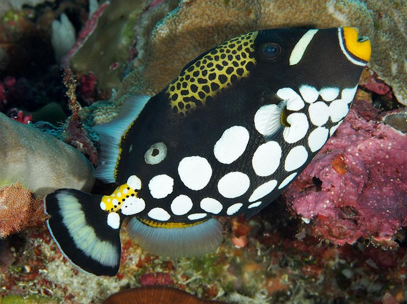

# Pez ballesta payaso — *Balistoides conspicillum* (Bloch & Schneider, 1801)

> Archivo generado desde `especies/datos/catalogo_inicial.json` con `especies/herramientas/generar_fichas.py`. No editar a mano.

*Imagen ilustrativa generada con IA por Brayan (2026-11-16). No es una fotografía de un ejemplar real; puede contener errores anatómicos.*

**Grupo:** pez  
**Otros nombres:** Clown triggerfish  
**Fecha de consulta:** 2026-11-16  
**Confianza global:** media  
**Estado:** verificada; pendiente de revisión del equipo

## Ficha AIRI

| Campo | Valor |
|---|---|
| Nombre común | Pez ballesta payaso |
| Nombre científico | *Balistoides conspicillum* |
| Temperamento | Agresivo |
| Comportamiento | Solitario, Territorial. Muy agresivo y solitario. Solo con peces grandes y agresivos. Reorganiza la decoración. |
| Adecuado para arrecife | No. LiveAquaria no lo considera apto para arrecife: come invertebrados. |
| Tipo de alimentación | Carnívoro: erizos y cangrejos, moluscos y tunicados, calamar, krill y almejas. |
| Temperatura | 22.2–25.6 °C |
| Litraje recomendado | 1135.5 L (300 gal EE. UU.). *Es el mínimo recomendado por una sola fuente comercial; ninguna fuente científica consultada establece un litraje.* |
| Tamaño adulto | 50 cm (longitud total). Al venderse mide 1.3–22.9 cm (juvenil o subadulto). *LiveAquaria indica 20 in (≈ 50.8 cm), coherente con FishBase.* |

## Detalle verificado

| Campo | Dato | Confianza | Fuentes |
|---|---|---|---|
| Clasificación taxonómica | Clase Teleostei; orden Tetraodontiformes; familia Balistidae. WoRMS AphiaID 219876 (aceptado). Sinónimos: Balistes conspicillum Bloch & Schneider, 1801 (combinación original), Balistapus conspicillum. | alta | [worms_balistoides_conspicillum](https://www.marinespecies.org/aphia.php?p=taxdetails&id=219876), [fishbase_balistoides_conspicillum](https://www.fishbase.se/summary/Balistoides-conspicillum.html) |
| Hábitat natural | Arrecifes de aguas claras, costeros a externos, sobre todo junto a caídas profundas. Solitario y poco común. Los juveniles se esconden en cuevas pequeñas. Profundidad: 1–75 m. Distribución: Indo-Pacífico, de África oriental por el norte de Australia a Samoa; al norte hasta el sur de Japón. | media | [fishbase_balistoides_conspicillum](https://www.fishbase.se/summary/Balistoides-conspicillum.html) |
| Tamaño adulto | Máx. 50 cm (longitud total). LiveAquaria indica 20 in (≈ 50.8 cm), coherente con FishBase. | alta | [fishbase_balistoides_conspicillum](https://www.fishbase.se/summary/Balistoides-conspicillum.html), [liveaquaria_balistoides_conspicillum](https://www.liveaquaria.com/products/clown-triggerfish) |
| Alimentación | Carnívoro: come erizos, cangrejos y otros crustáceos, moluscos y tunicados (FishBase). En acuario, calamar, krill, almejas, peces pequeños y camarones de caparazón duro para desgastar sus dientes (LiveAquaria). | alta | [fishbase_balistoides_conspicillum](https://www.fishbase.se/summary/Balistoides-conspicillum.html), [liveaquaria_balistoides_conspicillum](https://www.liveaquaria.com/products/clown-triggerfish) |
| Temperatura del agua | Acuario: 22.2–25.6 °C (72–78 °F). FishBase no indica rango de temperatura para esta especie. | baja | [liveaquaria_balistoides_conspicillum](https://www.liveaquaria.com/products/clown-triggerfish) |
| Rango de pH | Fuente de acuario: 8.1–8.4. Rango prudente AIRI: 8.1–8.3. Criterio: Intersección con la tabla MSD para agua salada (7.8–8.3). | media | [liveaquaria_balistoides_conspicillum](https://www.liveaquaria.com/products/clown-triggerfish), [msd_tabla_referencia](https://www.msdvetmanual.com/multimedia/table/normal-reference-ranges-for-routine-water-quality-analysis), [msd_capitulo](https://www.msdvetmanual.com/exotic-and-laboratory-animals/aquatic-systems/environmental-diseases-of-aquatic-animals-in-aquatic-systems) |
| Salinidad | 1.020–1.025 de gravedad específica (adimensional). Agua de mar media: 35 ppt (UF/IFAS). No se convierte a ppt porque la equivalencia depende de la temperatura. | media | [liveaquaria_balistoides_conspicillum](https://www.liveaquaria.com/products/clown-triggerfish), [ufifas_ph_sal_temp](https://waterwatch.ifas.ufl.edu/media/waterwatchifasufledu/FactSheet_pH_Sal_Temp.pdf) |
| Volumen mínimo | 1135.5 L (300 gal EE. UU.). Justificación: Cifra de LiveAquaria (300 gal): es un pez grande (50 cm) y uno de los más agresivos que se mantienen en acuario. | baja | [liveaquaria_balistoides_conspicillum](https://www.liveaquaria.com/products/clown-triggerfish) |
| Comportamiento | Solitario (FishBase). Uno de los habitantes de acuario más agresivos; sus compañeros deben ser peces grandes y agresivos. Reorganiza la decoración (LiveAquaria). | media | [fishbase_balistoides_conspicillum](https://www.fishbase.se/summary/Balistoides-conspicillum.html), [liveaquaria_balistoides_conspicillum](https://www.liveaquaria.com/products/clown-triggerfish) |
| Territorialidad y refugio | Solitario; se refugia en cuevas. | media | [liveaquaria_balistoides_conspicillum](https://www.liveaquaria.com/products/clown-triggerfish), [fishbase_balistoides_conspicillum](https://www.fishbase.se/summary/Balistoides-conspicillum.html) |
| Compatibilidad con arrecife | no (según la fuente; sin verificación independiente) | baja | [liveaquaria_balistoides_conspicillum](https://www.liveaquaria.com/products/clown-triggerfish) |
| Convivencia: condiciones | Acuario muy grande. · Solo peces grandes y agresivos. | baja | [liveaquaria_balistoides_conspicillum](https://www.liveaquaria.com/products/clown-triggerfish), [fishbase_balistoides_conspicillum](https://www.fishbase.se/summary/Balistoides-conspicillum.html) |
| Convivencia: riesgos | Ataca a peces más pequeños o pacíficos. · Come invertebrados. · FishBase registra casos de intoxicación por ciguatera al consumirlo. | baja | [liveaquaria_balistoides_conspicillum](https://www.liveaquaria.com/products/clown-triggerfish), [fishbase_balistoides_conspicillum](https://www.fishbase.se/summary/Balistoides-conspicillum.html) |
| Conservación | Preocupación menor (LC), evaluada el 11/01/2022, según FishBase. | media | [fishbase_balistoides_conspicillum](https://www.fishbase.se/summary/Balistoides-conspicillum.html) |

**Regla AIRI:** compartir rangos de agua no implica compatibilidad entre especies. Los rangos de acuario provienen de una fuente comercial y no son límites veterinarios.

## Fuentes

- **worms_balistoides_conspicillum** (taxonomía): WoRMS — Balistoides conspicillum (Bloch & Schneider, 1801) (AphiaID 219876). <https://www.marinespecies.org/aphia.php?p=taxdetails&id=219876>. Consultada el 2026-11-16.
- **fishbase_balistoides_conspicillum** (biología): FishBase — Balistoides conspicillum. <https://www.fishbase.se/summary/Balistoides-conspicillum.html>. Consultada el 2026-11-16.
- **liveaquaria_balistoides_conspicillum** (comercial): LiveAquaria — Clown Triggerfish. <https://www.liveaquaria.com/products/clown-triggerfish>. Consultada el 2026-11-16.
- **msd_tabla_referencia** (veterinaria): MSD Veterinary Manual — “Normal” Reference Ranges for Routine Water Quality Analysis. <https://www.msdvetmanual.com/multimedia/table/normal-reference-ranges-for-routine-water-quality-analysis>. Consultada el 2026-11-12. Reutilizada del registro del motor (motor/airi_motor/datos/fuentes.json); no se volvió a consultar para estas fichas.
- **ufifas_ph_sal_temp** (institucional): UF/IFAS — pH, Salinity and Temperature (hoja informativa). <https://waterwatch.ifas.ufl.edu/media/waterwatchifasufledu/FactSheet_pH_Sal_Temp.pdf>. Consultada el 2026-11-12. Reutilizada del registro del motor (motor/airi_motor/datos/fuentes.json); no se volvió a consultar para estas fichas.
- **msd_capitulo** (veterinaria): MSD Veterinary Manual — Environmental Diseases of Aquatic Animals in Aquatic Systems. <https://www.msdvetmanual.com/exotic-and-laboratory-animals/aquatic-systems/environmental-diseases-of-aquatic-animals-in-aquatic-systems>. Consultada el 2026-11-12. Reutilizada del registro del motor (motor/airi_motor/datos/fuentes.json); no se volvió a consultar para estas fichas.
