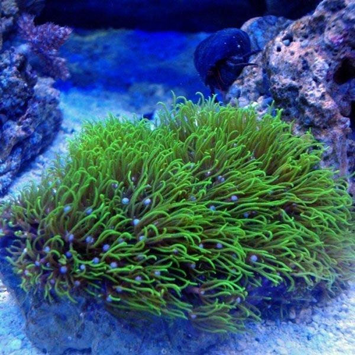

# Pólipo estrella verde — *Briareum violaceum* (Quoy & Gaimard, 1833)

> Archivo generado desde `especies/datos/catalogo_inicial.json` con `especies/herramientas/generar_fichas.py`. No editar a mano.

*Imagen ilustrativa generada con IA por Brayan (2026-11-16). No es una fotografía de un ejemplar real; puede contener errores anatómicos.*

**Grupo:** coral  
**Otros nombres:** Green star polyps (GSP), Starburst polyp, Pachyclavularia violacea (sinónimo)  
**Fecha de consulta:** 2026-11-16  
**Confianza global:** baja  
**Estado:** verificada; pendiente de revisión del equipo

## Ficha AIRI

| Campo | Valor |
|---|---|
| Nombre común | Pólipo estrella verde |
| Nombre científico | *Briareum violaceum* |
| Temperamento | Pacífico |
| Comportamiento | Pacífico. Coral blando pacífico y fácil. Crece muy rápido cubriendo roca, otros corales y el vidrio. Retrae sus pólipos al sentirse amenazado. |
| Adecuado para arrecife | Sí. Es un coral de arrecife apto para principiantes; conviene controlar su crecimiento porque cubre roca y otros corales (LiveAquaria). |
| Tipo de alimentación | Fotosintético: luz (zooxantelas simbióticas), yodo y oligoelementos. |
| Temperatura | 22.2–25.6 °C |
| Litraje recomendado | 113.6 L (30 gal EE. UU.). *Es el mínimo de una sola fuente comercial. La página de Saltwaterfish no indica la especie exacta del pólipo estrella.* |
| Tamaño adulto | null (no verificado). *Ninguna fuente indica un tamaño máximo: es una colonia que crece cubriendo la superficie disponible.* |

## Detalle verificado

| Campo | Dato | Confianza | Fuentes |
|---|---|---|---|
| Clasificación taxonómica | Clase Octocorallia; orden Scleralcyonacea; familia Briareidae. WoRMS AphiaID 517640 (aceptado). Sinónimos: Clavularia violacea Quoy & Gaimard, 1833 (combinación original), Pachyclavularia violacea (combinación reemplazada). WoRMS acepta Briareum violaceum; Pachyclavularia violacea es una combinación reemplazada. LiveAquaria vende los pólipos estrella verdes como Briareum sp. (antes llamados Clavularia viridis), sin indicar la especie, así que sus datos de acuario no son específicos de B. violaceum. | alta | [worms_briareum_violaceum](https://www.marinespecies.org/aphia.php?p=taxdetails&id=517640), [sealifebase_briareum_violaceum](https://www.sealifebase.se/summary/Briareum-violaceum.html) |
| Hábitat natural | Bentónico (SeaLifeBase). LiveAquaria lo describe como coral colonial e incrustante, con pólipos de ocho tentáculos sobre una base común. Profundidad: 0–31 m. Distribución: Indo-Pacífico occidental. | media | [sealifebase_briareum_violaceum](https://www.sealifebase.se/summary/Briareum-violaceum.html) |
| Tamaño adulto | null (no verificado). Ninguna fuente indica un tamaño máximo: es una colonia que crece cubriendo la superficie disponible. | baja | [sealifebase_briareum_violaceum](https://www.sealifebase.se/summary/Briareum-violaceum.html) |
| Alimentación | Fotosintético: alberga algas simbióticas (zooxantelas) que le dan alimento. Necesita luz moderada a alta y aportes de yodo y otros oligoelementos (LiveAquaria). | baja | [liveaquaria_briareum_violaceum](https://www.liveaquaria.com/products/metallic-green-starburst-polyp) |
| Temperatura del agua | Acuario: 22.2–25.6 °C (72–78 °F). SeaLifeBase no indica rango de temperatura para esta especie. | baja | [liveaquaria_briareum_violaceum](https://www.liveaquaria.com/products/metallic-green-starburst-polyp) |
| Rango de pH | Fuente de acuario: 8.1–8.4. Rango prudente AIRI: 8.1–8.3. Criterio: Intersección con la tabla MSD para agua salada (7.8–8.3). | media | [liveaquaria_briareum_violaceum](https://www.liveaquaria.com/products/metallic-green-starburst-polyp), [msd_tabla_referencia](https://www.msdvetmanual.com/multimedia/table/normal-reference-ranges-for-routine-water-quality-analysis), [msd_capitulo](https://www.msdvetmanual.com/exotic-and-laboratory-animals/aquatic-systems/environmental-diseases-of-aquatic-animals-in-aquatic-systems) |
| Salinidad | 1.020–1.025 de gravedad específica (adimensional). Agua de mar media: 35 ppt (UF/IFAS). No se convierte a ppt porque la equivalencia depende de la temperatura. | media | [liveaquaria_briareum_violaceum](https://www.liveaquaria.com/products/metallic-green-starburst-polyp), [ufifas_ph_sal_temp](https://waterwatch.ifas.ufl.edu/media/waterwatchifasufledu/FactSheet_pH_Sal_Temp.pdf) |
| Volumen mínimo | 113.6 L (30 gal EE. UU.). Justificación: Cifra de Saltwaterfish («Minimum Tank Size: 30 Gallons»). LiveAquaria y las fuentes científicas consultadas no publican un litraje para esta especie. | baja | [saltwaterfish_briareum_violaceum](https://www.saltwaterfish.com/product-star-polyp-starburst-green-62148) |
| Comportamiento | Coral pacífico y fácil de mantener. Crece rápido cubriendo roca, corales y hasta el vidrio. No daña a los corales cercanos, pero los corales agresivos sí pueden dañarlo. Retrae sus pólipos para defenderse (LiveAquaria). | media | [sealifebase_briareum_violaceum](https://www.sealifebase.se/summary/Briareum-violaceum.html), [liveaquaria_briareum_violaceum](https://www.liveaquaria.com/products/metallic-green-starburst-polyp) |
| Territorialidad y refugio | No territorial, pero invade el espacio de otros corales al crecer. | media | [liveaquaria_briareum_violaceum](https://www.liveaquaria.com/products/metallic-green-starburst-polyp), [sealifebase_briareum_violaceum](https://www.sealifebase.se/summary/Briareum-violaceum.html) |
| Compatibilidad con arrecife | sí (según la fuente; sin verificación independiente) | baja | [liveaquaria_briareum_violaceum](https://www.liveaquaria.com/products/metallic-green-starburst-polyp) |
| Convivencia: condiciones | Luz moderada a alta. · Corriente media a fuerte. · Yodo y oligoelementos. | baja | [liveaquaria_briareum_violaceum](https://www.liveaquaria.com/products/metallic-green-starburst-polyp), [sealifebase_briareum_violaceum](https://www.sealifebase.se/summary/Briareum-violaceum.html) |
| Convivencia: riesgos | Crece sobre otros corales y la roca si no se controla. · Los corales agresivos pueden dañarlo. | baja | [liveaquaria_briareum_violaceum](https://www.liveaquaria.com/products/metallic-green-starburst-polyp), [sealifebase_briareum_violaceum](https://www.sealifebase.se/summary/Briareum-violaceum.html) |
| Conservación | No evaluado por la UICN, según SeaLifeBase. | media | [sealifebase_briareum_violaceum](https://www.sealifebase.se/summary/Briareum-violaceum.html) |

**Regla AIRI:** compartir rangos de agua no implica compatibilidad entre especies. Los rangos de acuario provienen de una fuente comercial y no son límites veterinarios.

## Fuentes

- **worms_briareum_violaceum** (taxonomía): WoRMS — Briareum violaceum (Quoy & Gaimard, 1833) (AphiaID 517640). <https://www.marinespecies.org/aphia.php?p=taxdetails&id=517640>. Consultada el 2026-11-16.
- **sealifebase_briareum_violaceum** (biología): SeaLifeBase — Briareum violaceum. <https://www.sealifebase.se/summary/Briareum-violaceum.html>. Consultada el 2026-11-16.
- **liveaquaria_briareum_violaceum** (comercial): LiveAquaria — Metallic Green Starburst Polyp (Briareum sp.). <https://www.liveaquaria.com/products/metallic-green-starburst-polyp>. Consultada el 2026-11-16.
- **msd_tabla_referencia** (veterinaria): MSD Veterinary Manual — “Normal” Reference Ranges for Routine Water Quality Analysis. <https://www.msdvetmanual.com/multimedia/table/normal-reference-ranges-for-routine-water-quality-analysis>. Consultada el 2026-11-12. Reutilizada del registro del motor (motor/airi_motor/datos/fuentes.json); no se volvió a consultar para estas fichas.
- **ufifas_ph_sal_temp** (institucional): UF/IFAS — pH, Salinity and Temperature (hoja informativa). <https://waterwatch.ifas.ufl.edu/media/waterwatchifasufledu/FactSheet_pH_Sal_Temp.pdf>. Consultada el 2026-11-12. Reutilizada del registro del motor (motor/airi_motor/datos/fuentes.json); no se volvió a consultar para estas fichas.
- **saltwaterfish_briareum_violaceum** (comercial): Saltwaterfish — Star Polyp: Starburst Green. <https://www.saltwaterfish.com/product-star-polyp-starburst-green-62148>. Consultada el 2026-11-16.
- **msd_capitulo** (veterinaria): MSD Veterinary Manual — Environmental Diseases of Aquatic Animals in Aquatic Systems. <https://www.msdvetmanual.com/exotic-and-laboratory-animals/aquatic-systems/environmental-diseases-of-aquatic-animals-in-aquatic-systems>. Consultada el 2026-11-12. Reutilizada del registro del motor (motor/airi_motor/datos/fuentes.json); no se volvió a consultar para estas fichas.
