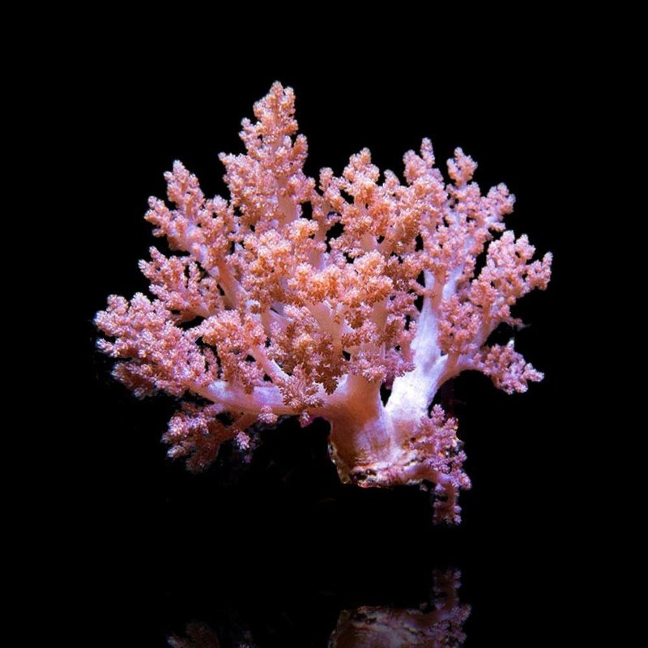

# Árbol de Kenia — *Capnella sp.* Gray, 1869 (género)

> Archivo generado desde `especies/datos/catalogo_inicial.json` con `especies/herramientas/generar_fichas.py`. No editar a mano.

*Imagen ilustrativa generada con IA por Brayan (2026-11-16). No es una fotografía de un ejemplar real; puede contener errores anatómicos.*

**Grupo:** coral  
**Otros nombres:** Kenya tree coral, Cauliflower soft coral  
**Fecha de consulta:** 2026-11-16  
**Confianza global:** baja  
**Estado:** verificada; pendiente de revisión del equipo

## Ficha AIRI

| Campo | Valor |
|---|---|
| Nombre común | Árbol de Kenia |
| Nombre científico | *Capnella sp.* |
| Temperamento | Semiagresivo *LiveAquaria lo clasifica como semiagresivo; Saltwaterfish, como pacífico.* |
| Comportamiento | Pacífico. Coral blando resistente, ideal para principiantes. Crece rápido; hay que dejarle espacio respecto a otros corales. |
| Adecuado para arrecife | Sí. Es un coral de arrecife; Saltwaterfish lo marca como apto. Conviene dejarle espacio porque crece con vigor (LiveAquaria). |
| Tipo de alimentación | Filtrador: partículas en suspensión, luz moderada a alta, estroncio, calcio, yodo y magnesio. |
| Temperatura | 22.2–25.6 °C *Rango de LiveAquaria.* |
| Litraje recomendado | 189.2 L (50 gal EE. UU.). *Es el mínimo de una sola fuente comercial.* |
| Tamaño adulto | null (no verificado). *Ninguna fuente indica un tamaño máximo; crece con vigor una vez establecido.* |

## Detalle verificado

| Campo | Dato | Confianza | Fuentes |
|---|---|---|---|
| Clasificación taxonómica | Clase Octocorallia; orden Malacalcyonacea; familia Capnellidae. WoRMS AphiaID 146763 (aceptado). Ficha a nivel de género: LiveAquaria y Saltwaterfish venden el árbol de Kenia como Capnella sp., sin indicar especie; WoRMS acepta 20 especies en el género. LiveAquaria lo sitúa en la familia Nephtheidae; WoRMS lo coloca en Capnellidae. | alta | [worms_capnella_sp](https://www.marinespecies.org/aphia.php?p=taxdetails&id=146763) |
| Hábitat natural | WoRMS no describe el hábitat del género. LiveAquaria lo presenta como un coral blando arborescente, resistente y de crecimiento vigoroso. Profundidad: no indicada. Distribución: No indicada para el género en las fuentes consultadas. | baja | [liveaquaria_capnella_sp](https://www.liveaquaria.com/products/kenya-tree-coral) |
| Tamaño adulto | null (no verificado). Ninguna fuente indica un tamaño máximo; crece con vigor una vez establecido. | baja | [liveaquaria_capnella_sp](https://www.liveaquaria.com/products/kenya-tree-coral) |
| Alimentación | Saltwaterfish lo clasifica como filtrador. LiveAquaria pide luz moderada a alta y aportes de estroncio, calcio, oligoelementos, yodo y magnesio. | baja | [saltwaterfish_capnella_sp](https://www.saltwaterfish.com/product-kenya-tree-coral-east-asia), [liveaquaria_capnella_sp](https://www.liveaquaria.com/products/kenya-tree-coral) |
| Temperatura del agua | Acuario: 22.2–25.6 °C (72–78 °F). Ninguna fuente científica consultada indica rango de temperatura para este taxón. | baja | [liveaquaria_capnella_sp](https://www.liveaquaria.com/products/kenya-tree-coral) |
| Rango de pH | Fuente de acuario: 8.1–8.4. Rango prudente AIRI: 8.1–8.3. Criterio: Intersección con la tabla MSD para agua salada (7.8–8.3). | media | [liveaquaria_capnella_sp](https://www.liveaquaria.com/products/kenya-tree-coral), [msd_tabla_referencia](https://www.msdvetmanual.com/multimedia/table/normal-reference-ranges-for-routine-water-quality-analysis), [msd_capitulo](https://www.msdvetmanual.com/exotic-and-laboratory-animals/aquatic-systems/environmental-diseases-of-aquatic-animals-in-aquatic-systems) |
| Salinidad | 1.023–1.025 de gravedad específica (adimensional). Agua de mar media: 35 ppt (UF/IFAS). No se convierte a ppt porque la equivalencia depende de la temperatura. | media | [liveaquaria_capnella_sp](https://www.liveaquaria.com/products/kenya-tree-coral), [ufifas_ph_sal_temp](https://waterwatch.ifas.ufl.edu/media/waterwatchifasufledu/FactSheet_pH_Sal_Temp.pdf) |
| Volumen mínimo | 189.2 L (50 gal EE. UU.). Justificación: Cifra de Saltwaterfish («Minimum Tank Size: 50 Gallons»). | baja | [saltwaterfish_capnella_sp](https://www.saltwaterfish.com/product-kenya-tree-coral-east-asia) |
| Comportamiento | Coral blando resistente que tolera condiciones no ideales; muy recomendado para principiantes. LiveAquaria lo clasifica como semiagresivo y pide dejar espacio con otros corales; algunas variedades producen sustancias nocivas, aunque normalmente no se considera una amenaza para los corales duros. | media | [liveaquaria_capnella_sp](https://www.liveaquaria.com/products/kenya-tree-coral) |
| Territorialidad y refugio | Necesita espacio libre a su alrededor. | media | [liveaquaria_capnella_sp](https://www.liveaquaria.com/products/kenya-tree-coral) |
| Compatibilidad con arrecife | sí (según la fuente; sin verificación independiente) | baja | [saltwaterfish_capnella_sp](https://www.saltwaterfish.com/product-kenya-tree-coral-east-asia), [liveaquaria_capnella_sp](https://www.liveaquaria.com/products/kenya-tree-coral) |
| Convivencia: condiciones | Luz moderada a alta. · Corriente media a fuerte. · Espacio respecto a otros corales. | baja | [liveaquaria_capnella_sp](https://www.liveaquaria.com/products/kenya-tree-coral) |
| Convivencia: riesgos | Algunas variedades producen sustancias nocivas para otros corales (LiveAquaria). | baja | [liveaquaria_capnella_sp](https://www.liveaquaria.com/products/kenya-tree-coral) |
| Conservación | No aplica (ficha de género). | media | [worms_capnella_sp](https://www.marinespecies.org/aphia.php?p=taxdetails&id=146763) |

**Regla AIRI:** compartir rangos de agua no implica compatibilidad entre especies. Los rangos de acuario provienen de una fuente comercial y no son límites veterinarios.

## Fuentes

- **worms_capnella_sp** (taxonomía): WoRMS — Capnella Gray, 1869 (género) (AphiaID 146763). <https://www.marinespecies.org/aphia.php?p=taxdetails&id=146763>. Consultada el 2026-11-16.
- **liveaquaria_capnella_sp** (comercial): LiveAquaria — Kenya Tree Coral (Capnella sp.). <https://www.liveaquaria.com/products/kenya-tree-coral>. Consultada el 2026-11-16.
- **saltwaterfish_capnella_sp** (comercial): Saltwaterfish — Kenya Tree Coral: Mini. <https://www.saltwaterfish.com/product-kenya-tree-coral-east-asia>. Consultada el 2026-11-16.
- **msd_tabla_referencia** (veterinaria): MSD Veterinary Manual — “Normal” Reference Ranges for Routine Water Quality Analysis. <https://www.msdvetmanual.com/multimedia/table/normal-reference-ranges-for-routine-water-quality-analysis>. Consultada el 2026-11-12. Reutilizada del registro del motor (motor/airi_motor/datos/fuentes.json); no se volvió a consultar para estas fichas.
- **ufifas_ph_sal_temp** (institucional): UF/IFAS — pH, Salinity and Temperature (hoja informativa). <https://waterwatch.ifas.ufl.edu/media/waterwatchifasufledu/FactSheet_pH_Sal_Temp.pdf>. Consultada el 2026-11-12. Reutilizada del registro del motor (motor/airi_motor/datos/fuentes.json); no se volvió a consultar para estas fichas.
- **msd_capitulo** (veterinaria): MSD Veterinary Manual — Environmental Diseases of Aquatic Animals in Aquatic Systems. <https://www.msdvetmanual.com/exotic-and-laboratory-animals/aquatic-systems/environmental-diseases-of-aquatic-animals-in-aquatic-systems>. Consultada el 2026-11-12. Reutilizada del registro del motor (motor/airi_motor/datos/fuentes.json); no se volvió a consultar para estas fichas.
