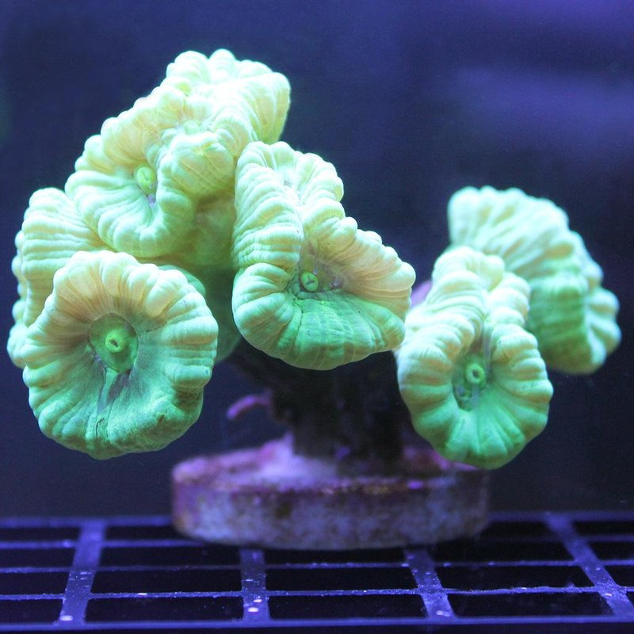

# Coral candy cane — *Caulastraea furcata* Dana, 1846

> Archivo generado desde `especies/datos/catalogo_inicial.json` con `especies/herramientas/generar_fichas.py`. No editar a mano.

*Imagen ilustrativa generada con IA por Brayan (2026-11-16). No es una fotografía de un ejemplar real; puede contener errores anatómicos.*

**Grupo:** coral  
**Otros nombres:** Candy cane coral, Trumpet coral, Torch coral (SeaLifeBase)  
**Fecha de consulta:** 2026-11-16  
**Confianza global:** media  
**Estado:** verificada; pendiente de revisión del equipo

## Ficha AIRI

| Campo | Valor |
|---|---|
| Nombre común | Coral candy cane |
| Nombre científico | *Caulastraea furcata* |
| Temperamento | Pacífico |
| Comportamiento | Pacífico. Coral duro resistente y pacífico, con tentáculos barredores muy cortos. |
| Adecuado para arrecife | Sí. Coral de arrecife; Saltwaterfish lo marca como apto. |
| Tipo de alimentación | Fotosintético: luz (zooxantelas), artemia o microplancton semanal, calcio y estroncio. |
| Temperatura | 22.2–25.6 °C *Rango de LiveAquaria.* |
| Litraje recomendado | 189.2 L (50 gal EE. UU.). *Es el mínimo de una sola fuente comercial.* |
| Tamaño adulto | null (no verificado). *SeaLifeBase no indica tamaño máximo de la colonia; sus coralitos miden menos de 19 mm de diámetro.* |

## Detalle verificado

| Campo | Dato | Confianza | Fuentes |
|---|---|---|---|
| Clasificación taxonómica | Clase Anthozoa (Hexacorallia); orden Scleractinia; familia Merulinidae. WoRMS AphiaID 289577 (aceptado). Sinónimos: Caulastraea distorta Dana, 1846, Caulastrea furcata (grafía incorrecta). Es un coral duro de pólipo grande (LPS). LiveAquaria escribe «Caulastrea» y lo sitúa en Faviidae; WoRMS usa Caulastraea y la familia Merulinidae. | alta | [worms_caulastraea_furcata](https://www.marinespecies.org/aphia.php?p=taxdetails&id=289577), [sealifebase_caulastraea_furcata](https://www.sealifebase.se/summary/Caulastraea-furcata.html) |
| Hábitat natural | Pendientes arrecifales protegidas con sustrato parcialmente arenoso, y lagunas (SeaLifeBase). Profundidad: 0–40 m. Distribución: Indo-Pacífico: de Somalia y Madagascar a Samoa; al norte hasta Ryukyu; al sur hasta Nueva Caledonia. | media | [sealifebase_caulastraea_furcata](https://www.sealifebase.se/summary/Caulastraea-furcata.html) |
| Tamaño adulto | null (no verificado). SeaLifeBase no indica tamaño máximo de la colonia; sus coralitos miden menos de 19 mm de diámetro. | baja | [liveaquaria_caulastraea_furcata](https://www.liveaquaria.com/products/candy-cane-coral-indonesia) |
| Alimentación | Zooxantelado (WoRMS): obtiene alimento de sus algas simbióticas. LiveAquaria recomienda alimento adicional semanal (artemia o microplancton) y aportes de calcio, estroncio y oligoelementos. | media | [worms_caulastraea_furcata](https://www.marinespecies.org/aphia.php?p=taxdetails&id=289577), [liveaquaria_caulastraea_furcata](https://www.liveaquaria.com/products/candy-cane-coral-indonesia) |
| Temperatura del agua | Acuario: 22.2–25.6 °C (72–78 °F). Ninguna fuente científica consultada indica rango de temperatura para este taxón. | baja | [liveaquaria_caulastraea_furcata](https://www.liveaquaria.com/products/candy-cane-coral-indonesia) |
| Rango de pH | Fuente de acuario: 8.1–8.4. Rango prudente AIRI: 8.1–8.3. Criterio: Intersección con la tabla MSD para agua salada (7.8–8.3). | media | [liveaquaria_caulastraea_furcata](https://www.liveaquaria.com/products/candy-cane-coral-indonesia), [msd_tabla_referencia](https://www.msdvetmanual.com/multimedia/table/normal-reference-ranges-for-routine-water-quality-analysis), [msd_capitulo](https://www.msdvetmanual.com/exotic-and-laboratory-animals/aquatic-systems/environmental-diseases-of-aquatic-animals-in-aquatic-systems) |
| Salinidad | 1.023–1.025 de gravedad específica (adimensional). Agua de mar media: 35 ppt (UF/IFAS). No se convierte a ppt porque la equivalencia depende de la temperatura. | media | [liveaquaria_caulastraea_furcata](https://www.liveaquaria.com/products/candy-cane-coral-indonesia), [ufifas_ph_sal_temp](https://waterwatch.ifas.ufl.edu/media/waterwatchifasufledu/FactSheet_pH_Sal_Temp.pdf) |
| Volumen mínimo | 189.2 L (50 gal EE. UU.). Justificación: Cifra de Saltwaterfish («Minimum Tank Size: 50 Gallons»). | baja | [saltwaterfish_caulastraea_furcata](https://www.saltwaterfish.com/product-trumpet-candy-cane-coral-fiji-63295) |
| Comportamiento | Resistente y relativamente pacífico, con tentáculos barredores muy cortos (LiveAquaria). | media | [liveaquaria_caulastraea_furcata](https://www.liveaquaria.com/products/candy-cane-coral-indonesia) |
| Territorialidad y refugio | Tentáculos barredores muy cortos: casi no daña a corales vecinos. | media | [liveaquaria_caulastraea_furcata](https://www.liveaquaria.com/products/candy-cane-coral-indonesia) |
| Compatibilidad con arrecife | sí (según la fuente; sin verificación independiente) | baja | [saltwaterfish_caulastraea_furcata](https://www.saltwaterfish.com/product-trumpet-candy-cane-coral-fiji-63295) |
| Convivencia: condiciones | Luz moderada. · Corriente media. · Calcio, estroncio y oligoelementos. | baja | [liveaquaria_caulastraea_furcata](https://www.liveaquaria.com/products/candy-cane-coral-indonesia) |
| Convivencia: riesgos | Las fuentes consultadas no indican riesgos específicos de convivencia. | baja | [liveaquaria_caulastraea_furcata](https://www.liveaquaria.com/products/candy-cane-coral-indonesia) |
| Conservación | Preocupación menor (LC), evaluada el 24/10/2023, según SeaLifeBase. Incluido en el Apéndice II de CITES (SeaLifeBase): su comercio internacional está regulado. | media | [sealifebase_caulastraea_furcata](https://www.sealifebase.se/summary/Caulastraea-furcata.html) |

**Regla AIRI:** compartir rangos de agua no implica compatibilidad entre especies. Los rangos de acuario provienen de una fuente comercial y no son límites veterinarios.

## Fuentes

- **worms_caulastraea_furcata** (taxonomía): WoRMS — Caulastraea furcata Dana, 1846 (AphiaID 289577). <https://www.marinespecies.org/aphia.php?p=taxdetails&id=289577>. Consultada el 2026-11-16.
- **sealifebase_caulastraea_furcata** (biología): SeaLifeBase — Caulastraea furcata. <https://www.sealifebase.se/summary/Caulastraea-furcata.html>. Consultada el 2026-11-16.
- **liveaquaria_caulastraea_furcata** (comercial): LiveAquaria — Candy Cane Coral, Indonesia (Caulastrea furcata). <https://www.liveaquaria.com/products/candy-cane-coral-indonesia>. Consultada el 2026-11-16.
- **saltwaterfish_caulastraea_furcata** (comercial): Saltwaterfish — Trumpet Candy Cane Coral - Fiji. <https://www.saltwaterfish.com/product-trumpet-candy-cane-coral-fiji-63295>. Consultada el 2026-11-16.
- **msd_tabla_referencia** (veterinaria): MSD Veterinary Manual — “Normal” Reference Ranges for Routine Water Quality Analysis. <https://www.msdvetmanual.com/multimedia/table/normal-reference-ranges-for-routine-water-quality-analysis>. Consultada el 2026-11-12. Reutilizada del registro del motor (motor/airi_motor/datos/fuentes.json); no se volvió a consultar para estas fichas.
- **ufifas_ph_sal_temp** (institucional): UF/IFAS — pH, Salinity and Temperature (hoja informativa). <https://waterwatch.ifas.ufl.edu/media/waterwatchifasufledu/FactSheet_pH_Sal_Temp.pdf>. Consultada el 2026-11-12. Reutilizada del registro del motor (motor/airi_motor/datos/fuentes.json); no se volvió a consultar para estas fichas.
- **msd_capitulo** (veterinaria): MSD Veterinary Manual — Environmental Diseases of Aquatic Animals in Aquatic Systems. <https://www.msdvetmanual.com/exotic-and-laboratory-animals/aquatic-systems/environmental-diseases-of-aquatic-animals-in-aquatic-systems>. Consultada el 2026-11-12. Reutilizada del registro del motor (motor/airi_motor/datos/fuentes.json); no se volvió a consultar para estas fichas.
