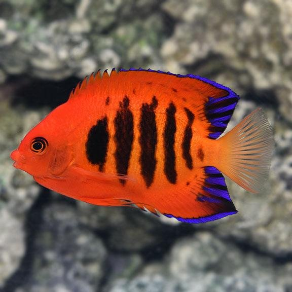

# Ángel llama — *Centropyge loriculus* (Günther, 1874)

> Archivo generado desde `especies/datos/catalogo_inicial.json` con `especies/herramientas/generar_fichas.py`. No editar a mano.

*Imagen ilustrativa generada con IA por Brayan (2026-11-16). No es una fotografía de un ejemplar real; puede contener errores anatómicos.*

**Grupo:** pez  
**Otros nombres:** Flame angelfish, Centropyge loricula (nombre comercial)  
**Fecha de consulta:** 2026-11-16  
**Confianza global:** media  
**Estado:** verificada; pendiente de revisión del equipo

## Ficha AIRI

| Campo | Valor |
|---|---|
| Nombre común | Ángel llama |
| Nombre científico | *Centropyge loriculus* |
| Temperamento | Semiagresivo |
| Comportamiento | Sociable. Semiagresivo; conviene que sea el último pez en entrar al acuario. Vive en harenes en la naturaleza. Muy sensible al cobre. |
| Adecuado para arrecife | Con precaución. LiveAquaria advierte que suele picar corales duros y blandos, invertebrados sésiles y el manto de las almejas. |
| Tipo de alimentación | Omnívoro: algas y espirulina, preparados para peces ángel, misis y camarón congelado. *Diferencia entre fuentes: FishBase describe una dieta de algas; LiveAquaria lo clasifica como omnívoro.* |
| Temperatura | 22.2–25.6 °C |
| Litraje recomendado | 264.9 L (70 gal EE. UU.). *Es el mínimo recomendado por una sola fuente comercial; ninguna fuente científica consultada establece un litraje.* |
| Tamaño adulto | 15 cm (longitud total). *Diferencia entre fuentes: FishBase 15 cm; LiveAquaria 4 in (≈ 10.2 cm).* |

## Detalle verificado

| Campo | Dato | Confianza | Fuentes |
|---|---|---|---|
| Clasificación taxonómica | Clase Teleostei; orden Chaetodontiformes (WoRMS); familia Pomacanthidae. WoRMS AphiaID 402161 (aceptado). Sinónimos: Holacanthus loriculus Günther, 1874 (combinación original), Centropyge loricula (grafía no aceptada, muy usada en el comercio), Centropyge flammeus. El nombre aceptado es Centropyge loriculus; «loricula», que usa LiveAquaria, no es aceptado por WoRMS. El orden varía: Chaetodontiformes (WoRMS) y Acanthuriformes (FishBase). | alta | [worms_centropyge_loriculus](https://www.marinespecies.org/aphia.php?p=taxdetails&id=402161), [fishbase_centropyge_loriculus](https://www.fishbase.se/summary/Centropyge-loricula.html) |
| Hábitat natural | Lagunas claras y arrecifes externos, desde la zona baja de rompiente hasta 57 m. Es reservado y se mantiene cerca de refugio. Vive en harenes de 3 a 7 individuos. Profundidad: 0–60 m. Distribución: Océano Pacífico, principalmente en aguas tropicales. | media | [fishbase_centropyge_loriculus](https://www.fishbase.se/summary/Centropyge-loricula.html) |
| Tamaño adulto | Máx. 15 cm (longitud total). Diferencia entre fuentes: FishBase 15 cm; LiveAquaria 4 in (≈ 10.2 cm). | media | [fishbase_centropyge_loriculus](https://www.fishbase.se/summary/Centropyge-loricula.html), [liveaquaria_centropyge_loriculus](https://www.liveaquaria.com/products/flame-angelfish) |
| Alimentación | FishBase indica que se alimenta de algas. En acuario, LiveAquaria lo clasifica como omnívoro: espirulina, algas marinas, preparados para peces ángel, misis o camarón congelado y otros alimentos cárnicos. | media | [fishbase_centropyge_loriculus](https://www.fishbase.se/summary/Centropyge-loricula.html), [liveaquaria_centropyge_loriculus](https://www.liveaquaria.com/products/flame-angelfish) |
| Temperatura del agua | Acuario: 22.2–25.6 °C (72–78 °F). FishBase no indica rango de temperatura para esta especie. | baja | [liveaquaria_centropyge_loriculus](https://www.liveaquaria.com/products/flame-angelfish) |
| Rango de pH | Fuente de acuario: 8.1–8.4. Rango prudente AIRI: 8.1–8.3. Criterio: Intersección con la tabla MSD para agua salada (7.8–8.3). | media | [liveaquaria_centropyge_loriculus](https://www.liveaquaria.com/products/flame-angelfish), [msd_tabla_referencia](https://www.msdvetmanual.com/multimedia/table/normal-reference-ranges-for-routine-water-quality-analysis), [msd_capitulo](https://www.msdvetmanual.com/exotic-and-laboratory-animals/aquatic-systems/environmental-diseases-of-aquatic-animals-in-aquatic-systems) |
| Salinidad | 1.020–1.025 de gravedad específica (adimensional). Agua de mar media: 35 ppt (UF/IFAS). No se convierte a ppt porque la equivalencia depende de la temperatura. | media | [liveaquaria_centropyge_loriculus](https://www.liveaquaria.com/products/flame-angelfish), [ufifas_ph_sal_temp](https://waterwatch.ifas.ufl.edu/media/waterwatchifasufledu/FactSheet_pH_Sal_Temp.pdf) |
| Volumen mínimo | 264.9 L (70 gal EE. UU.). Justificación: Cifra de LiveAquaria (70 gal), con muchos escondites y roca viva donde pastar. | baja | [liveaquaria_centropyge_loriculus](https://www.liveaquaria.com/products/flame-angelfish) |
| Comportamiento | Reservado y cercano al refugio; vive en harenes (FishBase). Hermafrodita. Si se añade a una comunidad pacífica, debe ser el último pez en introducirse; es muy sensible al cobre (no debe exponerse a niveles cercanos a 0.15 ppm) (LiveAquaria). | media | [fishbase_centropyge_loriculus](https://www.fishbase.se/summary/Centropyge-loricula.html), [liveaquaria_centropyge_loriculus](https://www.liveaquaria.com/products/flame-angelfish) |
| Territorialidad y refugio | Necesita muchos escondites. Mejor con peces de géneros distintos al suyo. | media | [liveaquaria_centropyge_loriculus](https://www.liveaquaria.com/products/flame-angelfish), [fishbase_centropyge_loriculus](https://www.fishbase.se/summary/Centropyge-loricula.html) |
| Compatibilidad con arrecife | con precaución (según la fuente; sin verificación independiente) | baja | [liveaquaria_centropyge_loriculus](https://www.liveaquaria.com/products/flame-angelfish) |
| Convivencia: condiciones | Acuario establecido con roca viva. · Último pez en introducirse. · Peces de géneros distintos. | baja | [liveaquaria_centropyge_loriculus](https://www.liveaquaria.com/products/flame-angelfish), [fishbase_centropyge_loriculus](https://www.fishbase.se/summary/Centropyge-loricula.html) |
| Convivencia: riesgos | Pica corales, invertebrados sésiles y mantos de almejas. · Muy sensible al cobre (≈ 0.15 ppm). | baja | [liveaquaria_centropyge_loriculus](https://www.liveaquaria.com/products/flame-angelfish), [fishbase_centropyge_loriculus](https://www.fishbase.se/summary/Centropyge-loricula.html) |
| Conservación | Preocupación menor (LC), evaluada el 09/10/2009, según FishBase. | media | [fishbase_centropyge_loriculus](https://www.fishbase.se/summary/Centropyge-loricula.html) |

**Regla AIRI:** compartir rangos de agua no implica compatibilidad entre especies. Los rangos de acuario provienen de una fuente comercial y no son límites veterinarios.

## Fuentes

- **worms_centropyge_loriculus** (taxonomía): WoRMS — Centropyge loriculus (Günther, 1874) (AphiaID 402161). <https://www.marinespecies.org/aphia.php?p=taxdetails&id=402161>. Consultada el 2026-11-16.
- **fishbase_centropyge_loriculus** (biología): FishBase — Centropyge loriculus. <https://www.fishbase.se/summary/Centropyge-loricula.html>. Consultada el 2026-11-16.
- **liveaquaria_centropyge_loriculus** (comercial): LiveAquaria — Flame Angelfish. <https://www.liveaquaria.com/products/flame-angelfish>. Consultada el 2026-11-16.
- **msd_tabla_referencia** (veterinaria): MSD Veterinary Manual — “Normal” Reference Ranges for Routine Water Quality Analysis. <https://www.msdvetmanual.com/multimedia/table/normal-reference-ranges-for-routine-water-quality-analysis>. Consultada el 2026-11-12. Reutilizada del registro del motor (motor/airi_motor/datos/fuentes.json); no se volvió a consultar para estas fichas.
- **ufifas_ph_sal_temp** (institucional): UF/IFAS — pH, Salinity and Temperature (hoja informativa). <https://waterwatch.ifas.ufl.edu/media/waterwatchifasufledu/FactSheet_pH_Sal_Temp.pdf>. Consultada el 2026-11-12. Reutilizada del registro del motor (motor/airi_motor/datos/fuentes.json); no se volvió a consultar para estas fichas.
- **msd_capitulo** (veterinaria): MSD Veterinary Manual — Environmental Diseases of Aquatic Animals in Aquatic Systems. <https://www.msdvetmanual.com/exotic-and-laboratory-animals/aquatic-systems/environmental-diseases-of-aquatic-animals-in-aquatic-systems>. Consultada el 2026-11-12. Reutilizada del registro del motor (motor/airi_motor/datos/fuentes.json); no se volvió a consultar para estas fichas.
