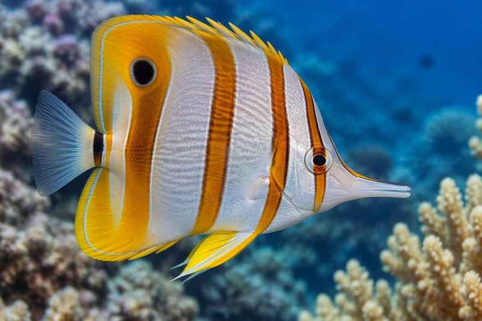

# Pez mariposa bandas de cobre — *Chelmon rostratus* (Linnaeus, 1758)

> Archivo generado desde `especies/datos/catalogo_inicial.json` con `especies/herramientas/generar_fichas.py`. No editar a mano.

*Imagen ilustrativa generada con IA por Brayan (2026-11-16). No es una fotografía de un ejemplar real; puede contener errores anatómicos.*

**Grupo:** pez  
**Otros nombres:** Copperband butterflyfish, Beaked coralfish  
**Fecha de consulta:** 2026-11-16  
**Confianza global:** media  
**Estado:** verificada; pendiente de revisión del equipo

## Ficha AIRI

| Campo | Valor |
|---|---|
| Nombre común | Pez mariposa bandas de cobre |
| Nombre científico | *Chelmon rostratus* |
| Temperamento | Pacífico |
| Comportamiento | Pacífico, Territorial, Solitario. Pacífico y tímido; territorial con su especie y con otros peces mariposa, por lo que se mantiene un solo ejemplar. Difícil de alimentar. |
| Adecuado para arrecife | Con precaución. Puede picar invertebrados, sobre todo anémonas y gusanos plumero (LiveAquaria). |
| Tipo de alimentación | Carnívoro: pequeños invertebrados de grietas, anémonas Aiptasia, alimentos cárnicos variados. |
| Temperatura | 22.2–25.6 °C *FishBase no indica rango de temperatura para esta especie.* |
| Litraje recomendado | 492.1 L (130 gal EE. UU.). *Es el mínimo recomendado por una sola fuente comercial; ninguna fuente científica consultada establece un litraje.* |
| Tamaño adulto | 20 cm (longitud total). Al venderse mide 5.1–15.2 cm (juvenil o subadulto). *LiveAquaria: 8 in (≈ 20.3 cm), coherente con FishBase. Vive hasta 10 años.* |

## Detalle verificado

| Campo | Dato | Confianza | Fuentes |
|---|---|---|---|
| Clasificación taxonómica | Clase Teleostei; orden Chaetodontiformes (WoRMS); familia Chaetodontidae. WoRMS AphiaID 218758 (aceptado). Sinónimos: Chaetodon rostratus Linnaeus, 1758 (combinación original). El orden varía según la fuente: Chaetodontiformes (WoRMS) y Acanthuriformes (FishBase). Se toma WoRMS como referencia. | alta | [worms_chelmon_rostratus](https://www.marinespecies.org/aphia.php?p=taxdetails&id=218758), [fishbase_chelmon_rostratus](https://www.fishbase.se/summary/Chelmon-rostratus.html) |
| Hábitat natural | Costas rocosas y arrecifes coralinos; también estuarios y arrecifes interiores con limo. Vive solo o en parejas; es territorial y monógamo. Profundidad: 1–25 m. Distribución: Pacífico occidental: del mar de Andamán a las islas Ryukyu y Australia. | media | [fishbase_chelmon_rostratus](https://www.fishbase.se/summary/Chelmon-rostratus.html) |
| Tamaño adulto | Máx. 20 cm (longitud total). LiveAquaria: 8 in (≈ 20.3 cm), coherente con FishBase. Vive hasta 10 años. | alta | [fishbase_chelmon_rostratus](https://www.fishbase.se/summary/Chelmon-rostratus.html), [liveaquaria_chelmon_rostratus](https://www.liveaquaria.com/products/copperband-butterflyfish) |
| Alimentación | Carnívoro. Usa su hocico largo para buscar alimento en grietas y agujeros. Es útil para controlar la anémona plaga Aiptasia. Es tímido y difícil de alimentar: puede necesitar varios alimentos distintos para empezar a comer. | baja | [liveaquaria_chelmon_rostratus](https://www.liveaquaria.com/products/copperband-butterflyfish) |
| Temperatura del agua | Acuario: 22.2–25.6 °C (72–78 °F). FishBase no indica rango de temperatura para esta especie. | baja | [liveaquaria_chelmon_rostratus](https://www.liveaquaria.com/products/copperband-butterflyfish) |
| Rango de pH | Fuente de acuario: 8.1–8.4. Rango prudente AIRI: 8.1–8.3. Criterio: Intersección con la tabla MSD para agua salada (7.8–8.3). | media | [liveaquaria_chelmon_rostratus](https://www.liveaquaria.com/products/copperband-butterflyfish), [msd_tabla_referencia](https://www.msdvetmanual.com/multimedia/table/normal-reference-ranges-for-routine-water-quality-analysis), [msd_capitulo](https://www.msdvetmanual.com/exotic-and-laboratory-animals/aquatic-systems/environmental-diseases-of-aquatic-animals-in-aquatic-systems) |
| Salinidad | 1.020–1.025 de gravedad específica (adimensional). Agua de mar media: 35 ppt (UF/IFAS). No se convierte a ppt porque la equivalencia depende de la temperatura. | media | [liveaquaria_chelmon_rostratus](https://www.liveaquaria.com/products/copperband-butterflyfish), [ufifas_ph_sal_temp](https://waterwatch.ifas.ufl.edu/media/waterwatchifasufledu/FactSheet_pH_Sal_Temp.pdf) |
| Volumen mínimo | 492.1 L (130 gal EE. UU.). Justificación: Cifra de LiveAquaria (130 gal), que lo recomienda para arrecifes muy grandes o acuarios comunitarios pacíficos. | baja | [liveaquaria_chelmon_rostratus](https://www.liveaquaria.com/products/copperband-butterflyfish), [fishbase_chelmon_rostratus](https://www.fishbase.se/summary/Chelmon-rostratus.html) |
| Comportamiento | Pacífico, tímido y de alimentación lenta. En la naturaleza es territorial y monógamo, y forma parejas para reproducirse (FishBase). Debe mantenerse solo, sin otros peces mariposa ni peces que lo estresen (LiveAquaria). | media | [fishbase_chelmon_rostratus](https://www.fishbase.se/summary/Chelmon-rostratus.html), [liveaquaria_chelmon_rostratus](https://www.liveaquaria.com/products/copperband-butterflyfish) |
| Territorialidad y refugio | Territorial (FishBase). Un solo ejemplar por acuario, sin otros peces mariposa. | media | [liveaquaria_chelmon_rostratus](https://www.liveaquaria.com/products/copperband-butterflyfish), [fishbase_chelmon_rostratus](https://www.fishbase.se/summary/Chelmon-rostratus.html) |
| Compatibilidad con arrecife | con precaución (según la fuente; sin verificación independiente) | baja | [liveaquaria_chelmon_rostratus](https://www.liveaquaria.com/products/copperband-butterflyfish) |
| Convivencia: condiciones | Un solo ejemplar, sin otros peces mariposa. · Compañeros pacíficos que no lo estresen. · Acuario muy grande. | baja | [liveaquaria_chelmon_rostratus](https://www.liveaquaria.com/products/copperband-butterflyfish), [fishbase_chelmon_rostratus](https://www.fishbase.se/summary/Chelmon-rostratus.html) |
| Convivencia: riesgos | Puede picar anémonas y gusanos plumero. · Difícil de alimentar. | baja | [liveaquaria_chelmon_rostratus](https://www.liveaquaria.com/products/copperband-butterflyfish), [fishbase_chelmon_rostratus](https://www.fishbase.se/summary/Chelmon-rostratus.html) |
| Conservación | Preocupación menor (LC), evaluada el 09/10/2009, según FishBase. | media | [fishbase_chelmon_rostratus](https://www.fishbase.se/summary/Chelmon-rostratus.html) |

**Regla AIRI:** compartir rangos de agua no implica compatibilidad entre especies. Los rangos de acuario provienen de una fuente comercial y no son límites veterinarios.

## Fuentes

- **worms_chelmon_rostratus** (taxonomía): WoRMS — Chelmon rostratus (Linnaeus, 1758) (AphiaID 218758). <https://www.marinespecies.org/aphia.php?p=taxdetails&id=218758>. Consultada el 2026-11-16.
- **fishbase_chelmon_rostratus** (biología): FishBase — Chelmon rostratus (Linnaeus, 1758). <https://www.fishbase.se/summary/Chelmon-rostratus.html>. Consultada el 2026-11-16.
- **liveaquaria_chelmon_rostratus** (comercial): LiveAquaria — Copperband Butterflyfish. <https://www.liveaquaria.com/products/copperband-butterflyfish>. Consultada el 2026-11-16.
- **msd_tabla_referencia** (veterinaria): MSD Veterinary Manual — “Normal” Reference Ranges for Routine Water Quality Analysis. <https://www.msdvetmanual.com/multimedia/table/normal-reference-ranges-for-routine-water-quality-analysis>. Consultada el 2026-11-12. Reutilizada del registro del motor (motor/airi_motor/datos/fuentes.json); no se volvió a consultar para estas fichas.
- **ufifas_ph_sal_temp** (institucional): UF/IFAS — pH, Salinity and Temperature (hoja informativa). <https://waterwatch.ifas.ufl.edu/media/waterwatchifasufledu/FactSheet_pH_Sal_Temp.pdf>. Consultada el 2026-11-12. Reutilizada del registro del motor (motor/airi_motor/datos/fuentes.json); no se volvió a consultar para estas fichas.
- **msd_capitulo** (veterinaria): MSD Veterinary Manual — Environmental Diseases of Aquatic Animals in Aquatic Systems. <https://www.msdvetmanual.com/exotic-and-laboratory-animals/aquatic-systems/environmental-diseases-of-aquatic-animals-in-aquatic-systems>. Consultada el 2026-11-12. Reutilizada del registro del motor (motor/airi_motor/datos/fuentes.json); no se volvió a consultar para estas fichas.
