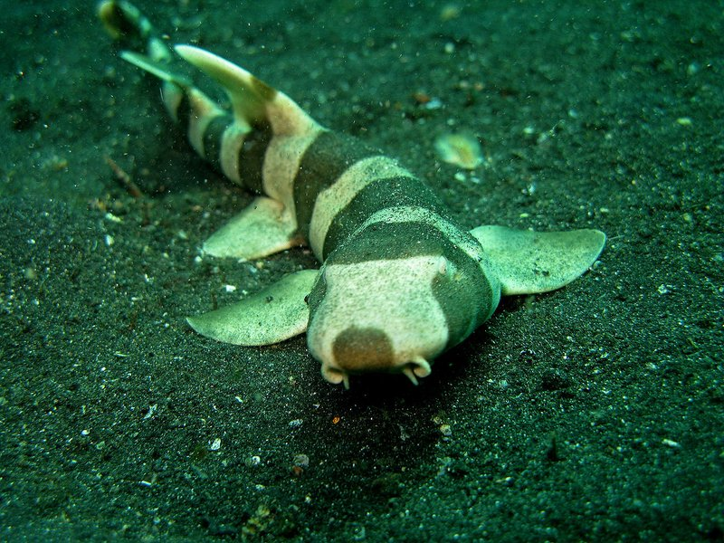

# Tiburón bambú — *Chiloscyllium punctatum* Müller & Henle, 1838

> Archivo generado desde `especies/datos/catalogo_inicial.json` con `especies/herramientas/generar_fichas.py`. No editar a mano.

*Imagen ilustrativa generada con IA por Brayan (2026-11-18). No es una fotografía de un ejemplar real; puede contener errores anatómicos.*

**Grupo:** pez  
**Otros nombres:** Brownbanded bamboo shark, Brown-banded catshark, Bambú estriado  
**Fecha de consulta:** 2026-11-18  
**Confianza global:** media  
**Estado:** verificada; pendiente de revisión del equipo

## Ficha AIRI

| Campo | Valor |
|---|---|
| Nombre común | Tiburón bambú |
| Nombre científico | *Chiloscyllium punctatum* |
| Temperamento | Semiagresivo *Saltwaterfish lo clasifica como semiagresivo; Quality Marine, como agresivo.* |
| Comportamiento | . Tiburón de fondo, nocturno, que crece mucho: necesita un acuario enorme. Se come peces y crustáceos. |
| Adecuado para arrecife | No. Saltwaterfish lo considera no apto para arrecife. |
| Tipo de alimentación | Carnívoro: peces pequeños, crustáceos, invertebrados del fondo, alimentos cárneos. |
| Temperatura | 22.2–25.6 °C *Rango de Quality Marine para Chiloscyllium sp.* |
| Litraje recomendado | 1135.5 L (300 gal EE. UU.). *Dos fuentes comerciales coinciden en 300 gal.* |
| Tamaño adulto | 132 cm (longitud total). *Diferencia entre fuentes: FishBase 132 cm (máximo); Saltwaterfish indica un tamaño medio de 30 in (≈ 76.2 cm); Quality Marine, casi 37 in (≈ 94 cm) para Chiloscyllium sp.* |

## Detalle verificado

| Campo | Dato | Confianza | Fuentes |
|---|---|---|---|
| Clasificación taxonómica | Clase Elasmobranchii; orden Orectolobiformes; familia Hemiscylliidae. WoRMS AphiaID 277833 (aceptado). Sinónimos: Chiloscyllium margaritiferum Bleeker, 1863, Hemiscyllium punctatum (Müller & Henle, 1838). Quality Marine lo vende como «Bamboo Shark» (Chiloscyllium sp.), sin indicar especie; Saltwaterfish sí lo identifica como C. punctatum. | alta | [worms_chiloscyllium_punctatum](https://www.marinespecies.org/aphia.php?p=taxdetails&id=277833), [fishbase_chiloscyllium_punctatum](https://www.fishbase.se/summary/Chiloscyllium-punctatum.html) |
| Hábitat natural | Tiburón de fondo costero, común en arrecifes coralinos y a menudo en pozas de marea; puede sobrevivir hasta 12 horas fuera del agua (FishBase). Profundidad: 0–85 m. Distribución: Indo-Pacífico occidental: de las islas Andamán y la India a Filipinas, al norte hasta Japón y al sur hasta Australia. | alta | [fishbase_chiloscyllium_punctatum](https://www.fishbase.se/summary/Chiloscyllium-punctatum.html) |
| Tamaño adulto | Máx. 132 cm (longitud total). Diferencia entre fuentes: FishBase 132 cm (máximo); Saltwaterfish indica un tamaño medio de 30 in (≈ 76.2 cm); Quality Marine, casi 37 in (≈ 94 cm) para Chiloscyllium sp. | media | [fishbase_chiloscyllium_punctatum](https://www.fishbase.se/summary/Chiloscyllium-punctatum.html), [saltwaterfish_chiloscyllium_punctatum](https://www.saltwaterfish.com/product-brown-banded-bamboo-shark), [qualitymarine_chiloscyllium_punctatum](https://www.qualitymarine.com/quality-marine/fish/sharks/chilocyllium/bamboo-29028/) |
| Alimentación | Probablemente come invertebrados del fondo y peces pequeños (FishBase). Cazador nocturno de peces y crustáceos (Saltwaterfish). En acuario necesita una dieta rica en alimentos cárneos (Quality Marine). | media | [fishbase_chiloscyllium_punctatum](https://www.fishbase.se/summary/Chiloscyllium-punctatum.html), [saltwaterfish_chiloscyllium_punctatum](https://www.saltwaterfish.com/product-brown-banded-bamboo-shark), [qualitymarine_chiloscyllium_punctatum](https://www.qualitymarine.com/quality-marine/fish/sharks/chilocyllium/bamboo-29028/) |
| Temperatura del agua | Acuario: 22.2–25.6 °C (72–78 °F). El rango de acuario es de Quality Marine para su «Bamboo Shark» (Chiloscyllium sp.); ninguna fuente consultada da un rango específico de C. punctatum. | baja | [qualitymarine_chiloscyllium_punctatum](https://www.qualitymarine.com/quality-marine/fish/sharks/chilocyllium/bamboo-29028/) |
| Rango de pH | Fuente de acuario: 8.1–8.4. Rango prudente AIRI: 8.1–8.3. Criterio: Intersección con la tabla MSD para agua salada (7.8–8.3). | media | [qualitymarine_chiloscyllium_punctatum](https://www.qualitymarine.com/quality-marine/fish/sharks/chilocyllium/bamboo-29028/), [msd_tabla_referencia](https://www.msdvetmanual.com/multimedia/table/normal-reference-ranges-for-routine-water-quality-analysis), [msd_capitulo](https://www.msdvetmanual.com/exotic-and-laboratory-animals/aquatic-systems/environmental-diseases-of-aquatic-animals-in-aquatic-systems) |
| Salinidad | 1.020–1.025 de gravedad específica (adimensional). Agua de mar media: 35 ppt (UF/IFAS). No se convierte a ppt porque la equivalencia depende de la temperatura. | media | [qualitymarine_chiloscyllium_punctatum](https://www.qualitymarine.com/quality-marine/fish/sharks/chilocyllium/bamboo-29028/), [ufifas_ph_sal_temp](https://waterwatch.ifas.ufl.edu/media/waterwatchifasufledu/FactSheet_pH_Sal_Temp.pdf) |
| Volumen mínimo | 1135.5 L (300 gal EE. UU.). Justificación: Saltwaterfish indica 300 gal o más para C. punctatum; Quality Marine también recomienda 300 gal o más para su «Bamboo Shark» (Chiloscyllium sp.). | baja | [saltwaterfish_chiloscyllium_punctatum](https://www.saltwaterfish.com/product-brown-banded-bamboo-shark), [qualitymarine_chiloscyllium_punctatum](https://www.qualitymarine.com/quality-marine/fish/sharks/chilocyllium/bamboo-29028/) |
| Comportamiento | Cazador nocturno; muy sensible a los cambios de los parámetros del agua (Saltwaterfish). Necesita fondo de arena fina y rocas estables con cuevas para descansar; es sensible al cobre y a los impulsos eléctricos (Quality Marine). | media | [saltwaterfish_chiloscyllium_punctatum](https://www.saltwaterfish.com/product-brown-banded-bamboo-shark), [qualitymarine_chiloscyllium_punctatum](https://www.qualitymarine.com/quality-marine/fish/sharks/chilocyllium/bamboo-29028/) |
| Territorialidad y refugio | Necesita cuevas y grietas estables para descansar y fondo de arena fina (Quality Marine). | media | [qualitymarine_chiloscyllium_punctatum](https://www.qualitymarine.com/quality-marine/fish/sharks/chilocyllium/bamboo-29028/) |
| Compatibilidad con arrecife | no (según la fuente; sin verificación independiente) | baja | [saltwaterfish_chiloscyllium_punctatum](https://www.saltwaterfish.com/product-brown-banded-bamboo-shark) |
| Convivencia: condiciones | Acuario de 300 gal o más. · Fondo de arena fina y cuevas estables. · Sin cobre ni aparatos que generen impulsos eléctricos. | baja | [saltwaterfish_chiloscyllium_punctatum](https://www.saltwaterfish.com/product-brown-banded-bamboo-shark), [qualitymarine_chiloscyllium_punctatum](https://www.qualitymarine.com/quality-marine/fish/sharks/chilocyllium/bamboo-29028/) |
| Convivencia: riesgos | Se come peces pequeños y crustáceos. · Muy sensible a los cambios del agua y al cobre. | baja | [saltwaterfish_chiloscyllium_punctatum](https://www.saltwaterfish.com/product-brown-banded-bamboo-shark), [qualitymarine_chiloscyllium_punctatum](https://www.qualitymarine.com/quality-marine/fish/sharks/chilocyllium/bamboo-29028/) |
| Conservación | Casi amenazada (NT), evaluada el 19/09/2023, según FishBase. | media | [fishbase_chiloscyllium_punctatum](https://www.fishbase.se/summary/Chiloscyllium-punctatum.html) |

**Regla AIRI:** compartir rangos de agua no implica compatibilidad entre especies. Los rangos de acuario provienen de una fuente comercial y no son límites veterinarios.

## Fuentes

- **worms_chiloscyllium_punctatum** (taxonomía): WoRMS — Chiloscyllium punctatum Müller & Henle, 1838 (AphiaID 277833). <https://www.marinespecies.org/aphia.php?p=taxdetails&id=277833>. Consultada el 2026-11-18.
- **fishbase_chiloscyllium_punctatum** (biología): FishBase — Chiloscyllium punctatum. <https://www.fishbase.se/summary/Chiloscyllium-punctatum.html>. Consultada el 2026-11-18.
- **qualitymarine_chiloscyllium_punctatum** (comercial): Quality Marine — Bamboo Shark (Chiloscyllium sp.). <https://www.qualitymarine.com/quality-marine/fish/sharks/chilocyllium/bamboo-29028/>. Consultada el 2026-11-18.
- **saltwaterfish_chiloscyllium_punctatum** (comercial): Saltwaterfish — Brown Banded Bamboo Shark. <https://www.saltwaterfish.com/product-brown-banded-bamboo-shark>. Consultada el 2026-11-18.
- **msd_tabla_referencia** (veterinaria): MSD Veterinary Manual — “Normal” Reference Ranges for Routine Water Quality Analysis. <https://www.msdvetmanual.com/multimedia/table/normal-reference-ranges-for-routine-water-quality-analysis>. Consultada el 2026-11-12. Reutilizada del registro del motor (motor/airi_motor/datos/fuentes.json); no se volvió a consultar para estas fichas.
- **ufifas_ph_sal_temp** (institucional): UF/IFAS — pH, Salinity and Temperature (hoja informativa). <https://waterwatch.ifas.ufl.edu/media/waterwatchifasufledu/FactSheet_pH_Sal_Temp.pdf>. Consultada el 2026-11-12. Reutilizada del registro del motor (motor/airi_motor/datos/fuentes.json); no se volvió a consultar para estas fichas.
- **msd_capitulo** (veterinaria): MSD Veterinary Manual — Environmental Diseases of Aquatic Animals in Aquatic Systems. <https://www.msdvetmanual.com/exotic-and-laboratory-animals/aquatic-systems/environmental-diseases-of-aquatic-animals-in-aquatic-systems>. Consultada el 2026-11-12. Reutilizada del registro del motor (motor/airi_motor/datos/fuentes.json); no se volvió a consultar para estas fichas.
