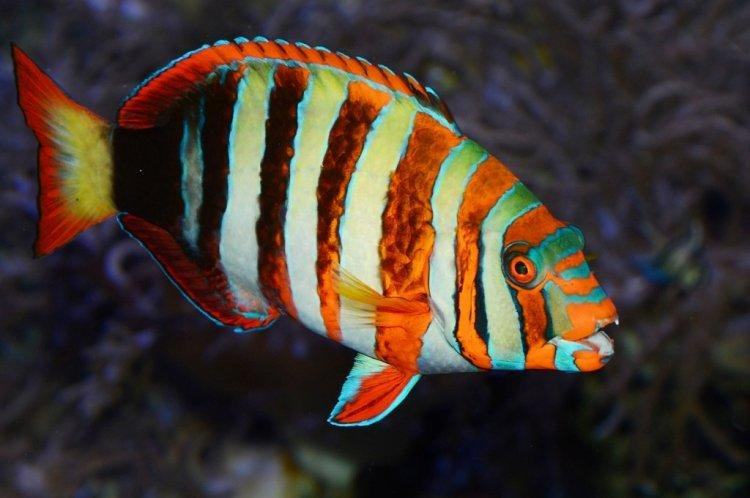

# Lábrido arlequín — *Choerodon fasciatus* (Günther, 1867)

> Archivo generado desde `especies/datos/catalogo_inicial.json` con `especies/herramientas/generar_fichas.py`. No editar a mano.

*Imagen ilustrativa generada con IA por Brayan (2026-11-16). No es una fotografía de un ejemplar real; puede contener errores anatómicos.*

**Grupo:** pez  
**Otros nombres:** Harlequin tuskfish, Harlequin tusk wrasse  
**Fecha de consulta:** 2026-11-16  
**Confianza global:** media  
**Estado:** verificada; pendiente de revisión del equipo

## Ficha AIRI

| Campo | Valor |
|---|---|
| Nombre común | Lábrido arlequín |
| Nombre científico | *Choerodon fasciatus* |
| Temperamento | Semiagresivo |
| Comportamiento | Territorial, Solitario. Territorial y solitario: un solo ejemplar. Tímido de joven. No molesta a los corales, pero come crustáceos y caracoles. |
| Adecuado para arrecife | Con precaución. LiveAquaria indica que no molesta a los corales, pero come crustáceos pequeños como caracoles y cangrejos. |
| Tipo de alimentación | Carnívoro: moluscos y crustáceos, gusanos y equinodermos, misis y artemia congeladas. |
| Temperatura | 22.2–25.6 °C *Discrepancia: el límite inferior de acuario (22.2 °C) está por debajo del mínimo natural indicado por FishBase (25 °C).* |
| Litraje recomendado | 473.1 L (125 gal EE. UU.). *Es el mínimo recomendado por una sola fuente comercial; ninguna fuente científica consultada establece un litraje.* |
| Tamaño adulto | 30 cm (longitud total). Al venderse mide 3.8–22.9 cm (juvenil o subadulto). *Diferencia entre fuentes: FishBase 30 cm; LiveAquaria 10 in (≈ 25.4 cm).* |

## Detalle verificado

| Campo | Dato | Confianza | Fuentes |
|---|---|---|---|
| Clasificación taxonómica | Clase Teleostei; orden Eupercaria incertae sedis (WoRMS); familia Labridae; subfamilia Hypsigenyinae. WoRMS AphiaID 277268 (aceptado). Sinónimos: Xiphochilus fasciatus Günther, 1867 (combinación original), Lienardella fasciata. | alta | [worms_choerodon_fasciatus](https://www.marinespecies.org/aphia.php?p=taxdetails&id=277268), [fishbase_choerodon_fasciatus](https://www.fishbase.se/summary/Choerodon-fasciatus.html) |
| Hábitat natural | Arrecifes externos. Solitario y territorial. Tiene 7 u 8 pares de bandas alternas rojas, azules, blancas y negruzcas. Profundidad: 5–35 m. Distribución: Pacífico occidental, en dos zonas separadas: de las Ryukyu a Taiwán, y de Nueva Caledonia a Queensland (Australia). | media | [fishbase_choerodon_fasciatus](https://www.fishbase.se/summary/Choerodon-fasciatus.html) |
| Tamaño adulto | Máx. 30 cm (longitud total). Diferencia entre fuentes: FishBase 30 cm; LiveAquaria 10 in (≈ 25.4 cm). | media | [fishbase_choerodon_fasciatus](https://www.fishbase.se/summary/Choerodon-fasciatus.html), [liveaquaria_choerodon_fasciatus](https://www.liveaquaria.com/products/harlequin-tusk) |
| Alimentación | Carnívoro: come moluscos, crustáceos, gusanos y equinodermos (FishBase); usa sus dientes azules para triturar invertebrados. En acuario, misis y artemia congeladas enriquecidas, otros alimentos cárnicos, escamas y gránulos (LiveAquaria). | alta | [fishbase_choerodon_fasciatus](https://www.fishbase.se/summary/Choerodon-fasciatus.html), [liveaquaria_choerodon_fasciatus](https://www.liveaquaria.com/products/harlequin-tusk) |
| Temperatura del agua | Acuario: 22.2–25.6 °C (72–78 °F). Medio natural: 25–28 °C. Discrepancia: el límite inferior de acuario (22.2 °C) está por debajo del mínimo natural indicado por FishBase (25 °C). | baja | [liveaquaria_choerodon_fasciatus](https://www.liveaquaria.com/products/harlequin-tusk), [fishbase_choerodon_fasciatus](https://www.fishbase.se/summary/Choerodon-fasciatus.html) |
| Rango de pH | Fuente de acuario: 8.1–8.4. Rango prudente AIRI: 8.1–8.3. Criterio: Intersección con la tabla MSD para agua salada (7.8–8.3). | media | [liveaquaria_choerodon_fasciatus](https://www.liveaquaria.com/products/harlequin-tusk), [msd_tabla_referencia](https://www.msdvetmanual.com/multimedia/table/normal-reference-ranges-for-routine-water-quality-analysis), [msd_capitulo](https://www.msdvetmanual.com/exotic-and-laboratory-animals/aquatic-systems/environmental-diseases-of-aquatic-animals-in-aquatic-systems) |
| Salinidad | 1.020–1.025 de gravedad específica (adimensional). Agua de mar media: 35 ppt (UF/IFAS). No se convierte a ppt porque la equivalencia depende de la temperatura. | media | [liveaquaria_choerodon_fasciatus](https://www.liveaquaria.com/products/harlequin-tusk), [ufifas_ph_sal_temp](https://waterwatch.ifas.ufl.edu/media/waterwatchifasufledu/FactSheet_pH_Sal_Temp.pdf) |
| Volumen mínimo | 473.1 L (125 gal EE. UU.). Justificación: Cifra de LiveAquaria (125 gal), con mucha roca viva y peces activos y moderadamente agresivos (ángeles, cirujanos, peces ballesta pequeños). | baja | [liveaquaria_choerodon_fasciatus](https://www.liveaquaria.com/products/harlequin-tusk) |
| Comportamiento | Solitario y territorial (FishBase). Tímido de pequeño, gana confianza al crecer. Un solo ejemplar por acuario (LiveAquaria). | media | [fishbase_choerodon_fasciatus](https://www.fishbase.se/summary/Choerodon-fasciatus.html), [liveaquaria_choerodon_fasciatus](https://www.liveaquaria.com/products/harlequin-tusk) |
| Territorialidad y refugio | Territorial; un solo ejemplar por acuario. Necesita roca viva con escondites. | media | [liveaquaria_choerodon_fasciatus](https://www.liveaquaria.com/products/harlequin-tusk), [fishbase_choerodon_fasciatus](https://www.fishbase.se/summary/Choerodon-fasciatus.html) |
| Compatibilidad con arrecife | con precaución (según la fuente; sin verificación independiente) | baja | [liveaquaria_choerodon_fasciatus](https://www.liveaquaria.com/products/harlequin-tusk) |
| Convivencia: condiciones | Un solo ejemplar. · Peces activos y moderadamente agresivos. | baja | [liveaquaria_choerodon_fasciatus](https://www.liveaquaria.com/products/harlequin-tusk), [fishbase_choerodon_fasciatus](https://www.fishbase.se/summary/Choerodon-fasciatus.html) |
| Convivencia: riesgos | Come caracoles, cangrejos y otros crustáceos pequeños. | baja | [liveaquaria_choerodon_fasciatus](https://www.liveaquaria.com/products/harlequin-tusk), [fishbase_choerodon_fasciatus](https://www.fishbase.se/summary/Choerodon-fasciatus.html) |
| Conservación | Preocupación menor (LC), evaluada el 12/04/2008, según FishBase. | media | [fishbase_choerodon_fasciatus](https://www.fishbase.se/summary/Choerodon-fasciatus.html) |

**Regla AIRI:** compartir rangos de agua no implica compatibilidad entre especies. Los rangos de acuario provienen de una fuente comercial y no son límites veterinarios.

## Fuentes

- **worms_choerodon_fasciatus** (taxonomía): WoRMS — Choerodon fasciatus (Günther, 1867) (AphiaID 277268). <https://www.marinespecies.org/aphia.php?p=taxdetails&id=277268>. Consultada el 2026-11-16.
- **fishbase_choerodon_fasciatus** (biología): FishBase — Choerodon fasciatus. <https://www.fishbase.se/summary/Choerodon-fasciatus.html>. Consultada el 2026-11-16.
- **liveaquaria_choerodon_fasciatus** (comercial): LiveAquaria — Harlequin Tusk. <https://www.liveaquaria.com/products/harlequin-tusk>. Consultada el 2026-11-16.
- **msd_tabla_referencia** (veterinaria): MSD Veterinary Manual — “Normal” Reference Ranges for Routine Water Quality Analysis. <https://www.msdvetmanual.com/multimedia/table/normal-reference-ranges-for-routine-water-quality-analysis>. Consultada el 2026-11-12. Reutilizada del registro del motor (motor/airi_motor/datos/fuentes.json); no se volvió a consultar para estas fichas.
- **ufifas_ph_sal_temp** (institucional): UF/IFAS — pH, Salinity and Temperature (hoja informativa). <https://waterwatch.ifas.ufl.edu/media/waterwatchifasufledu/FactSheet_pH_Sal_Temp.pdf>. Consultada el 2026-11-12. Reutilizada del registro del motor (motor/airi_motor/datos/fuentes.json); no se volvió a consultar para estas fichas.
- **msd_capitulo** (veterinaria): MSD Veterinary Manual — Environmental Diseases of Aquatic Animals in Aquatic Systems. <https://www.msdvetmanual.com/exotic-and-laboratory-animals/aquatic-systems/environmental-diseases-of-aquatic-animals-in-aquatic-systems>. Consultada el 2026-11-12. Reutilizada del registro del motor (motor/airi_motor/datos/fuentes.json); no se volvió a consultar para estas fichas.
