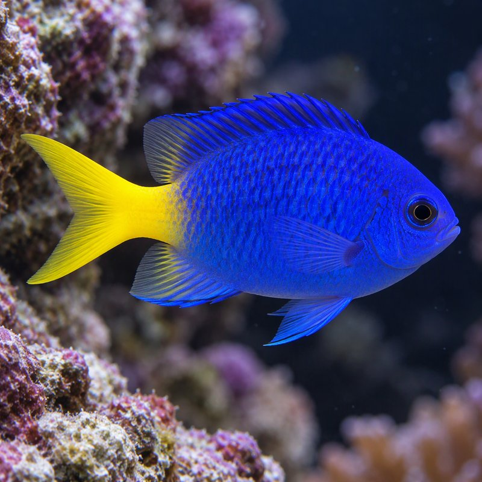

# Damisela de cola amarilla — *Chrysiptera parasema* (Fowler, 1918)

> Archivo generado desde `especies/datos/catalogo_inicial.json` con `especies/herramientas/generar_fichas.py`. No editar a mano.

*Imagen ilustrativa generada con IA por Brayan (2026-11-16). No es una fotografía de un ejemplar real; puede contener errores anatómicos.*

**Grupo:** pez  
**Otros nombres:** Goldtail demoiselle, Yellowtail damselfish, Yellowtail blue damsel  
**Fecha de consulta:** 2026-11-16  
**Confianza global:** media  
**Estado:** verificada; pendiente de revisión del equipo

## Ficha AIRI

| Campo | Valor |
|---|---|
| Nombre común | Damisela de cola amarilla |
| Nombre científico | *Chrysiptera parasema* |
| Temperamento | Semiagresivo *LiveAquaria la considera menos agresiva que otras damiselas.* |
| Comportamiento | Sociable, Territorial. Vive en pequeños grupos (mejor en número impar). Algunos ejemplares son territoriales con su especie o con peces de tamaño similar; el macho se vuelve muy territorial al cuidar la puesta. |
| Adecuado para arrecife | Sí. La única fuente consultada que lo evalúa (LiveAquaria) lo considera compatible con arrecife; no hay verificación independiente. |
| Tipo de alimentación | Omnívoro: zooplancton, algas, misis, camarón enriquecido. |
| Temperatura | 22.2–25.6 °C *FishBase no indica rango de temperatura para esta especie.* |
| Litraje recomendado | 113.6 L (30 gal EE. UU.). *Es el mínimo recomendado por una sola fuente comercial; ninguna fuente científica consultada establece un litraje.* |
| Tamaño adulto | 7 cm (longitud total). Al venderse mide 1.3–6.3 cm (juvenil o subadulto). *LiveAquaria indica 2¾ in (7.0 cm), igual que FishBase (7 cm).* |

## Detalle verificado

| Campo | Dato | Confianza | Fuentes |
|---|---|---|---|
| Clasificación taxonómica | Clase Teleostei; orden Ovalentaria (incertae sedis); familia Pomacentridae; subfamilia Pomacentrinae. WoRMS AphiaID 276836 (aceptado). Sinónimos: Abudefduf parasema Fowler, 1918 (combinación original). | alta | [worms_chrysiptera_parasema](https://www.marinespecies.org/aphia.php?p=taxdetails&id=276836), [fishbase_chrysiptera_parasema](https://www.fishbase.se/summary/Chrysiptera-parasema.html) |
| Hábitat natural | Zonas ricas en coral de lagunas resguardadas y arrecifes costeros. Vive en pequeños grupos sobre colonias de Acropora y es diurno. Marino, asociado a arrecifes, no migratorio. Profundidad: 1–16 m. Distribución: Pacífico occidental: Islas Salomón, norte de Papúa Nueva Guinea, Filipinas e islas Ryukyu. Hay un registro dudoso en la Gran Barrera de Coral. | media | [fishbase_chrysiptera_parasema](https://www.fishbase.se/summary/Chrysiptera-parasema.html) |
| Tamaño adulto | Máx. 7 cm (longitud total). LiveAquaria: 2¾ in (≈ 7.0 cm). | alta | [fishbase_chrysiptera_parasema](https://www.fishbase.se/summary/Chrysiptera-parasema.html), [liveaquaria_chrysiptera_parasema](https://www.liveaquaria.com/products/yellowtail-damselfish) |
| Alimentación | Omnívoro. En acuario come zooplancton y algas, y conviene darle una dieta variada de alimentos cárnicos (misis, camarón enriquecido) en varias tomas pequeñas al día. FishBase no describe la dieta natural en su resumen. | baja | [liveaquaria_chrysiptera_parasema](https://www.liveaquaria.com/products/yellowtail-damselfish) |
| Temperatura del agua | Acuario: 22.2–25.6 °C (72–78 °F). FishBase no indica rango de temperatura para esta especie. | baja | [liveaquaria_chrysiptera_parasema](https://www.liveaquaria.com/products/yellowtail-damselfish) |
| Rango de pH | Fuente de acuario: 8.1–8.4. Rango prudente AIRI: 8.1–8.3. Criterio: Intersección con la tabla MSD para agua salada (7.8–8.3). | media | [liveaquaria_chrysiptera_parasema](https://www.liveaquaria.com/products/yellowtail-damselfish), [msd_tabla_referencia](https://www.msdvetmanual.com/multimedia/table/normal-reference-ranges-for-routine-water-quality-analysis), [msd_capitulo](https://www.msdvetmanual.com/exotic-and-laboratory-animals/aquatic-systems/environmental-diseases-of-aquatic-animals-in-aquatic-systems) |
| Salinidad | 1.020–1.025 de gravedad específica (adimensional). Agua de mar media: 35 ppt (UF/IFAS). No se convierte a ppt porque la equivalencia depende de la temperatura. | media | [liveaquaria_chrysiptera_parasema](https://www.liveaquaria.com/products/yellowtail-damselfish), [ufifas_ph_sal_temp](https://waterwatch.ifas.ufl.edu/media/waterwatchifasufledu/FactSheet_pH_Sal_Temp.pdf) |
| Volumen mínimo | 113.6 L (30 gal EE. UU.). Justificación: Cifra de LiveAquaria. Aunque es pequeña (7 cm), se recomienda mantenerla en grupos pequeños de número impar y con varios escondites, lo que exige espacio para repartir territorios. | baja | [liveaquaria_chrysiptera_parasema](https://www.liveaquaria.com/products/yellowtail-damselfish) |
| Comportamiento | Diurna y gregaria en pequeños grupos. Durante la reproducción forma parejas bien definidas: los huevos quedan adheridos al sustrato y el macho los cuida y oxigena. LiveAquaria la considera semiagresiva, aunque menos agresiva que otras damiselas. | media | [fishbase_chrysiptera_parasema](https://www.fishbase.se/summary/Chrysiptera-parasema.html), [liveaquaria_chrysiptera_parasema](https://www.liveaquaria.com/products/yellowtail-damselfish) |
| Territorialidad y refugio | Prefiere tener varios escondites. Algunos ejemplares son territoriales con su especie o con peces de tamaño parecido, y el macho se vuelve muy territorial mientras cuida la puesta. | baja | [liveaquaria_chrysiptera_parasema](https://www.liveaquaria.com/products/yellowtail-damselfish) |
| Compatibilidad con arrecife | sí (según la fuente; sin verificación independiente) | baja | [liveaquaria_chrysiptera_parasema](https://www.liveaquaria.com/products/yellowtail-damselfish) |
| Convivencia: condiciones | Grupos pequeños de número impar en acuarios del tamaño adecuado. · Compañeros pacíficos. | baja | [liveaquaria_chrysiptera_parasema](https://www.liveaquaria.com/products/yellowtail-damselfish) |
| Convivencia: riesgos | Territorialidad hacia peces de su especie o de tamaño similar. · Agresividad del macho durante la reproducción. | baja | [liveaquaria_chrysiptera_parasema](https://www.liveaquaria.com/products/yellowtail-damselfish) |
| Conservación | Preocupación menor (LC), evaluada el 23/09/2021, según FishBase. | media | [fishbase_chrysiptera_parasema](https://www.fishbase.se/summary/Chrysiptera-parasema.html) |

**Regla AIRI:** compartir rangos de agua no implica compatibilidad entre especies. Los rangos de acuario provienen de una fuente comercial y no son límites veterinarios.

## Fuentes

- **worms_chrysiptera_parasema** (taxonomía): WoRMS — Chrysiptera parasema (Fowler, 1918) (AphiaID 276836). <https://www.marinespecies.org/aphia.php?p=taxdetails&id=276836>. Consultada el 2026-11-16.
- **fishbase_chrysiptera_parasema** (biología): FishBase — Chrysiptera parasema, Goldtail demoiselle. <https://www.fishbase.se/summary/Chrysiptera-parasema.html>. Consultada el 2026-11-16.
- **liveaquaria_chrysiptera_parasema** (comercial): LiveAquaria — Yellowtail Damselfish. <https://www.liveaquaria.com/products/yellowtail-damselfish>. Consultada el 2026-11-16.
- **msd_tabla_referencia** (veterinaria): MSD Veterinary Manual — “Normal” Reference Ranges for Routine Water Quality Analysis. <https://www.msdvetmanual.com/multimedia/table/normal-reference-ranges-for-routine-water-quality-analysis>. Consultada el 2026-11-12. Reutilizada del registro del motor (motor/airi_motor/datos/fuentes.json); no se volvió a consultar para estas fichas.
- **ufifas_ph_sal_temp** (institucional): UF/IFAS — pH, Salinity and Temperature (hoja informativa). <https://waterwatch.ifas.ufl.edu/media/waterwatchifasufledu/FactSheet_pH_Sal_Temp.pdf>. Consultada el 2026-11-12. Reutilizada del registro del motor (motor/airi_motor/datos/fuentes.json); no se volvió a consultar para estas fichas.
- **msd_capitulo** (veterinaria): MSD Veterinary Manual — Environmental Diseases of Aquatic Animals in Aquatic Systems. <https://www.msdvetmanual.com/exotic-and-laboratory-animals/aquatic-systems/environmental-diseases-of-aquatic-animals-in-aquatic-systems>. Consultada el 2026-11-12. Reutilizada del registro del motor (motor/airi_motor/datos/fuentes.json); no se volvió a consultar para estas fichas.
