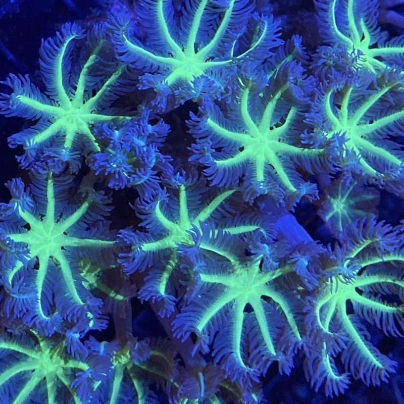

# Pólipos de clavo — *Clavularia sp.* Blainville, 1830 (género)

> Archivo generado desde `especies/datos/catalogo_inicial.json` con `especies/herramientas/generar_fichas.py`. No editar a mano.

*Imagen ilustrativa generada con IA por Brayan (2026-11-16). No es una fotografía de un ejemplar real; puede contener errores anatómicos.*

**Grupo:** coral  
**Otros nombres:** Clove polyps, Daisy polyps, Palm tree clove  
**Fecha de consulta:** 2026-11-16  
**Confianza global:** baja  
**Estado:** verificada; pendiente de revisión del equipo

## Ficha AIRI

| Campo | Valor |
|---|---|
| Nombre común | Pólipos de clavo |
| Nombre científico | *Clavularia sp.* |
| Temperamento | Pacífico |
| Comportamiento | Pacífico. Coral blando pacífico y fácil, para principiantes. Se extiende rápido; hay que dejarle espacio. |
| Adecuado para arrecife | Sí. Quality Marine y Saltwaterfish los consideran aptos para arrecife. |
| Tipo de alimentación | Fotosintético: luz (fotosíntesis), alimento planctónico, calcio, estroncio, yodo y magnesio. |
| Temperatura | 22.2–25.6 °C *Quality Marine 22.2–25.6 °C; Saltwaterfish 23.9–26.7 °C.* |
| Litraje recomendado | null (no verificado). *Ninguna fuente consultada publica un litraje mínimo para este organismo; se deja en null en lugar de estimarlo.* |
| Tamaño adulto | null (no verificado). *Ninguna fuente indica un tamaño máximo; sus pólipos varían mucho de tamaño.* |

## Detalle verificado

| Campo | Dato | Confianza | Fuentes |
|---|---|---|---|
| Clasificación taxonómica | Clase Octocorallia; orden Malacalcyonacea; familia Clavulariidae. WoRMS AphiaID 125286 (aceptado). Ficha a nivel de género: Quality Marine y Saltwaterfish los venden como Clavularia sp. WoRMS reconoce muchas especies; la especie tipo es Clavularia viridis. | alta | [worms_clavularia_sp](https://www.marinespecies.org/aphia.php?p=taxdetails&id=125286) |
| Hábitat natural | Generalmente cerca de las pendientes altas del arrecife (Quality Marine). Profundidad: no indicada. Distribución: No indicada para el género en las fuentes consultadas. | baja | [qualitymarine_clavularia_sp](https://www.qualitymarine.com/quality-marine/coral/polyps-button-zoanthid/clavularia/clove-green-55575/) |
| Tamaño adulto | null (no verificado). Ninguna fuente indica un tamaño máximo; sus pólipos varían mucho de tamaño. | baja | [qualitymarine_clavularia_sp](https://www.qualitymarine.com/quality-marine/coral/polyps-button-zoanthid/clavularia/clove-green-55575/) |
| Alimentación | Fotosintéticos: obtienen la mayor parte de sus nutrientes por fotosíntesis, y las tomas adicionales de alimento planctónico les benefician. Se recomiendan calcio, estroncio, yodo, magnesio y oligoelementos (Quality Marine). | media | [qualitymarine_clavularia_sp](https://www.qualitymarine.com/quality-marine/coral/polyps-button-zoanthid/clavularia/clove-green-55575/) |
| Temperatura del agua | Acuario: 22.2–25.6 °C (72–78 °F). Quality Marine indica 72–78 °F; Saltwaterfish indica 75–80 °F (≈ 23.9–26.7 °C). Se usa el de Quality Marine. | baja | [qualitymarine_clavularia_sp](https://www.qualitymarine.com/quality-marine/coral/polyps-button-zoanthid/clavularia/clove-green-55575/) |
| Rango de pH | Fuente de acuario: 8.1–8.4. Rango prudente AIRI: 8.1–8.3. Criterio: Intersección con la tabla MSD para agua salada (7.8–8.3). | media | [qualitymarine_clavularia_sp](https://www.qualitymarine.com/quality-marine/coral/polyps-button-zoanthid/clavularia/clove-green-55575/), [msd_tabla_referencia](https://www.msdvetmanual.com/multimedia/table/normal-reference-ranges-for-routine-water-quality-analysis), [msd_capitulo](https://www.msdvetmanual.com/exotic-and-laboratory-animals/aquatic-systems/environmental-diseases-of-aquatic-animals-in-aquatic-systems) |
| Salinidad | 1.023–1.025 de gravedad específica (adimensional). Agua de mar media: 35 ppt (UF/IFAS). No se convierte a ppt porque la equivalencia depende de la temperatura. | media | [qualitymarine_clavularia_sp](https://www.qualitymarine.com/quality-marine/coral/polyps-button-zoanthid/clavularia/clove-green-55575/), [ufifas_ph_sal_temp](https://waterwatch.ifas.ufl.edu/media/waterwatchifasufledu/FactSheet_pH_Sal_Temp.pdf) |
| Volumen mínimo | null (no verificado). Justificación: Ninguna fuente consultada publica un litraje: Saltwaterfish deja ese dato vacío. | baja |  |
| Comportamiento | Fáciles de mantener y de propagar; buenos para principiantes. Se extienden y reproducen con facilidad (Quality Marine). Saltwaterfish los marca como pacíficos y seguros con corales e invertebrados. | media | [qualitymarine_clavularia_sp](https://www.qualitymarine.com/quality-marine/coral/polyps-button-zoanthid/clavularia/clove-green-55575/), [saltwaterfish_clavularia_sp](https://www.saltwaterfish.com/product-clove-daisy-polyp-green-55645) |
| Territorialidad y refugio | Se extiende por la roca; necesita espacio respecto a otros corales. | media | [qualitymarine_clavularia_sp](https://www.qualitymarine.com/quality-marine/coral/polyps-button-zoanthid/clavularia/clove-green-55575/) |
| Compatibilidad con arrecife | sí (según la fuente; sin verificación independiente) | baja | [qualitymarine_clavularia_sp](https://www.qualitymarine.com/quality-marine/coral/polyps-button-zoanthid/clavularia/clove-green-55575/), [saltwaterfish_clavularia_sp](https://www.saltwaterfish.com/product-clove-daisy-polyp-green-55645) |
| Convivencia: condiciones | Acuario bien establecido. · Corriente suave. · Luz moderada a fuerte. | baja | [qualitymarine_clavularia_sp](https://www.qualitymarine.com/quality-marine/coral/polyps-button-zoanthid/clavularia/clove-green-55575/) |
| Convivencia: riesgos | No toleran medicamentos con cobre. · Pueden invadir el espacio de otros corales. | baja | [qualitymarine_clavularia_sp](https://www.qualitymarine.com/quality-marine/coral/polyps-button-zoanthid/clavularia/clove-green-55575/) |
| Conservación | No aplica (ficha de género). | media | [worms_clavularia_sp](https://www.marinespecies.org/aphia.php?p=taxdetails&id=125286) |

**Regla AIRI:** compartir rangos de agua no implica compatibilidad entre especies. Los rangos de acuario provienen de una fuente comercial y no son límites veterinarios.

## Fuentes

- **worms_clavularia_sp** (taxonomía): WoRMS — Clavularia Blainville, 1830 (género) (AphiaID 125286). <https://www.marinespecies.org/aphia.php?p=taxdetails&id=125286>. Consultada el 2026-11-16.
- **qualitymarine_clavularia_sp** (comercial): Quality Marine — Green Clove Polyp (Clavularia sp.). <https://www.qualitymarine.com/quality-marine/coral/polyps-button-zoanthid/clavularia/clove-green-55575/>. Consultada el 2026-11-16.
- **saltwaterfish_clavularia_sp** (comercial): Saltwaterfish — Clove (Daisy) Polyp: Green. <https://www.saltwaterfish.com/product-clove-daisy-polyp-green-55645>. Consultada el 2026-11-16.
- **msd_tabla_referencia** (veterinaria): MSD Veterinary Manual — “Normal” Reference Ranges for Routine Water Quality Analysis. <https://www.msdvetmanual.com/multimedia/table/normal-reference-ranges-for-routine-water-quality-analysis>. Consultada el 2026-11-12. Reutilizada del registro del motor (motor/airi_motor/datos/fuentes.json); no se volvió a consultar para estas fichas.
- **ufifas_ph_sal_temp** (institucional): UF/IFAS — pH, Salinity and Temperature (hoja informativa). <https://waterwatch.ifas.ufl.edu/media/waterwatchifasufledu/FactSheet_pH_Sal_Temp.pdf>. Consultada el 2026-11-12. Reutilizada del registro del motor (motor/airi_motor/datos/fuentes.json); no se volvió a consultar para estas fichas.
- **msd_capitulo** (veterinaria): MSD Veterinary Manual — Environmental Diseases of Aquatic Animals in Aquatic Systems. <https://www.msdvetmanual.com/exotic-and-laboratory-animals/aquatic-systems/environmental-diseases-of-aquatic-animals-in-aquatic-systems>. Consultada el 2026-11-12. Reutilizada del registro del motor (motor/airi_motor/datos/fuentes.json); no se volvió a consultar para estas fichas.
