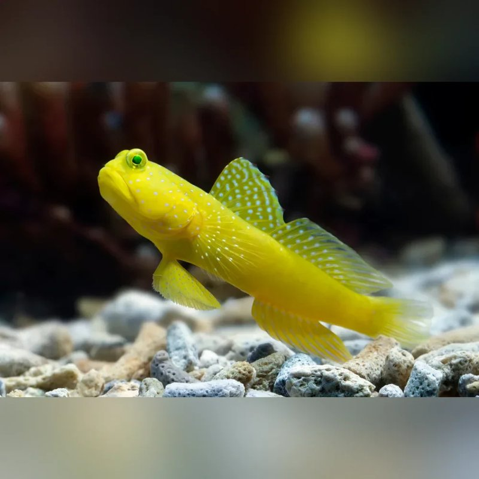

# Gobio watchman — *Cryptocentrus cinctus* (Herre, 1936)

> Archivo generado desde `especies/datos/catalogo_inicial.json` con `especies/herramientas/generar_fichas.py`. No editar a mano.

*Imagen ilustrativa generada con IA por Brayan (2026-11-18). No es una fotografía de un ejemplar real; puede contener errores anatómicos.*

**Grupo:** pez  
**Otros nombres:** Yellow watchman goby, Yellow prawn goby, Spotted watchman goby  
**Fecha de consulta:** 2026-11-18  
**Confianza global:** media  
**Estado:** verificada; pendiente de revisión del equipo

## Ficha AIRI

| Campo | Valor |
|---|---|
| Nombre común | Gobio watchman |
| Nombre científico | *Cryptocentrus cinctus* |
| Temperamento | Pacífico |
| Comportamiento | Pacífico, Territorial. Pacífico con otros peces, pero territorial con los suyos. Vive en una madriguera, a veces con un camarón. Puede saltar. |
| Adecuado para arrecife | Sí. LiveAquaria lo considera compatible con arrecife. |
| Tipo de alimentación | Carnívoro: mysis, artemia, camarón, preparados congelados para carnívoros. |
| Temperatura | 22.2–25.6 °C |
| Litraje recomendado | 113.6 L (30 gal EE. UU.). *Es el mínimo recomendado por una sola fuente comercial; ninguna fuente científica consultada establece un litraje.* |
| Tamaño adulto | 10 cm (longitud estándar). Al venderse mide 2.5–10.2 cm (juvenil o subadulto). *FishBase 10 cm (longitud estándar) y LiveAquaria 4 in (≈ 10.2 cm) coinciden.* |

## Detalle verificado

| Campo | Dato | Confianza | Fuentes |
|---|---|---|---|
| Clasificación taxonómica | Clase Teleostei; orden Gobiiformes; familia Gobiidae. WoRMS AphiaID 278326 (aceptado). Sinónimos: Smilogobius cinctus Herre, 1936 (combinación original). La ficha de LiveAquaria corresponde al «Spotted Watchman Goby», que la tienda describe como una variedad de color regional (Filipinas) de esta misma especie. | alta | [worms_cryptocentrus_cinctus](https://www.marinespecies.org/aphia.php?p=taxdetails&id=278326), [fishbase_cryptocentrus_cinctus](https://www.fishbase.se/summary/Cryptocentrus-cinctus.html) |
| Hábitat natural | Zonas arenosas de lagunas someras y bahías costeras protegidas; vive en una madriguera con camarones alfeidos (FishBase). Profundidad: 1–25 m (habitual 10–25 m). Distribución: Pacífico occidental: de las islas Yaeyama (Japón) a Singapur y el sur de la Gran Barrera; Palaos y Truk en Micronesia. | alta | [fishbase_cryptocentrus_cinctus](https://www.fishbase.se/summary/Cryptocentrus-cinctus.html) |
| Tamaño adulto | Máx. 10 cm (longitud estándar). FishBase 10 cm (longitud estándar) y LiveAquaria 4 in (≈ 10.2 cm) coinciden. | alta | [fishbase_cryptocentrus_cinctus](https://www.fishbase.se/summary/Cryptocentrus-cinctus.html), [liveaquaria_cryptocentrus_cinctus](https://www.liveaquaria.com/products/spotted-watchman-goby) |
| Alimentación | En acuario: mysis, artemia, camarón y preparados congelados para carnívoros, al menos dos veces al día (LiveAquaria). FishBase no detalla su dieta. | baja | [liveaquaria_cryptocentrus_cinctus](https://www.liveaquaria.com/products/spotted-watchman-goby) |
| Temperatura del agua | Acuario: 22.2–25.6 °C (72–78 °F). Medio natural: 22–28 °C. El rango de acuario cae dentro del rango registrado en el medio natural. | media | [liveaquaria_cryptocentrus_cinctus](https://www.liveaquaria.com/products/spotted-watchman-goby), [fishbase_cryptocentrus_cinctus](https://www.fishbase.se/summary/Cryptocentrus-cinctus.html) |
| Rango de pH | Fuente de acuario: 8.1–8.4. Rango prudente AIRI: 8.1–8.3. Criterio: Intersección con la tabla MSD para agua salada (7.8–8.3). | media | [liveaquaria_cryptocentrus_cinctus](https://www.liveaquaria.com/products/spotted-watchman-goby), [msd_tabla_referencia](https://www.msdvetmanual.com/multimedia/table/normal-reference-ranges-for-routine-water-quality-analysis), [msd_capitulo](https://www.msdvetmanual.com/exotic-and-laboratory-animals/aquatic-systems/environmental-diseases-of-aquatic-animals-in-aquatic-systems) |
| Salinidad | 1.020–1.025 de gravedad específica (adimensional). Agua de mar media: 35 ppt (UF/IFAS). No se convierte a ppt porque la equivalencia depende de la temperatura. | media | [liveaquaria_cryptocentrus_cinctus](https://www.liveaquaria.com/products/spotted-watchman-goby), [ufifas_ph_sal_temp](https://waterwatch.ifas.ufl.edu/media/waterwatchifasufledu/FactSheet_pH_Sal_Temp.pdf) |
| Volumen mínimo | 113.6 L (30 gal EE. UU.). Justificación: Cifra de LiveAquaria (30 gal), con cascajo de coral y fondo de arena. | baja | [liveaquaria_cryptocentrus_cinctus](https://www.liveaquaria.com/products/spotted-watchman-goby) |
| Comportamiento | Comparte madriguera con camarones alfeidos (FishBase). Le gusta asomarse detrás de las rocas. Rara vez es agresivo con otros peces, pero es territorial y pelea con los de su especie salvo que sean pareja. Puede saltar (LiveAquaria). | media | [fishbase_cryptocentrus_cinctus](https://www.fishbase.se/summary/Cryptocentrus-cinctus.html), [liveaquaria_cryptocentrus_cinctus](https://www.liveaquaria.com/products/spotted-watchman-goby) |
| Territorialidad y refugio | Excava en la arena; necesita cascajo de coral y fondo de arena (LiveAquaria). | media | [liveaquaria_cryptocentrus_cinctus](https://www.liveaquaria.com/products/spotted-watchman-goby) |
| Compatibilidad con arrecife | sí (según la fuente; sin verificación independiente) | baja | [liveaquaria_cryptocentrus_cinctus](https://www.liveaquaria.com/products/spotted-watchman-goby) |
| Convivencia: condiciones | Acuario de 30 gal o más. · Fondo de arena y cascajo de coral. · Tapa bien ajustada. | baja | [liveaquaria_cryptocentrus_cinctus](https://www.liveaquaria.com/products/spotted-watchman-goby) |
| Convivencia: riesgos | Pelea con los de su especie salvo en pareja. · Puede saltar del acuario. | baja | [liveaquaria_cryptocentrus_cinctus](https://www.liveaquaria.com/products/spotted-watchman-goby) |
| Conservación | Preocupación menor (LC), evaluada el 27/08/2020, según FishBase. | media | [fishbase_cryptocentrus_cinctus](https://www.fishbase.se/summary/Cryptocentrus-cinctus.html) |

**Regla AIRI:** compartir rangos de agua no implica compatibilidad entre especies. Los rangos de acuario provienen de una fuente comercial y no son límites veterinarios.

## Fuentes

- **worms_cryptocentrus_cinctus** (taxonomía): WoRMS — Cryptocentrus cinctus (Herre, 1936) (AphiaID 278326). <https://www.marinespecies.org/aphia.php?p=taxdetails&id=278326>. Consultada el 2026-11-18.
- **fishbase_cryptocentrus_cinctus** (biología): FishBase — Cryptocentrus cinctus. <https://www.fishbase.se/summary/Cryptocentrus-cinctus.html>. Consultada el 2026-11-18.
- **liveaquaria_cryptocentrus_cinctus** (comercial): LiveAquaria — Spotted Watchman Goby (Cryptocentrus cinctus). <https://www.liveaquaria.com/products/spotted-watchman-goby>. Consultada el 2026-11-18.
- **msd_tabla_referencia** (veterinaria): MSD Veterinary Manual — “Normal” Reference Ranges for Routine Water Quality Analysis. <https://www.msdvetmanual.com/multimedia/table/normal-reference-ranges-for-routine-water-quality-analysis>. Consultada el 2026-11-12. Reutilizada del registro del motor (motor/airi_motor/datos/fuentes.json); no se volvió a consultar para estas fichas.
- **ufifas_ph_sal_temp** (institucional): UF/IFAS — pH, Salinity and Temperature (hoja informativa). <https://waterwatch.ifas.ufl.edu/media/waterwatchifasufledu/FactSheet_pH_Sal_Temp.pdf>. Consultada el 2026-11-12. Reutilizada del registro del motor (motor/airi_motor/datos/fuentes.json); no se volvió a consultar para estas fichas.
- **msd_capitulo** (veterinaria): MSD Veterinary Manual — Environmental Diseases of Aquatic Animals in Aquatic Systems. <https://www.msdvetmanual.com/exotic-and-laboratory-animals/aquatic-systems/environmental-diseases-of-aquatic-animals-in-aquatic-systems>. Consultada el 2026-11-12. Reutilizada del registro del motor (motor/airi_motor/datos/fuentes.json); no se volvió a consultar para estas fichas.
