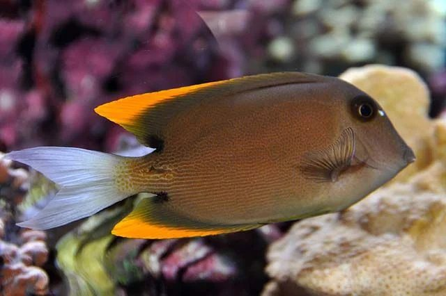

# Cirujano tomini — *Ctenochaetus tominiensis* Randall, 1955

> Archivo generado desde `especies/datos/catalogo_inicial.json` con `especies/herramientas/generar_fichas.py`. No editar a mano.

*Imagen ilustrativa generada con IA por Brayan (2026-11-18). No es una fotografía de un ejemplar real; puede contener errores anatómicos.*

**Grupo:** pez  
**Otros nombres:** Tomini tang, Bristletooth tomini tang, Tomini surgeonfish  
**Fecha de consulta:** 2026-11-18  
**Confianza global:** media  
**Estado:** verificada; pendiente de revisión del equipo

## Ficha AIRI

| Campo | Valor |
|---|---|
| Nombre común | Cirujano tomini |
| Nombre científico | *Ctenochaetus tominiensis* |
| Temperamento | Semiagresivo |
| Comportamiento | Territorial. Cirujano pequeño, agresivo solo con otros cirujanos. Buen pastador de algas. |
| Adecuado para arrecife | Sí. LiveAquaria lo considera compatible con arrecife. |
| Tipo de alimentación | Herbívoro: algas y su microfauna, algas marinas, alga seca (nori). |
| Temperatura | 22.2–25.6 °C |
| Litraje recomendado | 264.9 L (70 gal EE. UU.). *Es el mínimo recomendado por una sola fuente comercial; ninguna fuente científica consultada establece un litraje.* |
| Tamaño adulto | 16 cm (longitud estándar). Al venderse mide 1.9–15.2 cm (juvenil o subadulto). *FishBase 16 cm (longitud estándar) y LiveAquaria 6 in (≈ 15.2 cm) prácticamente coinciden.* |

## Detalle verificado

| Campo | Dato | Confianza | Fuentes |
|---|---|---|---|
| Clasificación taxonómica | Clase Teleostei; orden Acanthuriformes; familia Acanthuridae. WoRMS AphiaID 277562 (aceptado). Sinónimos: Ctenochaetus tominienis (grafía incorrecta). | alta | [worms_ctenochaetus_tominiensis](https://www.marinespecies.org/aphia.php?p=taxdetails&id=277562), [fishbase_ctenochaetus_tominiensis](https://www.fishbase.se/summary/Ctenochaetus-tominiensis.html) |
| Hábitat natural | Solo o en grupos pequeños en paredes con abundante coral de costas protegidas (FishBase). Profundidad: 0–45 m (habitual 3–25 m). Distribución: Pacífico centro-occidental: Indonesia, Filipinas, Papúa Nueva Guinea, norte de la Gran Barrera, Islas Salomón, Palaos, Vanuatu, Fiyi y Tonga. | alta | [fishbase_ctenochaetus_tominiensis](https://www.fishbase.se/summary/Ctenochaetus-tominiensis.html) |
| Tamaño adulto | Máx. 16 cm (longitud estándar). FishBase 16 cm (longitud estándar) y LiveAquaria 6 in (≈ 15.2 cm) prácticamente coinciden. | alta | [fishbase_ctenochaetus_tominiensis](https://www.fishbase.se/summary/Ctenochaetus-tominiensis.html), [liveaquaria_ctenochaetus_tominiensis](https://www.liveaquaria.com/products/bristletooth-tomini-tang) |
| Alimentación | Come algas y la microfauna que vive entre ellas (FishBase). En acuario: abundantes algas marinas y alga seca al menos tres veces por semana (LiveAquaria). | alta | [fishbase_ctenochaetus_tominiensis](https://www.fishbase.se/summary/Ctenochaetus-tominiensis.html), [liveaquaria_ctenochaetus_tominiensis](https://www.liveaquaria.com/products/bristletooth-tomini-tang) |
| Temperatura del agua | Acuario: 22.2–25.6 °C (72–78 °F). Medio natural: 24–27 °C. El rango de acuario no cae por completo dentro del rango natural registrado por FishBase. | baja | [liveaquaria_ctenochaetus_tominiensis](https://www.liveaquaria.com/products/bristletooth-tomini-tang), [fishbase_ctenochaetus_tominiensis](https://www.fishbase.se/summary/Ctenochaetus-tominiensis.html) |
| Rango de pH | Fuente de acuario: 8.1–8.4. Rango prudente AIRI: 8.1–8.3. Criterio: Intersección con la tabla MSD para agua salada (7.8–8.3). | media | [liveaquaria_ctenochaetus_tominiensis](https://www.liveaquaria.com/products/bristletooth-tomini-tang), [msd_tabla_referencia](https://www.msdvetmanual.com/multimedia/table/normal-reference-ranges-for-routine-water-quality-analysis), [msd_capitulo](https://www.msdvetmanual.com/exotic-and-laboratory-animals/aquatic-systems/environmental-diseases-of-aquatic-animals-in-aquatic-systems) |
| Salinidad | 1.020–1.025 de gravedad específica (adimensional). Agua de mar media: 35 ppt (UF/IFAS). No se convierte a ppt porque la equivalencia depende de la temperatura. | media | [liveaquaria_ctenochaetus_tominiensis](https://www.liveaquaria.com/products/bristletooth-tomini-tang), [ufifas_ph_sal_temp](https://waterwatch.ifas.ufl.edu/media/waterwatchifasufledu/FactSheet_pH_Sal_Temp.pdf) |
| Volumen mínimo | 264.9 L (70 gal EE. UU.). Justificación: Cifra de LiveAquaria (70 gal). | baja | [liveaquaria_ctenochaetus_tominiensis](https://www.liveaquaria.com/products/bristletooth-tomini-tang) |
| Comportamiento | Va solo o en grupos pequeños (FishBase). Agresivo con otros cirujanos y pacífico con el resto (LiveAquaria). | media | [fishbase_ctenochaetus_tominiensis](https://www.fishbase.se/summary/Ctenochaetus-tominiensis.html), [liveaquaria_ctenochaetus_tominiensis](https://www.liveaquaria.com/products/bristletooth-tomini-tang) |
| Territorialidad y refugio | Necesita espacio para nadar (LiveAquaria). | media | [liveaquaria_ctenochaetus_tominiensis](https://www.liveaquaria.com/products/bristletooth-tomini-tang) |
| Compatibilidad con arrecife | sí (según la fuente; sin verificación independiente) | baja | [liveaquaria_ctenochaetus_tominiensis](https://www.liveaquaria.com/products/bristletooth-tomini-tang) |
| Convivencia: condiciones | Acuario de 70 gal o más. · Dieta rica en algas. | baja | [liveaquaria_ctenochaetus_tominiensis](https://www.liveaquaria.com/products/bristletooth-tomini-tang) |
| Convivencia: riesgos | Agresivo con otros cirujanos. | baja | [liveaquaria_ctenochaetus_tominiensis](https://www.liveaquaria.com/products/bristletooth-tomini-tang) |
| Conservación | Preocupación menor (LC), evaluada el 07/05/2010, según FishBase. | media | [fishbase_ctenochaetus_tominiensis](https://www.fishbase.se/summary/Ctenochaetus-tominiensis.html) |

**Regla AIRI:** compartir rangos de agua no implica compatibilidad entre especies. Los rangos de acuario provienen de una fuente comercial y no son límites veterinarios.

## Fuentes

- **worms_ctenochaetus_tominiensis** (taxonomía): WoRMS — Ctenochaetus tominiensis Randall, 1955 (AphiaID 277562). <https://www.marinespecies.org/aphia.php?p=taxdetails&id=277562>. Consultada el 2026-11-18.
- **fishbase_ctenochaetus_tominiensis** (biología): FishBase — Ctenochaetus tominiensis. <https://www.fishbase.se/summary/Ctenochaetus-tominiensis.html>. Consultada el 2026-11-18.
- **liveaquaria_ctenochaetus_tominiensis** (comercial): LiveAquaria — Bristletooth Tomini Tang (Ctenochaetus tominiensis). <https://www.liveaquaria.com/products/bristletooth-tomini-tang>. Consultada el 2026-11-18.
- **msd_tabla_referencia** (veterinaria): MSD Veterinary Manual — “Normal” Reference Ranges for Routine Water Quality Analysis. <https://www.msdvetmanual.com/multimedia/table/normal-reference-ranges-for-routine-water-quality-analysis>. Consultada el 2026-11-12. Reutilizada del registro del motor (motor/airi_motor/datos/fuentes.json); no se volvió a consultar para estas fichas.
- **ufifas_ph_sal_temp** (institucional): UF/IFAS — pH, Salinity and Temperature (hoja informativa). <https://waterwatch.ifas.ufl.edu/media/waterwatchifasufledu/FactSheet_pH_Sal_Temp.pdf>. Consultada el 2026-11-12. Reutilizada del registro del motor (motor/airi_motor/datos/fuentes.json); no se volvió a consultar para estas fichas.
- **msd_capitulo** (veterinaria): MSD Veterinary Manual — Environmental Diseases of Aquatic Animals in Aquatic Systems. <https://www.msdvetmanual.com/exotic-and-laboratory-animals/aquatic-systems/environmental-diseases-of-aquatic-animals-in-aquatic-systems>. Consultada el 2026-11-12. Reutilizada del registro del motor (motor/airi_motor/datos/fuentes.json); no se volvió a consultar para estas fichas.
