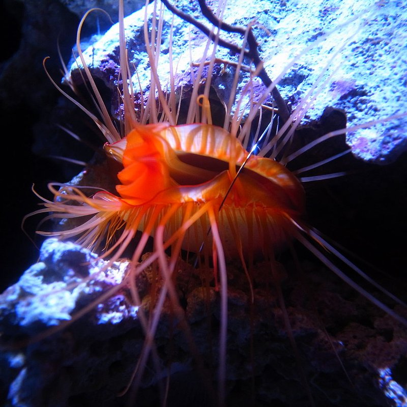

# Almeja fuego — *Ctenoides scaber* (Born, 1778)

> Archivo generado desde `especies/datos/catalogo_inicial.json` con `especies/herramientas/generar_fichas.py`. No editar a mano.

*Imagen ilustrativa generada con IA por Brayan (2026-11-18). No es una fotografía de un ejemplar real; puede contener errores anatómicos.*

**Grupo:** almeja  
**Otros nombres:** Flame scallop, Red file shell clam, Rough fileclam, Lima scabra (nombre comercial)  
**Fecha de consulta:** 2026-11-18  
**Confianza global:** baja  
**Estado:** verificada; pendiente de revisión del equipo

## Ficha AIRI

| Campo | Valor |
|---|---|
| Nombre común | Almeja fuego |
| Nombre científico | *Ctenoides scaber* |
| Temperamento | Pacífico |
| Comportamiento | Pacífico, Sociable. Pacífica pero muy difícil (solo expertos): hay que alimentarla una a una con plancton. Nada cerrando sus valvas. |
| Adecuado para arrecife | Sí. LiveAquaria y Saltwaterfish la consideran apta para arrecife. |
| Tipo de alimentación | Filtrador: microplancton, fitoplancton, alimentos orgánicos líquidos. |
| Temperatura | 22.2–25.6 °C *Rango de LiveAquaria.* |
| Litraje recomendado | 75.7 L (20 gal EE. UU.). *Es el mínimo de una sola fuente comercial y corresponde a una Lima sp., no necesariamente a C. scaber.* |
| Tamaño adulto | 7.6 cm (longitud de la concha). *Diferencia entre fuentes: LiveAquaria 3 in (≈ 7.6 cm); Saltwaterfish 4 in (≈ 10.2 cm) para una Lima sp. SeaLifeBase no indica tamaño.* |

## Detalle verificado

| Campo | Dato | Confianza | Fuentes |
|---|---|---|---|
| Clasificación taxonómica | Clase Bivalvia; orden Limida; familia Limidae. WoRMS AphiaID 420747 (aceptado). Sinónimos: Lima scabra (Born, 1778), Lima aspera Thiele, 1918. LiveAquaria la vende como Lima scabra, sinónimo de Ctenoides scaber según WoRMS. Aunque en inglés se llama «scallop» (vieira), es una lima de la familia Limidae, no una vieira verdadera. | alta | [worms_ctenoides_scaber](https://www.marinespecies.org/aphia.php?p=taxdetails&id=420747), [sealifebase_ctenoides_scaber](https://www.sealifebase.se/summary/Ctenoides-scaber.html) |
| Hábitat natural | Bentónica, de 0 a 141 m (SeaLifeBase). Construye un pequeño nido de piedrecitas y trozos de coral donde se encaja (LiveAquaria). Profundidad: 0–141 m. Distribución: Atlántico centro-occidental: Estados Unidos y Bonaire (SeaLifeBase). | media | [sealifebase_ctenoides_scaber](https://www.sealifebase.se/summary/Ctenoides-scaber.html), [liveaquaria_ctenoides_scaber](https://www.liveaquaria.com/products/flame-scallop-expert-only) |
| Tamaño adulto | Máx. 7.6 cm (longitud de la concha). Diferencia entre fuentes: LiveAquaria 3 in (≈ 7.6 cm); Saltwaterfish 4 in (≈ 10.2 cm) para una Lima sp. SeaLifeBase no indica tamaño. | baja | [liveaquaria_ctenoides_scaber](https://www.liveaquaria.com/products/flame-scallop-expert-only), [saltwaterfish_ctenoides_scaber](https://www.saltwaterfish.com/product-flame-scallop) |
| Alimentación | Filtradora y no fotosintética: necesita microplancton en suspensión, fitoplancton y alimentos orgánicos, que hay que darle a cada una con una pipeta, corriente arriba (LiveAquaria). | media | [liveaquaria_ctenoides_scaber](https://www.liveaquaria.com/products/flame-scallop-expert-only) |
| Temperatura del agua | Acuario: 22.2–25.6 °C (72–78 °F). SeaLifeBase no indica rango de temperatura para esta especie. | baja | [liveaquaria_ctenoides_scaber](https://www.liveaquaria.com/products/flame-scallop-expert-only) |
| Rango de pH | Fuente de acuario: 8.1–8.4. Rango prudente AIRI: 8.1–8.3. Criterio: Intersección con la tabla MSD para agua salada (7.8–8.3). | media | [liveaquaria_ctenoides_scaber](https://www.liveaquaria.com/products/flame-scallop-expert-only), [msd_tabla_referencia](https://www.msdvetmanual.com/multimedia/table/normal-reference-ranges-for-routine-water-quality-analysis), [msd_capitulo](https://www.msdvetmanual.com/exotic-and-laboratory-animals/aquatic-systems/environmental-diseases-of-aquatic-animals-in-aquatic-systems) |
| Salinidad | 1.023–1.025 de gravedad específica (adimensional). Agua de mar media: 35 ppt (UF/IFAS). No se convierte a ppt porque la equivalencia depende de la temperatura. | media | [liveaquaria_ctenoides_scaber](https://www.liveaquaria.com/products/flame-scallop-expert-only), [ufifas_ph_sal_temp](https://waterwatch.ifas.ufl.edu/media/waterwatchifasufledu/FactSheet_pH_Sal_Temp.pdf) |
| Volumen mínimo | 75.7 L (20 gal EE. UU.). Justificación: Cifra de Saltwaterfish («Minimum Tank Size: 20 gallons») para una Lima sp. | baja | [saltwaterfish_ctenoides_scaber](https://www.saltwaterfish.com/product-flame-scallop) |
| Comportamiento | Si se siente amenazada escapa nadando: cierra sus valvas de golpe y se impulsa por el agua. Tolera a todos los animales que no intenten comérsela y puede vivir en grupo. Solo para expertos (LiveAquaria). | media | [liveaquaria_ctenoides_scaber](https://www.liveaquaria.com/products/flame-scallop-expert-only) |
| Territorialidad y refugio | Se encaja en un nido de piedras y trozos de coral (LiveAquaria). | media | [liveaquaria_ctenoides_scaber](https://www.liveaquaria.com/products/flame-scallop-expert-only) |
| Compatibilidad con arrecife | sí (según la fuente; sin verificación independiente) | baja | [liveaquaria_ctenoides_scaber](https://www.liveaquaria.com/products/flame-scallop-expert-only), [saltwaterfish_ctenoides_scaber](https://www.saltwaterfish.com/product-flame-scallop) |
| Convivencia: condiciones | Arrecife maduro. · Fitoplancton y alimento orgánico para cada individuo. · Calcio y alcalinidad adecuados. | baja | [liveaquaria_ctenoides_scaber](https://www.liveaquaria.com/products/flame-scallop-expert-only) |
| Convivencia: riesgos | No tolera medicamentos con cobre ni nitratos altos. · Cuidado muy difícil: solo para expertos. | baja | [liveaquaria_ctenoides_scaber](https://www.liveaquaria.com/products/flame-scallop-expert-only) |
| Conservación | No evaluada por la UICN, según SeaLifeBase. | media | [sealifebase_ctenoides_scaber](https://www.sealifebase.se/summary/Ctenoides-scaber.html) |

**Regla AIRI:** compartir rangos de agua no implica compatibilidad entre especies. Los rangos de acuario provienen de una fuente comercial y no son límites veterinarios.

## Fuentes

- **worms_ctenoides_scaber** (taxonomía): WoRMS — Ctenoides scaber (Born, 1778) (AphiaID 420747). <https://www.marinespecies.org/aphia.php?p=taxdetails&id=420747>. Consultada el 2026-11-18.
- **sealifebase_ctenoides_scaber** (biología): SeaLifeBase — Ctenoides scaber. <https://www.sealifebase.se/summary/Ctenoides-scaber.html>. Consultada el 2026-11-18.
- **liveaquaria_ctenoides_scaber** (comercial): LiveAquaria — Flame Scallop (Red File Shell Clam) (Lima scabra). <https://www.liveaquaria.com/products/flame-scallop-expert-only>. Consultada el 2026-11-18.
- **saltwaterfish_ctenoides_scaber** (comercial): Saltwaterfish — Electric Flame Scallop (Lima sp.). <https://www.saltwaterfish.com/product-flame-scallop>. Consultada el 2026-11-18.
- **msd_tabla_referencia** (veterinaria): MSD Veterinary Manual — “Normal” Reference Ranges for Routine Water Quality Analysis. <https://www.msdvetmanual.com/multimedia/table/normal-reference-ranges-for-routine-water-quality-analysis>. Consultada el 2026-11-12. Reutilizada del registro del motor (motor/airi_motor/datos/fuentes.json); no se volvió a consultar para estas fichas.
- **ufifas_ph_sal_temp** (institucional): UF/IFAS — pH, Salinity and Temperature (hoja informativa). <https://waterwatch.ifas.ufl.edu/media/waterwatchifasufledu/FactSheet_pH_Sal_Temp.pdf>. Consultada el 2026-11-12. Reutilizada del registro del motor (motor/airi_motor/datos/fuentes.json); no se volvió a consultar para estas fichas.
- **msd_capitulo** (veterinaria): MSD Veterinary Manual — Environmental Diseases of Aquatic Animals in Aquatic Systems. <https://www.msdvetmanual.com/exotic-and-laboratory-animals/aquatic-systems/environmental-diseases-of-aquatic-animals-in-aquatic-systems>. Consultada el 2026-11-12. Reutilizada del registro del motor (motor/airi_motor/datos/fuentes.json); no se volvió a consultar para estas fichas.
