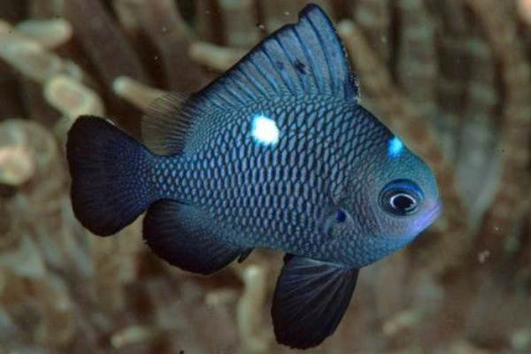

# Damisela dominó — *Dascyllus trimaculatus* (Rüppell, 1829)

> Archivo generado desde `especies/datos/catalogo_inicial.json` con `especies/herramientas/generar_fichas.py`. No editar a mano.

*Imagen ilustrativa generada con IA por Brayan (2026-11-18). No es una fotografía de un ejemplar real; puede contener errores anatómicos.*

**Grupo:** pez  
**Otros nombres:** Domino damselfish, Three spot damselfish, Threespot dascyllus  
**Fecha de consulta:** 2026-11-18  
**Confianza global:** media  
**Estado:** verificada; pendiente de revisión del equipo

## Ficha AIRI

| Campo | Valor |
|---|---|
| Nombre común | Damisela dominó |
| Nombre científico | *Dascyllus trimaculatus* |
| Temperamento | Agresivo |
| Comportamiento | Sociable. Resistente y fácil, pero muy agresivo de adulto. Los juveniles pueden vivir en una anémona. |
| Adecuado para arrecife | Sí. LiveAquaria lo considera compatible con arrecife. |
| Tipo de alimentación | Omnívoro: algas, crustáceos planctónicos, alimentos cárneos, escamas. |
| Temperatura | 22.2–25.6 °C |
| Litraje recomendado | 113.6 L (30 gal EE. UU.). *Es el mínimo recomendado por una sola fuente comercial; ninguna fuente científica consultada establece un litraje.* |
| Tamaño adulto | 14 cm (longitud total). Al venderse mide 2.5–7.6 cm (juvenil o subadulto). *FishBase 14 cm y LiveAquaria 5½ in (≈ 14 cm) coinciden.* |

## Detalle verificado

| Campo | Dato | Confianza | Fuentes |
|---|---|---|---|
| Clasificación taxonómica | Clase Teleostei; orden Ovalentaria (incertae sedis); familia Pomacentridae. WoRMS AphiaID 212846 (aceptado). Sinónimos: Dascyllus axillaris Smith, 1935, Dascyllus unicolor Bennett, 1831. | alta | [worms_dascyllus_trimaculatus](https://www.marinespecies.org/aphia.php?p=taxdetails&id=212846), [fishbase_dascyllus_trimaculatus](https://www.fishbase.se/summary/Dascyllus-trimaculatus.html) |
| Hábitat natural | Arrecifes coralinos y rocosos; los juveniles suelen vivir con grandes anémonas, erizos o pequeñas cabezas de coral (FishBase). Profundidad: 0–55 m. Distribución: Indo-Pacífico: del mar Rojo y África oriental a las islas de la Línea y Pitcairn; al norte hasta el sur de Japón y al sur hasta Sídney. No vive en Hawái ni en las Marquesas. | alta | [fishbase_dascyllus_trimaculatus](https://www.fishbase.se/summary/Dascyllus-trimaculatus.html) |
| Tamaño adulto | Máx. 14 cm (longitud total). FishBase 14 cm y LiveAquaria 5½ in (≈ 14 cm) coinciden. | alta | [fishbase_dascyllus_trimaculatus](https://www.fishbase.se/summary/Dascyllus-trimaculatus.html), [liveaquaria_dascyllus_trimaculatus](https://www.liveaquaria.com/products/three-spot-domino-damselfish) |
| Alimentación | Su contenido estomacal incluye algas, copépodos y otros crustáceos planctónicos (FishBase). En acuario: alimentos cárneos, preparados para herbívoros y escamas (LiveAquaria). | alta | [fishbase_dascyllus_trimaculatus](https://www.fishbase.se/summary/Dascyllus-trimaculatus.html), [liveaquaria_dascyllus_trimaculatus](https://www.liveaquaria.com/products/three-spot-domino-damselfish) |
| Temperatura del agua | Acuario: 22.2–25.6 °C (72–78 °F). FishBase no indica rango de temperatura para esta especie. | baja | [liveaquaria_dascyllus_trimaculatus](https://www.liveaquaria.com/products/three-spot-domino-damselfish) |
| Rango de pH | Fuente de acuario: 8.1–8.4. Rango prudente AIRI: 8.1–8.3. Criterio: Intersección con la tabla MSD para agua salada (7.8–8.3). | media | [liveaquaria_dascyllus_trimaculatus](https://www.liveaquaria.com/products/three-spot-domino-damselfish), [msd_tabla_referencia](https://www.msdvetmanual.com/multimedia/table/normal-reference-ranges-for-routine-water-quality-analysis), [msd_capitulo](https://www.msdvetmanual.com/exotic-and-laboratory-animals/aquatic-systems/environmental-diseases-of-aquatic-animals-in-aquatic-systems) |
| Salinidad | 1.020–1.025 de gravedad específica (adimensional). Agua de mar media: 35 ppt (UF/IFAS). No se convierte a ppt porque la equivalencia depende de la temperatura. | media | [liveaquaria_dascyllus_trimaculatus](https://www.liveaquaria.com/products/three-spot-domino-damselfish), [ufifas_ph_sal_temp](https://waterwatch.ifas.ufl.edu/media/waterwatchifasufledu/FactSheet_pH_Sal_Temp.pdf) |
| Volumen mínimo | 113.6 L (30 gal EE. UU.). Justificación: Cifra de LiveAquaria (30 gal). | baja | [liveaquaria_dascyllus_trimaculatus](https://www.liveaquaria.com/products/three-spot-domino-damselfish) |
| Comportamiento | Vive en grupos pequeños o grandes; los machos cuidan y oxigenan los huevos (FishBase). Se vuelve más activo y agresivo con la edad; tolera agua de calidad deficiente, por eso es popular entre principiantes (LiveAquaria). | media | [fishbase_dascyllus_trimaculatus](https://www.fishbase.se/summary/Dascyllus-trimaculatus.html), [liveaquaria_dascyllus_trimaculatus](https://www.liveaquaria.com/products/three-spot-domino-damselfish) |
| Territorialidad y refugio | Los juveniles se refugian en anémonas, erizos o cabezas de coral (FishBase). | media | [fishbase_dascyllus_trimaculatus](https://www.fishbase.se/summary/Dascyllus-trimaculatus.html) |
| Compatibilidad con arrecife | sí (según la fuente; sin verificación independiente) | baja | [liveaquaria_dascyllus_trimaculatus](https://www.liveaquaria.com/products/three-spot-domino-damselfish) |
| Convivencia: condiciones | Acuario de 30 gal o más. · Compañeros más grandes que él. | baja | [liveaquaria_dascyllus_trimaculatus](https://www.liveaquaria.com/products/three-spot-domino-damselfish) |
| Convivencia: riesgos | Se vuelve agresivo con la edad. | baja | [liveaquaria_dascyllus_trimaculatus](https://www.liveaquaria.com/products/three-spot-domino-damselfish) |
| Conservación | Preocupación menor (LC), evaluada el 23/09/2021, según FishBase. | media | [fishbase_dascyllus_trimaculatus](https://www.fishbase.se/summary/Dascyllus-trimaculatus.html) |

**Regla AIRI:** compartir rangos de agua no implica compatibilidad entre especies. Los rangos de acuario provienen de una fuente comercial y no son límites veterinarios.

## Fuentes

- **worms_dascyllus_trimaculatus** (taxonomía): WoRMS — Dascyllus trimaculatus (Rüppell, 1829) (AphiaID 212846). <https://www.marinespecies.org/aphia.php?p=taxdetails&id=212846>. Consultada el 2026-11-18.
- **fishbase_dascyllus_trimaculatus** (biología): FishBase — Dascyllus trimaculatus. <https://www.fishbase.se/summary/Dascyllus-trimaculatus.html>. Consultada el 2026-11-18.
- **liveaquaria_dascyllus_trimaculatus** (comercial): LiveAquaria — Three Spot Domino Damselfish (Dascyllus trimaculatus). <https://www.liveaquaria.com/products/three-spot-domino-damselfish>. Consultada el 2026-11-18.
- **msd_tabla_referencia** (veterinaria): MSD Veterinary Manual — “Normal” Reference Ranges for Routine Water Quality Analysis. <https://www.msdvetmanual.com/multimedia/table/normal-reference-ranges-for-routine-water-quality-analysis>. Consultada el 2026-11-12. Reutilizada del registro del motor (motor/airi_motor/datos/fuentes.json); no se volvió a consultar para estas fichas.
- **ufifas_ph_sal_temp** (institucional): UF/IFAS — pH, Salinity and Temperature (hoja informativa). <https://waterwatch.ifas.ufl.edu/media/waterwatchifasufledu/FactSheet_pH_Sal_Temp.pdf>. Consultada el 2026-11-12. Reutilizada del registro del motor (motor/airi_motor/datos/fuentes.json); no se volvió a consultar para estas fichas.
- **msd_capitulo** (veterinaria): MSD Veterinary Manual — Environmental Diseases of Aquatic Animals in Aquatic Systems. <https://www.msdvetmanual.com/exotic-and-laboratory-animals/aquatic-systems/environmental-diseases-of-aquatic-animals-in-aquatic-systems>. Consultada el 2026-11-12. Reutilizada del registro del motor (motor/airi_motor/datos/fuentes.json); no se volvió a consultar para estas fichas.
