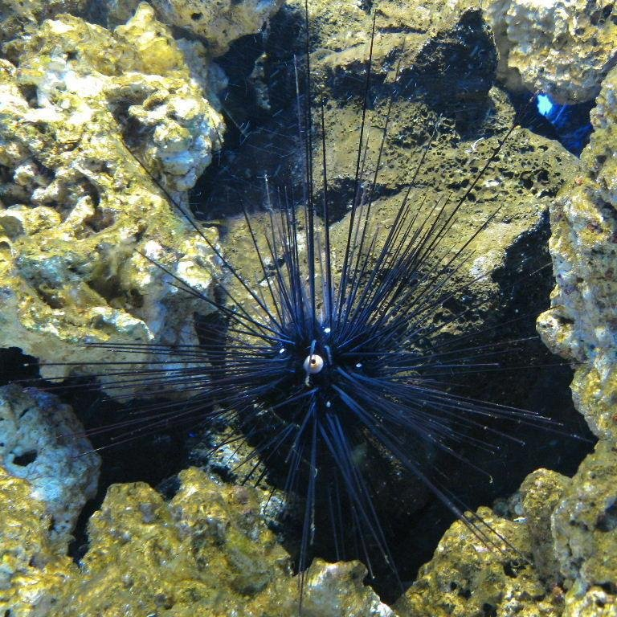

# Erizo de puntas largas — *Diadema setosum* (Leske, 1778)

> Archivo generado desde `especies/datos/catalogo_inicial.json` con `especies/herramientas/generar_fichas.py`. No editar a mano.

*Imagen ilustrativa generada con IA por Brayan (2026-11-16). No es una fotografía de un ejemplar real; puede contener errores anatómicos.*

**Grupo:** erizo de mar  
**Otros nombres:** Long spine urchin, Black longspine urchin, Porcupine sea urchin  
**Fecha de consulta:** 2026-11-16  
**Confianza global:** media  
**Estado:** verificada; pendiente de revisión del equipo

## Ficha AIRI

| Campo | Valor |
|---|---|
| Nombre común | Erizo de puntas largas |
| Nombre científico | *Diadema setosum* |
| Temperamento | Pacífico |
| Comportamiento | Pacífico. Pacífico y nocturno, buen controlador de algas. Sus espinas largas son venenosas: su picadura se compara con la de una abeja. |
| Adecuado para arrecife | Sí. LiveAquaria y Saltwaterfish lo consideran apto para arrecife. |
| Tipo de alimentación | Herbívoro: algas incrustantes, algas del coral muerto y el cascajo, alga seca (suplemento). |
| Temperatura | 22.2–25.6 °C *Dentro del rango natural registrado (16.9–30.8 °C).* |
| Litraje recomendado | 283.9 L (75 gal EE. UU.). *Es el mínimo de una sola fuente comercial.* |
| Tamaño adulto | 10.2 cm (diámetro del cuerpo). Al venderse mide 3.8–10.2 cm (juvenil o subadulto). *Saltwaterfish: cuerpo de 4 in (≈ 10.2 cm) y espinas de 10–12 in (≈ 25–30 cm). LiveAquaria indica 10 in (≈ 25.4 cm) sin aclarar si incluye las espinas. SeaLifeBase no indica tamaño.* |

## Detalle verificado

| Campo | Dato | Confianza | Fuentes |
|---|---|---|---|
| Clasificación taxonómica | Clase Echinoidea; orden Diadematoida; familia Diadematidae. WoRMS AphiaID 213372 (aceptado). Sinónimos: Echinometra setosa Leske, 1778 (combinación original), Diadema saxatile. | alta | [worms_diadema_setosum](https://www.marinespecies.org/aphia.php?p=taxdetails&id=213372), [sealifebase_diadema_setosum](https://www.sealifebase.se/summary/Diadema-setosum.html) |
| Hábitat natural | Franja sublitoral de costas rocosas protegidas; también fondos fangosos, arrecifes dominados por Porites, arrecifes coralinos y praderas marinas. Se esconde en grietas, sobre todo con luz intensa (SeaLifeBase). Profundidad: 0–70 m. Distribución: Indo-Pacífico, del Mar Rojo a las islas del Pacífico Sur y Japón; introducido en el Mediterráneo. | media | [sealifebase_diadema_setosum](https://www.sealifebase.se/summary/Diadema-setosum.html) |
| Tamaño adulto | Máx. 10.2 cm (diámetro del cuerpo). Saltwaterfish: cuerpo de 4 in (≈ 10.2 cm) y espinas de 10–12 in (≈ 25–30 cm). LiveAquaria indica 10 in (≈ 25.4 cm) sin aclarar si incluye las espinas. SeaLifeBase no indica tamaño. | baja | [saltwaterfish_diadema_setosum](https://www.saltwaterfish.com/product-diadema-long-spine-urchin) |
| Alimentación | Herbívoro nocturno: de noche pasta algas incrustantes sobre sustratos duros y algas del coral muerto o el cascajo (SeaLifeBase). En acuario, algas y alga seca (LiveAquaria). | alta | [sealifebase_diadema_setosum](https://www.sealifebase.se/summary/Diadema-setosum.html), [liveaquaria_diadema_setosum](https://www.liveaquaria.com/products/longspine-urchin-black) |
| Temperatura del agua | Acuario: 22.2–25.6 °C (72–78 °F). Medio natural: 16.9–30.8 °C. SeaLifeBase registra temperaturas del agua de 16.9 a 30.8 °C en su medio natural; el rango de acuario cae dentro. | media | [liveaquaria_diadema_setosum](https://www.liveaquaria.com/products/longspine-urchin-black), [sealifebase_diadema_setosum](https://www.sealifebase.se/summary/Diadema-setosum.html) |
| Rango de pH | Fuente de acuario: 8.1–8.4. Rango prudente AIRI: 8.1–8.3. Criterio: Intersección con la tabla MSD para agua salada (7.8–8.3). | media | [liveaquaria_diadema_setosum](https://www.liveaquaria.com/products/longspine-urchin-black), [msd_tabla_referencia](https://www.msdvetmanual.com/multimedia/table/normal-reference-ranges-for-routine-water-quality-analysis), [msd_capitulo](https://www.msdvetmanual.com/exotic-and-laboratory-animals/aquatic-systems/environmental-diseases-of-aquatic-animals-in-aquatic-systems) |
| Salinidad | 1.023–1.025 de gravedad específica (adimensional). Agua de mar media: 35 ppt (UF/IFAS). No se convierte a ppt porque la equivalencia depende de la temperatura. | media | [liveaquaria_diadema_setosum](https://www.liveaquaria.com/products/longspine-urchin-black), [ufifas_ph_sal_temp](https://waterwatch.ifas.ufl.edu/media/waterwatchifasufledu/FactSheet_pH_Sal_Temp.pdf) |
| Volumen mínimo | 283.9 L (75 gal EE. UU.). Justificación: Cifra de Saltwaterfish («Minimum Tank Size: 75 Gallons»). | baja | [saltwaterfish_diadema_setosum](https://www.saltwaterfish.com/product-diadema-long-spine-urchin) |
| Comportamiento | Nocturno: de día se esconde y de noche sale a buscar alimento. Cuando un pez se acerca, orienta sus espinas hacia él para defenderse. Es un buen controlador de algas en acuarios con peces agresivos (LiveAquaria). SeaLifeBase lo clasifica como venenoso. | media | [liveaquaria_diadema_setosum](https://www.liveaquaria.com/products/longspine-urchin-black), [sealifebase_diadema_setosum](https://www.sealifebase.se/summary/Diadema-setosum.html) |
| Territorialidad y refugio | Necesita escondites y espacio para desplazarse. | media | [liveaquaria_diadema_setosum](https://www.liveaquaria.com/products/longspine-urchin-black) |
| Compatibilidad con arrecife | sí (según la fuente; sin verificación independiente) | baja | [liveaquaria_diadema_setosum](https://www.liveaquaria.com/products/longspine-urchin-black), [saltwaterfish_diadema_setosum](https://www.saltwaterfish.com/product-diadema-long-spine-urchin) |
| Convivencia: condiciones | Escondites y espacio para desplazarse. · Algas suficientes. | baja | [liveaquaria_diadema_setosum](https://www.liveaquaria.com/products/longspine-urchin-black) |
| Convivencia: riesgos | Espinas venenosas: picadura comparable a la de una abeja (LiveAquaria; SeaLifeBase lo clasifica como venenoso). · Perder espinas indica muy mala calidad del agua. · No tolera medicamentos con cobre ni nitratos altos. | baja | [liveaquaria_diadema_setosum](https://www.liveaquaria.com/products/longspine-urchin-black) |
| Conservación | No evaluado por la UICN, según SeaLifeBase. Los datos rápidos de LiveAquaria indican «Venomous: No», pero su propia descripción y SeaLifeBase indican que es venenoso. | media | [sealifebase_diadema_setosum](https://www.sealifebase.se/summary/Diadema-setosum.html) |

**Regla AIRI:** compartir rangos de agua no implica compatibilidad entre especies. Los rangos de acuario provienen de una fuente comercial y no son límites veterinarios.

## Fuentes

- **worms_diadema_setosum** (taxonomía): WoRMS — Diadema setosum (Leske, 1778) (AphiaID 213372). <https://www.marinespecies.org/aphia.php?p=taxdetails&id=213372>. Consultada el 2026-11-16.
- **sealifebase_diadema_setosum** (biología): SeaLifeBase — Diadema setosum. <https://www.sealifebase.se/summary/Diadema-setosum.html>. Consultada el 2026-11-16.
- **liveaquaria_diadema_setosum** (comercial): LiveAquaria — Black Longspine Urchin. <https://www.liveaquaria.com/products/longspine-urchin-black>. Consultada el 2026-11-16.
- **saltwaterfish_diadema_setosum** (comercial): Saltwaterfish — Black Longspine Urchin. <https://www.saltwaterfish.com/product-diadema-long-spine-urchin>. Consultada el 2026-11-16.
- **msd_tabla_referencia** (veterinaria): MSD Veterinary Manual — “Normal” Reference Ranges for Routine Water Quality Analysis. <https://www.msdvetmanual.com/multimedia/table/normal-reference-ranges-for-routine-water-quality-analysis>. Consultada el 2026-11-12. Reutilizada del registro del motor (motor/airi_motor/datos/fuentes.json); no se volvió a consultar para estas fichas.
- **ufifas_ph_sal_temp** (institucional): UF/IFAS — pH, Salinity and Temperature (hoja informativa). <https://waterwatch.ifas.ufl.edu/media/waterwatchifasufledu/FactSheet_pH_Sal_Temp.pdf>. Consultada el 2026-11-12. Reutilizada del registro del motor (motor/airi_motor/datos/fuentes.json); no se volvió a consultar para estas fichas.
- **msd_capitulo** (veterinaria): MSD Veterinary Manual — Environmental Diseases of Aquatic Animals in Aquatic Systems. <https://www.msdvetmanual.com/exotic-and-laboratory-animals/aquatic-systems/environmental-diseases-of-aquatic-animals-in-aquatic-systems>. Consultada el 2026-11-12. Reutilizada del registro del motor (motor/airi_motor/datos/fuentes.json); no se volvió a consultar para estas fichas.
