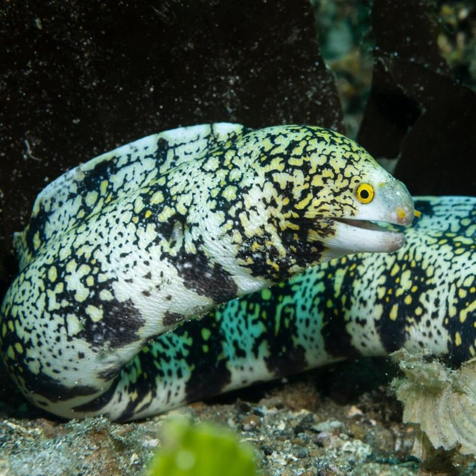

# Morena copo de nieve — *Echidna nebulosa* (Ahl, 1789)

> Archivo generado desde `especies/datos/catalogo_inicial.json` con `especies/herramientas/generar_fichas.py`. No editar a mano.

*Imagen ilustrativa generada con IA por Brayan (2026-11-16). No es una fotografía de un ejemplar real; puede contener errores anatómicos.*

**Grupo:** pez  
**Otros nombres:** Snowflake eel, Snowflake moray, Starry moray  
**Fecha de consulta:** 2026-11-16  
**Confianza global:** media  
**Estado:** verificada; pendiente de revisión del equipo

## Ficha AIRI

| Campo | Valor |
|---|---|
| Nombre común | Morena copo de nieve |
| Nombre científico | *Echidna nebulosa* |
| Temperamento | Semiagresivo |
| Comportamiento | Solitario. Solitaria y nocturna. Se escapa con facilidad: necesita tapa bien sellada. Puede morder si se la alimenta con la mano. |
| Adecuado para arrecife | Con precaución. LiveAquaria indica que puede convivir con anémonas y corales, pero no con crustáceos. |
| Tipo de alimentación | Carnívoro: crustáceos, peces pequeños, krill, pescado y camarón. |
| Temperatura | 22.2–25.6 °C |
| Litraje recomendado | 189.2 L (50 gal EE. UU.). *Es el mínimo recomendado por una sola fuente comercial; ninguna fuente científica consultada establece un litraje.* |
| Tamaño adulto | 100 cm (longitud total). Al venderse mide 10.2–30.5 cm (juvenil o subadulto). *FishBase: 100 cm (longitud habitual 50 cm). LiveAquaria indica en su texto 39 in (≈ 99 cm) en la naturaleza y que en acuario rara vez supera 24 in (≈ 61 cm); sus datos rápidos dicen «2 in», un error evidente de la página.* |

## Detalle verificado

| Campo | Dato | Confianza | Fuentes |
|---|---|---|---|
| Clasificación taxonómica | Clase Teleostei; orden Anguilliformes; familia Muraenidae; subfamilia Muraeninae. WoRMS AphiaID 217469 (aceptado). Sinónimos: Muraena nebulosa Ahl, 1789 (combinación original), Echidna variegata. | alta | [worms_echidna_nebulosa](https://www.marinespecies.org/aphia.php?p=taxdetails&id=217469), [fishbase_echidna_nebulosa](https://www.fishbase.se/summary/Echidna-nebulosa.html) |
| Hábitat natural | Entre rocas y corales de planicies arrecifales intermareales, lagunas someras y arrecifes externos hasta al menos 10 m. Nocturna y solitaria; suele verse con solo la cabeza fuera. Profundidad: 0–48 m (habitual hasta 10 m). Distribución: Indo-Pacífico occidental, del Mar Rojo y África oriental a las islas de la Sociedad, sur de Japón y Hawái; Pacífico oriental, del sur de Baja California al norte de Colombia. | media | [fishbase_echidna_nebulosa](https://www.fishbase.se/summary/Echidna-nebulosa.html) |
| Tamaño adulto | Máx. 100 cm (longitud total). FishBase: 100 cm (longitud habitual 50 cm). LiveAquaria indica en su texto 39 in (≈ 99 cm) en la naturaleza y que en acuario rara vez supera 24 in (≈ 61 cm); sus datos rápidos dicen «2 in», un error evidente de la página. | alta | [fishbase_echidna_nebulosa](https://www.fishbase.se/summary/Echidna-nebulosa.html), [liveaquaria_echidna_nebulosa](https://www.liveaquaria.com/products/snowflake-eel) |
| Alimentación | Carnívora: come sobre todo crustáceos (FishBase). Es una depredadora nocturna que embosca peces y crustáceos; en acuario acepta krill, pescado, camarón y alimentos cárnicos (LiveAquaria). | alta | [fishbase_echidna_nebulosa](https://www.fishbase.se/summary/Echidna-nebulosa.html), [liveaquaria_echidna_nebulosa](https://www.liveaquaria.com/products/snowflake-eel) |
| Temperatura del agua | Acuario: 22.2–25.6 °C (72–78 °F). FishBase no indica rango de temperatura para esta especie. | baja | [liveaquaria_echidna_nebulosa](https://www.liveaquaria.com/products/snowflake-eel) |
| Rango de pH | Fuente de acuario: 8.1–8.4. Rango prudente AIRI: 8.1–8.3. Criterio: Intersección con la tabla MSD para agua salada (7.8–8.3). | media | [liveaquaria_echidna_nebulosa](https://www.liveaquaria.com/products/snowflake-eel), [msd_tabla_referencia](https://www.msdvetmanual.com/multimedia/table/normal-reference-ranges-for-routine-water-quality-analysis), [msd_capitulo](https://www.msdvetmanual.com/exotic-and-laboratory-animals/aquatic-systems/environmental-diseases-of-aquatic-animals-in-aquatic-systems) |
| Salinidad | 1.020–1.025 de gravedad específica (adimensional). Agua de mar media: 35 ppt (UF/IFAS). No se convierte a ppt porque la equivalencia depende de la temperatura. | media | [liveaquaria_echidna_nebulosa](https://www.liveaquaria.com/products/snowflake-eel), [ufifas_ph_sal_temp](https://waterwatch.ifas.ufl.edu/media/waterwatchifasufledu/FactSheet_pH_Sal_Temp.pdf) |
| Volumen mínimo | 189.2 L (50 gal EE. UU.). Justificación: Cifra de LiveAquaria (50 gal), con mucha roca viva y una tapa muy bien ajustada, porque escapa con facilidad. | baja | [liveaquaria_echidna_nebulosa](https://www.liveaquaria.com/products/snowflake-eel) |
| Comportamiento | Nocturna y solitaria (FishBase). Muy resistente, pero se escapa con facilidad. Puede morder de forma dolorosa si se le alimenta con la mano (LiveAquaria). | media | [fishbase_echidna_nebulosa](https://www.fishbase.se/summary/Echidna-nebulosa.html), [liveaquaria_echidna_nebulosa](https://www.liveaquaria.com/products/snowflake-eel) |
| Territorialidad y refugio | Se refugia en cuevas y grietas. | media | [liveaquaria_echidna_nebulosa](https://www.liveaquaria.com/products/snowflake-eel), [fishbase_echidna_nebulosa](https://www.fishbase.se/summary/Echidna-nebulosa.html) |
| Compatibilidad con arrecife | con precaución (según la fuente; sin verificación independiente) | baja | [liveaquaria_echidna_nebulosa](https://www.liveaquaria.com/products/snowflake-eel) |
| Convivencia: condiciones | Tapa muy bien sellada. · Compañeros que no pueda tragar. | baja | [liveaquaria_echidna_nebulosa](https://www.liveaquaria.com/products/snowflake-eel), [fishbase_echidna_nebulosa](https://www.fishbase.se/summary/Echidna-nebulosa.html) |
| Convivencia: riesgos | Come crustáceos y peces que pueda tragar. · Se escapa por cualquier abertura. · Mordida dolorosa. | baja | [liveaquaria_echidna_nebulosa](https://www.liveaquaria.com/products/snowflake-eel), [fishbase_echidna_nebulosa](https://www.fishbase.se/summary/Echidna-nebulosa.html) |
| Conservación | Preocupación menor (LC), evaluada el 16/08/2011, según FishBase. FishBase indica que puede mantenerse con peces pequeños; LiveAquaria advierte que comerá los que pueda tragar. | media | [fishbase_echidna_nebulosa](https://www.fishbase.se/summary/Echidna-nebulosa.html) |

**Regla AIRI:** compartir rangos de agua no implica compatibilidad entre especies. Los rangos de acuario provienen de una fuente comercial y no son límites veterinarios.

## Fuentes

- **worms_echidna_nebulosa** (taxonomía): WoRMS — Echidna nebulosa (Ahl, 1789) (AphiaID 217469). <https://www.marinespecies.org/aphia.php?p=taxdetails&id=217469>. Consultada el 2026-11-16.
- **fishbase_echidna_nebulosa** (biología): FishBase — Echidna nebulosa. <https://www.fishbase.se/summary/Echidna-nebulosa.html>. Consultada el 2026-11-16.
- **liveaquaria_echidna_nebulosa** (comercial): LiveAquaria — Snowflake Eel. <https://www.liveaquaria.com/products/snowflake-eel>. Consultada el 2026-11-16.
- **msd_tabla_referencia** (veterinaria): MSD Veterinary Manual — “Normal” Reference Ranges for Routine Water Quality Analysis. <https://www.msdvetmanual.com/multimedia/table/normal-reference-ranges-for-routine-water-quality-analysis>. Consultada el 2026-11-12. Reutilizada del registro del motor (motor/airi_motor/datos/fuentes.json); no se volvió a consultar para estas fichas.
- **ufifas_ph_sal_temp** (institucional): UF/IFAS — pH, Salinity and Temperature (hoja informativa). <https://waterwatch.ifas.ufl.edu/media/waterwatchifasufledu/FactSheet_pH_Sal_Temp.pdf>. Consultada el 2026-11-12. Reutilizada del registro del motor (motor/airi_motor/datos/fuentes.json); no se volvió a consultar para estas fichas.
- **msd_capitulo** (veterinaria): MSD Veterinary Manual — Environmental Diseases of Aquatic Animals in Aquatic Systems. <https://www.msdvetmanual.com/exotic-and-laboratory-animals/aquatic-systems/environmental-diseases-of-aquatic-animals-in-aquatic-systems>. Consultada el 2026-11-12. Reutilizada del registro del motor (motor/airi_motor/datos/fuentes.json); no se volvió a consultar para estas fichas.
