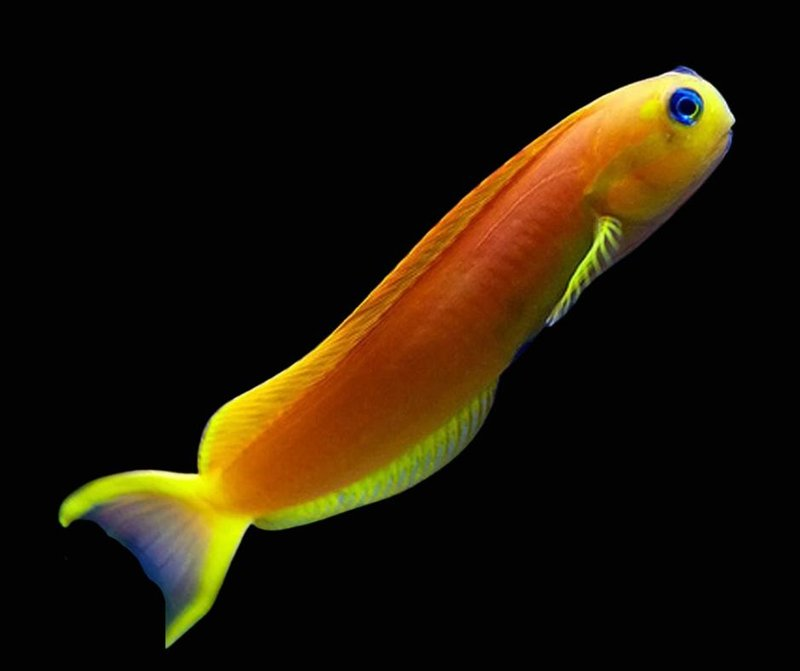

# Blenio Midas — *Ecsenius midas* Starck, 1969

> Archivo generado desde `especies/datos/catalogo_inicial.json` con `especies/herramientas/generar_fichas.py`. No editar a mano.

*Imagen ilustrativa generada con IA por Brayan (2026-11-16). No es una fotografía de un ejemplar real; puede contener errores anatómicos.*

**Grupo:** pez  
**Otros nombres:** Midas blenny, Persian blenny  
**Fecha de consulta:** 2026-11-16  
**Confianza global:** media  
**Estado:** verificada; pendiente de revisión del equipo

## Ficha AIRI

| Campo | Valor |
|---|---|
| Nombre común | Blenio Midas |
| Nombre científico | *Ecsenius midas* |
| Temperamento | Pacífico |
| Comportamiento | Pacífico. Pacífico, aunque puede molestar a peces fuego y gobios en acuarios pequeños. Nada como una anguila y se posa en las rocas. |
| Adecuado para arrecife | Sí. LiveAquaria lo considera un excelente candidato para arrecife. |
| Tipo de alimentación | Omnívoro: zooplancton, misis y artemia enriquecida, preparados herbívoros y algas. |
| Temperatura | 22.2–25.6 °C |
| Litraje recomendado | 113.6 L (30 gal EE. UU.). *Es el mínimo recomendado por una sola fuente comercial; ninguna fuente científica consultada establece un litraje.* |
| Tamaño adulto | 13 cm (longitud total). Al venderse mide 2.5–15.2 cm (juvenil o subadulto). *Diferencia entre fuentes: FishBase 13 cm; LiveAquaria 6 in (≈ 15.2 cm) y vende ejemplares de hasta 6 in.* |

## Detalle verificado

| Campo | Dato | Confianza | Fuentes |
|---|---|---|---|
| Clasificación taxonómica | Clase Teleostei; orden Blenniiformes; familia Blenniidae; subfamilia Salariinae. WoRMS AphiaID 219271 (aceptado). | alta | [worms_ecsenius_midas](https://www.marinespecies.org/aphia.php?p=taxdetails&id=219271), [fishbase_ecsenius_midas](https://www.fishbase.se/summary/Ecsenius-midas.html) |
| Hábitat natural | Arrecifes de coral, de zonas costeras claras a paredes externas, donde la corriente es moderada; nada a 2–3 m sobre el fondo. Su fase naranja-amarilla nada en grupo con los anthias Pseudanthias squamipinnis, a los que imita, y cambia de color rápidamente. Profundidad: 2–40 m. Distribución: Indo-Pacífico, del golfo de Áqaba y la costa sudoriental de África a las Marquesas. | media | [fishbase_ecsenius_midas](https://www.fishbase.se/summary/Ecsenius-midas.html) |
| Tamaño adulto | Máx. 13 cm (longitud total). Diferencia entre fuentes: FishBase 13 cm; LiveAquaria 6 in (≈ 15.2 cm) y vende ejemplares de hasta 6 in. | media | [fishbase_ecsenius_midas](https://www.fishbase.se/summary/Ecsenius-midas.html), [liveaquaria_ecsenius_midas](https://www.liveaquaria.com/products/midas-blenny) |
| Alimentación | Se alimenta de plancton (FishBase). A diferencia de la mayoría de los blenios, en acuario necesita una dieta cárnica (carne de crustáceo picada, misis, artemia enriquecida) junto con preparados herbívoros y algas (LiveAquaria). | alta | [fishbase_ecsenius_midas](https://www.fishbase.se/summary/Ecsenius-midas.html), [liveaquaria_ecsenius_midas](https://www.liveaquaria.com/products/midas-blenny) |
| Temperatura del agua | Acuario: 22.2–25.6 °C (72–78 °F). FishBase no indica rango de temperatura para esta especie. | baja | [liveaquaria_ecsenius_midas](https://www.liveaquaria.com/products/midas-blenny) |
| Rango de pH | Fuente de acuario: 8.1–8.4. Rango prudente AIRI: 8.1–8.3. Criterio: Intersección con la tabla MSD para agua salada (7.8–8.3). | media | [liveaquaria_ecsenius_midas](https://www.liveaquaria.com/products/midas-blenny), [msd_tabla_referencia](https://www.msdvetmanual.com/multimedia/table/normal-reference-ranges-for-routine-water-quality-analysis), [msd_capitulo](https://www.msdvetmanual.com/exotic-and-laboratory-animals/aquatic-systems/environmental-diseases-of-aquatic-animals-in-aquatic-systems) |
| Salinidad | 1.020–1.025 de gravedad específica (adimensional). Agua de mar media: 35 ppt (UF/IFAS). No se convierte a ppt porque la equivalencia depende de la temperatura. | media | [liveaquaria_ecsenius_midas](https://www.liveaquaria.com/products/midas-blenny), [ufifas_ph_sal_temp](https://waterwatch.ifas.ufl.edu/media/waterwatchifasufledu/FactSheet_pH_Sal_Temp.pdf) |
| Volumen mínimo | 113.6 L (30 gal EE. UU.). Justificación: Cifra de LiveAquaria (30 gal) con muchas rocas donde posarse; en acuarios grandes su agresividad disminuye. | baja | [liveaquaria_ecsenius_midas](https://www.liveaquaria.com/products/midas-blenny) |
| Comportamiento | Imita a los anthias y nada en grupo con ellos (FishBase). Pacífico, aunque a veces molesta a planctívoros pequeños y se sabe que pica a peces fuego y gobios; parte de su agresividad se relaciona con acuarios pequeños (LiveAquaria). | media | [fishbase_ecsenius_midas](https://www.fishbase.se/summary/Ecsenius-midas.html), [liveaquaria_ecsenius_midas](https://www.liveaquaria.com/products/midas-blenny) |
| Territorialidad y refugio | Necesita rocas donde posarse. | media | [liveaquaria_ecsenius_midas](https://www.liveaquaria.com/products/midas-blenny), [fishbase_ecsenius_midas](https://www.fishbase.se/summary/Ecsenius-midas.html) |
| Compatibilidad con arrecife | sí (según la fuente; sin verificación independiente) | baja | [liveaquaria_ecsenius_midas](https://www.liveaquaria.com/products/midas-blenny) |
| Convivencia: condiciones | Rocas donde posarse. · Acuario amplio para reducir su agresividad. | baja | [liveaquaria_ecsenius_midas](https://www.liveaquaria.com/products/midas-blenny), [fishbase_ecsenius_midas](https://www.fishbase.se/summary/Ecsenius-midas.html) |
| Convivencia: riesgos | Puede picar a peces fuego, gobios y planctívoros pequeños. | baja | [liveaquaria_ecsenius_midas](https://www.liveaquaria.com/products/midas-blenny), [fishbase_ecsenius_midas](https://www.fishbase.se/summary/Ecsenius-midas.html) |
| Conservación | Preocupación menor (LC), evaluada el 25/03/2009, según FishBase. | media | [fishbase_ecsenius_midas](https://www.fishbase.se/summary/Ecsenius-midas.html) |

**Regla AIRI:** compartir rangos de agua no implica compatibilidad entre especies. Los rangos de acuario provienen de una fuente comercial y no son límites veterinarios.

## Fuentes

- **worms_ecsenius_midas** (taxonomía): WoRMS — Ecsenius midas Starck, 1969 (AphiaID 219271). <https://www.marinespecies.org/aphia.php?p=taxdetails&id=219271>. Consultada el 2026-11-16.
- **fishbase_ecsenius_midas** (biología): FishBase — Ecsenius midas. <https://www.fishbase.se/summary/Ecsenius-midas.html>. Consultada el 2026-11-16.
- **liveaquaria_ecsenius_midas** (comercial): LiveAquaria — Midas Blenny. <https://www.liveaquaria.com/products/midas-blenny>. Consultada el 2026-11-16.
- **msd_tabla_referencia** (veterinaria): MSD Veterinary Manual — “Normal” Reference Ranges for Routine Water Quality Analysis. <https://www.msdvetmanual.com/multimedia/table/normal-reference-ranges-for-routine-water-quality-analysis>. Consultada el 2026-11-12. Reutilizada del registro del motor (motor/airi_motor/datos/fuentes.json); no se volvió a consultar para estas fichas.
- **ufifas_ph_sal_temp** (institucional): UF/IFAS — pH, Salinity and Temperature (hoja informativa). <https://waterwatch.ifas.ufl.edu/media/waterwatchifasufledu/FactSheet_pH_Sal_Temp.pdf>. Consultada el 2026-11-12. Reutilizada del registro del motor (motor/airi_motor/datos/fuentes.json); no se volvió a consultar para estas fichas.
- **msd_capitulo** (veterinaria): MSD Veterinary Manual — Environmental Diseases of Aquatic Animals in Aquatic Systems. <https://www.msdvetmanual.com/exotic-and-laboratory-animals/aquatic-systems/environmental-diseases-of-aquatic-animals-in-aquatic-systems>. Consultada el 2026-11-12. Reutilizada del registro del motor (motor/airi_motor/datos/fuentes.json); no se volvió a consultar para estas fichas.
