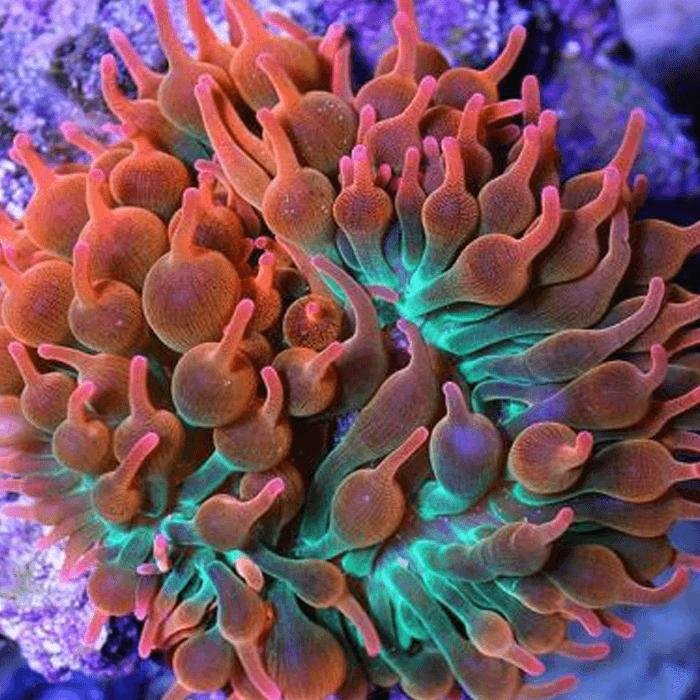

# Anémona burbuja — *Entacmaea quadricolor* (Leuckart in Rüppell & Leuckart, 1828)

> Archivo generado desde `especies/datos/catalogo_inicial.json` con `especies/herramientas/generar_fichas.py`. No editar a mano.

*Imagen ilustrativa generada con IA por Brayan (2026-11-16). No es una fotografía de un ejemplar real; puede contener errores anatómicos.*

**Grupo:** anémona  
**Otros nombres:** Bubble tip anemone, Rose bubble tip anemone, Bulb-tentacle sea anemone  
**Fecha de consulta:** 2026-11-16  
**Confianza global:** media  
**Estado:** verificada; pendiente de revisión del equipo

## Ficha AIRI

| Campo | Valor |
|---|---|
| Nombre común | Anémona burbuja |
| Nombre científico | *Entacmaea quadricolor* |
| Temperamento | Semiagresivo |
| Comportamiento | . Semiagresiva. Hospeda peces payaso. Necesita luz moderada a alta y agua de muy buena calidad. |
| Adecuado para arrecife | Con precaución. LiveAquaria la marca «con precaución» en sus datos rápidos; la parte consultada de su descripción no explica el motivo. |
| Tipo de alimentación | Carnívoro: presas cárnicas pequeñas, luz (zooxantelas simbióticas). *Combina la captura de presas con la fotosíntesis de sus zooxantelas.* |
| Temperatura | 22.2–25.6 °C |
| Litraje recomendado | 113.6 L (30 gal EE. UU.). *Es el mínimo recomendado por una sola fuente comercial; ninguna fuente científica consultada establece un litraje.* |
| Tamaño adulto | 40 cm (diámetro del disco oral). *Diferencia entre fuentes: SeaLifeBase hasta 40 cm de disco oral (en ejemplares solitarios de aguas profundas; en aguas someras unos 5 cm); LiveAquaria hasta 12 in (≈ 30.5 cm).* |

## Detalle verificado

| Campo | Dato | Confianza | Fuentes |
|---|---|---|---|
| Clasificación taxonómica | Clase Anthozoa (Hexacorallia); orden Actiniaria; familia Actiniidae. WoRMS AphiaID 289898 (aceptado). Sinónimos: Actinia (Entacmaea) quadricolor (combinación original), Entacmaea ramsayi, Gyrostoma stuhlmanni. | alta | [worms_entacmaea_quadricolor](https://www.marinespecies.org/aphia.php?p=taxdetails&id=289898), [sealifebase_entacmaea_quadricolor](https://www.sealifebase.se/summary/Entacmaea-quadricolor.html) |
| Hábitat natural | Fija en el fondo de grietas, de modo que solo se ven sus tentáculos. Alberga zooxantelas que producen alimento por fotosíntesis y hospeda al pez payaso Amphiprion clarkii; se dice que la forma de burbuja de sus tentáculos se relaciona con la presencia de peces (SeaLifeBase). Profundidad: 0–200 m. Distribución: Indo-Pacífico: de Micronesia y Melanesia a África oriental y el Mar Rojo, y de Australia a Japón. | media | [sealifebase_entacmaea_quadricolor](https://www.sealifebase.se/summary/Entacmaea-quadricolor.html) |
| Tamaño adulto | Máx. 40 cm (diámetro del disco oral). Diferencia entre fuentes: SeaLifeBase hasta 40 cm de disco oral (en ejemplares solitarios de aguas profundas; en aguas someras unos 5 cm); LiveAquaria hasta 12 in (≈ 30.5 cm). | media | [sealifebase_entacmaea_quadricolor](https://www.sealifebase.se/summary/Entacmaea-quadricolor.html), [liveaquaria_entacmaea_quadricolor](https://www.liveaquaria.com/products/rose-bubble-tip-anemone) |
| Alimentación | Carnívora: estira sus tentáculos para capturar alimento cuando tiene hambre (LiveAquaria). Además obtiene alimento de sus zooxantelas fotosintéticas, por lo que necesita luz moderada a alta (SeaLifeBase y LiveAquaria). | media | [sealifebase_entacmaea_quadricolor](https://www.sealifebase.se/summary/Entacmaea-quadricolor.html), [liveaquaria_entacmaea_quadricolor](https://www.liveaquaria.com/products/rose-bubble-tip-anemone) |
| Temperatura del agua | Acuario: 22.2–25.6 °C (72–78 °F). SeaLifeBase no indica rango de temperatura para esta especie. | baja | [liveaquaria_entacmaea_quadricolor](https://www.liveaquaria.com/products/rose-bubble-tip-anemone) |
| Rango de pH | Fuente de acuario: 8.1–8.4. Rango prudente AIRI: 8.1–8.3. Criterio: Intersección con la tabla MSD para agua salada (7.8–8.3). | media | [liveaquaria_entacmaea_quadricolor](https://www.liveaquaria.com/products/rose-bubble-tip-anemone), [msd_tabla_referencia](https://www.msdvetmanual.com/multimedia/table/normal-reference-ranges-for-routine-water-quality-analysis), [msd_capitulo](https://www.msdvetmanual.com/exotic-and-laboratory-animals/aquatic-systems/environmental-diseases-of-aquatic-animals-in-aquatic-systems) |
| Salinidad | 1.020–1.025 de gravedad específica (adimensional). Agua de mar media: 35 ppt (UF/IFAS). No se convierte a ppt porque la equivalencia depende de la temperatura. | media | [liveaquaria_entacmaea_quadricolor](https://www.liveaquaria.com/products/rose-bubble-tip-anemone), [ufifas_ph_sal_temp](https://waterwatch.ifas.ufl.edu/media/waterwatchifasufledu/FactSheet_pH_Sal_Temp.pdf) |
| Volumen mínimo | 113.6 L (30 gal EE. UU.). Justificación: Cifra de LiveAquaria (30 gal o más), porque puede llegar a 12 in de diámetro; recomienda un acuario más grande si convive con peces o en un arrecife mixto. | baja | [liveaquaria_entacmaea_quadricolor](https://www.liveaquaria.com/products/rose-bubble-tip-anemone) |
| Comportamiento | Se fija en el fondo de grietas y hospeda peces payaso (SeaLifeBase). Cuando tiene hambre estira sus tentáculos y, saciada, vuelven a su forma de burbuja. Necesita un acuario grande y establecido con muy buena calidad del agua (LiveAquaria). | media | [sealifebase_entacmaea_quadricolor](https://www.sealifebase.se/summary/Entacmaea-quadricolor.html), [liveaquaria_entacmaea_quadricolor](https://www.liveaquaria.com/products/rose-bubble-tip-anemone) |
| Territorialidad y refugio | Se fija en el fondo de grietas de la roca o el cascajo. | media | [liveaquaria_entacmaea_quadricolor](https://www.liveaquaria.com/products/rose-bubble-tip-anemone), [sealifebase_entacmaea_quadricolor](https://www.sealifebase.se/summary/Entacmaea-quadricolor.html) |
| Compatibilidad con arrecife | con precaución (según la fuente; sin verificación independiente) | baja | [liveaquaria_entacmaea_quadricolor](https://www.liveaquaria.com/products/rose-bubble-tip-anemone) |
| Convivencia: condiciones | Acuario establecido con muy buena filtración. · Luz moderada a alta. · Corriente media. | baja | [liveaquaria_entacmaea_quadricolor](https://www.liveaquaria.com/products/rose-bubble-tip-anemone), [sealifebase_entacmaea_quadricolor](https://www.sealifebase.se/summary/Entacmaea-quadricolor.html) |
| Convivencia: riesgos | Exige agua de muy buena calidad, filtración fuerte y buen espumador. | baja | [liveaquaria_entacmaea_quadricolor](https://www.liveaquaria.com/products/rose-bubble-tip-anemone), [sealifebase_entacmaea_quadricolor](https://www.sealifebase.se/summary/Entacmaea-quadricolor.html) |
| Conservación | No evaluada por la UICN, según SeaLifeBase. | media | [sealifebase_entacmaea_quadricolor](https://www.sealifebase.se/summary/Entacmaea-quadricolor.html) |

**Regla AIRI:** compartir rangos de agua no implica compatibilidad entre especies. Los rangos de acuario provienen de una fuente comercial y no son límites veterinarios.

## Fuentes

- **worms_entacmaea_quadricolor** (taxonomía): WoRMS — Entacmaea quadricolor (Leuckart in Rüppell & Leuckart, 1828) (AphiaID 289898). <https://www.marinespecies.org/aphia.php?p=taxdetails&id=289898>. Consultada el 2026-11-16.
- **sealifebase_entacmaea_quadricolor** (biología): SeaLifeBase — Entacmaea quadricolor. <https://www.sealifebase.se/summary/Entacmaea-quadricolor.html>. Consultada el 2026-11-16.
- **liveaquaria_entacmaea_quadricolor** (comercial): LiveAquaria — Rose Bubble Tip Anemone. <https://www.liveaquaria.com/products/rose-bubble-tip-anemone>. Consultada el 2026-11-16.
- **msd_tabla_referencia** (veterinaria): MSD Veterinary Manual — “Normal” Reference Ranges for Routine Water Quality Analysis. <https://www.msdvetmanual.com/multimedia/table/normal-reference-ranges-for-routine-water-quality-analysis>. Consultada el 2026-11-12. Reutilizada del registro del motor (motor/airi_motor/datos/fuentes.json); no se volvió a consultar para estas fichas.
- **ufifas_ph_sal_temp** (institucional): UF/IFAS — pH, Salinity and Temperature (hoja informativa). <https://waterwatch.ifas.ufl.edu/media/waterwatchifasufledu/FactSheet_pH_Sal_Temp.pdf>. Consultada el 2026-11-12. Reutilizada del registro del motor (motor/airi_motor/datos/fuentes.json); no se volvió a consultar para estas fichas.
- **msd_capitulo** (veterinaria): MSD Veterinary Manual — Environmental Diseases of Aquatic Animals in Aquatic Systems. <https://www.msdvetmanual.com/exotic-and-laboratory-animals/aquatic-systems/environmental-diseases-of-aquatic-animals-in-aquatic-systems>. Consultada el 2026-11-12. Reutilizada del registro del motor (motor/airi_motor/datos/fuentes.json); no se volvió a consultar para estas fichas.
