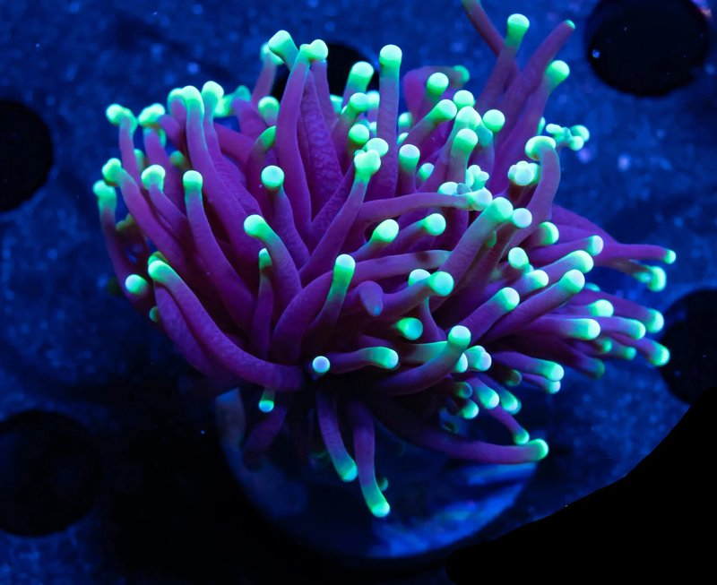

# Coral torch — *Euphyllia glabrescens* (Chamisso & Eysenhardt, 1821)

> Archivo generado desde `especies/datos/catalogo_inicial.json` con `especies/herramientas/generar_fichas.py`. No editar a mano.

*Imagen ilustrativa generada con IA por Brayan (2026-11-18). No es una fotografía de un ejemplar real; puede contener errores anatómicos.*

**Grupo:** coral  
**Otros nombres:** Torch coral, Trumpet coral (LiveAquaria), Joker coral  
**Fecha de consulta:** 2026-11-18  
**Confianza global:** media  
**Estado:** verificada; pendiente de revisión del equipo

## Ficha AIRI

| Campo | Valor |
|---|---|
| Nombre común | Coral torch |
| Nombre científico | *Euphyllia glabrescens* |
| Temperamento | Agresivo *LiveAquaria lo clasifica como agresivo; Saltwaterfish, como pacífico.* |
| Comportamiento | . Coral duro (LPS) de tentáculos largos. Sus tentáculos barredores pican a otros corales: hay que dejarle espacio. |
| Adecuado para arrecife | Sí. LiveAquaria y Saltwaterfish lo consideran apto, siempre que se le deje espacio respecto a otros corales. |
| Tipo de alimentación | Fotosintético: luz moderada, microplancton o artemia semanal, calcio, estroncio y oligoelementos. *Saltwaterfish lo clasifica como filtrador.* |
| Temperatura | 22.2–25.6 °C *Rango de LiveAquaria.* |
| Litraje recomendado | 189.2 L (50 gal EE. UU.). *Es el mínimo recomendado por una sola fuente comercial; ninguna fuente científica consultada establece un litraje.* |
| Tamaño adulto | null (no verificado). Al venderse mide 1.3–13.3 cm (juvenil o subadulto). *SeaLifeBase no indica el tamaño de la colonia (solo el de sus coralitos, unos 3 cm).* |

## Detalle verificado

| Campo | Dato | Confianza | Fuentes |
|---|---|---|---|
| Clasificación taxonómica | Clase Anthozoa (Hexacorallia); orden Scleractinia; familia Euphylliidae. WoRMS AphiaID 207617 (aceptado). Sinónimos: Caryophyllia glabrescens Chamisso & Eysenhardt, 1821 (combinación original), Catalaphyllia okinawaensis Eguchi & Shirai, 1977. Es un coral duro de pólipo grande (LPS). LiveAquaria lo sitúa en la familia Caryophylliidae; WoRMS, en Euphylliidae. | alta | [worms_euphyllia_glabrescens](https://www.marinespecies.org/aphia.php?p=taxdetails&id=207617), [sealifebase_euphyllia_glabrescens](https://www.sealifebase.se/summary/Euphyllia-glabrescens.html) |
| Hábitat natural | Puede ser común en lagunas protegidas y pendientes arrecifales; también en arrecifes de franja (SeaLifeBase). Profundidad: 0–40 m. Distribución: Indo-Pacífico. | alta | [sealifebase_euphyllia_glabrescens](https://www.sealifebase.se/summary/Euphyllia-glabrescens.html) |
| Tamaño adulto | null (no verificado). SeaLifeBase no indica el tamaño de la colonia (solo el de sus coralitos, unos 3 cm). | baja | [sealifebase_euphyllia_glabrescens](https://www.sealifebase.se/summary/Euphyllia-glabrescens.html) |
| Alimentación | Necesita luz moderada; se beneficia de alimento adicional semanal (microplancton o artemia) y de aportes de calcio, estroncio y oligoelementos (LiveAquaria). | baja | [liveaquaria_euphyllia_glabrescens](https://www.liveaquaria.com/products/torch-coral) |
| Temperatura del agua | Acuario: 22.2–25.6 °C (72–78 °F). SeaLifeBase no indica rango de temperatura para esta especie. | baja | [liveaquaria_euphyllia_glabrescens](https://www.liveaquaria.com/products/torch-coral) |
| Rango de pH | Fuente de acuario: 8.1–8.4. Rango prudente AIRI: 8.1–8.3. Criterio: Intersección con la tabla MSD para agua salada (7.8–8.3). | media | [liveaquaria_euphyllia_glabrescens](https://www.liveaquaria.com/products/torch-coral), [msd_tabla_referencia](https://www.msdvetmanual.com/multimedia/table/normal-reference-ranges-for-routine-water-quality-analysis), [msd_capitulo](https://www.msdvetmanual.com/exotic-and-laboratory-animals/aquatic-systems/environmental-diseases-of-aquatic-animals-in-aquatic-systems) |
| Salinidad | 1.023–1.025 de gravedad específica (adimensional). Agua de mar media: 35 ppt (UF/IFAS). No se convierte a ppt porque la equivalencia depende de la temperatura. | media | [liveaquaria_euphyllia_glabrescens](https://www.liveaquaria.com/products/torch-coral), [ufifas_ph_sal_temp](https://waterwatch.ifas.ufl.edu/media/waterwatchifasufledu/FactSheet_pH_Sal_Temp.pdf) |
| Volumen mínimo | 189.2 L (50 gal EE. UU.). Justificación: Cifra de Saltwaterfish («Minimum Tank Size: 50 Gallons») para torch corals vendidos como Euphyllia glabrescens. | baja | [saltwaterfish_euphyllia_glabrescens](https://www.saltwaterfish.com/product-green-torch-purple-tips) |
| Comportamiento | Sus pólipos largos y ondulantes están visibles de día y de noche. De noche extiende tentáculos barredores de varias pulgadas que pican a otros corales. Es moderadamente difícil y necesita excelente calidad de agua (LiveAquaria). | media | [liveaquaria_euphyllia_glabrescens](https://www.liveaquaria.com/products/torch-coral) |
| Territorialidad y refugio | Necesita mucho espacio respecto a otros animales sésiles (LiveAquaria). | media | [liveaquaria_euphyllia_glabrescens](https://www.liveaquaria.com/products/torch-coral) |
| Compatibilidad con arrecife | sí (según la fuente; sin verificación independiente) | baja | [liveaquaria_euphyllia_glabrescens](https://www.liveaquaria.com/products/torch-coral), [saltwaterfish_euphyllia_glabrescens](https://www.saltwaterfish.com/product-green-torch-purple-tips) |
| Convivencia: condiciones | Espacio libre a su alrededor. · Luz y corriente moderadas. · Calcio, estroncio y oligoelementos. | baja | [liveaquaria_euphyllia_glabrescens](https://www.liveaquaria.com/products/torch-coral) |
| Convivencia: riesgos | Sus tentáculos barredores pican a otros corales. | baja | [liveaquaria_euphyllia_glabrescens](https://www.liveaquaria.com/products/torch-coral) |
| Conservación | Preocupación menor (LC), evaluada el 27/10/2023, según SeaLifeBase. Incluido en el Apéndice II de CITES (SeaLifeBase): su comercio internacional está regulado. SeaLifeBase registra un alto nivel de blanqueamiento en Palaos. | media | [sealifebase_euphyllia_glabrescens](https://www.sealifebase.se/summary/Euphyllia-glabrescens.html) |

**Regla AIRI:** compartir rangos de agua no implica compatibilidad entre especies. Los rangos de acuario provienen de una fuente comercial y no son límites veterinarios.

## Fuentes

- **worms_euphyllia_glabrescens** (taxonomía): WoRMS — Euphyllia glabrescens (Chamisso & Eysenhardt, 1821) (AphiaID 207617). <https://www.marinespecies.org/aphia.php?p=taxdetails&id=207617>. Consultada el 2026-11-18.
- **sealifebase_euphyllia_glabrescens** (biología): SeaLifeBase — Euphyllia glabrescens. <https://www.sealifebase.se/summary/Euphyllia-glabrescens.html>. Consultada el 2026-11-18.
- **liveaquaria_euphyllia_glabrescens** (comercial): LiveAquaria — Torch Coral (Euphyllia glabrescens). <https://www.liveaquaria.com/products/torch-coral>. Consultada el 2026-11-18.
- **saltwaterfish_euphyllia_glabrescens** (comercial): Saltwaterfish — Torch Coral: Green w/ Purple Tips - Aquacultured. <https://www.saltwaterfish.com/product-green-torch-purple-tips>. Consultada el 2026-11-18.
- **msd_tabla_referencia** (veterinaria): MSD Veterinary Manual — “Normal” Reference Ranges for Routine Water Quality Analysis. <https://www.msdvetmanual.com/multimedia/table/normal-reference-ranges-for-routine-water-quality-analysis>. Consultada el 2026-11-12. Reutilizada del registro del motor (motor/airi_motor/datos/fuentes.json); no se volvió a consultar para estas fichas.
- **ufifas_ph_sal_temp** (institucional): UF/IFAS — pH, Salinity and Temperature (hoja informativa). <https://waterwatch.ifas.ufl.edu/media/waterwatchifasufledu/FactSheet_pH_Sal_Temp.pdf>. Consultada el 2026-11-12. Reutilizada del registro del motor (motor/airi_motor/datos/fuentes.json); no se volvió a consultar para estas fichas.
- **msd_capitulo** (veterinaria): MSD Veterinary Manual — Environmental Diseases of Aquatic Animals in Aquatic Systems. <https://www.msdvetmanual.com/exotic-and-laboratory-animals/aquatic-systems/environmental-diseases-of-aquatic-animals-in-aquatic-systems>. Consultada el 2026-11-12. Reutilizada del registro del motor (motor/airi_motor/datos/fuentes.json); no se volvió a consultar para estas fichas.
