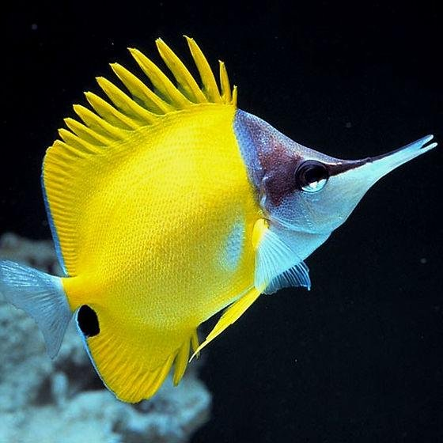

# Pez mariposa de nariz larga — *Forcipiger flavissimus* Jordan & McGregor, 1898

> Archivo generado desde `especies/datos/catalogo_inicial.json` con `especies/herramientas/generar_fichas.py`. No editar a mano.

*Imagen ilustrativa generada con IA por Brayan (2026-11-16). No es una fotografía de un ejemplar real; puede contener errores anatómicos.*

**Grupo:** pez  
**Otros nombres:** Yellow longnose butterflyfish, Forcepsfish  
**Fecha de consulta:** 2026-11-16  
**Confianza global:** media  
**Estado:** verificada; pendiente de revisión del equipo

## Ficha AIRI

| Campo | Valor |
|---|---|
| Nombre común | Pez mariposa de nariz larga |
| Nombre científico | *Forcipiger flavissimus* |
| Temperamento | Pacífico |
| Comportamiento | Pacífico. Pacífico; los adultos suelen ir en pareja. Usa su hocico largo para sacar alimento de las grietas. |
| Adecuado para arrecife | Con precaución. LiveAquaria advierte que puede picar corales e invertebrados sésiles. |
| Tipo de alimentación | Carnívoro: pequeñas presas de grietas (pies de equinodermos, tentáculos de gusanos), misis, carne de crustáceo y congelados. |
| Temperatura | 22.2–25.6 °C |
| Litraje recomendado | 473.1 L (125 gal EE. UU.). *Es el mínimo recomendado por una sola fuente comercial; ninguna fuente científica consultada establece un litraje.* |
| Tamaño adulto | 22 cm (longitud total). Al venderse mide 5.1–16.5 cm (juvenil o subadulto). *LiveAquaria indica 9 in (≈ 22.9 cm), coherente con FishBase. Vive hasta 18 años.* |

## Detalle verificado

| Campo | Dato | Confianza | Fuentes |
|---|---|---|---|
| Clasificación taxonómica | Clase Teleostei; orden Chaetodontiformes (WoRMS); familia Chaetodontidae. WoRMS AphiaID 218760 (aceptado). El orden varía según la fuente: Chaetodontiformes (WoRMS) y Acanthuriformes (FishBase). Se toma WoRMS como referencia. | alta | [worms_forcipiger_flavissimus](https://www.marinespecies.org/aphia.php?p=taxdetails&id=218760), [fishbase_forcipiger_flavissimus](https://www.fishbase.se/summary/Forcipiger-flavissimus.html) |
| Hábitat natural | Común en arrecifes externos expuestos y también en arrecifes de laguna. Va solo o en grupos de hasta 5; los adultos suelen ir en pareja. Profundidad: 0–145 m. Distribución: Indo-Pacífico, de África oriental y el Mar Rojo a Hawái e isla de Pascua; Pacífico oriental, del sur de Baja California a Revillagigedo y Galápagos. | media | [fishbase_forcipiger_flavissimus](https://www.fishbase.se/summary/Forcipiger-flavissimus.html) |
| Tamaño adulto | Máx. 22 cm (longitud total). LiveAquaria indica 9 in (≈ 22.9 cm), coherente con FishBase. Vive hasta 18 años. | alta | [fishbase_forcipiger_flavissimus](https://www.fishbase.se/summary/Forcipiger-flavissimus.html), [liveaquaria_forcipiger_flavissimus](https://www.liveaquaria.com/products/yellow-longnose-butterflyfish) |
| Alimentación | Carnívoro: come una gran variedad de presas animales y prefiere pies ambulacrales de equinodermos, pedicelarios de erizos y tentáculos de poliquetos (FishBase). En acuario, misis, carne de crustáceo y congelados (LiveAquaria). | alta | [fishbase_forcipiger_flavissimus](https://www.fishbase.se/summary/Forcipiger-flavissimus.html), [liveaquaria_forcipiger_flavissimus](https://www.liveaquaria.com/products/yellow-longnose-butterflyfish) |
| Temperatura del agua | Acuario: 22.2–25.6 °C (72–78 °F). FishBase no indica rango de temperatura para esta especie. | baja | [liveaquaria_forcipiger_flavissimus](https://www.liveaquaria.com/products/yellow-longnose-butterflyfish) |
| Rango de pH | Fuente de acuario: 8.1–8.4. Rango prudente AIRI: 8.1–8.3. Criterio: Intersección con la tabla MSD para agua salada (7.8–8.3). | media | [liveaquaria_forcipiger_flavissimus](https://www.liveaquaria.com/products/yellow-longnose-butterflyfish), [msd_tabla_referencia](https://www.msdvetmanual.com/multimedia/table/normal-reference-ranges-for-routine-water-quality-analysis), [msd_capitulo](https://www.msdvetmanual.com/exotic-and-laboratory-animals/aquatic-systems/environmental-diseases-of-aquatic-animals-in-aquatic-systems) |
| Salinidad | 1.020–1.025 de gravedad específica (adimensional). Agua de mar media: 35 ppt (UF/IFAS). No se convierte a ppt porque la equivalencia depende de la temperatura. | media | [liveaquaria_forcipiger_flavissimus](https://www.liveaquaria.com/products/yellow-longnose-butterflyfish), [ufifas_ph_sal_temp](https://waterwatch.ifas.ufl.edu/media/waterwatchifasufledu/FactSheet_pH_Sal_Temp.pdf) |
| Volumen mínimo | 473.1 L (125 gal EE. UU.). Justificación: Cifra de LiveAquaria (125 gal), con compañeros pacíficos. | baja | [liveaquaria_forcipiger_flavissimus](https://www.liveaquaria.com/products/yellow-longnose-butterflyfish) |
| Comportamiento | Monógamo; forma parejas para reproducirse (FishBase). Pacífico. Su hocico largo le sirve para sacar alimento de grietas y entre los corales (LiveAquaria). | media | [fishbase_forcipiger_flavissimus](https://www.fishbase.se/summary/Forcipiger-flavissimus.html), [liveaquaria_forcipiger_flavissimus](https://www.liveaquaria.com/products/yellow-longnose-butterflyfish) |
| Territorialidad y refugio | No se describe como territorial. | media | [liveaquaria_forcipiger_flavissimus](https://www.liveaquaria.com/products/yellow-longnose-butterflyfish), [fishbase_forcipiger_flavissimus](https://www.fishbase.se/summary/Forcipiger-flavissimus.html) |
| Compatibilidad con arrecife | con precaución (según la fuente; sin verificación independiente) | baja | [liveaquaria_forcipiger_flavissimus](https://www.liveaquaria.com/products/yellow-longnose-butterflyfish) |
| Convivencia: condiciones | Compañeros pacíficos. · Buena aclimatación. | baja | [liveaquaria_forcipiger_flavissimus](https://www.liveaquaria.com/products/yellow-longnose-butterflyfish), [fishbase_forcipiger_flavissimus](https://www.fishbase.se/summary/Forcipiger-flavissimus.html) |
| Convivencia: riesgos | Puede picar corales e invertebrados sésiles. | baja | [liveaquaria_forcipiger_flavissimus](https://www.liveaquaria.com/products/yellow-longnose-butterflyfish), [fishbase_forcipiger_flavissimus](https://www.fishbase.se/summary/Forcipiger-flavissimus.html) |
| Conservación | Preocupación menor (LC), evaluada el 09/10/2009, según FishBase. | media | [fishbase_forcipiger_flavissimus](https://www.fishbase.se/summary/Forcipiger-flavissimus.html) |

**Regla AIRI:** compartir rangos de agua no implica compatibilidad entre especies. Los rangos de acuario provienen de una fuente comercial y no son límites veterinarios.

## Fuentes

- **worms_forcipiger_flavissimus** (taxonomía): WoRMS — Forcipiger flavissimus Jordan & McGregor, 1898 (AphiaID 218760). <https://www.marinespecies.org/aphia.php?p=taxdetails&id=218760>. Consultada el 2026-11-16.
- **fishbase_forcipiger_flavissimus** (biología): FishBase — Forcipiger flavissimus. <https://www.fishbase.se/summary/Forcipiger-flavissimus.html>. Consultada el 2026-11-16.
- **liveaquaria_forcipiger_flavissimus** (comercial): LiveAquaria — Yellow Longnose Butterflyfish. <https://www.liveaquaria.com/products/yellow-longnose-butterflyfish>. Consultada el 2026-11-16.
- **msd_tabla_referencia** (veterinaria): MSD Veterinary Manual — “Normal” Reference Ranges for Routine Water Quality Analysis. <https://www.msdvetmanual.com/multimedia/table/normal-reference-ranges-for-routine-water-quality-analysis>. Consultada el 2026-11-12. Reutilizada del registro del motor (motor/airi_motor/datos/fuentes.json); no se volvió a consultar para estas fichas.
- **ufifas_ph_sal_temp** (institucional): UF/IFAS — pH, Salinity and Temperature (hoja informativa). <https://waterwatch.ifas.ufl.edu/media/waterwatchifasufledu/FactSheet_pH_Sal_Temp.pdf>. Consultada el 2026-11-12. Reutilizada del registro del motor (motor/airi_motor/datos/fuentes.json); no se volvió a consultar para estas fichas.
- **msd_capitulo** (veterinaria): MSD Veterinary Manual — Environmental Diseases of Aquatic Animals in Aquatic Systems. <https://www.msdvetmanual.com/exotic-and-laboratory-animals/aquatic-systems/environmental-diseases-of-aquatic-animals-in-aquatic-systems>. Consultada el 2026-11-12. Reutilizada del registro del motor (motor/airi_motor/datos/fuentes.json); no se volvió a consultar para estas fichas.
