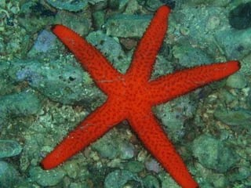

# Estrella Fromia naranja — *Fromia milleporella* (Lamarck, 1816)

> Archivo generado desde `especies/datos/catalogo_inicial.json` con `especies/herramientas/generar_fichas.py`. No editar a mano.

*Imagen ilustrativa generada con IA por Brayan (2026-11-16). No es una fotografía de un ejemplar real; puede contener errores anatómicos.*

> **Aviso:** la especie de esta imagen no está confirmada. Imagen ilustrativa generada con IA; no es una fotografía real. La especie de la imagen no está confirmada: sus brazos largos y finos se parecen más a Echinaster que a Fromia milleporella. Se usa por decisión del responsable mientras se consigue otra.

**Grupo:** estrella de mar  
**Otros nombres:** Red Fromia sea star, Red sea star  
**Fecha de consulta:** 2026-11-16  
**Confianza global:** baja  
**Estado:** verificada; pendiente de revisión del equipo

## Ficha AIRI

| Campo | Valor |
|---|---|
| Nombre común | Estrella Fromia naranja |
| Nombre científico | *Fromia milleporella* |
| Temperamento | Pacífico |
| Comportamiento | Pacífico. Pacífica y apta para arrecife. Necesita un acuario bien establecido con mucho alimento natural en la roca y la arena. |
| Adecuado para arrecife | Sí. Quality Marine la considera generalmente apta para arrecife y pacífica. |
| Tipo de alimentación | Omnívoro: materia orgánica y detritos, algas, pellets de camarón (suplemento), trocitos de pescado o mejillón. |
| Temperatura | 22.2–25.6 °C |
| Litraje recomendado | null (no verificado). *Ninguna fuente consultada publica un litraje mínimo para esta especie; se deja en null en lugar de estimarlo.* |
| Tamaño adulto | 15.2 cm (diámetro). *SeaLifeBase no indica tamaño máximo; Quality Marine indica que llega a unas 6 in (≈ 15.2 cm).* |

## Detalle verificado

| Campo | Dato | Confianza | Fuentes |
|---|---|---|---|
| Clasificación taxonómica | Clase Asteroidea; orden Valvatida; familia Goniasteridae. WoRMS AphiaID 213299 (aceptado). Sinónimos: Asterias milleporella Lamarck, 1816 (combinación original), Fromia pistoria, Scytaster milleporellus. Quality Marine la describe de color rojo a rojo anaranjado. SeaLifeBase y WoRMS la sitúan en la familia Goniasteridae. | alta | [worms_fromia_milleporella](https://www.marinespecies.org/aphia.php?p=taxdetails&id=213299), [sealifebase_fromia_milleporella](https://www.sealifebase.se/summary/Fromia-milleporella.html) |
| Hábitat natural | Bentónica, en aguas tropicales someras (SeaLifeBase). Quality Marine la sitúa en aguas someras del Indo-Pacífico, incluidos el Mar Rojo y el océano Índico. Profundidad: 0–73 m (habitual 0–30 m (WoRMS)). Distribución: Indo-Pacífico occidental. | media | [sealifebase_fromia_milleporella](https://www.sealifebase.se/summary/Fromia-milleporella.html) |
| Tamaño adulto | Máx. 15.2 cm (diámetro). SeaLifeBase no indica tamaño máximo; Quality Marine indica que llega a unas 6 in (≈ 15.2 cm). | baja | [sealifebase_fromia_milleporella](https://www.sealifebase.se/summary/Fromia-milleporella.html), [qualitymarine_fromia_milleporella](https://www.qualitymarine.com/quality-marine/invertebrates/stars/fromia/red-fromia-59026/) |
| Alimentación | Detritívora y carroñera: come materia orgánica, algas y partículas pequeñas del sustrato y la roca viva. Si falta alimento natural, se le dan pellets de camarón que se hundan o trocitos de pescado o mejillón (Quality Marine). SeaLifeBase la describe como comedora de depósitos. | media | [sealifebase_fromia_milleporella](https://www.sealifebase.se/summary/Fromia-milleporella.html), [qualitymarine_fromia_milleporella](https://www.qualitymarine.com/quality-marine/invertebrates/stars/fromia/red-fromia-59026/) |
| Temperatura del agua | Acuario: 22.2–25.6 °C (72–78 °F). SeaLifeBase no indica rango de temperatura para esta especie. | baja | [qualitymarine_fromia_milleporella](https://www.qualitymarine.com/quality-marine/invertebrates/stars/fromia/red-fromia-59026/) |
| Rango de pH | Fuente de acuario: 8.1–8.4. Rango prudente AIRI: 8.1–8.3. Criterio: Intersección con la tabla MSD para agua salada (7.8–8.3). | media | [qualitymarine_fromia_milleporella](https://www.qualitymarine.com/quality-marine/invertebrates/stars/fromia/red-fromia-59026/), [msd_tabla_referencia](https://www.msdvetmanual.com/multimedia/table/normal-reference-ranges-for-routine-water-quality-analysis), [msd_capitulo](https://www.msdvetmanual.com/exotic-and-laboratory-animals/aquatic-systems/environmental-diseases-of-aquatic-animals-in-aquatic-systems) |
| Salinidad | 1.023–1.025 de gravedad específica (adimensional). Agua de mar media: 35 ppt (UF/IFAS). No se convierte a ppt porque la equivalencia depende de la temperatura. | media | [qualitymarine_fromia_milleporella](https://www.qualitymarine.com/quality-marine/invertebrates/stars/fromia/red-fromia-59026/), [ufifas_ph_sal_temp](https://waterwatch.ifas.ufl.edu/media/waterwatchifasufledu/FactSheet_pH_Sal_Temp.pdf) |
| Volumen mínimo | null (no verificado). Justificación: Ninguna fuente consultada publica un litraje mínimo para esta especie; se deja en null en lugar de estimarlo. | baja | [qualitymarine_fromia_milleporella](https://www.qualitymarine.com/quality-marine/invertebrates/stars/fromia/red-fromia-59026/) |
| Comportamiento | Pacífica. Puede regenerar un brazo dañado. Sensible a los cambios de parámetros y al cobre (Quality Marine). | media | [sealifebase_fromia_milleporella](https://www.sealifebase.se/summary/Fromia-milleporella.html), [qualitymarine_fromia_milleporella](https://www.qualitymarine.com/quality-marine/invertebrates/stars/fromia/red-fromia-59026/) |
| Territorialidad y refugio | No territorial. Necesita un lecho profundo de arena y espacio abierto. | media | [qualitymarine_fromia_milleporella](https://www.qualitymarine.com/quality-marine/invertebrates/stars/fromia/red-fromia-59026/), [sealifebase_fromia_milleporella](https://www.sealifebase.se/summary/Fromia-milleporella.html) |
| Compatibilidad con arrecife | sí (según la fuente; sin verificación independiente) | baja | [qualitymarine_fromia_milleporella](https://www.qualitymarine.com/quality-marine/invertebrates/stars/fromia/red-fromia-59026/) |
| Convivencia: condiciones | Acuario bien establecido, con lecho profundo de arena. · Alimento suplementario si no hay suficiente alimento natural. | baja | [qualitymarine_fromia_milleporella](https://www.qualitymarine.com/quality-marine/invertebrates/stars/fromia/red-fromia-59026/), [sealifebase_fromia_milleporella](https://www.sealifebase.se/summary/Fromia-milleporella.html) |
| Convivencia: riesgos | No tolera medicamentos con cobre ni cambios bruscos de salinidad, pH u oxígeno; requiere aclimatación por goteo. | baja | [qualitymarine_fromia_milleporella](https://www.qualitymarine.com/quality-marine/invertebrates/stars/fromia/red-fromia-59026/), [sealifebase_fromia_milleporella](https://www.sealifebase.se/summary/Fromia-milleporella.html) |
| Conservación | No evaluada por la UICN, según SeaLifeBase. | media | [sealifebase_fromia_milleporella](https://www.sealifebase.se/summary/Fromia-milleporella.html) |

**Regla AIRI:** compartir rangos de agua no implica compatibilidad entre especies. Los rangos de acuario provienen de una fuente comercial y no son límites veterinarios.

## Fuentes

- **worms_fromia_milleporella** (taxonomía): WoRMS — Fromia milleporella (Lamarck, 1816) (AphiaID 213299). <https://www.marinespecies.org/aphia.php?p=taxdetails&id=213299>. Consultada el 2026-11-16.
- **sealifebase_fromia_milleporella** (biología): SeaLifeBase — Fromia milleporella. <https://www.sealifebase.se/summary/Fromia-milleporella.html>. Consultada el 2026-11-16.
- **qualitymarine_fromia_milleporella** (comercial): Quality Marine — Red Fromia Sea Star. <https://www.qualitymarine.com/quality-marine/invertebrates/stars/fromia/red-fromia-59026/>. Consultada el 2026-11-16.
- **msd_tabla_referencia** (veterinaria): MSD Veterinary Manual — “Normal” Reference Ranges for Routine Water Quality Analysis. <https://www.msdvetmanual.com/multimedia/table/normal-reference-ranges-for-routine-water-quality-analysis>. Consultada el 2026-11-12. Reutilizada del registro del motor (motor/airi_motor/datos/fuentes.json); no se volvió a consultar para estas fichas.
- **ufifas_ph_sal_temp** (institucional): UF/IFAS — pH, Salinity and Temperature (hoja informativa). <https://waterwatch.ifas.ufl.edu/media/waterwatchifasufledu/FactSheet_pH_Sal_Temp.pdf>. Consultada el 2026-11-12. Reutilizada del registro del motor (motor/airi_motor/datos/fuentes.json); no se volvió a consultar para estas fichas.
- **msd_capitulo** (veterinaria): MSD Veterinary Manual — Environmental Diseases of Aquatic Animals in Aquatic Systems. <https://www.msdvetmanual.com/exotic-and-laboratory-animals/aquatic-systems/environmental-diseases-of-aquatic-animals-in-aquatic-systems>. Consultada el 2026-11-12. Reutilizada del registro del motor (motor/airi_motor/datos/fuentes.json); no se volvió a consultar para estas fichas.
