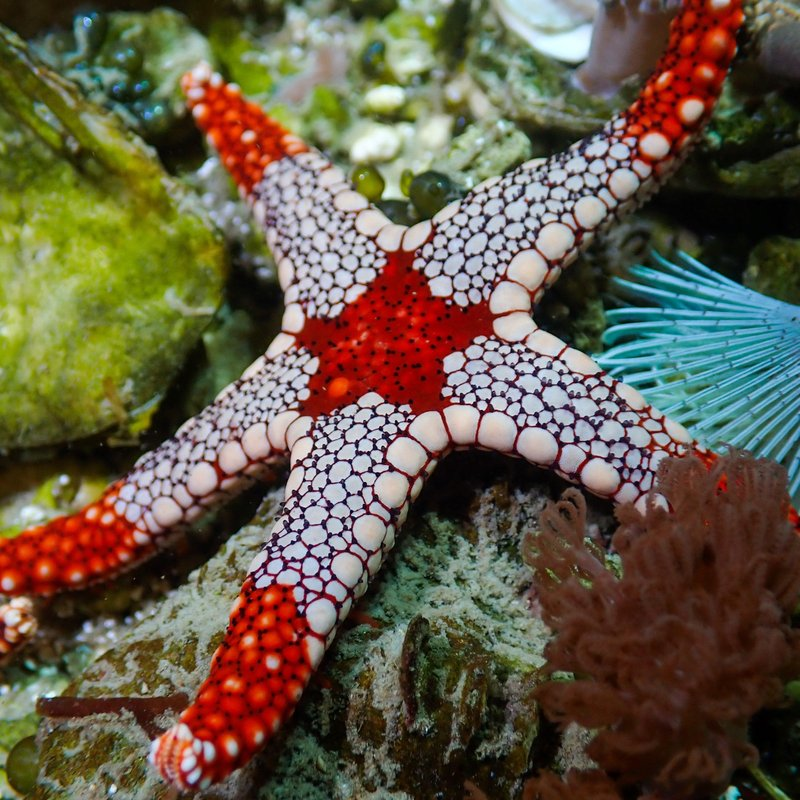

# Estrella mosaico — *Fromia monilis* Perrier, 1869

> Archivo generado desde `especies/datos/catalogo_inicial.json` con `especies/herramientas/generar_fichas.py`. No editar a mano.

*Imagen ilustrativa generada con IA por Brayan (2026-11-16). No es una fotografía de un ejemplar real; puede contener errores anatómicos.*

**Grupo:** estrella de mar  
**Otros nombres:** Tile sea star, Marble starfish, Peppermint sea star  
**Fecha de consulta:** 2026-11-16  
**Confianza global:** media  
**Estado:** verificada; pendiente de revisión del equipo

## Ficha AIRI

| Campo | Valor |
|---|---|
| Nombre común | Estrella mosaico |
| Nombre científico | *Fromia monilis* |
| Temperamento | Pacífico |
| Comportamiento | Pacífico, Solitario. Pacífica; suele vivir sola, aunque tolera a otras de su especie en acuarios grandes. Busca alimento constantemente en la roca viva. Muy delicada con los cambios del agua. |
| Adecuado para arrecife | Sí. LiveAquaria y Saltwaterfish la consideran apta para arrecife. |
| Tipo de alimentación | Omnívoro: detritos y microorganismos, esponjas incrustantes, pequeños invertebrados, trocitos de camarón o mejillón. |
| Temperatura | 22.2–25.6 °C *Rango de LiveAquaria.* |
| Litraje recomendado | 56.8 L (15 gal EE. UU.). *Es el mínimo de una sola fuente comercial y corresponde a una Fromia sp., no necesariamente a F. monilis.* |
| Tamaño adulto | 12.7 cm (diámetro). Al venderse mide 2.5–8.9 cm (juvenil o subadulto). *Diferencia entre fuentes: SeaLifeBase no indica tamaño; LiveAquaria 5 in (≈ 12.7 cm); Saltwaterfish 6 in (≈ 15.2 cm) para una Fromia sp.* |

## Detalle verificado

| Campo | Dato | Confianza | Fuentes |
|---|---|---|---|
| Clasificación taxonómica | Clase Asteroidea; orden Valvatida; familia Goniasteridae. WoRMS AphiaID 213301 (aceptado). Sinónimos: Scytaster monilis Perrier, 1869 (combinación original), Fromia japonica Perrier, 1881, Fromia major Koehler, 1895. LiveAquaria la sitúa en la familia Ophidiasteridae; WoRMS y SeaLifeBase, en Goniasteridae. Se toma WoRMS como referencia. LiveAquaria la vende como «Tile Sea Star» o «Marble Starfish». | alta | [worms_fromia_monilis](https://www.marinespecies.org/aphia.php?p=taxdetails&id=213301), [sealifebase_fromia_monilis](https://www.sealifebase.se/summary/Fromia-monilis.html) |
| Hábitat natural | Zonas someras del arrecife, de 1 a 35 m, sobre todo pendientes arrecifales de fondo rocoso (SeaLifeBase). LiveAquaria indica que vive sobre sustratos arenosos y rocas, y a veces trepa sobre anémonas. Profundidad: 0–51 m (habitual 1–35 m). Distribución: Indo-Pacífico occidental, de las islas Andamán a Australia y Japón (SeaLifeBase); WoRMS también la registra en el Mar Rojo. | media | [sealifebase_fromia_monilis](https://www.sealifebase.se/summary/Fromia-monilis.html), [worms_fromia_monilis](https://www.marinespecies.org/aphia.php?p=taxdetails&id=213301), [liveaquaria_fromia_monilis](https://www.liveaquaria.com/products/tile-sea-star-orange-red) |
| Tamaño adulto | Máx. 12.7 cm (diámetro). Diferencia entre fuentes: SeaLifeBase no indica tamaño; LiveAquaria 5 in (≈ 12.7 cm); Saltwaterfish 6 in (≈ 15.2 cm) para una Fromia sp. | baja | [liveaquaria_fromia_monilis](https://www.liveaquaria.com/products/tile-sea-star-orange-red) |
| Alimentación | Omnívora: come detritos, esponjas incrustantes y pequeños invertebrados (SeaLifeBase). En acuario busca constantemente microorganismos y detritos en la roca viva; se recomienda complementar con trocitos de camarón, mejillón o alimento en escamas (LiveAquaria). | alta | [sealifebase_fromia_monilis](https://www.sealifebase.se/summary/Fromia-monilis.html), [liveaquaria_fromia_monilis](https://www.liveaquaria.com/products/tile-sea-star-orange-red) |
| Temperatura del agua | Acuario: 22.2–25.6 °C (72–78 °F). SeaLifeBase no indica rango de temperatura para esta especie. | baja | [liveaquaria_fromia_monilis](https://www.liveaquaria.com/products/tile-sea-star-orange-red) |
| Rango de pH | Fuente de acuario: 8.1–8.4. Rango prudente AIRI: 8.1–8.3. Criterio: Intersección con la tabla MSD para agua salada (7.8–8.3). | media | [liveaquaria_fromia_monilis](https://www.liveaquaria.com/products/tile-sea-star-orange-red), [msd_tabla_referencia](https://www.msdvetmanual.com/multimedia/table/normal-reference-ranges-for-routine-water-quality-analysis), [msd_capitulo](https://www.msdvetmanual.com/exotic-and-laboratory-animals/aquatic-systems/environmental-diseases-of-aquatic-animals-in-aquatic-systems) |
| Salinidad | 1.023–1.025 de gravedad específica (adimensional). Agua de mar media: 35 ppt (UF/IFAS). No se convierte a ppt porque la equivalencia depende de la temperatura. | media | [liveaquaria_fromia_monilis](https://www.liveaquaria.com/products/tile-sea-star-orange-red), [ufifas_ph_sal_temp](https://waterwatch.ifas.ufl.edu/media/waterwatchifasufledu/FactSheet_pH_Sal_Temp.pdf) |
| Volumen mínimo | 56.8 L (15 gal EE. UU.). Justificación: Cifra de Saltwaterfish («Minimum Tank Size: 15 Gallons») para su «Marble Starfish: Red», vendida como Fromia sp. LiveAquaria no publica litraje. | baja | [saltwaterfish_fromia_monilis](https://www.saltwaterfish.com/product-marble-starfish-red) |
| Comportamiento | Busca alimento constantemente en la roca viva. Suele vivir sola, pero tolera a otras de su especie si el acuario es lo bastante grande (LiveAquaria). | media | [liveaquaria_fromia_monilis](https://www.liveaquaria.com/products/tile-sea-star-orange-red) |
| Territorialidad y refugio | No territorial. Necesita abundante roca viva donde buscar alimento. | media | [liveaquaria_fromia_monilis](https://www.liveaquaria.com/products/tile-sea-star-orange-red) |
| Compatibilidad con arrecife | sí (según la fuente; sin verificación independiente) | baja | [liveaquaria_fromia_monilis](https://www.liveaquaria.com/products/tile-sea-star-orange-red), [saltwaterfish_fromia_monilis](https://www.saltwaterfish.com/product-marble-starfish-red) |
| Convivencia: condiciones | Acuario maduro con abundante roca viva. · Aclimatación por goteo, sin exponerla al aire. | baja | [liveaquaria_fromia_monilis](https://www.liveaquaria.com/products/tile-sea-star-orange-red) |
| Convivencia: riesgos | No tolera cambios bruscos de oxígeno, salinidad o pH ni medicamentos con cobre; requiere aclimatación por goteo y nunca debe exponerse al aire. | baja | [liveaquaria_fromia_monilis](https://www.liveaquaria.com/products/tile-sea-star-orange-red) |
| Conservación | No evaluada por la UICN, según SeaLifeBase. | media | [sealifebase_fromia_monilis](https://www.sealifebase.se/summary/Fromia-monilis.html) |

**Regla AIRI:** compartir rangos de agua no implica compatibilidad entre especies. Los rangos de acuario provienen de una fuente comercial y no son límites veterinarios.

## Fuentes

- **worms_fromia_monilis** (taxonomía): WoRMS — Fromia monilis Perrier, 1869 (AphiaID 213301). <https://www.marinespecies.org/aphia.php?p=taxdetails&id=213301>. Consultada el 2026-11-16.
- **sealifebase_fromia_monilis** (biología): SeaLifeBase — Fromia monilis. <https://www.sealifebase.se/summary/Fromia-monilis.html>. Consultada el 2026-11-16.
- **liveaquaria_fromia_monilis** (comercial): LiveAquaria — Tile Sea Star, Orange/Red (Fromia monilis). <https://www.liveaquaria.com/products/tile-sea-star-orange-red>. Consultada el 2026-11-16.
- **saltwaterfish_fromia_monilis** (comercial): Saltwaterfish — Marble Starfish: Red (Fromia sp.). <https://www.saltwaterfish.com/product-marble-starfish-red>. Consultada el 2026-11-16.
- **msd_tabla_referencia** (veterinaria): MSD Veterinary Manual — “Normal” Reference Ranges for Routine Water Quality Analysis. <https://www.msdvetmanual.com/multimedia/table/normal-reference-ranges-for-routine-water-quality-analysis>. Consultada el 2026-11-12. Reutilizada del registro del motor (motor/airi_motor/datos/fuentes.json); no se volvió a consultar para estas fichas.
- **ufifas_ph_sal_temp** (institucional): UF/IFAS — pH, Salinity and Temperature (hoja informativa). <https://waterwatch.ifas.ufl.edu/media/waterwatchifasufledu/FactSheet_pH_Sal_Temp.pdf>. Consultada el 2026-11-12. Reutilizada del registro del motor (motor/airi_motor/datos/fuentes.json); no se volvió a consultar para estas fichas.
- **msd_capitulo** (veterinaria): MSD Veterinary Manual — Environmental Diseases of Aquatic Animals in Aquatic Systems. <https://www.msdvetmanual.com/exotic-and-laboratory-animals/aquatic-systems/environmental-diseases-of-aquatic-animals-in-aquatic-systems>. Consultada el 2026-11-12. Reutilizada del registro del motor (motor/airi_motor/datos/fuentes.json); no se volvió a consultar para estas fichas.
