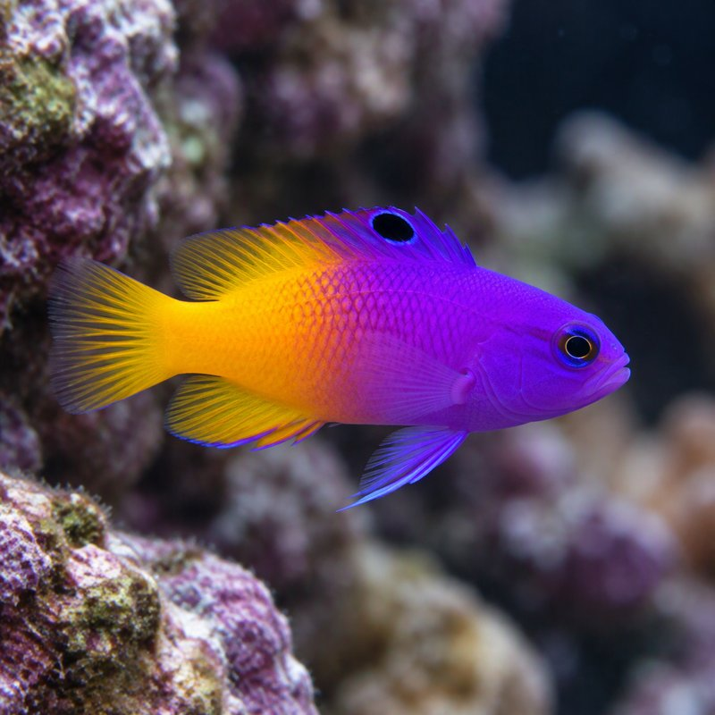

# Gramma real — *Gramma loreto* Poey, 1868

> Archivo generado desde `especies/datos/catalogo_inicial.json` con `especies/herramientas/generar_fichas.py`. No editar a mano.

*Imagen ilustrativa generada con IA por Brayan (2026-11-16). No es una fotografía de un ejemplar real; puede contener errores anatómicos.*

**Grupo:** pez  
**Otros nombres:** Royal gramma, Fairy basslet  
**Fecha de consulta:** 2026-11-16  
**Confianza global:** media  
**Estado:** verificada; pendiente de revisión del equipo

## Ficha AIRI

| Campo | Valor |
|---|---|
| Nombre común | Gramma real |
| Nombre científico | *Gramma loreto* |
| Temperamento | Pacífico |
| Comportamiento | Pacífico, Territorial, Solitario. Territorial con su propia especie, por lo que se mantiene un solo ejemplar. Pacífico con peces de tamaño y temperamento similares. Se esconde en cuevas y nada con el vientre hacia la roca. |
| Adecuado para arrecife | Sí. La única fuente consultada que lo evalúa (LiveAquaria) lo considera compatible con arrecife; no hay verificación independiente. |
| Tipo de alimentación | Carnívoro: ectoparásitos de otros peces (en la naturaleza), artemia, misis, preparados congelados. |
| Temperatura | 22.2–25.6 °C *El rango de acuario cae dentro del rango natural indicado por FishBase.* |
| Litraje recomendado | 113.6 L (30 gal EE. UU.). *Es el mínimo recomendado por una sola fuente comercial; ninguna fuente científica consultada establece un litraje.* |
| Tamaño adulto | 8 cm (longitud total). Al venderse mide 1.3–6.3 cm (juvenil o subadulto). *Diferencia menor entre fuentes: FishBase 8 cm; LiveAquaria 3 in (7.6 cm).* |

## Detalle verificado

| Campo | Dato | Confianza | Fuentes |
|---|---|---|---|
| Clasificación taxonómica | Clase Teleostei; orden Ovalentaria (incertae sedis); familia Grammatidae. WoRMS AphiaID 280932 (aceptado). LiveAquaria escribe «Grammidae»; la grafía aceptada es Grammatidae (WoRMS, FishBase). | alta | [worms_gramma_loreto](https://www.marinespecies.org/aphia.php?p=taxdetails&id=280932), [fishbase_gramma_loreto](https://www.fishbase.se/summary/Gramma-loreto.html) |
| Hábitat natural | Arrecifes del Atlántico centro-occidental. Suele vivir en cuevas o bajo salientes, nadando con el vientre orientado hacia el sustrato. Marino, asociado a arrecifes. Profundidad: 1–60 m (habitual 1–40 m). Distribución: Bermudas, Bahamas y Centroamérica hasta el norte de Sudamérica. | media | [fishbase_gramma_loreto](https://www.fishbase.se/summary/Gramma-loreto.html) |
| Tamaño adulto | Máx. 8 cm (longitud total). LiveAquaria: 3 in (≈ 7.6 cm). | media | [fishbase_gramma_loreto](https://www.fishbase.se/summary/Gramma-loreto.html), [liveaquaria_gramma_loreto](https://www.liveaquaria.com/products/royal-gramma-basslet) |
| Alimentación | Carnívoro. En la naturaleza come, entre otras cosas, ectoparásitos de otros peces. En acuario: artemia, misis y preparados congelados de calidad. | media | [fishbase_gramma_loreto](https://www.fishbase.se/summary/Gramma-loreto.html), [liveaquaria_gramma_loreto](https://www.liveaquaria.com/products/royal-gramma-basslet) |
| Temperatura del agua | Acuario: 22.2–25.6 °C (72–78 °F). Medio natural: 22–27 °C. El rango de acuario cae dentro del rango natural indicado por FishBase. | media | [liveaquaria_gramma_loreto](https://www.liveaquaria.com/products/royal-gramma-basslet), [fishbase_gramma_loreto](https://www.fishbase.se/summary/Gramma-loreto.html) |
| Rango de pH | Fuente de acuario: 8.1–8.4. Rango prudente AIRI: 8.1–8.3. Criterio: Intersección con la tabla MSD para agua salada (7.8–8.3). | media | [liveaquaria_gramma_loreto](https://www.liveaquaria.com/products/royal-gramma-basslet), [msd_tabla_referencia](https://www.msdvetmanual.com/multimedia/table/normal-reference-ranges-for-routine-water-quality-analysis), [msd_capitulo](https://www.msdvetmanual.com/exotic-and-laboratory-animals/aquatic-systems/environmental-diseases-of-aquatic-animals-in-aquatic-systems) |
| Salinidad | 1.020–1.025 de gravedad específica (adimensional). Agua de mar media: 35 ppt (UF/IFAS). No se convierte a ppt porque la equivalencia depende de la temperatura. | media | [liveaquaria_gramma_loreto](https://www.liveaquaria.com/products/royal-gramma-basslet), [ufifas_ph_sal_temp](https://waterwatch.ifas.ufl.edu/media/waterwatchifasufledu/FactSheet_pH_Sal_Temp.pdf) |
| Volumen mínimo | 113.6 L (30 gal EE. UU.). Justificación: Cifra de LiveAquaria, que recomienda abundante roca con cuevas y luz tenue. El espacio permite que mantenga su territorio sin enfrentarse constantemente con otros peces. | baja | [liveaquaria_gramma_loreto](https://www.liveaquaria.com/products/royal-gramma-basslet) |
| Comportamiento | Pacífico con peces de tamaño y temperamento similares. Cuando se alarma se esconde en grietas. El macho construye y cuida el nido en pequeños agujeros, y la hembra deposita allí los huevos al amanecer. Se ha criado en cautividad. | media | [fishbase_gramma_loreto](https://www.fishbase.se/summary/Gramma-loreto.html), [liveaquaria_gramma_loreto](https://www.liveaquaria.com/products/royal-gramma-basslet) |
| Territorialidad y refugio | Es territorialmente agresivo con su propia especie, por lo que conviene mantenerlo como ejemplar único. Necesita cuevas en la roca. | media | [liveaquaria_gramma_loreto](https://www.liveaquaria.com/products/royal-gramma-basslet), [fishbase_gramma_loreto](https://www.fishbase.se/summary/Gramma-loreto.html) |
| Compatibilidad con arrecife | sí (según la fuente; sin verificación independiente) | baja | [liveaquaria_gramma_loreto](https://www.liveaquaria.com/products/royal-gramma-basslet) |
| Convivencia: condiciones | Un solo ejemplar por acuario. · Compañeros de tamaño y temperamento similares. | baja | [liveaquaria_gramma_loreto](https://www.liveaquaria.com/products/royal-gramma-basslet) |
| Convivencia: riesgos | Agresión territorial hacia otros ejemplares de su especie. | baja | [liveaquaria_gramma_loreto](https://www.liveaquaria.com/products/royal-gramma-basslet) |
| Conservación | Preocupación menor (LC), evaluada el 21/03/2011, según FishBase. | media | [fishbase_gramma_loreto](https://www.fishbase.se/summary/Gramma-loreto.html) |

**Regla AIRI:** compartir rangos de agua no implica compatibilidad entre especies. Los rangos de acuario provienen de una fuente comercial y no son límites veterinarios.

## Fuentes

- **worms_gramma_loreto** (taxonomía): WoRMS — Gramma loreto Poey, 1868 (AphiaID 280932). <https://www.marinespecies.org/aphia.php?p=taxdetails&id=280932>. Consultada el 2026-11-16.
- **fishbase_gramma_loreto** (biología): FishBase — Gramma loreto, Royal gramma. <https://www.fishbase.se/summary/Gramma-loreto.html>. Consultada el 2026-11-16.
- **liveaquaria_gramma_loreto** (comercial): LiveAquaria — Royal Gramma Basslet. <https://www.liveaquaria.com/products/royal-gramma-basslet>. Consultada el 2026-11-16.
- **msd_tabla_referencia** (veterinaria): MSD Veterinary Manual — “Normal” Reference Ranges for Routine Water Quality Analysis. <https://www.msdvetmanual.com/multimedia/table/normal-reference-ranges-for-routine-water-quality-analysis>. Consultada el 2026-11-12. Reutilizada del registro del motor (motor/airi_motor/datos/fuentes.json); no se volvió a consultar para estas fichas.
- **ufifas_ph_sal_temp** (institucional): UF/IFAS — pH, Salinity and Temperature (hoja informativa). <https://waterwatch.ifas.ufl.edu/media/waterwatchifasufledu/FactSheet_pH_Sal_Temp.pdf>. Consultada el 2026-11-12. Reutilizada del registro del motor (motor/airi_motor/datos/fuentes.json); no se volvió a consultar para estas fichas.
- **msd_capitulo** (veterinaria): MSD Veterinary Manual — Environmental Diseases of Aquatic Animals in Aquatic Systems. <https://www.msdvetmanual.com/exotic-and-laboratory-animals/aquatic-systems/environmental-diseases-of-aquatic-animals-in-aquatic-systems>. Consultada el 2026-11-12. Reutilizada del registro del motor (motor/airi_motor/datos/fuentes.json); no se volvió a consultar para estas fichas.
