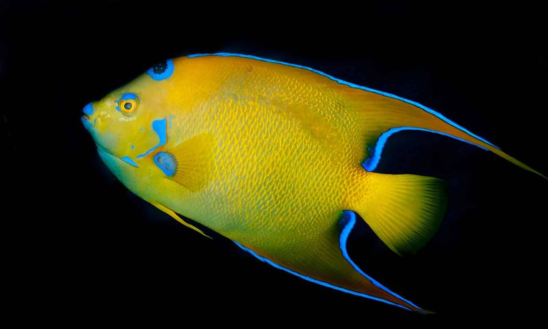

# Pez ángel reina — *Holacanthus ciliaris* (Linnaeus, 1758)

> Archivo generado desde `especies/datos/catalogo_inicial.json` con `especies/herramientas/generar_fichas.py`. No editar a mano.

*Imagen ilustrativa generada con IA por Brayan (2026-11-18). No es una fotografía de un ejemplar real; puede contener errores anatómicos.*

**Grupo:** pez  
**Otros nombres:** Queen angelfish, Ángel reina  
**Fecha de consulta:** 2026-11-18  
**Confianza global:** media  
**Estado:** verificada; pendiente de revisión del equipo

## Ficha AIRI

| Campo | Valor |
|---|---|
| Nombre común | Pez ángel reina |
| Nombre científico | *Holacanthus ciliaris* |
| Temperamento | Semiagresivo |
| Comportamiento | . Semiagresivo: debe ser el último pez en entrar. Pica corales y almejas. Necesita un acuario enorme. |
| Adecuado para arrecife | Con precaución. LiveAquaria lo marca «con precaución»: tiende a picar corales duros y blandos y el manto de las almejas. |
| Tipo de alimentación | Omnívoro: esponjas, algas, preparados para peces ángel, mysis y alimentos cárneos. |
| Temperatura | 22.2–25.6 °C |
| Litraje recomendado | 946.2 L (250 gal EE. UU.). *Es el mínimo recomendado por una sola fuente comercial; ninguna fuente científica consultada establece un litraje.* |
| Tamaño adulto | 45 cm (longitud total). Madura desde 22 cm. *FishBase 45 cm y LiveAquaria 18 in (≈ 45.7 cm) coinciden.* |

## Detalle verificado

| Campo | Dato | Confianza | Fuentes |
|---|---|---|---|
| Clasificación taxonómica | Clase Teleostei; orden Chaetodontiformes; familia Pomacanthidae. WoRMS AphiaID 276012 (aceptado). Sinónimos: Chaetodon ciliaris Linnaeus, 1758 (combinación original), Angelichthys ciliaris (Linnaeus, 1758). | alta | [worms_holacanthus_ciliaris](https://www.marinespecies.org/aphia.php?p=taxdetails&id=276012), [fishbase_holacanthus_ciliaris](https://www.fishbase.se/summary/Holacanthus-ciliaris.html) |
| Hábitat natural | Arrecifes coralinos; se mueve entre gorgonias, látigos de mar y corales (FishBase). Profundidad: 1–70 m. Distribución: Atlántico occidental: de Florida y el golfo de México a Brasil; Atlántico centro-oriental: peñascos de San Pedro y San Pablo. | alta | [fishbase_holacanthus_ciliaris](https://www.fishbase.se/summary/Holacanthus-ciliaris.html) |
| Tamaño adulto | Máx. 45 cm (longitud total). FishBase 45 cm y LiveAquaria 18 in (≈ 45.7 cm) coinciden. | alta | [fishbase_holacanthus_ciliaris](https://www.fishbase.se/summary/Holacanthus-ciliaris.html), [liveaquaria_holacanthus_ciliaris](https://www.liveaquaria.com/products/queen-angelfish) |
| Alimentación | Come casi exclusivamente esponjas, más pequeñas cantidades de algas, tunicados, hidroides y briozoos; los jóvenes quitan parásitos a otros peces (FishBase). En acuario: espirulina, algas, preparados para peces ángel, mysis y otros alimentos cárneos, al menos tres veces al día (LiveAquaria). | alta | [fishbase_holacanthus_ciliaris](https://www.fishbase.se/summary/Holacanthus-ciliaris.html), [liveaquaria_holacanthus_ciliaris](https://www.liveaquaria.com/products/queen-angelfish) |
| Temperatura del agua | Acuario: 22.2–25.6 °C (72–78 °F). FishBase no indica rango de temperatura para esta especie. | baja | [liveaquaria_holacanthus_ciliaris](https://www.liveaquaria.com/products/queen-angelfish) |
| Rango de pH | Fuente de acuario: 8.1–8.4. Rango prudente AIRI: 8.1–8.3. Criterio: Intersección con la tabla MSD para agua salada (7.8–8.3). | media | [liveaquaria_holacanthus_ciliaris](https://www.liveaquaria.com/products/queen-angelfish), [msd_tabla_referencia](https://www.msdvetmanual.com/multimedia/table/normal-reference-ranges-for-routine-water-quality-analysis), [msd_capitulo](https://www.msdvetmanual.com/exotic-and-laboratory-animals/aquatic-systems/environmental-diseases-of-aquatic-animals-in-aquatic-systems) |
| Salinidad | 1.020–1.025 de gravedad específica (adimensional). Agua de mar media: 35 ppt (UF/IFAS). No se convierte a ppt porque la equivalencia depende de la temperatura. | media | [liveaquaria_holacanthus_ciliaris](https://www.liveaquaria.com/products/queen-angelfish), [ufifas_ph_sal_temp](https://waterwatch.ifas.ufl.edu/media/waterwatchifasufledu/FactSheet_pH_Sal_Temp.pdf) |
| Volumen mínimo | 946.2 L (250 gal EE. UU.). Justificación: Cifra de LiveAquaria (250 gal), con escondites y roca viva para pastar. | baja | [liveaquaria_holacanthus_ciliaris](https://www.liveaquaria.com/products/queen-angelfish) |
| Comportamiento | Suele ir solo o en pareja (FishBase). Puede ser agresivo, así que debe ser el último en entrar al acuario. Es algo difícil: sufre con parámetros o dieta inadecuados (LiveAquaria). | media | [fishbase_holacanthus_ciliaris](https://www.fishbase.se/summary/Holacanthus-ciliaris.html), [liveaquaria_holacanthus_ciliaris](https://www.liveaquaria.com/products/queen-angelfish) |
| Territorialidad y refugio | Necesita escondites y roca viva para pastar (LiveAquaria). | media | [liveaquaria_holacanthus_ciliaris](https://www.liveaquaria.com/products/queen-angelfish) |
| Compatibilidad con arrecife | con precaución (según la fuente; sin verificación independiente) | baja | [liveaquaria_holacanthus_ciliaris](https://www.liveaquaria.com/products/queen-angelfish) |
| Convivencia: condiciones | Acuario de 250 gal o más. · Introducirlo el último. | baja | [liveaquaria_holacanthus_ciliaris](https://www.liveaquaria.com/products/queen-angelfish) |
| Convivencia: riesgos | Pica corales y almejas. · Sensible a parámetros del agua y dieta inadecuados. | baja | [liveaquaria_holacanthus_ciliaris](https://www.liveaquaria.com/products/queen-angelfish) |
| Conservación | Preocupación menor (LC), evaluada el 08/10/2009, según FishBase. | media | [fishbase_holacanthus_ciliaris](https://www.fishbase.se/summary/Holacanthus-ciliaris.html) |

**Regla AIRI:** compartir rangos de agua no implica compatibilidad entre especies. Los rangos de acuario provienen de una fuente comercial y no son límites veterinarios.

## Fuentes

- **worms_holacanthus_ciliaris** (taxonomía): WoRMS — Holacanthus ciliaris (Linnaeus, 1758) (AphiaID 276012). <https://www.marinespecies.org/aphia.php?p=taxdetails&id=276012>. Consultada el 2026-11-18.
- **fishbase_holacanthus_ciliaris** (biología): FishBase — Holacanthus ciliaris. <https://www.fishbase.se/summary/Holacanthus-ciliaris.html>. Consultada el 2026-11-18.
- **liveaquaria_holacanthus_ciliaris** (comercial): LiveAquaria — Queen Angelfish (Holacanthus ciliaris). <https://www.liveaquaria.com/products/queen-angelfish>. Consultada el 2026-11-18.
- **msd_tabla_referencia** (veterinaria): MSD Veterinary Manual — “Normal” Reference Ranges for Routine Water Quality Analysis. <https://www.msdvetmanual.com/multimedia/table/normal-reference-ranges-for-routine-water-quality-analysis>. Consultada el 2026-11-12. Reutilizada del registro del motor (motor/airi_motor/datos/fuentes.json); no se volvió a consultar para estas fichas.
- **ufifas_ph_sal_temp** (institucional): UF/IFAS — pH, Salinity and Temperature (hoja informativa). <https://waterwatch.ifas.ufl.edu/media/waterwatchifasufledu/FactSheet_pH_Sal_Temp.pdf>. Consultada el 2026-11-12. Reutilizada del registro del motor (motor/airi_motor/datos/fuentes.json); no se volvió a consultar para estas fichas.
- **msd_capitulo** (veterinaria): MSD Veterinary Manual — Environmental Diseases of Aquatic Animals in Aquatic Systems. <https://www.msdvetmanual.com/exotic-and-laboratory-animals/aquatic-systems/environmental-diseases-of-aquatic-animals-in-aquatic-systems>. Consultada el 2026-11-12. Reutilizada del registro del motor (motor/airi_motor/datos/fuentes.json); no se volvió a consultar para estas fichas.
