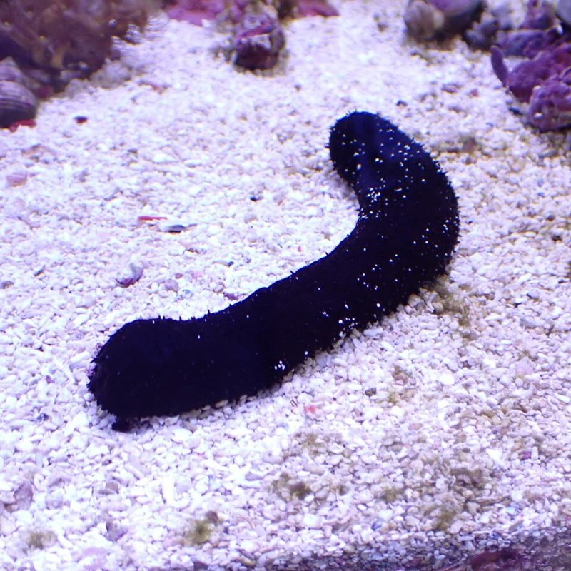

# Pepino de mar negro — *Holothuria atra* Jaeger, 1833

> Archivo generado desde `especies/datos/catalogo_inicial.json` con `especies/herramientas/generar_fichas.py`. No editar a mano.

*Imagen ilustrativa generada con IA por Brayan (2026-11-16). No es una fotografía de un ejemplar real; puede contener errores anatómicos.*

**Grupo:** pepino de mar  
**Otros nombres:** Black sea cucumber, Lollyfish  
**Fecha de consulta:** 2026-11-16  
**Confianza global:** media  
**Estado:** verificada; pendiente de revisión del equipo

## Ficha AIRI

| Campo | Valor |
|---|---|
| Nombre común | Pepino de mar negro |
| Nombre científico | *Holothuria atra* |
| Temperamento | Pacífico |
| Comportamiento | Pacífico. Pacífico, vive sobre la arena. Si se estresa o muere puede liberar sustancias tóxicas para los peces. Solo para expertos. |
| Adecuado para arrecife | Sí. LiveAquaria lo considera apto para arrecife. |
| Tipo de alimentación | Omnívoro: algas (Halimeda), material del fondo arenoso. |
| Temperatura | 22.2–25.6 °C *Rango de LiveAquaria.* |
| Litraje recomendado | null (no verificado). *Ninguna fuente consultada publica un litraje mínimo; LiveAquaria solo da una proporción (≈ 7.6 cm de animal por cada 75.7 L).* |
| Tamaño adulto | 60 cm (longitud total). Al venderse mide 2.5–17.8 cm (juvenil o subadulto). Madura desde 15.5 cm. *SeaLifeBase: hasta 60 cm (longitud habitual 20 cm); LiveAquaria lo vende de 1 a 7 in.* |

## Detalle verificado

| Campo | Dato | Confianza | Fuentes |
|---|---|---|---|
| Clasificación taxonómica | Clase Holothuroidea; orden Holothuriida; familia Holothuriidae. WoRMS AphiaID 1672768 (aceptado). Sinónimos: Halodeima atra, Holothuria amboinensis Semper, 1868. | alta | [worms_holothuria_atra](https://www.marinespecies.org/aphia.php?p=taxdetails&id=1672768), [sealifebase_holothuria_atra](https://www.sealifebase.se/summary/Holothuria-atra.html) |
| Hábitat natural | Especie común de aguas someras, rara vez por debajo de 20 m: planicies arrecifales internas y externas, lagunas someras, fondos arenoso-fangosos, praderas marinas y zonas intermareales (SeaLifeBase). Suele vivir parcialmente cubierto de arena (LiveAquaria). Profundidad: 0–30 m. Distribución: Indo-Pacífico; LiveAquaria precisa del Mar Rojo a Hawái. | media | [sealifebase_holothuria_atra](https://www.sealifebase.se/summary/Holothuria-atra.html) |
| Tamaño adulto | Máx. 60 cm (longitud total). SeaLifeBase: hasta 60 cm (longitud habitual 20 cm); LiveAquaria lo vende de 1 a 7 in. | alta | [sealifebase_holothuria_atra](https://www.sealifebase.se/summary/Holothuria-atra.html) |
| Alimentación | Se alimenta del alga Halimeda (SeaLifeBase). LiveAquaria lo clasifica como omnívoro. | media | [sealifebase_holothuria_atra](https://www.sealifebase.se/summary/Holothuria-atra.html), [liveaquaria_holothuria_atra](https://www.liveaquaria.com/products/sea-cucumber-black-expert-only) |
| Temperatura del agua | Acuario: 22.2–25.6 °C (72–78 °F). Ninguna fuente científica consultada indica rango de temperatura para este taxón. | baja | [liveaquaria_holothuria_atra](https://www.liveaquaria.com/products/sea-cucumber-black-expert-only) |
| Rango de pH | Fuente de acuario: 8.1–8.4. Rango prudente AIRI: 8.1–8.3. Criterio: Intersección con la tabla MSD para agua salada (7.8–8.3). | media | [liveaquaria_holothuria_atra](https://www.liveaquaria.com/products/sea-cucumber-black-expert-only), [msd_tabla_referencia](https://www.msdvetmanual.com/multimedia/table/normal-reference-ranges-for-routine-water-quality-analysis), [msd_capitulo](https://www.msdvetmanual.com/exotic-and-laboratory-animals/aquatic-systems/environmental-diseases-of-aquatic-animals-in-aquatic-systems) |
| Salinidad | 1.023–1.025 de gravedad específica (adimensional). Agua de mar media: 35 ppt (UF/IFAS). No se convierte a ppt porque la equivalencia depende de la temperatura. | media | [liveaquaria_holothuria_atra](https://www.liveaquaria.com/products/sea-cucumber-black-expert-only), [ufifas_ph_sal_temp](https://waterwatch.ifas.ufl.edu/media/waterwatchifasufledu/FactSheet_pH_Sal_Temp.pdf) |
| Volumen mínimo | null (no verificado). Justificación: LiveAquaria no da un mínimo, pero recomienda no sobrepoblar: unas 3 in de pepino por cada 20 gal de agua. | baja |  |
| Comportamiento | Pacífico. Si lo atacan o lo hieren, expulsa sus órganos internos, que pueden ser tóxicos para los peces; en acuario rara vez los regenera (LiveAquaria). SeaLifeBase indica que segrega un líquido rojo tóxico si se frota con fuerza su piel. Solo para expertos. | media | [liveaquaria_holothuria_atra](https://www.liveaquaria.com/products/sea-cucumber-black-expert-only), [sealifebase_holothuria_atra](https://www.sealifebase.se/summary/Holothuria-atra.html) |
| Territorialidad y refugio | Vive sobre el fondo arenoso, a veces parcialmente enterrado. | media | [liveaquaria_holothuria_atra](https://www.liveaquaria.com/products/sea-cucumber-black-expert-only) |
| Compatibilidad con arrecife | sí (según la fuente; sin verificación independiente) | baja | [liveaquaria_holothuria_atra](https://www.liveaquaria.com/products/sea-cucumber-black-expert-only) |
| Convivencia: condiciones | Compañeros pacíficos. · Fondo de arena amplio. · No sobrepoblar el acuario. | baja | [liveaquaria_holothuria_atra](https://www.liveaquaria.com/products/sea-cucumber-black-expert-only) |
| Convivencia: riesgos | Libera sustancias tóxicas para los peces si se estresa, se hiere o muere. · No tolera medicamentos con cobre ni nitratos altos. | baja | [liveaquaria_holothuria_atra](https://www.liveaquaria.com/products/sea-cucumber-black-expert-only) |
| Conservación | Preocupación menor (LC), evaluada el 18/05/2010, según SeaLifeBase. | media | [sealifebase_holothuria_atra](https://www.sealifebase.se/summary/Holothuria-atra.html) |

**Regla AIRI:** compartir rangos de agua no implica compatibilidad entre especies. Los rangos de acuario provienen de una fuente comercial y no son límites veterinarios.

## Fuentes

- **worms_holothuria_atra** (taxonomía): WoRMS — Holothuria atra Jaeger, 1833 (AphiaID 1672768). <https://www.marinespecies.org/aphia.php?p=taxdetails&id=1672768>. Consultada el 2026-11-16.
- **sealifebase_holothuria_atra** (biología): SeaLifeBase — Holothuria atra. <https://www.sealifebase.se/summary/Holothuria-atra.html>. Consultada el 2026-11-16.
- **liveaquaria_holothuria_atra** (comercial): LiveAquaria — Black Sea Cucumber (EXPERT ONLY). <https://www.liveaquaria.com/products/sea-cucumber-black-expert-only>. Consultada el 2026-11-16.
- **msd_tabla_referencia** (veterinaria): MSD Veterinary Manual — “Normal” Reference Ranges for Routine Water Quality Analysis. <https://www.msdvetmanual.com/multimedia/table/normal-reference-ranges-for-routine-water-quality-analysis>. Consultada el 2026-11-12. Reutilizada del registro del motor (motor/airi_motor/datos/fuentes.json); no se volvió a consultar para estas fichas.
- **ufifas_ph_sal_temp** (institucional): UF/IFAS — pH, Salinity and Temperature (hoja informativa). <https://waterwatch.ifas.ufl.edu/media/waterwatchifasufledu/FactSheet_pH_Sal_Temp.pdf>. Consultada el 2026-11-12. Reutilizada del registro del motor (motor/airi_motor/datos/fuentes.json); no se volvió a consultar para estas fichas.
- **msd_capitulo** (veterinaria): MSD Veterinary Manual — Environmental Diseases of Aquatic Animals in Aquatic Systems. <https://www.msdvetmanual.com/exotic-and-laboratory-animals/aquatic-systems/environmental-diseases-of-aquatic-animals-in-aquatic-systems>. Consultada el 2026-11-12. Reutilizada del registro del motor (motor/airi_motor/datos/fuentes.json); no se volvió a consultar para estas fichas.
