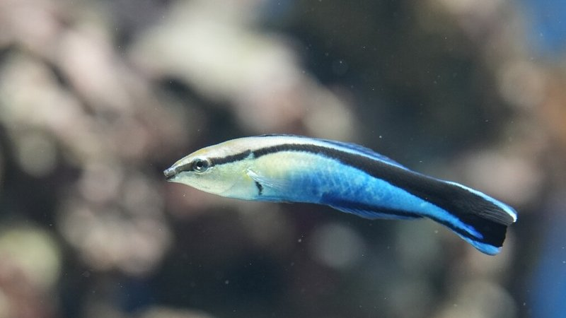

# Lábrido limpiador — *Labroides dimidiatus* (Valenciennes, 1839)

> Archivo generado desde `especies/datos/catalogo_inicial.json` con `especies/herramientas/generar_fichas.py`. No editar a mano.

*Imagen ilustrativa generada con IA por Brayan (2026-11-18). No es una fotografía de un ejemplar real; puede contener errores anatómicos.*

**Grupo:** pez  
**Otros nombres:** Bluestreak cleaner wrasse, Cleaner wrasse  
**Fecha de consulta:** 2026-11-18  
**Confianza global:** media  
**Estado:** verificada; pendiente de revisión del equipo

## Ficha AIRI

| Campo | Valor |
|---|---|
| Nombre común | Lábrido limpiador |
| Nombre científico | *Labroides dimidiatus* |
| Temperamento | Pacífico |
| Comportamiento | Pacífico. Pacífico: limpia de parásitos a otros peces. Difícil de mantener: necesita comer varias veces al día. Puede saltar. |
| Adecuado para arrecife | Sí. LiveAquaria lo considera compatible con arrecife. |
| Tipo de alimentación | Carnívoro: parásitos de otros peces, mysis enriquecido, alimento cárneo en porciones pequeñas. |
| Temperatura | 22.2–25.6 °C |
| Litraje recomendado | 340.7 L (90 gal EE. UU.). *Es el mínimo recomendado por una sola fuente comercial; ninguna fuente científica consultada establece un litraje.* |
| Tamaño adulto | 14 cm (longitud total). *FishBase 14 cm y LiveAquaria 5½ in (≈ 14 cm) coinciden.* |

## Detalle verificado

| Campo | Dato | Confianza | Fuentes |
|---|---|---|---|
| Clasificación taxonómica | Clase Teleostei; orden Labriformes; familia Labridae. WoRMS AphiaID 219014 (aceptado). Sinónimos: Cossyphus dimidiatus Valenciennes, 1839 (combinación original), Fissilabrus dimidiatus. | alta | [worms_labroides_dimidiatus](https://www.marinespecies.org/aphia.php?p=taxdetails&id=219014), [fishbase_labroides_dimidiatus](https://www.fishbase.se/summary/Labroides-dimidiatus.html) |
| Hábitat natural | Zonas ricas en coral de lagunas interiores, planicies arrecifales y arrecifes externos (FishBase). Profundidad: 0–100 m (habitual 1–30 m). Distribución: Indo-Pacífico: del golfo Pérsico, el mar Rojo y África oriental a las islas de la Línea, Marquesas y Ducie; al norte hasta el sur de Japón y al sur hasta Lord Howe y Rapa. | alta | [fishbase_labroides_dimidiatus](https://www.fishbase.se/summary/Labroides-dimidiatus.html) |
| Tamaño adulto | Máx. 14 cm (longitud total). FishBase 14 cm y LiveAquaria 5½ in (≈ 14 cm) coinciden. | alta | [fishbase_labroides_dimidiatus](https://www.fishbase.se/summary/Labroides-dimidiatus.html), [liveaquaria_labroides_dimidiatus](https://www.liveaquaria.com/products/bluestreak-cleaner-wrasse) |
| Alimentación | Come ectoparásitos crustáceos y la mucosidad de otros peces (FishBase). En acuario necesita pequeñas porciones de alimento cárneo fresco varias veces al día, como mysis enriquecido, porque no puede comer mucho de una vez (LiveAquaria). | alta | [fishbase_labroides_dimidiatus](https://www.fishbase.se/summary/Labroides-dimidiatus.html), [liveaquaria_labroides_dimidiatus](https://www.liveaquaria.com/products/bluestreak-cleaner-wrasse) |
| Temperatura del agua | Acuario: 22.2–25.6 °C (72–78 °F). Medio natural: 24–28 °C. El rango de acuario no cae por completo dentro del rango natural registrado por FishBase. | baja | [liveaquaria_labroides_dimidiatus](https://www.liveaquaria.com/products/bluestreak-cleaner-wrasse), [fishbase_labroides_dimidiatus](https://www.fishbase.se/summary/Labroides-dimidiatus.html) |
| Rango de pH | Fuente de acuario: 8.1–8.4. Rango prudente AIRI: 8.1–8.3. Criterio: Intersección con la tabla MSD para agua salada (7.8–8.3). | media | [liveaquaria_labroides_dimidiatus](https://www.liveaquaria.com/products/bluestreak-cleaner-wrasse), [msd_tabla_referencia](https://www.msdvetmanual.com/multimedia/table/normal-reference-ranges-for-routine-water-quality-analysis), [msd_capitulo](https://www.msdvetmanual.com/exotic-and-laboratory-animals/aquatic-systems/environmental-diseases-of-aquatic-animals-in-aquatic-systems) |
| Salinidad | 1.020–1.025 de gravedad específica (adimensional). Agua de mar media: 35 ppt (UF/IFAS). No se convierte a ppt porque la equivalencia depende de la temperatura. | media | [liveaquaria_labroides_dimidiatus](https://www.liveaquaria.com/products/bluestreak-cleaner-wrasse), [ufifas_ph_sal_temp](https://waterwatch.ifas.ufl.edu/media/waterwatchifasufledu/FactSheet_pH_Sal_Temp.pdf) |
| Volumen mínimo | 340.7 L (90 gal EE. UU.). Justificación: Cifra de LiveAquaria (90 gal), con mucho espacio para nadar. | baja | [liveaquaria_labroides_dimidiatus](https://www.liveaquaria.com/products/bluestreak-cleaner-wrasse) |
| Comportamiento | Mantiene «estaciones de limpieza» a las que otros peces acuden para que les quite parásitos; es monógamo y hermafrodita protogínico (FishBase). Muy activo y puede saltar fuera del acuario. Requiere cuidados avanzados: solo para acuaristas con experiencia (LiveAquaria). | media | [fishbase_labroides_dimidiatus](https://www.fishbase.se/summary/Labroides-dimidiatus.html), [liveaquaria_labroides_dimidiatus](https://www.liveaquaria.com/products/bluestreak-cleaner-wrasse) |
| Territorialidad y refugio | Ocupa una estación de limpieza fija (FishBase). | media | [fishbase_labroides_dimidiatus](https://www.fishbase.se/summary/Labroides-dimidiatus.html) |
| Compatibilidad con arrecife | sí (según la fuente; sin verificación independiente) | baja | [liveaquaria_labroides_dimidiatus](https://www.liveaquaria.com/products/bluestreak-cleaner-wrasse) |
| Convivencia: condiciones | Acuario de 90 gal o más con tapa bien ajustada. · Varias tomas pequeñas de alimento al día. · Compañeros de forma y color distintos. | baja | [liveaquaria_labroides_dimidiatus](https://www.liveaquaria.com/products/bluestreak-cleaner-wrasse) |
| Convivencia: riesgos | Puede saltar del acuario. · Cuidado difícil. | baja | [liveaquaria_labroides_dimidiatus](https://www.liveaquaria.com/products/bluestreak-cleaner-wrasse) |
| Conservación | Preocupación menor (LC), evaluada el 12/05/2008, según FishBase. | media | [fishbase_labroides_dimidiatus](https://www.fishbase.se/summary/Labroides-dimidiatus.html) |

**Regla AIRI:** compartir rangos de agua no implica compatibilidad entre especies. Los rangos de acuario provienen de una fuente comercial y no son límites veterinarios.

## Fuentes

- **worms_labroides_dimidiatus** (taxonomía): WoRMS — Labroides dimidiatus (Valenciennes, 1839) (AphiaID 219014). <https://www.marinespecies.org/aphia.php?p=taxdetails&id=219014>. Consultada el 2026-11-18.
- **fishbase_labroides_dimidiatus** (biología): FishBase — Labroides dimidiatus. <https://www.fishbase.se/summary/Labroides-dimidiatus.html>. Consultada el 2026-11-18.
- **liveaquaria_labroides_dimidiatus** (comercial): LiveAquaria — Bluestreak Cleaner Wrasse (Labroides dimidiatus). <https://www.liveaquaria.com/products/bluestreak-cleaner-wrasse>. Consultada el 2026-11-18.
- **msd_tabla_referencia** (veterinaria): MSD Veterinary Manual — “Normal” Reference Ranges for Routine Water Quality Analysis. <https://www.msdvetmanual.com/multimedia/table/normal-reference-ranges-for-routine-water-quality-analysis>. Consultada el 2026-11-12. Reutilizada del registro del motor (motor/airi_motor/datos/fuentes.json); no se volvió a consultar para estas fichas.
- **ufifas_ph_sal_temp** (institucional): UF/IFAS — pH, Salinity and Temperature (hoja informativa). <https://waterwatch.ifas.ufl.edu/media/waterwatchifasufledu/FactSheet_pH_Sal_Temp.pdf>. Consultada el 2026-11-12. Reutilizada del registro del motor (motor/airi_motor/datos/fuentes.json); no se volvió a consultar para estas fichas.
- **msd_capitulo** (veterinaria): MSD Veterinary Manual — Environmental Diseases of Aquatic Animals in Aquatic Systems. <https://www.msdvetmanual.com/exotic-and-laboratory-animals/aquatic-systems/environmental-diseases-of-aquatic-animals-in-aquatic-systems>. Consultada el 2026-11-12. Reutilizada del registro del motor (motor/airi_motor/datos/fuentes.json); no se volvió a consultar para estas fichas.
