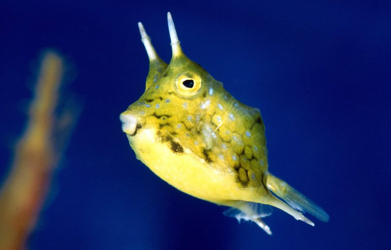

# Pez vaca — *Lactoria cornuta* (Linnaeus, 1758)

> Archivo generado desde `especies/datos/catalogo_inicial.json` con `especies/herramientas/generar_fichas.py`. No editar a mano.

*Imagen ilustrativa generada con IA por Brayan (2026-11-18). No es una fotografía de un ejemplar real; puede contener errores anatómicos.*

**Grupo:** pez  
**Otros nombres:** Longhorn cowfish, Pez vaca de cuernos largos  
**Fecha de consulta:** 2026-11-18  
**Confianza global:** media  
**Estado:** verificada; pendiente de revisión del equipo

## Ficha AIRI

| Campo | Valor |
|---|---|
| Nombre común | Pez vaca |
| Nombre científico | *Lactoria cornuta* |
| Temperamento | Pacífico |
| Comportamiento | Pacífico, Solitario. Pacífico pero peligroso: si se estresa o muere libera una toxina que puede matar a los demás peces. Solo para expertos. |
| Adecuado para arrecife | Con precaución. LiveAquaria lo marca «con precaución»: puede picar gusanos tubícolas. |
| Tipo de alimentación | Omnívoro: invertebrados del fondo, alimentos cárneos, alimentos vegetales. |
| Temperatura | 22.2–25.6 °C |
| Litraje recomendado | 946.2 L (250 gal EE. UU.). *Es el mínimo recomendado por una sola fuente comercial; ninguna fuente científica consultada establece un litraje.* |
| Tamaño adulto | 46 cm (longitud total). Al venderse mide 2.5–12.7 cm (juvenil o subadulto). *Diferencia entre fuentes: FishBase 46 cm (longitud habitual 40 cm); LiveAquaria 20 in (≈ 50.8 cm) en el medio natural y 16 in (≈ 40.6 cm) o menos en acuario.* |

## Detalle verificado

| Campo | Dato | Confianza | Fuentes |
|---|---|---|---|
| Clasificación taxonómica | Clase Teleostei; orden Tetraodontiformes; familia Ostraciidae. WoRMS AphiaID 219904 (aceptado). Sinónimos: Ostracion cornutus Linnaeus, 1758 (combinación original), Lactoria cornutus (Linnaeus, 1758). | alta | [worms_lactoria_cornuta](https://www.marinespecies.org/aphia.php?p=taxdetails&id=219904), [fishbase_lactoria_cornuta](https://www.fishbase.se/summary/Lactoria-cornuta.html) |
| Hábitat natural | Costas de fondo fangoso o arenoso en bahías tranquilas, puertos y estuarios, y zonas con algas cerca de rocas o arrecifes. Los juveniles viven cerca de desembocaduras y en agua salobre (FishBase). Profundidad: 1–100 m (habitual 1–50 m). Distribución: Indo-Pacífico: del mar Rojo y África oriental a las Marquesas y Tuamotu; al norte hasta el sur de Japón y al sur hasta Lord Howe. | alta | [fishbase_lactoria_cornuta](https://www.fishbase.se/summary/Lactoria-cornuta.html) |
| Tamaño adulto | Máx. 46 cm (longitud total). Diferencia entre fuentes: FishBase 46 cm (longitud habitual 40 cm); LiveAquaria 20 in (≈ 50.8 cm) en el medio natural y 16 in (≈ 40.6 cm) o menos en acuario. | media | [fishbase_lactoria_cornuta](https://www.fishbase.se/summary/Lactoria-cornuta.html), [liveaquaria_lactoria_cornuta](https://www.liveaquaria.com/products/longhorn-cowfish-expert-only) |
| Alimentación | Come invertebrados del fondo, que descubre soplando la arena (FishBase). En acuario: variedad de alimentos cárneos y vegetales; come despacio (LiveAquaria). | alta | [fishbase_lactoria_cornuta](https://www.fishbase.se/summary/Lactoria-cornuta.html), [liveaquaria_lactoria_cornuta](https://www.liveaquaria.com/products/longhorn-cowfish-expert-only) |
| Temperatura del agua | Acuario: 22.2–25.6 °C (72–78 °F). FishBase no indica rango de temperatura para esta especie. | baja | [liveaquaria_lactoria_cornuta](https://www.liveaquaria.com/products/longhorn-cowfish-expert-only) |
| Rango de pH | Fuente de acuario: 8.1–8.4. Rango prudente AIRI: 8.1–8.3. Criterio: Intersección con la tabla MSD para agua salada (7.8–8.3). | media | [liveaquaria_lactoria_cornuta](https://www.liveaquaria.com/products/longhorn-cowfish-expert-only), [msd_tabla_referencia](https://www.msdvetmanual.com/multimedia/table/normal-reference-ranges-for-routine-water-quality-analysis), [msd_capitulo](https://www.msdvetmanual.com/exotic-and-laboratory-animals/aquatic-systems/environmental-diseases-of-aquatic-animals-in-aquatic-systems) |
| Salinidad | 1.020–1.025 de gravedad específica (adimensional). Agua de mar media: 35 ppt (UF/IFAS). No se convierte a ppt porque la equivalencia depende de la temperatura. | media | [liveaquaria_lactoria_cornuta](https://www.liveaquaria.com/products/longhorn-cowfish-expert-only), [ufifas_ph_sal_temp](https://waterwatch.ifas.ufl.edu/media/waterwatchifasufledu/FactSheet_pH_Sal_Temp.pdf) |
| Volumen mínimo | 946.2 L (250 gal EE. UU.). Justificación: Cifra de LiveAquaria (250 gal). | baja | [liveaquaria_lactoria_cornuta](https://www.liveaquaria.com/products/longhorn-cowfish-expert-only) |
| Comportamiento | Los adultos son solitarios y tímidos; los juveniles forman grupos pequeños (FishBase). Si se siente amenazado libera una toxina letal para los demás peces del acuario, incluidos otros peces vaca. Solo para expertos (LiveAquaria). | media | [fishbase_lactoria_cornuta](https://www.fishbase.se/summary/Lactoria-cornuta.html), [liveaquaria_lactoria_cornuta](https://www.liveaquaria.com/products/longhorn-cowfish-expert-only) |
| Territorialidad y refugio | No tolera a otros peces vaca; necesita roca viva para raspar algas (LiveAquaria). | media | [liveaquaria_lactoria_cornuta](https://www.liveaquaria.com/products/longhorn-cowfish-expert-only) |
| Compatibilidad con arrecife | con precaución (según la fuente; sin verificación independiente) | baja | [liveaquaria_lactoria_cornuta](https://www.liveaquaria.com/products/longhorn-cowfish-expert-only) |
| Convivencia: condiciones | Acuario de 250 gal o más. · Debe ser el primer pez en entrar. · Sin comedores agresivos. | baja | [liveaquaria_lactoria_cornuta](https://www.liveaquaria.com/products/longhorn-cowfish-expert-only) |
| Convivencia: riesgos | Libera una toxina letal para los demás peces si se estresa o muere. · No tolera a otros peces vaca. | baja | [liveaquaria_lactoria_cornuta](https://www.liveaquaria.com/products/longhorn-cowfish-expert-only) |
| Conservación | Preocupación menor (LC), evaluada el 18/08/2023, según FishBase. | media | [fishbase_lactoria_cornuta](https://www.fishbase.se/summary/Lactoria-cornuta.html) |

**Regla AIRI:** compartir rangos de agua no implica compatibilidad entre especies. Los rangos de acuario provienen de una fuente comercial y no son límites veterinarios.

## Fuentes

- **worms_lactoria_cornuta** (taxonomía): WoRMS — Lactoria cornuta (Linnaeus, 1758) (AphiaID 219904). <https://www.marinespecies.org/aphia.php?p=taxdetails&id=219904>. Consultada el 2026-11-18.
- **fishbase_lactoria_cornuta** (biología): FishBase — Lactoria cornuta. <https://www.fishbase.se/summary/Lactoria-cornuta.html>. Consultada el 2026-11-18.
- **liveaquaria_lactoria_cornuta** (comercial): LiveAquaria — Longhorn Cowfish (EXPERT ONLY). <https://www.liveaquaria.com/products/longhorn-cowfish-expert-only>. Consultada el 2026-11-18.
- **msd_tabla_referencia** (veterinaria): MSD Veterinary Manual — “Normal” Reference Ranges for Routine Water Quality Analysis. <https://www.msdvetmanual.com/multimedia/table/normal-reference-ranges-for-routine-water-quality-analysis>. Consultada el 2026-11-12. Reutilizada del registro del motor (motor/airi_motor/datos/fuentes.json); no se volvió a consultar para estas fichas.
- **ufifas_ph_sal_temp** (institucional): UF/IFAS — pH, Salinity and Temperature (hoja informativa). <https://waterwatch.ifas.ufl.edu/media/waterwatchifasufledu/FactSheet_pH_Sal_Temp.pdf>. Consultada el 2026-11-12. Reutilizada del registro del motor (motor/airi_motor/datos/fuentes.json); no se volvió a consultar para estas fichas.
- **msd_capitulo** (veterinaria): MSD Veterinary Manual — Environmental Diseases of Aquatic Animals in Aquatic Systems. <https://www.msdvetmanual.com/exotic-and-laboratory-animals/aquatic-systems/environmental-diseases-of-aquatic-animals-in-aquatic-systems>. Consultada el 2026-11-12. Reutilizada del registro del motor (motor/airi_motor/datos/fuentes.json); no se volvió a consultar para estas fichas.
