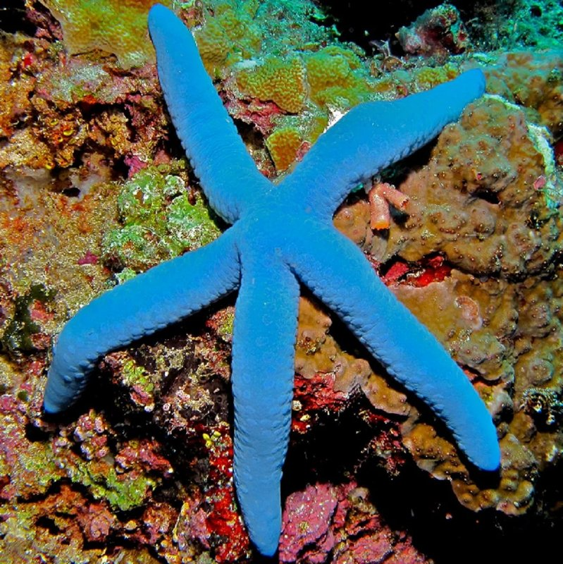

# Estrella Linckia azul — *Linckia laevigata* (Linnaeus, 1758)

> Archivo generado desde `especies/datos/catalogo_inicial.json` con `especies/herramientas/generar_fichas.py`. No editar a mano.

*Imagen ilustrativa generada con IA por Brayan (2026-11-16). No es una fotografía de un ejemplar real; puede contener errores anatómicos.*

**Grupo:** estrella de mar  
**Otros nombres:** Blue linckia, Blue sea star, Comet sea star  
**Fecha de consulta:** 2026-11-16  
**Confianza global:** media  
**Estado:** verificada; pendiente de revisión del equipo

## Ficha AIRI

| Campo | Valor |
|---|---|
| Nombre común | Estrella Linckia azul |
| Nombre científico | *Linckia laevigata* |
| Temperamento | Pacífico |
| Comportamiento | Pacífico, Solitario. Solitaria y pacífica. Muy delicada (solo para expertos): no tolera cambios bruscos del agua ni el cobre, y no debe sacarse del agua. |
| Adecuado para arrecife | Sí. LiveAquaria la considera compatible con arrecife; no hay verificación independiente. |
| Tipo de alimentación | Omnívoro: película de microorganismos y algas, detritos, pequeños invertebrados, trozos de almeja (suplemento). |
| Temperatura | 22.2–25.6 °C |
| Litraje recomendado | 94.6 L (25 gal EE. UU.). *Es el mínimo de una sola fuente comercial.* |
| Tamaño adulto | 40 cm (diámetro). Al venderse mide 1.3–5.1 cm (juvenil o subadulto). *Diferencia entre fuentes: SeaLifeBase 40 cm de diámetro; LiveAquaria 1 pie (≈ 30.5 cm).* |

## Detalle verificado

| Campo | Dato | Confianza | Fuentes |
|---|---|---|---|
| Clasificación taxonómica | Clase Asteroidea; orden Valvatida; familia Ophidiasteridae. WoRMS AphiaID 207610 (aceptado). Sinónimos: Asterias laevigata Linnaeus, 1758 (combinación original), Ophidiaster laevigatus. | alta | [worms_linckia_laevigata](https://www.marinespecies.org/aphia.php?p=taxdetails&id=207610), [sealifebase_linckia_laevigata](https://www.sealifebase.se/summary/Linckia-laevigata.html) |
| Hábitat natural | Zonas someras del arrecife sobre roca, coral muerto o cascajo, y en la pendiente arrecifal entre esponjas, macroalgas y pastos marinos. Los juveniles se esconden bajo corales y rocas. Profundidad: 0–60 m. Distribución: Indo-Pacífico. | media | [sealifebase_linckia_laevigata](https://www.sealifebase.se/summary/Linckia-laevigata.html) |
| Tamaño adulto | Máx. 40 cm (diámetro). Diferencia entre fuentes: SeaLifeBase 40 cm de diámetro; LiveAquaria 1 pie (≈ 30.5 cm). | media | [sealifebase_linckia_laevigata](https://www.sealifebase.se/summary/Linckia-laevigata.html), [liveaquaria_linckia_laevigata](https://www.liveaquaria.com/products/linckia-sea-star-blue-expert-only) |
| Alimentación | Omnívora: come detritos, pequeños invertebrados de las alfombras de algas y animales muertos; probablemente también algas cespitosas y película bacteriana (SeaLifeBase). En acuario se puede complementar con trozos de almeja o tabletas (LiveAquaria). | alta | [sealifebase_linckia_laevigata](https://www.sealifebase.se/summary/Linckia-laevigata.html), [liveaquaria_linckia_laevigata](https://www.liveaquaria.com/products/linckia-sea-star-blue-expert-only) |
| Temperatura del agua | Acuario: 22.2–25.6 °C (72–78 °F). SeaLifeBase no indica rango de temperatura para esta especie. | baja | [liveaquaria_linckia_laevigata](https://www.liveaquaria.com/products/linckia-sea-star-blue-expert-only) |
| Rango de pH | Fuente de acuario: 8.1–8.4. Rango prudente AIRI: 8.1–8.3. Criterio: Intersección con la tabla MSD para agua salada (7.8–8.3). | media | [liveaquaria_linckia_laevigata](https://www.liveaquaria.com/products/linckia-sea-star-blue-expert-only), [msd_tabla_referencia](https://www.msdvetmanual.com/multimedia/table/normal-reference-ranges-for-routine-water-quality-analysis), [msd_capitulo](https://www.msdvetmanual.com/exotic-and-laboratory-animals/aquatic-systems/environmental-diseases-of-aquatic-animals-in-aquatic-systems) |
| Salinidad | 1.023–1.025 de gravedad específica (adimensional). Agua de mar media: 35 ppt (UF/IFAS). No se convierte a ppt porque la equivalencia depende de la temperatura. | media | [liveaquaria_linckia_laevigata](https://www.liveaquaria.com/products/linckia-sea-star-blue-expert-only), [ufifas_ph_sal_temp](https://waterwatch.ifas.ufl.edu/media/waterwatchifasufledu/FactSheet_pH_Sal_Temp.pdf) |
| Volumen mínimo | 94.6 L (25 gal EE. UU.). Justificación: Cifra de Saltwaterfish («Minimum Tank Size: 25 Gallons»). LiveAquaria y las fuentes científicas consultadas no publican un litraje para esta especie. | baja | [saltwaterfish_linckia_laevigata](https://www.saltwaterfish.com/product-blue-linkia-starfish-fiji) |
| Comportamiento | Generalmente solitaria, pero tolera otras estrellas y peces tranquilos. Muy sensible a cambios de oxígeno, salinidad y pH; no tolera el cobre; nunca debe exponerse al aire. Puede portar el caracol parásito Thyca crystallina (LiveAquaria). | media | [sealifebase_linckia_laevigata](https://www.sealifebase.se/summary/Linckia-laevigata.html), [liveaquaria_linckia_laevigata](https://www.liveaquaria.com/products/linckia-sea-star-blue-expert-only) |
| Territorialidad y refugio | No territorial. De juvenil se esconde en cuevas pequeñas; necesita escondites en la roca y sustrato de arena o cascajo bien iluminado. | media | [liveaquaria_linckia_laevigata](https://www.liveaquaria.com/products/linckia-sea-star-blue-expert-only), [sealifebase_linckia_laevigata](https://www.sealifebase.se/summary/Linckia-laevigata.html) |
| Compatibilidad con arrecife | sí (según la fuente; sin verificación independiente) | baja | [liveaquaria_linckia_laevigata](https://www.liveaquaria.com/products/linckia-sea-star-blue-expert-only) |
| Convivencia: condiciones | Acuario maduro y estable; solo para expertos. · Aclimatación por goteo, sin exponerla al aire. · Revisar si porta el caracol parásito Thyca crystallina. | baja | [liveaquaria_linckia_laevigata](https://www.liveaquaria.com/products/linckia-sea-star-blue-expert-only), [sealifebase_linckia_laevigata](https://www.sealifebase.se/summary/Linckia-laevigata.html) |
| Convivencia: riesgos | No tolera medicamentos con cobre ni cambios bruscos de salinidad, pH u oxígeno; requiere aclimatación por goteo. · Muere con facilidad si los parámetros del agua cambian. | baja | [liveaquaria_linckia_laevigata](https://www.liveaquaria.com/products/linckia-sea-star-blue-expert-only), [sealifebase_linckia_laevigata](https://www.sealifebase.se/summary/Linckia-laevigata.html) |
| Conservación | No evaluada por la UICN, según SeaLifeBase. | media | [sealifebase_linckia_laevigata](https://www.sealifebase.se/summary/Linckia-laevigata.html) |

**Regla AIRI:** compartir rangos de agua no implica compatibilidad entre especies. Los rangos de acuario provienen de una fuente comercial y no son límites veterinarios.

## Fuentes

- **worms_linckia_laevigata** (taxonomía): WoRMS — Linckia laevigata (Linnaeus, 1758) (AphiaID 207610). <https://www.marinespecies.org/aphia.php?p=taxdetails&id=207610>. Consultada el 2026-11-16.
- **sealifebase_linckia_laevigata** (biología): SeaLifeBase — Linckia laevigata. <https://www.sealifebase.se/summary/Linckia-laevigata.html>. Consultada el 2026-11-16.
- **liveaquaria_linckia_laevigata** (comercial): LiveAquaria — Linckia Sea Star, Blue (EXPERT ONLY). <https://www.liveaquaria.com/products/linckia-sea-star-blue-expert-only>. Consultada el 2026-11-16.
- **msd_tabla_referencia** (veterinaria): MSD Veterinary Manual — “Normal” Reference Ranges for Routine Water Quality Analysis. <https://www.msdvetmanual.com/multimedia/table/normal-reference-ranges-for-routine-water-quality-analysis>. Consultada el 2026-11-12. Reutilizada del registro del motor (motor/airi_motor/datos/fuentes.json); no se volvió a consultar para estas fichas.
- **ufifas_ph_sal_temp** (institucional): UF/IFAS — pH, Salinity and Temperature (hoja informativa). <https://waterwatch.ifas.ufl.edu/media/waterwatchifasufledu/FactSheet_pH_Sal_Temp.pdf>. Consultada el 2026-11-12. Reutilizada del registro del motor (motor/airi_motor/datos/fuentes.json); no se volvió a consultar para estas fichas.
- **saltwaterfish_linckia_laevigata** (comercial): Saltwaterfish — Blue Linckia Starfish. <https://www.saltwaterfish.com/product-blue-linkia-starfish-fiji>. Consultada el 2026-11-16.
- **msd_capitulo** (veterinaria): MSD Veterinary Manual — Environmental Diseases of Aquatic Animals in Aquatic Systems. <https://www.msdvetmanual.com/exotic-and-laboratory-animals/aquatic-systems/environmental-diseases-of-aquatic-animals-in-aquatic-systems>. Consultada el 2026-11-12. Reutilizada del registro del motor (motor/airi_motor/datos/fuentes.json); no se volvió a consultar para estas fichas.
