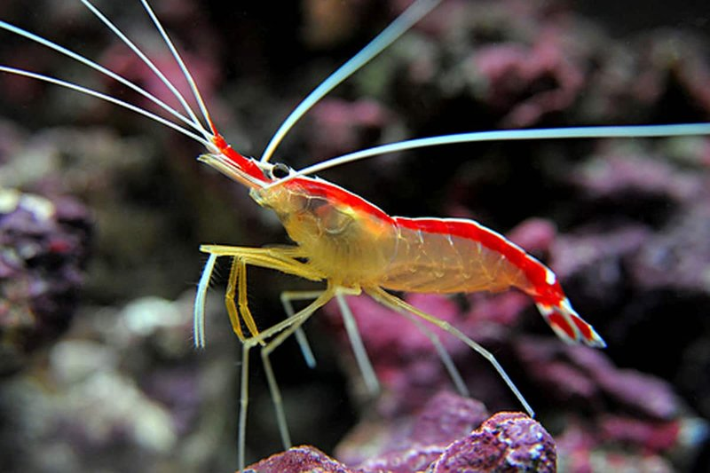

# Camarón limpiador — *Lysmata amboinensis* (De Man, 1888)

> Archivo generado desde `especies/datos/catalogo_inicial.json` con `especies/herramientas/generar_fichas.py`. No editar a mano.

*Imagen ilustrativa generada con IA por Brayan (2026-11-16). No es una fotografía de un ejemplar real; puede contener errores anatómicos.*

**Grupo:** crustáceo  
**Otros nombres:** Scarlet skunk cleaner shrimp, Skunk cleaner shrimp, Pacific cleaner shrimp  
**Fecha de consulta:** 2026-11-16  
**Confianza global:** baja  
**Estado:** verificada; pendiente de revisión del equipo

## Ficha AIRI

| Campo | Valor |
|---|---|
| Nombre común | Camarón limpiador |
| Nombre científico | *Lysmata amboinensis* |
| Temperamento | Pacífico |
| Comportamiento | Pacífico, Sociable. Pacífico y sociable. Limpia a los peces de parásitos y tejido muerto, incluso dentro de su boca. |
| Adecuado para arrecife | Sí. LiveAquaria lo considera compatible con arrecife. |
| Tipo de alimentación | Carnívoro: ectoparásitos y tejido muerto de peces, alimentos congelados y liofilizados, escamas. |
| Temperatura | 22.2–25.6 °C |
| Litraje recomendado | 75.7 L (20 gal EE. UU.). *Es el mínimo de una sola fuente comercial. La página de Saltwaterfish no muestra el nombre científico; se lista como «Skunk Cleaner».* |
| Tamaño adulto | 10.2 cm (longitud). Al venderse mide 1.3–8.3 cm (juvenil o subadulto). *SeaLifeBase no indica tamaño; LiveAquaria indica 4 in (≈ 10.2 cm).* |

## Detalle verificado

| Campo | Dato | Confianza | Fuentes |
|---|---|---|---|
| Clasificación taxonómica | Clase Malacostraca; orden Decapoda; familia Lysmatidae. WoRMS AphiaID 241289 (aceptado). Sinónimos: Hippolysmata vittata var. amboinensis De Man, 1888 (combinación original), Hippolysmata amboinensis. LiveAquaria lo sitúa en la familia Hippolytidae; WoRMS y SeaLifeBase, en Lysmatidae. Se toma WoRMS como referencia. | alta | [worms_lysmata_amboinensis](https://www.marinespecies.org/aphia.php?p=taxdetails&id=241289), [sealifebase_lysmata_amboinensis](https://www.sealifebase.se/summary/Lysmata-amboinensis.html) |
| Hábitat natural | Bentónico; a menudo en grupos entre roca viva o coral (LiveAquaria). SeaLifeBase no describe su hábitat. Profundidad: 1–120 m. Distribución: Indo-Pacífico. | media | [sealifebase_lysmata_amboinensis](https://www.sealifebase.se/summary/Lysmata-amboinensis.html) |
| Tamaño adulto | Máx. 10.2 cm (longitud). SeaLifeBase no indica tamaño; LiveAquaria indica 4 in (≈ 10.2 cm). | baja | [sealifebase_lysmata_amboinensis](https://www.sealifebase.se/summary/Lysmata-amboinensis.html), [liveaquaria_lysmata_amboinensis](https://www.liveaquaria.com/products/scarlet-skunk-cleaner-shrimp) |
| Alimentación | Carnívoro: limpia a los peces de ectoparásitos y tejido muerto, incluso dentro de su boca. Se complementa con alimentos liofilizados, congelados y en escamas (LiveAquaria). | baja | [liveaquaria_lysmata_amboinensis](https://www.liveaquaria.com/products/scarlet-skunk-cleaner-shrimp) |
| Temperatura del agua | Acuario: 22.2–25.6 °C (72–78 °F). SeaLifeBase no indica rango de temperatura para esta especie. | baja | [liveaquaria_lysmata_amboinensis](https://www.liveaquaria.com/products/scarlet-skunk-cleaner-shrimp) |
| Rango de pH | Fuente de acuario: 8.1–8.4. Rango prudente AIRI: 8.1–8.3. Criterio: Intersección con la tabla MSD para agua salada (7.8–8.3). | media | [liveaquaria_lysmata_amboinensis](https://www.liveaquaria.com/products/scarlet-skunk-cleaner-shrimp), [msd_tabla_referencia](https://www.msdvetmanual.com/multimedia/table/normal-reference-ranges-for-routine-water-quality-analysis), [msd_capitulo](https://www.msdvetmanual.com/exotic-and-laboratory-animals/aquatic-systems/environmental-diseases-of-aquatic-animals-in-aquatic-systems) |
| Salinidad | 1.023–1.025 de gravedad específica (adimensional). Agua de mar media: 35 ppt (UF/IFAS). No se convierte a ppt porque la equivalencia depende de la temperatura. | media | [liveaquaria_lysmata_amboinensis](https://www.liveaquaria.com/products/scarlet-skunk-cleaner-shrimp), [ufifas_ph_sal_temp](https://waterwatch.ifas.ufl.edu/media/waterwatchifasufledu/FactSheet_pH_Sal_Temp.pdf) |
| Volumen mínimo | 75.7 L (20 gal EE. UU.). Justificación: Cifra de Saltwaterfish («Minimum Tank Size: 20 Gallons»). LiveAquaria y las fuentes científicas consultadas no publican un litraje para esta especie. | baja | [saltwaterfish_lysmata_amboinensis](https://www.saltwaterfish.com/product-cleaner-shrimp) |
| Comportamiento | Limpiador activo: se instala en la roca o el coral y espera a que los peces vengan a limpiarse. Pacífico; a menudo en grupos (LiveAquaria). | media | [sealifebase_lysmata_amboinensis](https://www.sealifebase.se/summary/Lysmata-amboinensis.html), [liveaquaria_lysmata_amboinensis](https://www.liveaquaria.com/products/scarlet-skunk-cleaner-shrimp) |
| Territorialidad y refugio | No territorial. Se instala en una «estación de limpieza» en la roca o el coral. | media | [liveaquaria_lysmata_amboinensis](https://www.liveaquaria.com/products/scarlet-skunk-cleaner-shrimp), [sealifebase_lysmata_amboinensis](https://www.sealifebase.se/summary/Lysmata-amboinensis.html) |
| Compatibilidad con arrecife | sí (según la fuente; sin verificación independiente) | baja | [liveaquaria_lysmata_amboinensis](https://www.liveaquaria.com/products/scarlet-skunk-cleaner-shrimp) |
| Convivencia: condiciones | Compañeros pacíficos. · Yodo suficiente para que mude y crezca. | baja | [liveaquaria_lysmata_amboinensis](https://www.liveaquaria.com/products/scarlet-skunk-cleaner-shrimp), [sealifebase_lysmata_amboinensis](https://www.sealifebase.se/summary/Lysmata-amboinensis.html) |
| Convivencia: riesgos | Peces halcón, peces león y camarones o cangrejos depredadores pueden comérselo. · No tolera nitratos altos. · No tolera medicamentos con cobre ni cambios bruscos de salinidad, pH u oxígeno; requiere aclimatación por goteo. | baja | [liveaquaria_lysmata_amboinensis](https://www.liveaquaria.com/products/scarlet-skunk-cleaner-shrimp), [sealifebase_lysmata_amboinensis](https://www.sealifebase.se/summary/Lysmata-amboinensis.html) |
| Conservación | No evaluado por la UICN, según SeaLifeBase. | media | [sealifebase_lysmata_amboinensis](https://www.sealifebase.se/summary/Lysmata-amboinensis.html) |

**Regla AIRI:** compartir rangos de agua no implica compatibilidad entre especies. Los rangos de acuario provienen de una fuente comercial y no son límites veterinarios.

## Fuentes

- **worms_lysmata_amboinensis** (taxonomía): WoRMS — Lysmata amboinensis (De Man, 1888) (AphiaID 241289). <https://www.marinespecies.org/aphia.php?p=taxdetails&id=241289>. Consultada el 2026-11-16.
- **sealifebase_lysmata_amboinensis** (biología): SeaLifeBase — Lysmata amboinensis. <https://www.sealifebase.se/summary/Lysmata-amboinensis.html>. Consultada el 2026-11-16.
- **liveaquaria_lysmata_amboinensis** (comercial): LiveAquaria — Scarlet Skunk Cleaner Shrimp. <https://www.liveaquaria.com/products/scarlet-skunk-cleaner-shrimp>. Consultada el 2026-11-16.
- **msd_tabla_referencia** (veterinaria): MSD Veterinary Manual — “Normal” Reference Ranges for Routine Water Quality Analysis. <https://www.msdvetmanual.com/multimedia/table/normal-reference-ranges-for-routine-water-quality-analysis>. Consultada el 2026-11-12. Reutilizada del registro del motor (motor/airi_motor/datos/fuentes.json); no se volvió a consultar para estas fichas.
- **ufifas_ph_sal_temp** (institucional): UF/IFAS — pH, Salinity and Temperature (hoja informativa). <https://waterwatch.ifas.ufl.edu/media/waterwatchifasufledu/FactSheet_pH_Sal_Temp.pdf>. Consultada el 2026-11-12. Reutilizada del registro del motor (motor/airi_motor/datos/fuentes.json); no se volvió a consultar para estas fichas.
- **saltwaterfish_lysmata_amboinensis** (comercial): Saltwaterfish — Cleaner Shrimp. <https://www.saltwaterfish.com/product-cleaner-shrimp>. Consultada el 2026-11-16.
- **msd_capitulo** (veterinaria): MSD Veterinary Manual — Environmental Diseases of Aquatic Animals in Aquatic Systems. <https://www.msdvetmanual.com/exotic-and-laboratory-animals/aquatic-systems/environmental-diseases-of-aquatic-animals-in-aquatic-systems>. Consultada el 2026-11-12. Reutilizada del registro del motor (motor/airi_motor/datos/fuentes.json); no se volvió a consultar para estas fichas.
