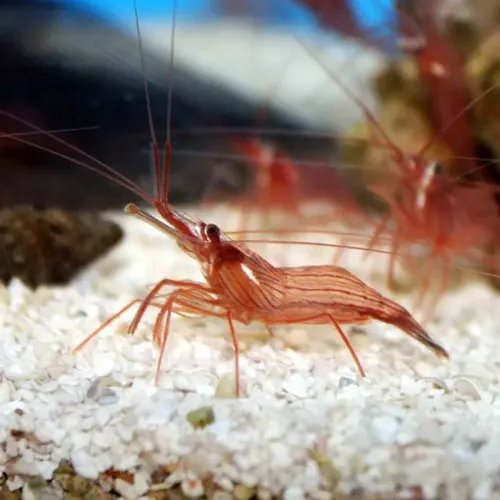

# Camarón pimienta — *Lysmata wurdemanni* (Gibbes, 1850)

> Archivo generado desde `especies/datos/catalogo_inicial.json` con `especies/herramientas/generar_fichas.py`. No editar a mano.

*Imagen ilustrativa generada con IA por Brayan (2026-11-18). No es una fotografía de un ejemplar real; puede contener errores anatómicos.*

**Grupo:** crustáceo  
**Otros nombres:** Peppermint shrimp, Veined shrimp, Caribbean cleaner shrimp  
**Fecha de consulta:** 2026-11-18  
**Confianza global:** media  
**Estado:** verificada; pendiente de revisión del equipo

## Ficha AIRI

| Campo | Valor |
|---|---|
| Nombre común | Camarón pimienta |
| Nombre científico | *Lysmata wurdemanni* |
| Temperamento | Pacífico |
| Comportamiento | Pacífico, Sociable. Pacífico y sociable. Limpia restos de comida y algunos se comen la plaga Aiptasia. |
| Adecuado para arrecife | Sí. LiveAquaria y Saltwaterfish lo consideran apto para arrecife. |
| Tipo de alimentación | Carnívoro: detritos y restos de comida, Aiptasia (algunos individuos), alimentos preparados. *Saltwaterfish lo clasifica como omnívoro.* |
| Temperatura | 22.2–25.6 °C *Rango de LiveAquaria.* |
| Litraje recomendado | 37.9 L (10 gal EE. UU.). *Es el mínimo recomendado por una sola fuente comercial; ninguna fuente científica consultada establece un litraje.* |
| Tamaño adulto | 5.1 cm (longitud total). *LiveAquaria y Saltwaterfish coinciden en 2 in (≈ 5.1 cm); SeaLifeBase solo da la longitud del caparazón (0.7 cm).* |

## Detalle verificado

| Campo | Dato | Confianza | Fuentes |
|---|---|---|---|
| Clasificación taxonómica | Clase Malacostraca; orden Decapoda; familia Lysmatidae. WoRMS AphiaID 158365 (aceptado). Sinónimos: Hippolyte wurdemanni Gibbes, 1850 (combinación original), Hippolysmata wurdemanni (Gibbes, 1850). LiveAquaria lo sitúa en la familia Hippolytidae; WoRMS, en Lysmatidae. LiveAquaria advierte que el complejo de camarones «peppermint» del Atlántico occidental se revisó en 2006, así que el animal vendido puede ser otra especie de Lysmata muy parecida. | alta | [worms_lysmata_wurdemanni](https://www.marinespecies.org/aphia.php?p=taxdetails&id=158365), [sealifebase_lysmata_wurdemanni](https://www.sealifebase.se/summary/Lysmata-wurdemanni.html) |
| Hábitat natural | Bentónico, de 0 a 37 m (SeaLifeBase). En el medio natural suele vivir en las grietas verticales del arrecife; algunos, dentro de esponjas tubulares (LiveAquaria). Profundidad: 0–37 m. Distribución: Atlántico occidental. | media | [sealifebase_lysmata_wurdemanni](https://www.sealifebase.se/summary/Lysmata-wurdemanni.html), [liveaquaria_lysmata_wurdemanni](https://www.liveaquaria.com/products/peppermint-shrimp) |
| Tamaño adulto | Máx. 5.1 cm (longitud total). LiveAquaria y Saltwaterfish coinciden en 2 in (≈ 5.1 cm); SeaLifeBase solo da la longitud del caparazón (0.7 cm). | media | [liveaquaria_lysmata_wurdemanni](https://www.liveaquaria.com/products/peppermint-shrimp), [saltwaterfish_lysmata_wurdemanni](https://www.saltwaterfish.com/product-peppermint-shrimp), [sealifebase_lysmata_wurdemanni](https://www.sealifebase.se/summary/Lysmata-wurdemanni.html) |
| Alimentación | Carroñero: come detritos, restos de comida y materia orgánica en descomposición; algunos individuos controlan la anémona plaga Aiptasia y otros no. Acepta casi todos los alimentos preparados (LiveAquaria). | media | [liveaquaria_lysmata_wurdemanni](https://www.liveaquaria.com/products/peppermint-shrimp) |
| Temperatura del agua | Acuario: 22.2–25.6 °C (72–78 °F). SeaLifeBase no indica rango de temperatura para esta especie. | baja | [liveaquaria_lysmata_wurdemanni](https://www.liveaquaria.com/products/peppermint-shrimp) |
| Rango de pH | Fuente de acuario: 8.1–8.4. Rango prudente AIRI: 8.1–8.3. Criterio: Intersección con la tabla MSD para agua salada (7.8–8.3). | media | [liveaquaria_lysmata_wurdemanni](https://www.liveaquaria.com/products/peppermint-shrimp), [msd_tabla_referencia](https://www.msdvetmanual.com/multimedia/table/normal-reference-ranges-for-routine-water-quality-analysis), [msd_capitulo](https://www.msdvetmanual.com/exotic-and-laboratory-animals/aquatic-systems/environmental-diseases-of-aquatic-animals-in-aquatic-systems) |
| Salinidad | 1.020–1.025 de gravedad específica (adimensional). Agua de mar media: 35 ppt (UF/IFAS). No se convierte a ppt porque la equivalencia depende de la temperatura. | media | [liveaquaria_lysmata_wurdemanni](https://www.liveaquaria.com/products/peppermint-shrimp), [ufifas_ph_sal_temp](https://waterwatch.ifas.ufl.edu/media/waterwatchifasufledu/FactSheet_pH_Sal_Temp.pdf) |
| Volumen mínimo | 37.9 L (10 gal EE. UU.). Justificación: Cifra de Saltwaterfish («Minimum Tank Size: 10 Gallons»). | baja | [saltwaterfish_lysmata_wurdemanni](https://www.saltwaterfish.com/product-peppermint-shrimp) |
| Comportamiento | Muy social y pacífico con casi todos los habitantes del arrecife. Necesita escondites y zonas abiertas donde buscar alimento, y yodo para mudar bien (LiveAquaria). | media | [liveaquaria_lysmata_wurdemanni](https://www.liveaquaria.com/products/peppermint-shrimp) |
| Territorialidad y refugio | Necesita roca viva con escondites (LiveAquaria). | media | [liveaquaria_lysmata_wurdemanni](https://www.liveaquaria.com/products/peppermint-shrimp) |
| Compatibilidad con arrecife | sí (según la fuente; sin verificación independiente) | baja | [liveaquaria_lysmata_wurdemanni](https://www.liveaquaria.com/products/peppermint-shrimp), [saltwaterfish_lysmata_wurdemanni](https://www.saltwaterfish.com/product-peppermint-shrimp) |
| Convivencia: condiciones | Roca viva con escondites. · Yodo para la muda. | baja | [liveaquaria_lysmata_wurdemanni](https://www.liveaquaria.com/products/peppermint-shrimp) |
| Convivencia: riesgos | No tolera medicamentos con cobre ni nitratos altos. | baja | [liveaquaria_lysmata_wurdemanni](https://www.liveaquaria.com/products/peppermint-shrimp) |
| Conservación | No evaluado por la UICN, según SeaLifeBase. | media | [sealifebase_lysmata_wurdemanni](https://www.sealifebase.se/summary/Lysmata-wurdemanni.html) |

**Regla AIRI:** compartir rangos de agua no implica compatibilidad entre especies. Los rangos de acuario provienen de una fuente comercial y no son límites veterinarios.

## Fuentes

- **worms_lysmata_wurdemanni** (taxonomía): WoRMS — Lysmata wurdemanni (Gibbes, 1850) (AphiaID 158365). <https://www.marinespecies.org/aphia.php?p=taxdetails&id=158365>. Consultada el 2026-11-18.
- **sealifebase_lysmata_wurdemanni** (biología): SeaLifeBase — Lysmata wurdemanni. <https://www.sealifebase.se/summary/Lysmata-wurdemanni.html>. Consultada el 2026-11-18.
- **liveaquaria_lysmata_wurdemanni** (comercial): LiveAquaria — Peppermint Shrimp (Lysmata wurdemanni). <https://www.liveaquaria.com/products/peppermint-shrimp>. Consultada el 2026-11-18.
- **saltwaterfish_lysmata_wurdemanni** (comercial): Saltwaterfish — Peppermint Shrimp. <https://www.saltwaterfish.com/product-peppermint-shrimp>. Consultada el 2026-11-18.
- **msd_tabla_referencia** (veterinaria): MSD Veterinary Manual — “Normal” Reference Ranges for Routine Water Quality Analysis. <https://www.msdvetmanual.com/multimedia/table/normal-reference-ranges-for-routine-water-quality-analysis>. Consultada el 2026-11-12. Reutilizada del registro del motor (motor/airi_motor/datos/fuentes.json); no se volvió a consultar para estas fichas.
- **ufifas_ph_sal_temp** (institucional): UF/IFAS — pH, Salinity and Temperature (hoja informativa). <https://waterwatch.ifas.ufl.edu/media/waterwatchifasufledu/FactSheet_pH_Sal_Temp.pdf>. Consultada el 2026-11-12. Reutilizada del registro del motor (motor/airi_motor/datos/fuentes.json); no se volvió a consultar para estas fichas.
- **msd_capitulo** (veterinaria): MSD Veterinary Manual — Environmental Diseases of Aquatic Animals in Aquatic Systems. <https://www.msdvetmanual.com/exotic-and-laboratory-animals/aquatic-systems/environmental-diseases-of-aquatic-animals-in-aquatic-systems>. Consultada el 2026-11-12. Reutilizada del registro del motor (motor/airi_motor/datos/fuentes.json); no se volvió a consultar para estas fichas.
