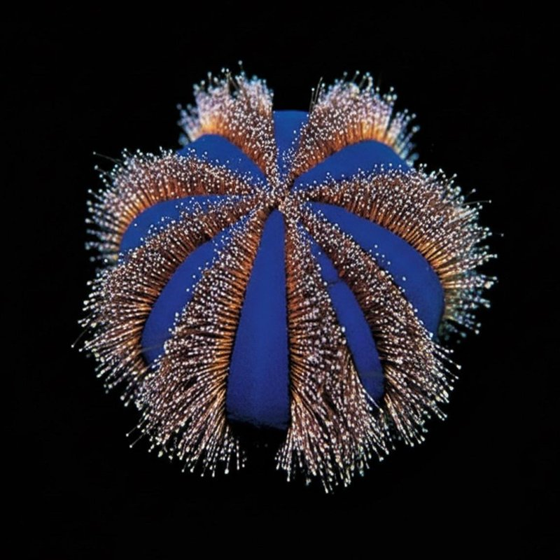

# Erizo tuxedo — *Mespilia globulus* (Linnaeus, 1758)

> Archivo generado desde `especies/datos/catalogo_inicial.json` con `especies/herramientas/generar_fichas.py`. No editar a mano.

*Imagen ilustrativa generada con IA por Brayan (2026-11-16). No es una fotografía de un ejemplar real; puede contener errores anatómicos.*

**Grupo:** erizo de mar  
**Otros nombres:** Tuxedo urchin, Blue tuxedo urchin, Globular sea urchin  
**Fecha de consulta:** 2026-11-16  
**Confianza global:** media  
**Estado:** verificada; pendiente de revisión del equipo

## Ficha AIRI

| Campo | Valor |
|---|---|
| Nombre común | Erizo tuxedo |
| Nombre científico | *Mespilia globulus* |
| Temperamento | Pacífico |
| Comportamiento | Pacífico, Solitario. Pacífico y nocturno: de día se esconde y de noche come algas. Perder espinas indica mala calidad del agua. |
| Adecuado para arrecife | Sí. LiveAquaria y Saltwaterfish lo consideran apto para arrecife. |
| Tipo de alimentación | Herbívoro: algas, detritos, alga seca (suplemento). *SeaLifeBase describe una dieta de detritos; LiveAquaria lo clasifica como herbívoro.* |
| Temperatura | 22.2–25.6 °C *Rango de LiveAquaria.* |
| Litraje recomendado | 75.7 L (20 gal EE. UU.). *Dos fuentes comerciales coinciden en 20 gal.* |
| Tamaño adulto | 5 cm (diámetro). Al venderse mide 2.5–7.6 cm (juvenil o subadulto). *Diferencia entre fuentes: SeaLifeBase 5 cm de diámetro; LiveAquaria y Saltwaterfish 3 in (≈ 7.6 cm).* |

## Detalle verificado

| Campo | Dato | Confianza | Fuentes |
|---|---|---|---|
| Clasificación taxonómica | Clase Echinoidea; orden Camarodonta; familia Temnopleuridae. WoRMS AphiaID 214476 (aceptado). Sinónimos: Echinus globulus Linnaeus, 1758 (combinación original), Mespilia whitmaei. | alta | [worms_mespilia_globulus](https://www.marinespecies.org/aphia.php?p=taxdetails&id=214476), [sealifebase_mespilia_globulus](https://www.sealifebase.se/summary/Mespilia-globulus.html) |
| Hábitat natural | Zonas someras del arrecife, cascajo coralino y praderas marinas. Se cubre con restos que adhiere a su caparazón (SeaLifeBase). Profundidad: 0–80 m. Distribución: Indo-Pacífico. | media | [sealifebase_mespilia_globulus](https://www.sealifebase.se/summary/Mespilia-globulus.html) |
| Tamaño adulto | Máx. 5 cm (diámetro). Diferencia entre fuentes: SeaLifeBase 5 cm de diámetro; LiveAquaria y Saltwaterfish 3 in (≈ 7.6 cm). | media | [sealifebase_mespilia_globulus](https://www.sealifebase.se/summary/Mespilia-globulus.html), [liveaquaria_mespilia_globulus](https://www.liveaquaria.com/products/tuxedo-urchin) |
| Alimentación | Herbívoro: de noche sale a pastar algas (LiveAquaria). SeaLifeBase indica que ingiere sedimento calcáreo al alimentarse de detritos. Si faltan algas, se complementa con alga seca. | media | [liveaquaria_mespilia_globulus](https://www.liveaquaria.com/products/tuxedo-urchin), [sealifebase_mespilia_globulus](https://www.sealifebase.se/summary/Mespilia-globulus.html) |
| Temperatura del agua | Acuario: 22.2–25.6 °C (72–78 °F). Ninguna fuente científica consultada indica rango de temperatura para este taxón. | baja | [liveaquaria_mespilia_globulus](https://www.liveaquaria.com/products/tuxedo-urchin) |
| Rango de pH | Fuente de acuario: 8.1–8.4. Rango prudente AIRI: 8.1–8.3. Criterio: Intersección con la tabla MSD para agua salada (7.8–8.3). | media | [liveaquaria_mespilia_globulus](https://www.liveaquaria.com/products/tuxedo-urchin), [msd_tabla_referencia](https://www.msdvetmanual.com/multimedia/table/normal-reference-ranges-for-routine-water-quality-analysis), [msd_capitulo](https://www.msdvetmanual.com/exotic-and-laboratory-animals/aquatic-systems/environmental-diseases-of-aquatic-animals-in-aquatic-systems) |
| Salinidad | 1.023–1.025 de gravedad específica (adimensional). Agua de mar media: 35 ppt (UF/IFAS). No se convierte a ppt porque la equivalencia depende de la temperatura. | media | [liveaquaria_mespilia_globulus](https://www.liveaquaria.com/products/tuxedo-urchin), [ufifas_ph_sal_temp](https://waterwatch.ifas.ufl.edu/media/waterwatchifasufledu/FactSheet_pH_Sal_Temp.pdf) |
| Volumen mínimo | 75.7 L (20 gal EE. UU.). Justificación: Cifra de LiveAquaria y de Saltwaterfish (20 gal en ambas). | baja | [liveaquaria_mespilia_globulus](https://www.liveaquaria.com/products/tuxedo-urchin) |
| Comportamiento | De día se esconde entre rocas, grietas o plantas; de noche sale a pastar. Suele ir solo, aunque pueden convivir varios en un acuario grande con suficiente alimento y refugio (LiveAquaria). | media | [liveaquaria_mespilia_globulus](https://www.liveaquaria.com/products/tuxedo-urchin), [sealifebase_mespilia_globulus](https://www.sealifebase.se/summary/Mespilia-globulus.html) |
| Territorialidad y refugio | Se esconde de día en grietas y entre rocas. | media | [liveaquaria_mespilia_globulus](https://www.liveaquaria.com/products/tuxedo-urchin) |
| Compatibilidad con arrecife | sí (según la fuente; sin verificación independiente) | baja | [liveaquaria_mespilia_globulus](https://www.liveaquaria.com/products/tuxedo-urchin), [saltwaterfish_mespilia_globulus](https://www.saltwaterfish.com/product-royal-urchin) |
| Convivencia: condiciones | Algas suficientes o alga seca. · Escondites en la roca. | baja | [liveaquaria_mespilia_globulus](https://www.liveaquaria.com/products/tuxedo-urchin) |
| Convivencia: riesgos | Perder espinas indica mala calidad del agua. · No tolera medicamentos con cobre ni nitratos altos. | baja | [liveaquaria_mespilia_globulus](https://www.liveaquaria.com/products/tuxedo-urchin) |
| Conservación | No evaluado por la UICN, según SeaLifeBase. | media | [sealifebase_mespilia_globulus](https://www.sealifebase.se/summary/Mespilia-globulus.html) |

**Regla AIRI:** compartir rangos de agua no implica compatibilidad entre especies. Los rangos de acuario provienen de una fuente comercial y no son límites veterinarios.

## Fuentes

- **worms_mespilia_globulus** (taxonomía): WoRMS — Mespilia globulus (Linnaeus, 1758) (AphiaID 214476). <https://www.marinespecies.org/aphia.php?p=taxdetails&id=214476>. Consultada el 2026-11-16.
- **sealifebase_mespilia_globulus** (biología): SeaLifeBase — Mespilia globulus. <https://www.sealifebase.se/summary/Mespilia-globulus.html>. Consultada el 2026-11-16.
- **liveaquaria_mespilia_globulus** (comercial): LiveAquaria — Tuxedo Urchin. <https://www.liveaquaria.com/products/tuxedo-urchin>. Consultada el 2026-11-16.
- **saltwaterfish_mespilia_globulus** (comercial): Saltwaterfish — Blue Tuxedo Sea Urchin. <https://www.saltwaterfish.com/product-royal-urchin>. Consultada el 2026-11-16.
- **msd_tabla_referencia** (veterinaria): MSD Veterinary Manual — “Normal” Reference Ranges for Routine Water Quality Analysis. <https://www.msdvetmanual.com/multimedia/table/normal-reference-ranges-for-routine-water-quality-analysis>. Consultada el 2026-11-12. Reutilizada del registro del motor (motor/airi_motor/datos/fuentes.json); no se volvió a consultar para estas fichas.
- **ufifas_ph_sal_temp** (institucional): UF/IFAS — pH, Salinity and Temperature (hoja informativa). <https://waterwatch.ifas.ufl.edu/media/waterwatchifasufledu/FactSheet_pH_Sal_Temp.pdf>. Consultada el 2026-11-12. Reutilizada del registro del motor (motor/airi_motor/datos/fuentes.json); no se volvió a consultar para estas fichas.
- **msd_capitulo** (veterinaria): MSD Veterinary Manual — Environmental Diseases of Aquatic Animals in Aquatic Systems. <https://www.msdvetmanual.com/exotic-and-laboratory-animals/aquatic-systems/environmental-diseases-of-aquatic-animals-in-aquatic-systems>. Consultada el 2026-11-12. Reutilizada del registro del motor (motor/airi_motor/datos/fuentes.json); no se volvió a consultar para estas fichas.
