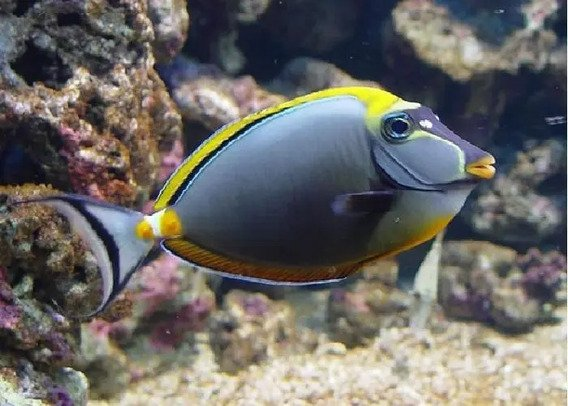

# Cirujano naso — *Naso lituratus* (Forster, 1801)

> Archivo generado desde `especies/datos/catalogo_inicial.json` con `especies/herramientas/generar_fichas.py`. No editar a mano.

*Imagen ilustrativa generada con IA por Brayan (2026-11-16). No es una fotografía de un ejemplar real; puede contener errores anatómicos.*

**Grupo:** pez  
**Otros nombres:** Orangespine unicornfish, Naso tang  
**Fecha de consulta:** 2026-11-16  
**Confianza global:** media  
**Estado:** verificada; pendiente de revisión del equipo

## Ficha AIRI

| Campo | Valor |
|---|---|
| Nombre común | Cirujano naso |
| Nombre científico | *Naso lituratus* |
| Temperamento | Semiagresivo |
| Comportamiento | Territorial. Nadador activo que necesita mucho espacio. Agresivo con otros peces cirujano y pacífico con el resto. Puede saltar: el acuario necesita tapa. |
| Adecuado para arrecife | Sí. LiveAquaria lo considera compatible con arrecife; no hay verificación independiente. |
| Tipo de alimentación | Herbívoro: algas pardas foliosas (Sargassum, Dictyota), alga marina seca, algas al menos 3 veces por semana. |
| Temperatura | 22.2–25.6 °C *FishBase no indica rango de temperatura para esta especie.* |
| Litraje recomendado | 681.3 L (180 gal EE. UU.). *Es el mínimo recomendado por una sola fuente comercial; ninguna fuente científica consultada establece un litraje.* |
| Tamaño adulto | 46 cm (longitud estándar). Al venderse mide 2.5–22.9 cm (juvenil o subadulto). *LiveAquaria: 18 in (≈ 45.7 cm). FishBase mide longitud estándar (sin la aleta caudal), así que la longitud total es mayor.* |

## Detalle verificado

| Campo | Dato | Confianza | Fuentes |
|---|---|---|---|
| Clasificación taxonómica | Clase Teleostei; orden Acanthuriformes; familia Acanthuridae; subfamilia Nasinae. WoRMS AphiaID 219665 (aceptado). Sinónimos: Acanthurus lituratus Forster, 1801 (combinación original). FishBase indica que la población del océano Índico se considera ahora otra especie, Naso elegans. | alta | [worms_naso_lituratus](https://www.marinespecies.org/aphia.php?p=taxdetails&id=219665), [fishbase_naso_lituratus](https://www.fishbase.se/summary/Naso-lituratus.html) |
| Hábitat natural | Zonas de coral, roca o cascajo en lagunas y arrecifes externos. Los adultos suelen ir en grupos pequeños y a veces forman grandes agregaciones; los juveniles viven en arrecifes rocosos someros. Profundidad: 0–90 m (habitual 5–30 m). Distribución: Pacífico: de Honshu (Japón) a la Gran Barrera de Coral y Nueva Caledonia, y al este hasta Hawái, Polinesia Francesa, Pitcairn y la isla Clipperton. | media | [fishbase_naso_lituratus](https://www.fishbase.se/summary/Naso-lituratus.html) |
| Tamaño adulto | Máx. 46 cm (longitud estándar). LiveAquaria: 18 in (≈ 45.7 cm). FishBase mide longitud estándar (sin la aleta caudal), así que la longitud total es mayor. | alta | [fishbase_naso_lituratus](https://www.fishbase.se/summary/Naso-lituratus.html), [liveaquaria_naso_lituratus](https://www.liveaquaria.com/products/naso-tang) |
| Alimentación | Herbívoro: en la naturaleza come sobre todo algas pardas foliosas (Sargassum y Dictyota). En acuario necesita abundantes algas marinas, al menos tres veces por semana. | alta | [fishbase_naso_lituratus](https://www.fishbase.se/summary/Naso-lituratus.html), [liveaquaria_naso_lituratus](https://www.liveaquaria.com/products/naso-tang) |
| Temperatura del agua | Acuario: 22.2–25.6 °C (72–78 °F). FishBase no indica rango de temperatura para esta especie. | baja | [liveaquaria_naso_lituratus](https://www.liveaquaria.com/products/naso-tang) |
| Rango de pH | Fuente de acuario: 8.1–8.4. Rango prudente AIRI: 8.1–8.3. Criterio: Intersección con la tabla MSD para agua salada (7.8–8.3). | media | [liveaquaria_naso_lituratus](https://www.liveaquaria.com/products/naso-tang), [msd_tabla_referencia](https://www.msdvetmanual.com/multimedia/table/normal-reference-ranges-for-routine-water-quality-analysis), [msd_capitulo](https://www.msdvetmanual.com/exotic-and-laboratory-animals/aquatic-systems/environmental-diseases-of-aquatic-animals-in-aquatic-systems) |
| Salinidad | 1.020–1.025 de gravedad específica (adimensional). Agua de mar media: 35 ppt (UF/IFAS). No se convierte a ppt porque la equivalencia depende de la temperatura. | media | [liveaquaria_naso_lituratus](https://www.liveaquaria.com/products/naso-tang), [ufifas_ph_sal_temp](https://waterwatch.ifas.ufl.edu/media/waterwatchifasufledu/FactSheet_pH_Sal_Temp.pdf) |
| Volumen mínimo | 681.3 L (180 gal EE. UU.). Justificación: Cifra de LiveAquaria (180 gal). Es un pez grande (hasta 46 cm de longitud estándar) y nadador activo que necesita mucho espacio libre, escondites y tapa, porque puede saltar. | baja | [liveaquaria_naso_lituratus](https://www.liveaquaria.com/products/naso-tang), [fishbase_naso_lituratus](https://www.fishbase.se/summary/Naso-lituratus.html) |
| Comportamiento | Nadador activo. Agresivo con otros peces cirujano y pacífico con el resto (LiveAquaria). Puede saltar para escapar. Probablemente desova en parejas (FishBase). | media | [fishbase_naso_lituratus](https://www.fishbase.se/summary/Naso-lituratus.html), [liveaquaria_naso_lituratus](https://www.liveaquaria.com/products/naso-tang) |
| Territorialidad y refugio | Territorial con otros cirujanos. Necesita escondites además de espacio libre para nadar. | media | [liveaquaria_naso_lituratus](https://www.liveaquaria.com/products/naso-tang), [fishbase_naso_lituratus](https://www.fishbase.se/summary/Naso-lituratus.html) |
| Compatibilidad con arrecife | sí (según la fuente; sin verificación independiente) | baja | [liveaquaria_naso_lituratus](https://www.liveaquaria.com/products/naso-tang) |
| Convivencia: condiciones | Acuario grande con tapa. · Dieta rica en algas. | baja | [liveaquaria_naso_lituratus](https://www.liveaquaria.com/products/naso-tang), [fishbase_naso_lituratus](https://www.fishbase.se/summary/Naso-lituratus.html) |
| Convivencia: riesgos | Agresión hacia otros peces cirujano. · Puede saltar fuera del acuario. · FishBase lo clasifica como venenoso para las personas (muy rara vez). | baja | [liveaquaria_naso_lituratus](https://www.liveaquaria.com/products/naso-tang), [fishbase_naso_lituratus](https://www.fishbase.se/summary/Naso-lituratus.html) |
| Conservación | Preocupación menor (LC), evaluada el 06/05/2010, según FishBase. | media | [fishbase_naso_lituratus](https://www.fishbase.se/summary/Naso-lituratus.html) |

**Regla AIRI:** compartir rangos de agua no implica compatibilidad entre especies. Los rangos de acuario provienen de una fuente comercial y no son límites veterinarios.

## Fuentes

- **worms_naso_lituratus** (taxonomía): WoRMS — Naso lituratus (Forster, 1801) (AphiaID 219665). <https://www.marinespecies.org/aphia.php?p=taxdetails&id=219665>. Consultada el 2026-11-16.
- **fishbase_naso_lituratus** (biología): FishBase — Naso lituratus (Forster, 1801). <https://www.fishbase.se/summary/Naso-lituratus.html>. Consultada el 2026-11-16.
- **liveaquaria_naso_lituratus** (comercial): LiveAquaria — Naso Tang. <https://www.liveaquaria.com/products/naso-tang>. Consultada el 2026-11-16.
- **msd_tabla_referencia** (veterinaria): MSD Veterinary Manual — “Normal” Reference Ranges for Routine Water Quality Analysis. <https://www.msdvetmanual.com/multimedia/table/normal-reference-ranges-for-routine-water-quality-analysis>. Consultada el 2026-11-12. Reutilizada del registro del motor (motor/airi_motor/datos/fuentes.json); no se volvió a consultar para estas fichas.
- **ufifas_ph_sal_temp** (institucional): UF/IFAS — pH, Salinity and Temperature (hoja informativa). <https://waterwatch.ifas.ufl.edu/media/waterwatchifasufledu/FactSheet_pH_Sal_Temp.pdf>. Consultada el 2026-11-12. Reutilizada del registro del motor (motor/airi_motor/datos/fuentes.json); no se volvió a consultar para estas fichas.
- **msd_capitulo** (veterinaria): MSD Veterinary Manual — Environmental Diseases of Aquatic Animals in Aquatic Systems. <https://www.msdvetmanual.com/exotic-and-laboratory-animals/aquatic-systems/environmental-diseases-of-aquatic-animals-in-aquatic-systems>. Consultada el 2026-11-12. Reutilizada del registro del motor (motor/airi_motor/datos/fuentes.json); no se volvió a consultar para estas fichas.
