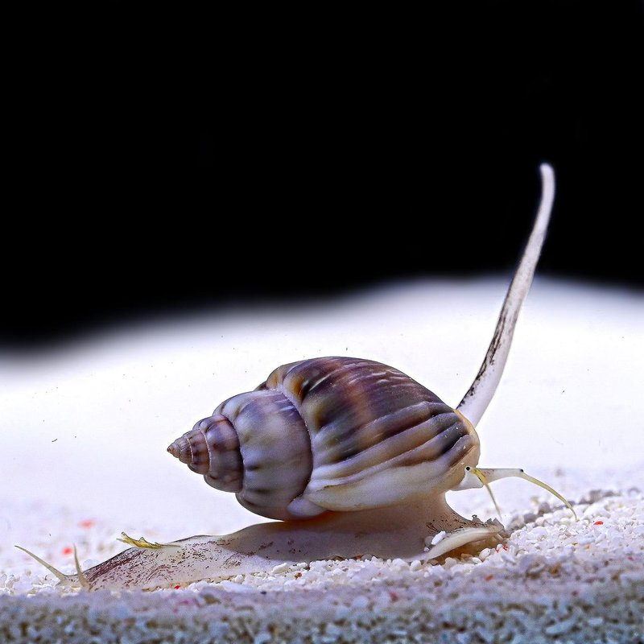

# Caracol Nassarius — *Nassarius sp.* Duméril, 1805 (género)

> Archivo generado desde `especies/datos/catalogo_inicial.json` con `especies/herramientas/generar_fichas.py`. No editar a mano.

*Imagen ilustrativa generada con IA por Brayan (2026-11-16). No es una fotografía de un ejemplar real; puede contener errores anatómicos.*

**Grupo:** caracol  
**Otros nombres:** Nassarius snail  
**Fecha de consulta:** 2026-11-16  
**Confianza global:** baja  
**Estado:** verificada; pendiente de revisión del equipo

## Ficha AIRI

| Campo | Valor |
|---|---|
| Nombre común | Caracol Nassarius |
| Nombre científico | *Nassarius sp.* |
| Temperamento | Pacífico |
| Comportamiento | Pacífico, Sociable. Carroñero pacífico del «equipo de limpieza». Se entierra en la arena y la remueve; mejor en grupos pequeños. |
| Adecuado para arrecife | Sí. LiveAquaria y Saltwaterfish lo consideran apto para arrecife. |
| Tipo de alimentación | Carnívoro: restos de comida, detritos y materia orgánica, desechos de peces. *Saltwaterfish lo clasifica como omnívoro.* |
| Temperatura | 22.2–25.6 °C *Rango de LiveAquaria.* |
| Litraje recomendado | 18.9 L (5 gal EE. UU.). *Es el mínimo de una sola fuente comercial.* |
| Tamaño adulto | 1.3 cm (longitud de la concha). Al venderse mide 0.6–1.3 cm (juvenil o subadulto). *Diferencia entre fuentes: LiveAquaria ½ in (≈ 1.3 cm); Saltwaterfish 1 in (≈ 2.5 cm).* |

## Detalle verificado

| Campo | Dato | Confianza | Fuentes |
|---|---|---|---|
| Clasificación taxonómica | Clase Gastropoda; orden Neogastropoda; familia Nassariidae. WoRMS AphiaID 138235 (aceptado). Ficha a nivel de género: LiveAquaria y Saltwaterfish lo venden como Nassarius sp. WoRMS reúne cientos de especies en el género. | alta | [worms_nassarius_sp](https://www.marinespecies.org/aphia.php?p=taxdetails&id=138235) |
| Hábitat natural | Las fuentes consultadas no describen su hábitat natural. En acuario se entierra en la arena con el sifón asomando (LiveAquaria). Profundidad: no indicada. Distribución: No indicada para el género en las fuentes consultadas. | baja | [liveaquaria_nassarius_sp](https://www.liveaquaria.com/products/nassarius-snail) |
| Tamaño adulto | Máx. 1.3 cm (longitud de la concha). Diferencia entre fuentes: LiveAquaria ½ in (≈ 1.3 cm); Saltwaterfish 1 in (≈ 2.5 cm). | baja | [liveaquaria_nassarius_sp](https://www.liveaquaria.com/products/nassarius-snail) |
| Alimentación | Carroñero y detritívoro: come detritos, restos de comida, materia orgánica en descomposición y desechos de peces. LiveAquaria lo clasifica como carnívoro. | baja | [liveaquaria_nassarius_sp](https://www.liveaquaria.com/products/nassarius-snail) |
| Temperatura del agua | Acuario: 22.2–25.6 °C (72–78 °F). Ninguna fuente científica consultada indica rango de temperatura para este taxón. | baja | [liveaquaria_nassarius_sp](https://www.liveaquaria.com/products/nassarius-snail) |
| Rango de pH | Fuente de acuario: 8.1–8.4. Rango prudente AIRI: 8.1–8.3. Criterio: Intersección con la tabla MSD para agua salada (7.8–8.3). | media | [liveaquaria_nassarius_sp](https://www.liveaquaria.com/products/nassarius-snail), [msd_tabla_referencia](https://www.msdvetmanual.com/multimedia/table/normal-reference-ranges-for-routine-water-quality-analysis), [msd_capitulo](https://www.msdvetmanual.com/exotic-and-laboratory-animals/aquatic-systems/environmental-diseases-of-aquatic-animals-in-aquatic-systems) |
| Salinidad | 1.023–1.025 de gravedad específica (adimensional). Agua de mar media: 35 ppt (UF/IFAS). No se convierte a ppt porque la equivalencia depende de la temperatura. | media | [liveaquaria_nassarius_sp](https://www.liveaquaria.com/products/nassarius-snail), [ufifas_ph_sal_temp](https://waterwatch.ifas.ufl.edu/media/waterwatchifasufledu/FactSheet_pH_Sal_Temp.pdf) |
| Volumen mínimo | 18.9 L (5 gal EE. UU.). Justificación: Cifra de Saltwaterfish («Minimum Tank Size: 5 Gallons»). | baja | [saltwaterfish_nassarius_sp](https://www.saltwaterfish.com/product-nassarius-snail-55535) |
| Comportamiento | Pequeño carroñero muy activo. Se entierra en la arena con su sifón tubular asomando; al buscar alimento evita que la arena se compacte y la airea (LiveAquaria). | media | [liveaquaria_nassarius_sp](https://www.liveaquaria.com/products/nassarius-snail) |
| Territorialidad y refugio | Se entierra en la arena; necesita un lecho de arena profundo. | media | [liveaquaria_nassarius_sp](https://www.liveaquaria.com/products/nassarius-snail) |
| Compatibilidad con arrecife | sí (según la fuente; sin verificación independiente) | baja | [liveaquaria_nassarius_sp](https://www.liveaquaria.com/products/nassarius-snail), [saltwaterfish_nassarius_sp](https://www.saltwaterfish.com/product-nassarius-snail-55535) |
| Convivencia: condiciones | Acuario establecido con roca viva y lecho de arena profundo. · En grupos pequeños. | baja | [liveaquaria_nassarius_sp](https://www.liveaquaria.com/products/nassarius-snail) |
| Convivencia: riesgos | No tolera medicamentos con cobre ni nitratos altos. | baja | [liveaquaria_nassarius_sp](https://www.liveaquaria.com/products/nassarius-snail) |
| Conservación | No aplica (ficha de género). | media | [worms_nassarius_sp](https://www.marinespecies.org/aphia.php?p=taxdetails&id=138235) |

**Regla AIRI:** compartir rangos de agua no implica compatibilidad entre especies. Los rangos de acuario provienen de una fuente comercial y no son límites veterinarios.

## Fuentes

- **worms_nassarius_sp** (taxonomía): WoRMS — Nassarius Duméril, 1805 (género) (AphiaID 138235). <https://www.marinespecies.org/aphia.php?p=taxdetails&id=138235>. Consultada el 2026-11-16.
- **liveaquaria_nassarius_sp** (comercial): LiveAquaria — Nassarius Snail (Nassarius sp.). <https://www.liveaquaria.com/products/nassarius-snail>. Consultada el 2026-11-16.
- **saltwaterfish_nassarius_sp** (comercial): Saltwaterfish — Nassarius Snail. <https://www.saltwaterfish.com/product-nassarius-snail-55535>. Consultada el 2026-11-16.
- **msd_tabla_referencia** (veterinaria): MSD Veterinary Manual — “Normal” Reference Ranges for Routine Water Quality Analysis. <https://www.msdvetmanual.com/multimedia/table/normal-reference-ranges-for-routine-water-quality-analysis>. Consultada el 2026-11-12. Reutilizada del registro del motor (motor/airi_motor/datos/fuentes.json); no se volvió a consultar para estas fichas.
- **ufifas_ph_sal_temp** (institucional): UF/IFAS — pH, Salinity and Temperature (hoja informativa). <https://waterwatch.ifas.ufl.edu/media/waterwatchifasufledu/FactSheet_pH_Sal_Temp.pdf>. Consultada el 2026-11-12. Reutilizada del registro del motor (motor/airi_motor/datos/fuentes.json); no se volvió a consultar para estas fichas.
- **msd_capitulo** (veterinaria): MSD Veterinary Manual — Environmental Diseases of Aquatic Animals in Aquatic Systems. <https://www.msdvetmanual.com/exotic-and-laboratory-animals/aquatic-systems/environmental-diseases-of-aquatic-animals-in-aquatic-systems>. Consultada el 2026-11-12. Reutilizada del registro del motor (motor/airi_motor/datos/fuentes.json); no se volvió a consultar para estas fichas.
