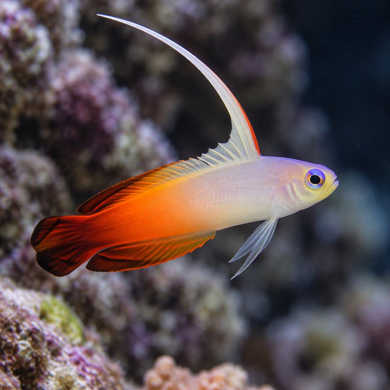

# Pez fuego — *Nemateleotris magnifica* Fowler, 1938

> Archivo generado desde `especies/datos/catalogo_inicial.json` con `especies/herramientas/generar_fichas.py`. No editar a mano.

*Imagen ilustrativa generada con IA por Brayan (2026-11-16). No es una fotografía de un ejemplar real; puede contener errores anatómicos.*

**Grupo:** pez  
**Otros nombres:** Fire goby, Firefish goby, Fire dartfish  
**Fecha de consulta:** 2026-11-16  
**Confianza global:** media  
**Estado:** verificada; pendiente de revisión del equipo

## Ficha AIRI

| Campo | Valor |
|---|---|
| Nombre común | Pez fuego |
| Nombre científico | *Nemateleotris magnifica* |
| Temperamento | Pacífico |
| Comportamiento | Pacífico, Territorial. Tímido: necesita varios refugios entre las rocas. Solo es agresivo con su propia especie; una pareja formada convive en paz. Salta fuera del acuario si se estresa, por lo que necesita tapa. |
| Adecuado para arrecife | Sí. La única fuente consultada que lo evalúa (LiveAquaria) lo considera compatible con arrecife; no hay verificación independiente. |
| Tipo de alimentación | Carnívoro: zooplancton, copépodos, larvas de crustáceos, artemia enriquecida y misis (en acuario). *FishBase lo describe como planctívoro; LiveAquaria lo clasifica como carnívoro.* |
| Temperatura | 22.2–25.6 °C *El rango de acuario cae dentro del rango natural indicado por FishBase.* |
| Litraje recomendado | 75.7 L (20 gal EE. UU.). *Es el mínimo recomendado por una sola fuente comercial; ninguna fuente científica consultada establece un litraje.* |
| Tamaño adulto | 9 cm (longitud total). Al venderse mide 2.5–7.6 cm (juvenil o subadulto). *Diferencia entre fuentes: FishBase 9 cm; LiveAquaria 3 in (7.6 cm).* |

## Detalle verificado

| Campo | Dato | Confianza | Fuentes |
|---|---|---|---|
| Clasificación taxonómica | Clase Teleostei; orden Gobiiformes; familia Gobiidae (WoRMS). WoRMS AphiaID 219611 (aceptado). Sinónimos: Nemateleotris magnificus (grafía incorrecta), Nemaeleotris magnifica. La familia varía según la fuente: Gobiidae (WoRMS) frente a Microdesmidae, subfamilia Ptereleotrinae (FishBase). Se toma WoRMS como referencia. | alta | [worms_nemateleotris_magnifica](https://www.marinespecies.org/aphia.php?p=taxdetails&id=219611), [fishbase_nemateleotris_magnifica](https://www.fishbase.se/summary/Nemateleotris-magnifica.html) |
| Hábitat natural | Partes altas de las pendientes externas de arrecife en el Indo-Pacífico. Bentopelágico: se mantiene sobre el fondo de cara a la corriente. Marino, asociado a arrecifes, no migratorio. Profundidad: 0–70 m (habitual 6–28 m). Distribución: Indo-Pacífico, desde África oriental hasta Hawái, Marquesas y Pitcairn; al norte hasta Ryukyu, al sur hasta Nueva Caledonia y las Australes; toda Micronesia. | media | [fishbase_nemateleotris_magnifica](https://www.fishbase.se/summary/Nemateleotris-magnifica.html) |
| Tamaño adulto | Máx. 9 cm (longitud total). LiveAquaria: 3 in (≈ 7.6 cm). | media | [fishbase_nemateleotris_magnifica](https://www.fishbase.se/summary/Nemateleotris-magnifica.html), [liveaquaria_nemateleotris_magnifica](https://www.liveaquaria.com/products/firefish) |
| Alimentación | Planctívoro y carnívoro: zooplancton, copépodos y larvas de crustáceos. En acuario: artemia enriquecida, misis y alimentos marinos preparados. | alta | [fishbase_nemateleotris_magnifica](https://www.fishbase.se/summary/Nemateleotris-magnifica.html), [liveaquaria_nemateleotris_magnifica](https://www.liveaquaria.com/products/firefish) |
| Temperatura del agua | Acuario: 22.2–25.6 °C (72–78 °F). Medio natural: 22–28 °C. El rango de acuario cae dentro del rango natural indicado por FishBase. | media | [liveaquaria_nemateleotris_magnifica](https://www.liveaquaria.com/products/firefish), [fishbase_nemateleotris_magnifica](https://www.fishbase.se/summary/Nemateleotris-magnifica.html) |
| Rango de pH | Fuente de acuario: 8.1–8.4. Rango prudente AIRI: 8.1–8.3. Criterio: Intersección con la tabla MSD para agua salada (7.8–8.3). | media | [liveaquaria_nemateleotris_magnifica](https://www.liveaquaria.com/products/firefish), [msd_tabla_referencia](https://www.msdvetmanual.com/multimedia/table/normal-reference-ranges-for-routine-water-quality-analysis), [msd_capitulo](https://www.msdvetmanual.com/exotic-and-laboratory-animals/aquatic-systems/environmental-diseases-of-aquatic-animals-in-aquatic-systems) |
| Salinidad | 1.020–1.025 de gravedad específica (adimensional). Agua de mar media: 35 ppt (UF/IFAS). No se convierte a ppt porque la equivalencia depende de la temperatura. | media | [liveaquaria_nemateleotris_magnifica](https://www.liveaquaria.com/products/firefish), [ufifas_ph_sal_temp](https://waterwatch.ifas.ufl.edu/media/waterwatchifasufledu/FactSheet_pH_Sal_Temp.pdf) |
| Volumen mínimo | 75.7 L (20 gal EE. UU.). Justificación: Cifra de LiveAquaria. Necesita varias zonas de refugio entre rocas y una corriente moderada. | baja | [liveaquaria_nemateleotris_magnifica](https://www.liveaquaria.com/products/firefish) |
| Comportamiento | Tímido. Se mantiene suspendido sobre el arrecife y agita su primera aleta dorsal. Varios individuos, sobre todo juveniles, pueden compartir un agujero. Es monógamo. Cuando se estresa intenta saltar fuera del acuario. | alta | [fishbase_nemateleotris_magnifica](https://www.fishbase.se/summary/Nemateleotris-magnifica.html), [liveaquaria_nemateleotris_magnifica](https://www.liveaquaria.com/products/firefish) |
| Territorialidad y refugio | Cada individuo tiene un agujero de escape al que huye si se siente amenazado. En acuario necesita varias grietas o salientes rocosos. Solo es agresivo con su propia especie; una pareja formada convive en paz. | media | [fishbase_nemateleotris_magnifica](https://www.fishbase.se/summary/Nemateleotris-magnifica.html), [liveaquaria_nemateleotris_magnifica](https://www.liveaquaria.com/products/firefish) |
| Compatibilidad con arrecife | sí (según la fuente; sin verificación independiente) | baja | [liveaquaria_nemateleotris_magnifica](https://www.liveaquaria.com/products/firefish) |
| Convivencia: condiciones | Acuario con tapa, porque salta. · Es tímido: necesita varias zonas de refugio entre las rocas. · Un solo ejemplar o una pareja ya formada. | baja | [liveaquaria_nemateleotris_magnifica](https://www.liveaquaria.com/products/firefish) |
| Convivencia: riesgos | Agresión hacia otros ejemplares de su especie. · Salta fuera del acuario cuando se estresa. | baja | [liveaquaria_nemateleotris_magnifica](https://www.liveaquaria.com/products/firefish) |
| Conservación | Preocupación menor (LC), evaluada el 18/08/2023, según FishBase. | media | [fishbase_nemateleotris_magnifica](https://www.fishbase.se/summary/Nemateleotris-magnifica.html) |

**Regla AIRI:** compartir rangos de agua no implica compatibilidad entre especies. Los rangos de acuario provienen de una fuente comercial y no son límites veterinarios.

## Fuentes

- **worms_nemateleotris_magnifica** (taxonomía): WoRMS — Nemateleotris magnifica Fowler, 1938 (AphiaID 219611). <https://www.marinespecies.org/aphia.php?p=taxdetails&id=219611>. Consultada el 2026-11-16.
- **fishbase_nemateleotris_magnifica** (biología): FishBase — Nemateleotris magnifica, Fire goby. <https://www.fishbase.se/summary/Nemateleotris-magnifica.html>. Consultada el 2026-11-16.
- **liveaquaria_nemateleotris_magnifica** (comercial): LiveAquaria — Firefish Goby. <https://www.liveaquaria.com/products/firefish>. Consultada el 2026-11-16.
- **msd_tabla_referencia** (veterinaria): MSD Veterinary Manual — “Normal” Reference Ranges for Routine Water Quality Analysis. <https://www.msdvetmanual.com/multimedia/table/normal-reference-ranges-for-routine-water-quality-analysis>. Consultada el 2026-11-12. Reutilizada del registro del motor (motor/airi_motor/datos/fuentes.json); no se volvió a consultar para estas fichas.
- **ufifas_ph_sal_temp** (institucional): UF/IFAS — pH, Salinity and Temperature (hoja informativa). <https://waterwatch.ifas.ufl.edu/media/waterwatchifasufledu/FactSheet_pH_Sal_Temp.pdf>. Consultada el 2026-11-12. Reutilizada del registro del motor (motor/airi_motor/datos/fuentes.json); no se volvió a consultar para estas fichas.
- **msd_capitulo** (veterinaria): MSD Veterinary Manual — Environmental Diseases of Aquatic Animals in Aquatic Systems. <https://www.msdvetmanual.com/exotic-and-laboratory-animals/aquatic-systems/environmental-diseases-of-aquatic-animals-in-aquatic-systems>. Consultada el 2026-11-12. Reutilizada del registro del motor (motor/airi_motor/datos/fuentes.json); no se volvió a consultar para estas fichas.
