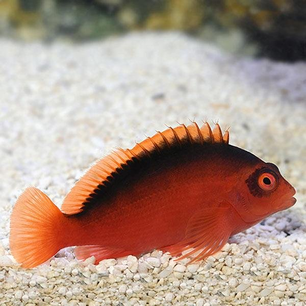

# Pez halcón llama — *Neocirrhites armatus* Castelnau, 1873

> Archivo generado desde `especies/datos/catalogo_inicial.json` con `especies/herramientas/generar_fichas.py`. No editar a mano.

*Imagen ilustrativa generada con IA por Brayan (2026-11-16). No es una fotografía de un ejemplar real; puede contener errores anatómicos.*

**Grupo:** pez  
**Otros nombres:** Flame hawkfish, Brilliant hawkfish  
**Fecha de consulta:** 2026-11-16  
**Confianza global:** media  
**Estado:** verificada; pendiente de revisión del equipo

## Ficha AIRI

| Campo | Valor |
|---|---|
| Nombre común | Pez halcón llama |
| Nombre científico | *Neocirrhites armatus* |
| Temperamento | Pacífico *LiveAquaria no publica datos rápidos; su descripción lo llama «mayormente pacífico».* |
| Comportamiento | Pacífico. Mayormente pacífico. Se posa entre corales esperando comida. Necesita agua bien oxigenada. |
| Adecuado para arrecife | Con precaución. LiveAquaria lo considera bueno para arrecife siempre que no haya camarones pequeños; precaución con gobios y blenios pequeños de fondo. |
| Tipo de alimentación | Carnívoro: pequeños crustáceos, carnes marinas y congelados, camarones vivos. |
| Temperatura | 22.2–25.6 °C *Rango de Quality Marine; FishBase no indica temperatura.* |
| Litraje recomendado | 113.6 L (30 gal EE. UU.). *LiveAquaria no publica datos rápidos de esta especie; la cifra sale de su descripción.* |
| Tamaño adulto | 9 cm (longitud total). Al venderse mide 1.3–8.9 cm (juvenil o subadulto). *LiveAquaria no publica datos rápidos de esta especie; vende ejemplares de ½ a 3½ in (≈ 1.3–8.9 cm).* |

## Detalle verificado

| Campo | Dato | Confianza | Fuentes |
|---|---|---|---|
| Clasificación taxonómica | Clase Teleostei; orden Centrarchiformes; familia Cirrhitidae. WoRMS AphiaID 281678 (aceptado). | alta | [worms_neocirrhites_armatus](https://www.marinespecies.org/aphia.php?p=taxdetails&id=281678), [fishbase_neocirrhites_armatus](https://www.fishbase.se/summary/Neocirrhites-armatus.html) |
| Hábitat natural | Frentes arrecifales batidos por el oleaje y terrazas submarinas hasta unos 11 m, entre las ramas de corales vivos (Pocillopora, Stylophora); se esconde dentro del coral cuando se le acerca. Profundidad: 1–10 m. Distribución: Océano Pacífico, de las Ryukyu a las islas de la Línea y Mangareva; al sur hasta la Gran Barrera y las Australes. | media | [fishbase_neocirrhites_armatus](https://www.fishbase.se/summary/Neocirrhites-armatus.html) |
| Tamaño adulto | Máx. 9 cm (longitud total). LiveAquaria no publica datos rápidos de esta especie; vende ejemplares de ½ a 3½ in (≈ 1.3–8.9 cm). | media | [fishbase_neocirrhites_armatus](https://www.fishbase.se/summary/Neocirrhites-armatus.html) |
| Alimentación | Carnívoro: come pequeños crustáceos (FishBase). En acuario, carnes marinas variadas, congelados y camarones vivos (LiveAquaria). | alta | [fishbase_neocirrhites_armatus](https://www.fishbase.se/summary/Neocirrhites-armatus.html), [liveaquaria_neocirrhites_armatus](https://www.liveaquaria.com/products/flame-hawkfish) |
| Temperatura del agua | Acuario: 22.2–25.6 °C (72–78 °F). FishBase no indica rango de temperatura; el rango de acuario es de Quality Marine (LiveAquaria no publica datos rápidos de esta especie). | baja | [qualitymarine_neocirrhites_armatus](https://www.qualitymarine.com/quality-marine/fish/hawks/neocirrhites/flame-armatus-21004/) |
| Rango de pH | Fuente de acuario: 8.1–8.4. Rango prudente AIRI: 8.1–8.3. Criterio: Intersección con la tabla MSD para agua salada (7.8–8.3). | media | [qualitymarine_neocirrhites_armatus](https://www.qualitymarine.com/quality-marine/fish/hawks/neocirrhites/flame-armatus-21004/), [msd_tabla_referencia](https://www.msdvetmanual.com/multimedia/table/normal-reference-ranges-for-routine-water-quality-analysis), [msd_capitulo](https://www.msdvetmanual.com/exotic-and-laboratory-animals/aquatic-systems/environmental-diseases-of-aquatic-animals-in-aquatic-systems) |
| Salinidad | 1.020–1.025 de gravedad específica (adimensional). Agua de mar media: 35 ppt (UF/IFAS). No se convierte a ppt porque la equivalencia depende de la temperatura. | media | [qualitymarine_neocirrhites_armatus](https://www.qualitymarine.com/quality-marine/fish/hawks/neocirrhites/flame-armatus-21004/), [ufifas_ph_sal_temp](https://waterwatch.ifas.ufl.edu/media/waterwatchifasufledu/FactSheet_pH_Sal_Temp.pdf) |
| Volumen mínimo | 113.6 L (30 gal EE. UU.). Justificación: LiveAquaria pide 30 gal o más, con mucha roca viva para posarse y esconderse. Quality Marine también recomienda 30 gal o más. | baja | [liveaquaria_neocirrhites_armatus](https://www.liveaquaria.com/products/flame-hawkfish), [qualitymarine_neocirrhites_armatus](https://www.qualitymarine.com/quality-marine/fish/hawks/neocirrhites/flame-armatus-21004/) |
| Comportamiento | Monógamo (FishBase). Mayormente pacífico; pasa el tiempo posado entre las ramas de corales duros esperando alimento (LiveAquaria). FishBase advierte que necesita agua bien oxigenada y que pierde color en cautiverio. | media | [fishbase_neocirrhites_armatus](https://www.fishbase.se/summary/Neocirrhites-armatus.html), [liveaquaria_neocirrhites_armatus](https://www.liveaquaria.com/products/flame-hawkfish) |
| Territorialidad y refugio | Se refugia entre las ramas de los corales. | media | [liveaquaria_neocirrhites_armatus](https://www.liveaquaria.com/products/flame-hawkfish), [fishbase_neocirrhites_armatus](https://www.fishbase.se/summary/Neocirrhites-armatus.html) |
| Compatibilidad con arrecife | con precaución (según la fuente; sin verificación independiente) | baja | [liveaquaria_neocirrhites_armatus](https://www.liveaquaria.com/products/flame-hawkfish) |
| Convivencia: condiciones | Roca viva y corales ramificados donde posarse. · Sin camarones pequeños. | baja | [liveaquaria_neocirrhites_armatus](https://www.liveaquaria.com/products/flame-hawkfish), [fishbase_neocirrhites_armatus](https://www.fishbase.se/summary/Neocirrhites-armatus.html) |
| Convivencia: riesgos | Come camarones pequeños. · Puede molestar a gobios y blenios pequeños. · Pierde color en cautiverio (FishBase). | baja | [liveaquaria_neocirrhites_armatus](https://www.liveaquaria.com/products/flame-hawkfish), [fishbase_neocirrhites_armatus](https://www.fishbase.se/summary/Neocirrhites-armatus.html) |
| Conservación | Preocupación menor (LC), evaluada el 03/03/2015, según FishBase. | media | [fishbase_neocirrhites_armatus](https://www.fishbase.se/summary/Neocirrhites-armatus.html) |

**Regla AIRI:** compartir rangos de agua no implica compatibilidad entre especies. Los rangos de acuario provienen de una fuente comercial y no son límites veterinarios.

## Fuentes

- **worms_neocirrhites_armatus** (taxonomía): WoRMS — Neocirrhites armatus Castelnau, 1873 (AphiaID 281678). <https://www.marinespecies.org/aphia.php?p=taxdetails&id=281678>. Consultada el 2026-11-16.
- **fishbase_neocirrhites_armatus** (biología): FishBase — Neocirrhites armatus. <https://www.fishbase.se/summary/Neocirrhites-armatus.html>. Consultada el 2026-11-16.
- **liveaquaria_neocirrhites_armatus** (comercial): LiveAquaria — Flame Hawkfish. <https://www.liveaquaria.com/products/flame-hawkfish>. Consultada el 2026-11-16.
- **msd_tabla_referencia** (veterinaria): MSD Veterinary Manual — “Normal” Reference Ranges for Routine Water Quality Analysis. <https://www.msdvetmanual.com/multimedia/table/normal-reference-ranges-for-routine-water-quality-analysis>. Consultada el 2026-11-12. Reutilizada del registro del motor (motor/airi_motor/datos/fuentes.json); no se volvió a consultar para estas fichas.
- **ufifas_ph_sal_temp** (institucional): UF/IFAS — pH, Salinity and Temperature (hoja informativa). <https://waterwatch.ifas.ufl.edu/media/waterwatchifasufledu/FactSheet_pH_Sal_Temp.pdf>. Consultada el 2026-11-12. Reutilizada del registro del motor (motor/airi_motor/datos/fuentes.json); no se volvió a consultar para estas fichas.
- **qualitymarine_neocirrhites_armatus** (comercial): Quality Marine — Flame Hawkfish. <https://www.qualitymarine.com/quality-marine/fish/hawks/neocirrhites/flame-armatus-21004/>. Consultada el 2026-11-16.
- **msd_capitulo** (veterinaria): MSD Veterinary Manual — Environmental Diseases of Aquatic Animals in Aquatic Systems. <https://www.msdvetmanual.com/exotic-and-laboratory-animals/aquatic-systems/environmental-diseases-of-aquatic-animals-in-aquatic-systems>. Consultada el 2026-11-12. Reutilizada del registro del motor (motor/airi_motor/datos/fuentes.json); no se volvió a consultar para estas fichas.
