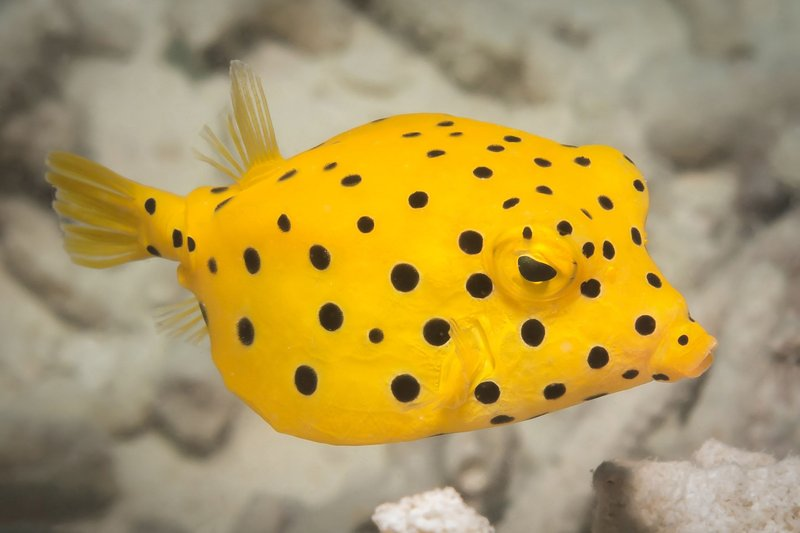

# Pez cofre amarillo — *Ostracion cubicum* Linnaeus, 1758

> Archivo generado desde `especies/datos/catalogo_inicial.json` con `especies/herramientas/generar_fichas.py`. No editar a mano.

*Imagen ilustrativa generada con IA por Brayan (2026-11-16). No es una fotografía de un ejemplar real; puede contener errores anatómicos.*

**Grupo:** pez  
**Otros nombres:** Yellow boxfish, Cubicus boxfish, Polka dot boxfish  
**Fecha de consulta:** 2026-11-16  
**Confianza global:** media  
**Estado:** verificada; pendiente de revisión del equipo

## Ficha AIRI

| Campo | Valor |
|---|---|
| Nombre común | Pez cofre amarillo |
| Nombre científico | *Ostracion cubicum* |
| Temperamento | Semiagresivo |
| Comportamiento | Solitario. Solitario y muy difícil de mantener (solo expertos). Si se estresa o muere libera ostracitoxina, un veneno que puede matar rápidamente a los demás peces. |
| Adecuado para arrecife | No. Los datos rápidos de LiveAquaria lo marcan como no apto para arrecife, y su descripción advierte que suele mordisquear gusanos tubícolas. |
| Tipo de alimentación | Omnívoro: algas, invertebrados y moluscos, esponjas y poliquetos, calamar, almejas y mejillones picados. |
| Temperatura | 22.2–25.6 °C *FishBase no indica rango de temperatura para esta especie.* |
| Litraje recomendado | 946.2 L (250 gal EE. UU.). *Diferencia dentro de LiveAquaria: sus datos rápidos indican 250 gal y su descripción, un mínimo de 125 gal. Se adopta la cifra mayor. Ninguna fuente científica consultada establece un litraje.* |
| Tamaño adulto | 45 cm (longitud total). Al venderse mide 2.5–12.7 cm (juvenil o subadulto). *Diferencia entre fuentes: FishBase 45 cm; LiveAquaria 20 in (≈ 50.8 cm). El juvenil es amarillo con puntos y el adulto se vuelve marrón.* |

## Detalle verificado

| Campo | Dato | Confianza | Fuentes |
|---|---|---|---|
| Clasificación taxonómica | Clase Teleostei; orden Tetraodontiformes; familia Ostraciidae. WoRMS AphiaID 403462 (aceptado). Sinónimos: Ostracion cubicus Linnaeus, 1758 (grafía no aceptada), Ostracion argus Rüppell, 1828, Ostracion tuberculatus Linnaeus, 1758. El nombre aceptado es Ostracion cubicum; «cubicus», muy usado en acuariofilia, es una grafía no aceptada (WoRMS). | alta | [worms_ostracion_cubicum](https://www.marinespecies.org/aphia.php?p=taxdetails&id=403462), [fishbase_ostracion_cubicum](https://www.fishbase.se/summary/Ostracion-cubicus.html) |
| Hábitat natural | Lagunas y arrecifes externos semiprotegidos. Los juveniles viven entre corales Acropora y se esconden en grietas estrechas. Es solitario; se reproduce en harenes de un macho y 2–4 hembras. Profundidad: 1–280 m (habitual 1–50 m). Distribución: Indo-Pacífico: golfo Pérsico, Mar Rojo y África oriental hasta Hawái y las Tuamotu; al norte hasta las Ryukyu; al sur hasta Lord Howe. También en la costa sur de Sudáfrica. | media | [fishbase_ostracion_cubicum](https://www.fishbase.se/summary/Ostracion-cubicus.html) |
| Tamaño adulto | Máx. 45 cm (longitud total). Diferencia entre fuentes: FishBase 45 cm; LiveAquaria 20 in (≈ 50.8 cm). El juvenil es amarillo con puntos y el adulto se vuelve marrón. | media | [fishbase_ostracion_cubicum](https://www.fishbase.se/summary/Ostracion-cubicus.html), [liveaquaria_ostracion_cubicum](https://www.liveaquaria.com/products/cubicus-boxfish-expert-only) |
| Alimentación | Omnívoro: en la naturaleza come algas con microorganismos, invertebrados, moluscos, esponjas, poliquetos, crustáceos, foraminíferos y peces (FishBase). En acuario, al principio artemia viva o larvas de mosquito; después calamar, almejas y mejillones picados, y preparados herbívoros (LiveAquaria). | alta | [fishbase_ostracion_cubicum](https://www.fishbase.se/summary/Ostracion-cubicus.html), [liveaquaria_ostracion_cubicum](https://www.liveaquaria.com/products/cubicus-boxfish-expert-only) |
| Temperatura del agua | Acuario: 22.2–25.6 °C (72–78 °F). FishBase no indica rango de temperatura para esta especie. | baja | [liveaquaria_ostracion_cubicum](https://www.liveaquaria.com/products/cubicus-boxfish-expert-only) |
| Rango de pH | Fuente de acuario: 8.1–8.4. Rango prudente AIRI: 8.1–8.3. Criterio: Intersección con la tabla MSD para agua salada (7.8–8.3). | media | [liveaquaria_ostracion_cubicum](https://www.liveaquaria.com/products/cubicus-boxfish-expert-only), [msd_tabla_referencia](https://www.msdvetmanual.com/multimedia/table/normal-reference-ranges-for-routine-water-quality-analysis), [msd_capitulo](https://www.msdvetmanual.com/exotic-and-laboratory-animals/aquatic-systems/environmental-diseases-of-aquatic-animals-in-aquatic-systems) |
| Salinidad | 1.020–1.025 de gravedad específica (adimensional). Agua de mar media: 35 ppt (UF/IFAS). No se convierte a ppt porque la equivalencia depende de la temperatura. | media | [liveaquaria_ostracion_cubicum](https://www.liveaquaria.com/products/cubicus-boxfish-expert-only), [ufifas_ph_sal_temp](https://waterwatch.ifas.ufl.edu/media/waterwatchifasufledu/FactSheet_pH_Sal_Temp.pdf) |
| Volumen mínimo | 946.2 L (250 gal EE. UU.). Justificación: Cifra de los datos rápidos de LiveAquaria (250 gal). Es un pez grande (45–50 cm) y difícil de mantener. | baja | [liveaquaria_ostracion_cubicum](https://www.liveaquaria.com/products/cubicus-boxfish-expert-only), [fishbase_ostracion_cubicum](https://www.fishbase.se/summary/Ostracion-cubicus.html) |
| Comportamiento | Solitario (FishBase). Muy difícil de mantener: solo para los aficionados más experimentados. Si se estresa libera ostracitoxina por sus glándulas mucosas, un veneno que puede matar muy rápido a los demás peces del acuario (LiveAquaria). | media | [fishbase_ostracion_cubicum](https://www.fishbase.se/summary/Ostracion-cubicus.html), [liveaquaria_ostracion_cubicum](https://www.liveaquaria.com/products/cubicus-boxfish-expert-only) |
| Territorialidad y refugio | Solitario. Los juveniles se esconden en grietas estrechas. | media | [liveaquaria_ostracion_cubicum](https://www.liveaquaria.com/products/cubicus-boxfish-expert-only), [fishbase_ostracion_cubicum](https://www.fishbase.se/summary/Ostracion-cubicus.html) |
| Compatibilidad con arrecife | no (según la fuente; sin verificación independiente) | baja | [liveaquaria_ostracion_cubicum](https://www.liveaquaria.com/products/cubicus-boxfish-expert-only) |
| Convivencia: condiciones | Solo para aficionados expertos. · Acuario muy grande y sin fuentes de estrés. | baja | [liveaquaria_ostracion_cubicum](https://www.liveaquaria.com/products/cubicus-boxfish-expert-only), [fishbase_ostracion_cubicum](https://www.fishbase.se/summary/Ostracion-cubicus.html) |
| Convivencia: riesgos | Libera ostracitoxina al estresarse o morir y puede matar a todo el acuario. · Mordisquea gusanos tubícolas. | baja | [liveaquaria_ostracion_cubicum](https://www.liveaquaria.com/products/cubicus-boxfish-expert-only), [fishbase_ostracion_cubicum](https://www.fishbase.se/summary/Ostracion-cubicus.html) |
| Conservación | Preocupación menor (LC), evaluada el 18/08/2023, según FishBase. FishBase lo clasifica como inofensivo para las personas, pero LiveAquaria advierte que es venenoso cuando se estresa o muere. | media | [fishbase_ostracion_cubicum](https://www.fishbase.se/summary/Ostracion-cubicus.html) |

**Regla AIRI:** compartir rangos de agua no implica compatibilidad entre especies. Los rangos de acuario provienen de una fuente comercial y no son límites veterinarios.

## Fuentes

- **worms_ostracion_cubicum** (taxonomía): WoRMS — Ostracion cubicum Linnaeus, 1758 (AphiaID 403462). <https://www.marinespecies.org/aphia.php?p=taxdetails&id=403462>. Consultada el 2026-11-16.
- **fishbase_ostracion_cubicum** (biología): FishBase — Ostracion cubicum Linnaeus, 1758. <https://www.fishbase.se/summary/Ostracion-cubicus.html>. Consultada el 2026-11-16.
- **liveaquaria_ostracion_cubicum** (comercial): LiveAquaria — Cubicus Boxfish (EXPERT ONLY). <https://www.liveaquaria.com/products/cubicus-boxfish-expert-only>. Consultada el 2026-11-16.
- **msd_tabla_referencia** (veterinaria): MSD Veterinary Manual — “Normal” Reference Ranges for Routine Water Quality Analysis. <https://www.msdvetmanual.com/multimedia/table/normal-reference-ranges-for-routine-water-quality-analysis>. Consultada el 2026-11-12. Reutilizada del registro del motor (motor/airi_motor/datos/fuentes.json); no se volvió a consultar para estas fichas.
- **ufifas_ph_sal_temp** (institucional): UF/IFAS — pH, Salinity and Temperature (hoja informativa). <https://waterwatch.ifas.ufl.edu/media/waterwatchifasufledu/FactSheet_pH_Sal_Temp.pdf>. Consultada el 2026-11-12. Reutilizada del registro del motor (motor/airi_motor/datos/fuentes.json); no se volvió a consultar para estas fichas.
- **msd_capitulo** (veterinaria): MSD Veterinary Manual — Environmental Diseases of Aquatic Animals in Aquatic Systems. <https://www.msdvetmanual.com/exotic-and-laboratory-animals/aquatic-systems/environmental-diseases-of-aquatic-animals-in-aquatic-systems>. Consultada el 2026-11-12. Reutilizada del registro del motor (motor/airi_motor/datos/fuentes.json); no se volvió a consultar para estas fichas.
