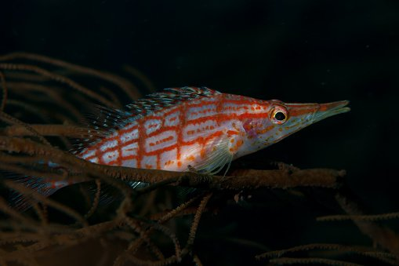

# Pez halcón de nariz larga — *Oxycirrhites typus* Bleeker, 1857

> Archivo generado desde `especies/datos/catalogo_inicial.json` con `especies/herramientas/generar_fichas.py`. No editar a mano.

*Imagen ilustrativa generada con IA por Brayan (2026-11-16). No es una fotografía de un ejemplar real; puede contener errores anatómicos.*

**Grupo:** pez  
**Otros nombres:** Longnose hawkfish  
**Fecha de consulta:** 2026-11-16  
**Confianza global:** media  
**Estado:** verificada; pendiente de revisión del equipo

## Ficha AIRI

| Campo | Valor |
|---|---|
| Nombre común | Pez halcón de nariz larga |
| Nombre científico | *Oxycirrhites typus* |
| Temperamento | Semiagresivo |
| Comportamiento | Territorial. Territorial y semiagresivo. Se posa en gorgonias para acechar. Puede comer peces pequeños y camarones. |
| Adecuado para arrecife | Con precaución. LiveAquaria lo considera apto con precaución: come peces pequeños y camarones. |
| Tipo de alimentación | Carnívoro: pequeños crustáceos, carnes marinas y congelados, camarones vivos. |
| Temperatura | 22.2–25.6 °C |
| Litraje recomendado | 113.6 L (30 gal EE. UU.). *Es el mínimo recomendado por una sola fuente comercial; ninguna fuente científica consultada establece un litraje.* |
| Tamaño adulto | 13 cm (longitud total). Al venderse mide 1.9–10.2 cm (juvenil o subadulto). *LiveAquaria indica 5 in (≈ 12.7 cm), coherente con FishBase.* |

## Detalle verificado

| Campo | Dato | Confianza | Fuentes |
|---|---|---|---|
| Clasificación taxonómica | Clase Teleostei; orden Centrarchiformes; familia Cirrhitidae. WoRMS AphiaID 218865 (aceptado). | alta | [worms_oxycirrhites_typus](https://www.marinespecies.org/aphia.php?p=taxdetails&id=218865), [fishbase_oxycirrhites_typus](https://www.fishbase.se/summary/Oxycirrhites-typus.html) |
| Hábitat natural | Pendientes externas empinadas del arrecife con corrientes fuertes, donde vive sobre gorgonias grandes y corales negros. Es común por debajo de los 25 m. Profundidad: 10–100 m (habitual desde 25 m). Distribución: Indo-Pacífico occidental, del Mar Rojo y Sudáfrica a Hawái, sur de Japón y Nueva Caledonia; Pacífico oriental, del golfo de California a Colombia y Galápagos. | media | [fishbase_oxycirrhites_typus](https://www.fishbase.se/summary/Oxycirrhites-typus.html) |
| Tamaño adulto | Máx. 13 cm (longitud total). LiveAquaria indica 5 in (≈ 12.7 cm), coherente con FishBase. | alta | [fishbase_oxycirrhites_typus](https://www.fishbase.se/summary/Oxycirrhites-typus.html), [liveaquaria_oxycirrhites_typus](https://www.liveaquaria.com/products/longnose-hawkfish) |
| Alimentación | Carnívoro: come pequeños crustáceos bentónicos o planctónicos (FishBase). En acuario, carnes marinas variadas, preparados congelados y camarones vivos (LiveAquaria). | alta | [fishbase_oxycirrhites_typus](https://www.fishbase.se/summary/Oxycirrhites-typus.html), [liveaquaria_oxycirrhites_typus](https://www.liveaquaria.com/products/longnose-hawkfish) |
| Temperatura del agua | Acuario: 22.2–25.6 °C (72–78 °F). FishBase no indica rango de temperatura para esta especie. | baja | [liveaquaria_oxycirrhites_typus](https://www.liveaquaria.com/products/longnose-hawkfish) |
| Rango de pH | Fuente de acuario: 8.1–8.4. Rango prudente AIRI: 8.1–8.3. Criterio: Intersección con la tabla MSD para agua salada (7.8–8.3). | media | [liveaquaria_oxycirrhites_typus](https://www.liveaquaria.com/products/longnose-hawkfish), [msd_tabla_referencia](https://www.msdvetmanual.com/multimedia/table/normal-reference-ranges-for-routine-water-quality-analysis), [msd_capitulo](https://www.msdvetmanual.com/exotic-and-laboratory-animals/aquatic-systems/environmental-diseases-of-aquatic-animals-in-aquatic-systems) |
| Salinidad | 1.020–1.025 de gravedad específica (adimensional). Agua de mar media: 35 ppt (UF/IFAS). No se convierte a ppt porque la equivalencia depende de la temperatura. | media | [liveaquaria_oxycirrhites_typus](https://www.liveaquaria.com/products/longnose-hawkfish), [ufifas_ph_sal_temp](https://waterwatch.ifas.ufl.edu/media/waterwatchifasufledu/FactSheet_pH_Sal_Temp.pdf) |
| Volumen mínimo | 113.6 L (30 gal EE. UU.). Justificación: Cifra de LiveAquaria (30 gal), con tapa ajustada para que no escape y una gorgonia o decorado similar donde posarse. | baja | [liveaquaria_oxycirrhites_typus](https://www.liveaquaria.com/products/longnose-hawkfish) |
| Comportamiento | Monógamo y fuertemente territorial (FishBase). Resistente y semiagresivo, aunque los peces halcón más grandes lo dominan; le gusta posarse y camuflarse en gorgonias. Es el único pez halcón con reproducción registrada en cautiverio (LiveAquaria). | media | [fishbase_oxycirrhites_typus](https://www.fishbase.se/summary/Oxycirrhites-typus.html), [liveaquaria_oxycirrhites_typus](https://www.liveaquaria.com/products/longnose-hawkfish) |
| Territorialidad y refugio | Fuertemente territorial (FishBase). Necesita un lugar alto donde posarse. | media | [liveaquaria_oxycirrhites_typus](https://www.liveaquaria.com/products/longnose-hawkfish), [fishbase_oxycirrhites_typus](https://www.fishbase.se/summary/Oxycirrhites-typus.html) |
| Compatibilidad con arrecife | con precaución (según la fuente; sin verificación independiente) | baja | [liveaquaria_oxycirrhites_typus](https://www.liveaquaria.com/products/longnose-hawkfish) |
| Convivencia: condiciones | Acuario con tapa ajustada. · Sin peces halcón más grandes. | baja | [liveaquaria_oxycirrhites_typus](https://www.liveaquaria.com/products/longnose-hawkfish), [fishbase_oxycirrhites_typus](https://www.fishbase.se/summary/Oxycirrhites-typus.html) |
| Convivencia: riesgos | Come peces pequeños y camarones. · Puede saltar fuera del acuario. | baja | [liveaquaria_oxycirrhites_typus](https://www.liveaquaria.com/products/longnose-hawkfish), [fishbase_oxycirrhites_typus](https://www.fishbase.se/summary/Oxycirrhites-typus.html) |
| Conservación | Preocupación menor (LC), evaluada el 03/03/2015, según FishBase. | media | [fishbase_oxycirrhites_typus](https://www.fishbase.se/summary/Oxycirrhites-typus.html) |

**Regla AIRI:** compartir rangos de agua no implica compatibilidad entre especies. Los rangos de acuario provienen de una fuente comercial y no son límites veterinarios.

## Fuentes

- **worms_oxycirrhites_typus** (taxonomía): WoRMS — Oxycirrhites typus Bleeker, 1857 (AphiaID 218865). <https://www.marinespecies.org/aphia.php?p=taxdetails&id=218865>. Consultada el 2026-11-16.
- **fishbase_oxycirrhites_typus** (biología): FishBase — Oxycirrhites typus. <https://www.fishbase.se/summary/Oxycirrhites-typus.html>. Consultada el 2026-11-16.
- **liveaquaria_oxycirrhites_typus** (comercial): LiveAquaria — Longnose Hawkfish. <https://www.liveaquaria.com/products/longnose-hawkfish>. Consultada el 2026-11-16.
- **msd_tabla_referencia** (veterinaria): MSD Veterinary Manual — “Normal” Reference Ranges for Routine Water Quality Analysis. <https://www.msdvetmanual.com/multimedia/table/normal-reference-ranges-for-routine-water-quality-analysis>. Consultada el 2026-11-12. Reutilizada del registro del motor (motor/airi_motor/datos/fuentes.json); no se volvió a consultar para estas fichas.
- **ufifas_ph_sal_temp** (institucional): UF/IFAS — pH, Salinity and Temperature (hoja informativa). <https://waterwatch.ifas.ufl.edu/media/waterwatchifasufledu/FactSheet_pH_Sal_Temp.pdf>. Consultada el 2026-11-12. Reutilizada del registro del motor (motor/airi_motor/datos/fuentes.json); no se volvió a consultar para estas fichas.
- **msd_capitulo** (veterinaria): MSD Veterinary Manual — Environmental Diseases of Aquatic Animals in Aquatic Systems. <https://www.msdvetmanual.com/exotic-and-laboratory-animals/aquatic-systems/environmental-diseases-of-aquatic-animals-in-aquatic-systems>. Consultada el 2026-11-12. Reutilizada del registro del motor (motor/airi_motor/datos/fuentes.json); no se volvió a consultar para estas fichas.
