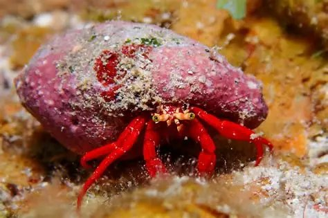

# Ermitaño patas rojas — *Paguristes cadenati* Forest, 1954

> Archivo generado desde `especies/datos/catalogo_inicial.json` con `especies/herramientas/generar_fichas.py`. No editar a mano.

*Imagen ilustrativa generada con IA por Brayan (2026-11-16). No es una fotografía de un ejemplar real; puede contener errores anatómicos.*

**Grupo:** crustáceo  
**Otros nombres:** Scarlet reef hermit crab, Red reef hermit, Red legged hermit crab  
**Fecha de consulta:** 2026-11-16  
**Confianza global:** baja  
**Estado:** verificada; pendiente de revisión del equipo

## Ficha AIRI

| Campo | Valor |
|---|---|
| Nombre común | Ermitaño patas rojas |
| Nombre científico | *Paguristes cadenati* |
| Temperamento | Pacífico |
| Comportamiento | Pacífico. Pacífico y resistente. Forma parte del «equipo de limpieza»: come algas molestas y detritos. Necesita conchas vacías de repuesto. |
| Adecuado para arrecife | Sí. LiveAquaria lo considera compatible con arrecife y muy útil contra algas molestas. |
| Tipo de alimentación | Omnívoro: detritos, algas filamentosas y de pelo, cianobacterias, alga seca y restos de comida. |
| Temperatura | 22.2–25.6 °C |
| Litraje recomendado | 18.9 L (5 gal EE. UU.). *Es el mínimo de una sola fuente comercial.* |
| Tamaño adulto | 3.8 cm (longitud). Al venderse mide 1.3–3.2 cm (juvenil o subadulto). *SeaLifeBase no indica tamaño; LiveAquaria indica 1½ in (≈ 3.8 cm).* |

## Detalle verificado

| Campo | Dato | Confianza | Fuentes |
|---|---|---|---|
| Clasificación taxonómica | Clase Malacostraca; orden Decapoda; familia Diogenidae. WoRMS AphiaID 368215 (aceptado). Es un cangrejo ermitaño, no un caracol: vive dentro de conchas vacías de caracol. | alta | [worms_paguristes_cadenati](https://www.marinespecies.org/aphia.php?p=taxdetails&id=368215), [sealifebase_paguristes_cadenati](https://www.sealifebase.se/summary/Paguristes-cadenati.html) |
| Hábitat natural | Bentónico, en fondos duros de roca y cascajo (WoRMS). LiveAquaria lo sitúa en paredes de arrecife y cascajo de coral del Caribe y el Atlántico occidental. Profundidad: 1–52 m (habitual 0–100 m (WoRMS)). Distribución: Atlántico occidental: Belice (SeaLifeBase); el holotipo procede de Martinica (WoRMS). | media | [sealifebase_paguristes_cadenati](https://www.sealifebase.se/summary/Paguristes-cadenati.html) |
| Tamaño adulto | Máx. 3.8 cm (longitud). SeaLifeBase no indica tamaño; LiveAquaria indica 1½ in (≈ 3.8 cm). | baja | [sealifebase_paguristes_cadenati](https://www.sealifebase.se/summary/Paguristes-cadenati.html), [liveaquaria_paguristes_cadenati](https://www.liveaquaria.com/products/scarlet-reef-hermit-crabs) |
| Alimentación | Omnívoro: come detritos y algas, en especial algas filamentosas, de pelo y de limo, y cianobacterias; también comida de peces. Si faltan algas, se complementa con alga seca (LiveAquaria). | baja | [liveaquaria_paguristes_cadenati](https://www.liveaquaria.com/products/scarlet-reef-hermit-crabs) |
| Temperatura del agua | Acuario: 22.2–25.6 °C (72–78 °F). SeaLifeBase no indica rango de temperatura para esta especie. | baja | [liveaquaria_paguristes_cadenati](https://www.liveaquaria.com/products/scarlet-reef-hermit-crabs) |
| Rango de pH | Fuente de acuario: 8.1–8.4. Rango prudente AIRI: 8.1–8.3. Criterio: Intersección con la tabla MSD para agua salada (7.8–8.3). | media | [liveaquaria_paguristes_cadenati](https://www.liveaquaria.com/products/scarlet-reef-hermit-crabs), [msd_tabla_referencia](https://www.msdvetmanual.com/multimedia/table/normal-reference-ranges-for-routine-water-quality-analysis), [msd_capitulo](https://www.msdvetmanual.com/exotic-and-laboratory-animals/aquatic-systems/environmental-diseases-of-aquatic-animals-in-aquatic-systems) |
| Salinidad | 1.020–1.025 de gravedad específica (adimensional). Agua de mar media: 35 ppt (UF/IFAS). No se convierte a ppt porque la equivalencia depende de la temperatura. | media | [liveaquaria_paguristes_cadenati](https://www.liveaquaria.com/products/scarlet-reef-hermit-crabs), [ufifas_ph_sal_temp](https://waterwatch.ifas.ufl.edu/media/waterwatchifasufledu/FactSheet_pH_Sal_Temp.pdf) |
| Volumen mínimo | 18.9 L (5 gal EE. UU.). Justificación: Cifra de Saltwaterfish («Minimum Tank Size: 5 Gallons»). LiveAquaria y las fuentes científicas consultadas no publican un litraje para esta especie. | baja | [saltwaterfish_paguristes_cadenati](https://www.saltwaterfish.com/product-scarlet-hermit-crab) |
| Comportamiento | Muy resistente y, a diferencia de otros ermitaños, muy pacífico con sus compañeros. Necesita conchas vacías para cambiarse al crecer (LiveAquaria). | media | [sealifebase_paguristes_cadenati](https://www.sealifebase.se/summary/Paguristes-cadenati.html), [liveaquaria_paguristes_cadenati](https://www.liveaquaria.com/products/scarlet-reef-hermit-crabs) |
| Territorialidad y refugio | No territorial. Necesita conchas vacías de repuesto para mudarse al crecer. | media | [liveaquaria_paguristes_cadenati](https://www.liveaquaria.com/products/scarlet-reef-hermit-crabs), [sealifebase_paguristes_cadenati](https://www.sealifebase.se/summary/Paguristes-cadenati.html) |
| Compatibilidad con arrecife | sí (según la fuente; sin verificación independiente) | baja | [liveaquaria_paguristes_cadenati](https://www.liveaquaria.com/products/scarlet-reef-hermit-crabs) |
| Convivencia: condiciones | Acuario de arrecife establecido con algas. · Conchas vacías de repuesto. · Sin depredadores de invertebrados. | baja | [liveaquaria_paguristes_cadenati](https://www.liveaquaria.com/products/scarlet-reef-hermit-crabs), [sealifebase_paguristes_cadenati](https://www.sealifebase.se/summary/Paguristes-cadenati.html) |
| Convivencia: riesgos | Sin conchas vacías de repuesto no puede cambiar de concha al crecer. · No tolera medicamentos con cobre ni cambios bruscos de salinidad, pH u oxígeno; requiere aclimatación por goteo. | baja | [liveaquaria_paguristes_cadenati](https://www.liveaquaria.com/products/scarlet-reef-hermit-crabs), [sealifebase_paguristes_cadenati](https://www.sealifebase.se/summary/Paguristes-cadenati.html) |
| Conservación | No evaluado por la UICN, según SeaLifeBase. | media | [sealifebase_paguristes_cadenati](https://www.sealifebase.se/summary/Paguristes-cadenati.html) |

**Regla AIRI:** compartir rangos de agua no implica compatibilidad entre especies. Los rangos de acuario provienen de una fuente comercial y no son límites veterinarios.

## Fuentes

- **worms_paguristes_cadenati** (taxonomía): WoRMS — Paguristes cadenati Forest, 1954 (AphiaID 368215). <https://www.marinespecies.org/aphia.php?p=taxdetails&id=368215>. Consultada el 2026-11-16.
- **sealifebase_paguristes_cadenati** (biología): SeaLifeBase — Paguristes cadenati. <https://www.sealifebase.se/summary/Paguristes-cadenati.html>. Consultada el 2026-11-16.
- **liveaquaria_paguristes_cadenati** (comercial): LiveAquaria — Scarlet Reef Hermit Crabs. <https://www.liveaquaria.com/products/scarlet-reef-hermit-crabs>. Consultada el 2026-11-16.
- **msd_tabla_referencia** (veterinaria): MSD Veterinary Manual — “Normal” Reference Ranges for Routine Water Quality Analysis. <https://www.msdvetmanual.com/multimedia/table/normal-reference-ranges-for-routine-water-quality-analysis>. Consultada el 2026-11-12. Reutilizada del registro del motor (motor/airi_motor/datos/fuentes.json); no se volvió a consultar para estas fichas.
- **ufifas_ph_sal_temp** (institucional): UF/IFAS — pH, Salinity and Temperature (hoja informativa). <https://waterwatch.ifas.ufl.edu/media/waterwatchifasufledu/FactSheet_pH_Sal_Temp.pdf>. Consultada el 2026-11-12. Reutilizada del registro del motor (motor/airi_motor/datos/fuentes.json); no se volvió a consultar para estas fichas.
- **saltwaterfish_paguristes_cadenati** (comercial): Saltwaterfish — Scarlet Hermit Crab. <https://www.saltwaterfish.com/product-scarlet-hermit-crab>. Consultada el 2026-11-16.
- **msd_capitulo** (veterinaria): MSD Veterinary Manual — Environmental Diseases of Aquatic Animals in Aquatic Systems. <https://www.msdvetmanual.com/exotic-and-laboratory-animals/aquatic-systems/environmental-diseases-of-aquatic-animals-in-aquatic-systems>. Consultada el 2026-11-12. Reutilizada del registro del motor (motor/airi_motor/datos/fuentes.json); no se volvió a consultar para estas fichas.
