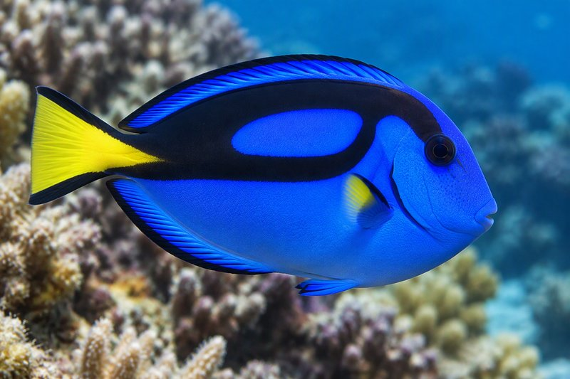

# Cirujano azul — *Paracanthurus hepatus* (Linnaeus, 1766)

> Archivo generado desde `especies/datos/catalogo_inicial.json` con `especies/herramientas/generar_fichas.py`. No editar a mano.

*Imagen ilustrativa generada con IA por Brayan (2026-11-16). No es una fotografía de un ejemplar real; puede contener errores anatómicos.*

**Grupo:** pez  
**Otros nombres:** Palette surgeonfish, Blue tang, Regal tang  
**Fecha de consulta:** 2026-11-16  
**Confianza global:** media  
**Estado:** verificada; pendiente de revisión del equipo

## Ficha AIRI

| Campo | Valor |
|---|---|
| Nombre común | Cirujano azul |
| Nombre científico | *Paracanthurus hepatus* |
| Temperamento | Semiagresivo *LiveAquaria lo clasifica como semiagresivo, aunque lo describe como pacífico con la mayoría de los peces.* |
| Comportamiento | Territorial. Nadador activo; necesita espacio y escondites. Pacífico con la mayoría de los peces, agresivo con los de su especie. Delicado: propenso al ich y a la erosión de aletas. |
| Adecuado para arrecife | Sí. LiveAquaria lo considera compatible con arrecife; no hay verificación independiente. |
| Tipo de alimentación | Omnívoro: zooplancton, algas, alga marina seca, alimentos cárnicos. *Diferencia entre fuentes: FishBase describe una dieta de zooplancton y algas; LiveAquaria lo clasifica como herbívoro.* |
| Temperatura | 22.2–25.6 °C *FishBase no indica rango de temperatura para esta especie.* |
| Litraje recomendado | 681.3 L (180 gal EE. UU.). *Es el mínimo recomendado por una sola fuente comercial; ninguna fuente científica consultada establece un litraje.* |
| Tamaño adulto | 31 cm (longitud total). Al venderse mide 1.3–10.2 cm (juvenil o subadulto). *LiveAquaria: 12 in (≈ 30.5 cm), coherente con FishBase.* |

## Detalle verificado

| Campo | Dato | Confianza | Fuentes |
|---|---|---|---|
| Clasificación taxonómica | Clase Teleostei; orden Acanthuriformes; familia Acanthuridae; subfamilia Acanthurinae. WoRMS AphiaID 219676 (aceptado). Sinónimos: Teuthis hepatus Linnaeus, 1766 (combinación original), Acanthurus hepatus. | alta | [worms_paracanthurus_hepatus](https://www.marinespecies.org/aphia.php?p=taxdetails&id=219676), [fishbase_paracanthurus_hepatus](https://www.fishbase.se/summary/Paracanthurus-hepatus.html) |
| Hábitat natural | Terrazas claras y con corriente de arrecifes externos, en grupos sueltos a 1–2 m sobre el fondo. Juveniles y subadultos viven en grupo cerca de cabezas del coral Pocillopora eydouxi y se esconden entre sus ramas. Profundidad: 2–40 m (habitual 10–40 m). Distribución: Indo-Pacífico: de África oriental (incluidas las Mascareñas) a Kiribati; al norte hasta el sur de Japón; al sur hasta la Gran Barrera de Coral, Nueva Caledonia y Samoa. | media | [fishbase_paracanthurus_hepatus](https://www.fishbase.se/summary/Paracanthurus-hepatus.html) |
| Tamaño adulto | Máx. 31 cm (longitud total). LiveAquaria: 12 in (≈ 30.5 cm), coherente con FishBase. | alta | [fishbase_paracanthurus_hepatus](https://www.fishbase.se/summary/Paracanthurus-hepatus.html), [liveaquaria_paracanthurus_hepatus](https://www.liveaquaria.com/products/blue-tang-1) |
| Alimentación | FishBase indica que come zooplancton y ocasionalmente algas; LiveAquaria lo clasifica como herbívoro y recomienda abundantes algas marinas al menos tres veces por semana, además de alimentos cárnicos. | media | [fishbase_paracanthurus_hepatus](https://www.fishbase.se/summary/Paracanthurus-hepatus.html), [liveaquaria_paracanthurus_hepatus](https://www.liveaquaria.com/products/blue-tang-1) |
| Temperatura del agua | Acuario: 22.2–25.6 °C (72–78 °F). FishBase no indica rango de temperatura para esta especie. | baja | [liveaquaria_paracanthurus_hepatus](https://www.liveaquaria.com/products/blue-tang-1) |
| Rango de pH | Fuente de acuario: 8.1–8.4. Rango prudente AIRI: 8.1–8.3. Criterio: Intersección con la tabla MSD para agua salada (7.8–8.3). | media | [liveaquaria_paracanthurus_hepatus](https://www.liveaquaria.com/products/blue-tang-1), [msd_tabla_referencia](https://www.msdvetmanual.com/multimedia/table/normal-reference-ranges-for-routine-water-quality-analysis), [msd_capitulo](https://www.msdvetmanual.com/exotic-and-laboratory-animals/aquatic-systems/environmental-diseases-of-aquatic-animals-in-aquatic-systems) |
| Salinidad | 1.020–1.025 de gravedad específica (adimensional). Agua de mar media: 35 ppt (UF/IFAS). No se convierte a ppt porque la equivalencia depende de la temperatura. | media | [liveaquaria_paracanthurus_hepatus](https://www.liveaquaria.com/products/blue-tang-1), [ufifas_ph_sal_temp](https://waterwatch.ifas.ufl.edu/media/waterwatchifasufledu/FactSheet_pH_Sal_Temp.pdf) |
| Volumen mínimo | 681.3 L (180 gal EE. UU.). Justificación: Cifra de LiveAquaria (180 gal), que además recomienda acuarios de al menos 6 pies (≈ 1.8 m) de largo. Es un nadador activo de hasta 31 cm que necesita mucho espacio y escondites en la roca. | baja | [liveaquaria_paracanthurus_hepatus](https://www.liveaquaria.com/products/blue-tang-1), [fishbase_paracanthurus_hepatus](https://www.fishbase.se/summary/Paracanthurus-hepatus.html) |
| Comportamiento | Nadador activo que necesita espacio y escondites. Pacífico con la mayoría de los peces, pero agresivo con los de su especie. Más propenso que otros peces a enfermedades de la línea lateral, erosión de aletas e ich (LiveAquaria). | media | [fishbase_paracanthurus_hepatus](https://www.fishbase.se/summary/Paracanthurus-hepatus.html), [liveaquaria_paracanthurus_hepatus](https://www.liveaquaria.com/products/blue-tang-1) |
| Territorialidad y refugio | Agresivo con su propia especie. Necesita escondites en la roca viva. | media | [liveaquaria_paracanthurus_hepatus](https://www.liveaquaria.com/products/blue-tang-1), [fishbase_paracanthurus_hepatus](https://www.fishbase.se/summary/Paracanthurus-hepatus.html) |
| Compatibilidad con arrecife | sí (según la fuente; sin verificación independiente) | baja | [liveaquaria_paracanthurus_hepatus](https://www.liveaquaria.com/products/blue-tang-1) |
| Convivencia: condiciones | Para varios ejemplares, introducirlos todos a la vez en un acuario grande. · Excelente calidad del agua y dieta rica en algas. | baja | [liveaquaria_paracanthurus_hepatus](https://www.liveaquaria.com/products/blue-tang-1), [fishbase_paracanthurus_hepatus](https://www.fishbase.se/summary/Paracanthurus-hepatus.html) |
| Convivencia: riesgos | Agresión hacia otros cirujanos azules. · Propenso a enfermedades de piel y aletas (ich, erosión de aletas). · FishBase lo clasifica como venenoso (glándula de veneno). | baja | [liveaquaria_paracanthurus_hepatus](https://www.liveaquaria.com/products/blue-tang-1), [fishbase_paracanthurus_hepatus](https://www.fishbase.se/summary/Paracanthurus-hepatus.html) |
| Conservación | Preocupación menor (LC), evaluada el 07/05/2010, según FishBase. | media | [fishbase_paracanthurus_hepatus](https://www.fishbase.se/summary/Paracanthurus-hepatus.html) |

**Regla AIRI:** compartir rangos de agua no implica compatibilidad entre especies. Los rangos de acuario provienen de una fuente comercial y no son límites veterinarios.

## Fuentes

- **worms_paracanthurus_hepatus** (taxonomía): WoRMS — Paracanthurus hepatus (Linnaeus, 1766) (AphiaID 219676). <https://www.marinespecies.org/aphia.php?p=taxdetails&id=219676>. Consultada el 2026-11-16.
- **fishbase_paracanthurus_hepatus** (biología): FishBase — Paracanthurus hepatus (Linnaeus, 1766). <https://www.fishbase.se/summary/Paracanthurus-hepatus.html>. Consultada el 2026-11-16.
- **liveaquaria_paracanthurus_hepatus** (comercial): LiveAquaria — Blue Tang. <https://www.liveaquaria.com/products/blue-tang-1>. Consultada el 2026-11-16.
- **msd_tabla_referencia** (veterinaria): MSD Veterinary Manual — “Normal” Reference Ranges for Routine Water Quality Analysis. <https://www.msdvetmanual.com/multimedia/table/normal-reference-ranges-for-routine-water-quality-analysis>. Consultada el 2026-11-12. Reutilizada del registro del motor (motor/airi_motor/datos/fuentes.json); no se volvió a consultar para estas fichas.
- **ufifas_ph_sal_temp** (institucional): UF/IFAS — pH, Salinity and Temperature (hoja informativa). <https://waterwatch.ifas.ufl.edu/media/waterwatchifasufledu/FactSheet_pH_Sal_Temp.pdf>. Consultada el 2026-11-12. Reutilizada del registro del motor (motor/airi_motor/datos/fuentes.json); no se volvió a consultar para estas fichas.
- **msd_capitulo** (veterinaria): MSD Veterinary Manual — Environmental Diseases of Aquatic Animals in Aquatic Systems. <https://www.msdvetmanual.com/exotic-and-laboratory-animals/aquatic-systems/environmental-diseases-of-aquatic-animals-in-aquatic-systems>. Consultada el 2026-11-12. Reutilizada del registro del motor (motor/airi_motor/datos/fuentes.json); no se volvió a consultar para estas fichas.
